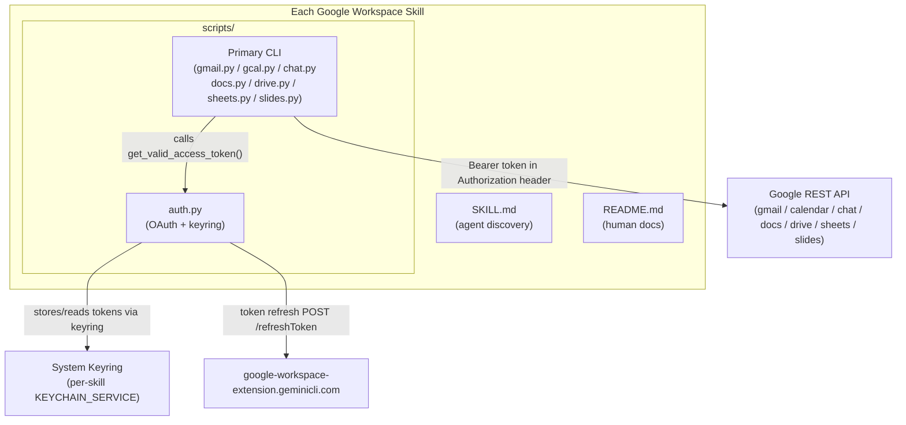
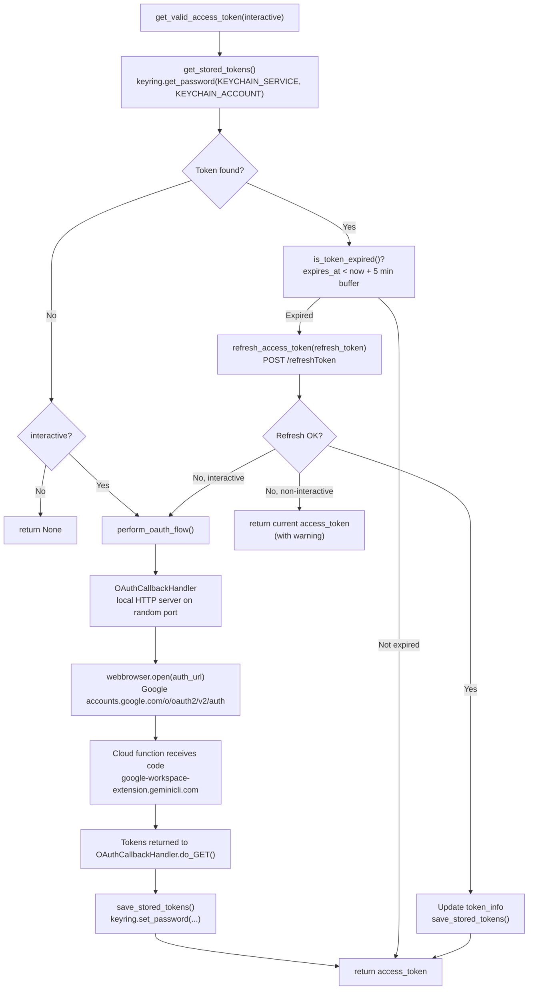
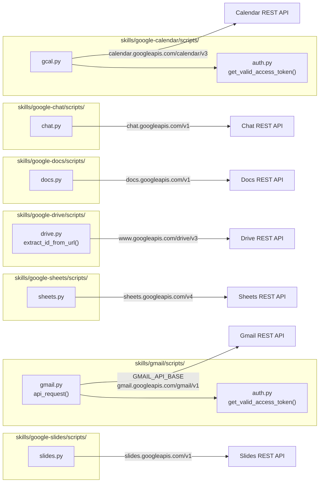

<!-- source: DeepWiki mcp.deepwiki.com · repo sanjay3290/ai-skills · page 5 Google Workspace Skills · fetched 2026-10-26 -->

# Google Workspace Skills

<details>
<summary>Relevant source files</summary>

The following files were used as context for generating this wiki page:

- [README.md](README.md)
- [skills/gmail/SKILL.md](skills/gmail/SKILL.md)
- [skills/google-sheets/SKILL.md](skills/google-sheets/SKILL.md)
- [skills/jules/SKILL.md](skills/jules/SKILL.md)
- [skills/manus/SKILL.md](skills/manus/SKILL.md)

</details>


This section covers the seven Google Workspace skills in the `ai-skills` repository: Gmail, Google Calendar, Google Chat, Google Docs, Google Drive, Google Sheets, and Google Slides. All seven skills share a common OAuth 2.0 authentication pattern and require a **Google Workspace account** — personal Gmail accounts are not supported.

For details on how OAuth tokens are stored and refreshed, see the dedicated [Shared Authentication](#5.1) page. For general skill installation, see [Installation Methods](#2.1).

---

## Overview

All seven skills are designed as lightweight, standalone alternatives to the full Google Workspace MCP server. Each skill is a directory under `skills/` containing:

- A `SKILL.md` file for agent discovery
- A `README.md` for human documentation
- A `scripts/` directory with a primary CLI script and a shared `auth.py`

### Skills at a Glance

| Skill | Directory | Primary Script | Keychain Service Name |
|---|---|---|---|
| Gmail | `skills/gmail/` | `scripts/gmail.py` | `gmail-skill-oauth` |
| Google Calendar | `skills/google-calendar/` | `scripts/gcal.py` | `google-calendar-skill-oauth` |
| Google Chat | `skills/google-chat/` | `scripts/chat.py` | `google-chat-skill-oauth` |
| Google Docs | `skills/google-docs/` | `scripts/docs.py` | `google-docs-skill-oauth` |
| Google Drive | `skills/google-drive/` | `scripts/drive.py` | `google-drive-skill-oauth` |
| Google Sheets | `skills/google-sheets/` | `scripts/sheets.py` | `google-sheets-skill-oauth` |
| Google Slides | `skills/google-slides/` | `scripts/slides.py` | `google-slides-skill-oauth` |

Sources: [skills/gmail/README.md:1-15](), [skills/google-calendar/README.md:1-17](), [skills/google-chat/README.md:1-16](), [skills/google-docs/README.md:1-15](), [skills/google-drive/README.md:1-14]()

---

## Shared Architecture

**Skill component layout (all seven skills)**



Sources: [skills/gmail/scripts/auth.py:24-38](), [skills/gmail/scripts/gmail.py:19-50](), [skills/google-calendar/scripts/auth.py:24-37]()

---

## Shared Authentication Pattern

Every skill ships its own copy of `auth.py` with identical logic but a distinct `KEYCHAIN_SERVICE` value. The core shared constants are:

- `CLIENT_ID`: `338689075775-o75k922vn5fdl18qergr96rp8g63e4d7.apps.googleusercontent.com`
- `CLOUD_FUNCTION_URL`: `https://google-workspace-extension.geminicli.com`
- `REFRESH_ENDPOINT`: `{CLOUD_FUNCTION_URL}/refreshToken`
- `TOKEN_EXPIRY_BUFFER_MS`: `5 * 60 * 1000` (5 minutes)

**Token resolution flow — `get_valid_access_token()`**



Sources: [skills/gmail/scripts/auth.py:253-300](), [skills/gmail/scripts/auth.py:129-250](), [skills/gmail/scripts/auth.py:103-127](), [skills/google-calendar/scripts/auth.py:281-328]()

**Key functions in each `auth.py`:**

| Function | Purpose |
|---|---|
| `get_valid_access_token(interactive)` | Main entry point; returns a valid token or `None` |
| `get_stored_tokens()` | Reads `TokenInfo` from `keyring` |
| `save_stored_tokens(token_info)` | Writes `TokenInfo` to `keyring` |
| `is_token_expired(token_info)` | Returns `True` if within 5-minute expiry window |
| `refresh_access_token(refresh_token)` | POSTs to `/refreshToken` cloud function |
| `perform_oauth_flow()` | Opens browser, runs `OAuthCallbackHandler` local server |
| `OAuthCallbackHandler.do_GET()` | Handles `/oauth2callback`, validates CSRF `state` token |
| `logout()` | Calls `keyring.delete_password(...)` |

The CLI commands exposed by each `auth.py` are: `login`, `logout`, `token`, `status`.

Sources: [skills/gmail/scripts/auth.py:199-367](), [skills/google-calendar/scripts/auth.py:227-399]()

**Prerequisite: install the `keyring` Python package.**

```
pip install keyring
```

Sources: [skills/gmail/requirements.txt:1-1](), [skills/google-calendar/requirements.txt:1-1]()

---

## Gmail

**Script:** `skills/gmail/scripts/gmail.py`  
**Auth scope:** `https://www.googleapis.com/auth/gmail.modify`  
**API base:** `https://gmail.googleapis.com/gmail/v1`

### Commands

| Command | Function | Key Options |
|---|---|---|
| `search [query]` | `search()` | `--limit`, `--label`, `--page-token`, `--include-spam-trash` |
| `get <message_id>` | `get_message()` | `--format` (full/metadata/minimal/raw) |
| `send` | `send_email()` | `--to`, `--subject`, `--body`, `--cc`, `--bcc`, `--html`, `--from`, `--attach` |
| `create-draft` | `create_draft()` | same options as `send` |
| `send-draft <draft_id>` | `send_draft()` | — |
| `modify <message_id>` | `modify_message()` | `--add-label`, `--remove-label` |
| `list-labels` | `list_labels()` | — |

All commands call `api_request()`, which invokes `get_valid_access_token()` and attaches a `Bearer` token header.

### Gmail Query Syntax Reference

| Operator | Example | Effect |
|---|---|---|
| `from:` | `from:user@example.com` | Filter by sender |
| `to:` | `to:user@example.com` | Filter by recipient |
| `subject:` | `subject:meeting` | Subject contains word |
| `is:unread` | `is:unread` | Unread messages only |
| `is:starred` | `is:starred` | Starred messages |
| `has:attachment` | `has:attachment` | Has file attachments |
| `after:` | `after:2024/01/01` | After a date |
| `newer_than:` | `newer_than:7d` | Relative date range |
| `label:` | `label:work` | Custom label filter |

Combine operators with spaces (AND), `OR`, or `-` (NOT).

### System Label Constants

| Label | Meaning |
|---|---|
| `INBOX` | Inbox |
| `SENT` | Sent mail |
| `STARRED` | Starred |
| `IMPORTANT` | Important |
| `UNREAD` | Unread |
| `TRASH` | Trash |
| `SPAM` | Spam |

Sources: [skills/gmail/scripts/gmail.py:133-157](), [skills/gmail/scripts/gmail.py:302-383](), [skills/gmail/README.md:109-148]()

---

## Google Calendar

**Script:** `skills/google-calendar/scripts/gcal.py`  
**Auth scope:** `https://www.googleapis.com/auth/calendar`  
**Keychain service:** `google-calendar-skill-oauth`

### Commands

| Command | Description | Key Arguments |
|---|---|---|
| `list-calendars` | List all calendars accessible to the user | — |
| `list-events` | List events in a calendar | `--calendar`, `--time-min`, `--time-max` |
| `get-event <id>` | Fetch details for one event | event ID |
| `create-event <title> <start> <end>` | Create a new event | `--description`, `--location`, `--attendees` |
| `update-event <id>` | Patch fields on an existing event | `--summary`, `--start`, `--end` |
| `delete-event <id>` | Delete an event | event ID |
| `find-free-time` | Query free/busy across attendees | `--attendees`, `--time-min`, `--time-max`, `--duration` |
| `respond-to-event <id> <response>` | Accept, decline, or mark tentative | `accepted` / `declined` / `tentative` |

**Datetime format:** ISO 8601 is required for all time arguments.

| Format | Example |
|---|---|
| UTC | `2024-01-15T10:30:00Z` |
| With offset | `2024-01-15T10:30:00-05:00` |
| Local (offset added automatically) | `2024-01-15T10:30:00` |

Sources: [skills/google-calendar/README.md:103-145]()

---

## Google Chat

**Script:** `skills/google-chat/scripts/chat.py`  
**Keychain service:** `google-chat-skill-oauth`

### Commands

| Command | Description | Key Arguments |
|---|---|---|
| `list-spaces` | List all Chat spaces the user belongs to | — |
| `find-space <name>` | Search spaces by name | space name string |
| `get-messages <space_id>` | Retrieve messages from a space | space ID, `--limit` |
| `send-message <space_id> <text>` | Post a message to a space | space ID, text |
| `send-dm <email> <text>` | Open or reuse a DM space and send a message | user email, text |
| `find-dm <email>` | Find or create a DM space with a user | user email |
| `list-threads <space_id>` | List threads in a space | space ID |
| `setup-space <name> [emails...]` | Create a new space and add members | name, member emails |

**Space ID format:** `spaces/AAAA123`. Use `list-spaces` or `find-space` to resolve IDs.

For file attachments via `send-message`, the API requires a two-step upload: first upload the file to get a media resource name, then reference that name in the message body.

Sources: [skills/google-chat/README.md:43-101]()

---

## Google Docs

**Script:** `skills/google-docs/scripts/docs.py`  
**Keychain service:** `google-docs-skill-oauth`

> Requires a Google Workspace account. Personal Gmail accounts are not supported.

### Commands

| Command | Description | Key Arguments |
|---|---|---|
| `create <title>` | Create a new document | title, `--content` |
| `find <query>` | Search for documents by title | query string, `--limit` |
| `get-text <id>` | Extract full text from a document | document ID or URL |
| `append-text <id> <text>` | Append text to the end | document ID, text |
| `insert-text <id> <text>` | Insert text at the beginning | document ID, text |
| `replace-text <id> <old> <new>` | Replace a substring in the document | document ID, old text, new text |

**Document ID format:** A string like `1BxiMVs0XRA5nFMdKvBdBZjgmUUqptlbs74OgvE2upms`. The `get-text` command also accepts a full Google Docs URL and extracts the ID automatically.

Sources: [skills/google-docs/README.md:38-92]()

---

## Google Drive

**Script:** `skills/google-drive/scripts/drive.py`  
**Keychain service:** `google-drive-skill-oauth`

> Requires a Google Workspace account. Personal Gmail accounts are not supported.

### Commands

| Command | Description | Key Arguments |
|---|---|---|
| `search [query]` | Full-text or title search across Drive | query, `--shared-with-me`, `--limit`, `--page-token` |
| `find-folder <name>` | Locate a folder by exact name | folder name |
| `list [folder_id]` | List folder contents | optional folder ID, `--limit` |
| `download <id> <path>` | Download a file to a local path | file ID, destination path |
| `upload` | Upload a local file | `--folder`, `--name` |
| `create-folder` | Create a new folder | `--parent` |
| `move` | Move a file to a different folder | file ID, destination folder ID |
| `copy` | Copy a file | file ID |
| `rename` | Rename a file | file ID, new name |
| `trash` | Move a file to trash | file ID |

**Search query formats:**

| Format | Example |
|---|---|
| Full-text search | `"quarterly report"` |
| Title-only search | `"title:budget"` |
| Google Drive URL | `https://drive.google.com/drive/folders/1ABC123...` |
| Native Drive query | `mimeType='application/pdf'` |

The `search` command uses `extract_id_from_url` to parse Drive and Docs URLs into file IDs. Google Docs/Sheets/Slides native files cannot be downloaded directly; use their dedicated skills instead.

Sources: [skills/google-drive/README.md:40-113]()

---

## Google Sheets

**Script:** `skills/google-sheets/scripts/sheets.py`  
**Keychain service:** `google-sheets-skill-oauth`

### Commands

| Command | Description | Key Arguments |
|---|---|---|
| `get-text <id>` | Read sheet content as text, CSV, or JSON | spreadsheet ID, `--format` (text/csv/json) |
| `get-range <id> <range>` | Read a cell range using A1 notation | spreadsheet ID, e.g. `Sheet1!A1:C10` |
| `find <query>` | Search for spreadsheets by title | query string, `--limit` |
| `get-metadata <id>` | Get spreadsheet title and sheet names | spreadsheet ID |
| `update-range <id> <range> <values>` | Write values to a range | `--raw` flag for RAW vs USER_ENTERED input |
| `append-rows <id> <range> <values>` | Append rows after existing data | spreadsheet ID, range, values |
| `clear-range <id> <range>` | Clear values in a range | spreadsheet ID, range |
| `batch-update <id> <requests>` | Apply advanced formatting via Sheets API requests array | JSON requests array |

**Spreadsheet ID** is extracted from URLs automatically. **A1 notation** examples: `A1`, `Sheet1!B2:D10`.

`update-range` defaults to `USER_ENTERED` input (interprets formulas). Pass `--raw` to use `RAW` mode, which stores the literal string.

---

## Google Slides

**Script:** `skills/google-slides/scripts/slides.py`  
**Keychain service:** `google-slides-skill-oauth`

### Commands

| Command | Description | Key Arguments |
|---|---|---|
| `get-text <id>` | Extract all text from a presentation | presentation ID |
| `find <query>` | Search presentations by title | query, `--limit` |
| `get-metadata <id>` | Get title, slide count, and object IDs | presentation ID |
| `create <title>` | Create a new blank presentation | title |
| `add-slide <id>` | Append or insert a slide | `--layout`, `--at` (position) |
| `replace-text <id> <find> <replace>` | Replace text across all slides | `--match-case` |
| `delete-slide <id> <object_id>` | Delete a slide by its object ID | presentation ID, slide object ID |
| `batch-update <id> <requests>` | Apply raw Slides API requests | JSON requests array |

**Available slide layouts:** `BLANK`, `TITLE`, `TITLE_AND_BODY`, `SECTION_HEADER`, and other standard Slides API layout types.

Slide object IDs are returned by `get-metadata` and are required for `delete-slide`.

---

## Authentication Setup (All Skills)

The setup sequence is identical for all seven skills:

```
pip install keyring
python scripts/auth.py login    # opens browser for OAuth consent
python scripts/auth.py status   # verify token is stored and valid
```

**Keychain service names by platform:**

| Platform | Storage Mechanism |
|---|---|
| macOS | Keychain (per `KEYCHAIN_SERVICE` service name) |
| Windows | Windows Credential Locker |
| Linux | Secret Service API (GNOME Keyring / KDE Wallet) |

The token JSON stored in the keyring has the shape:

```json
{
  "serverName": "main-account",
  "token": {
    "accessToken": "...",
    "refreshToken": "...",
    "tokenType": "Bearer",
    "scope": "...",
    "expiresAt": 1700000000000
  },
  "updatedAt": 1699999990000
}
```

Sources: [skills/gmail/scripts/auth.py:56-100](), [skills/google-calendar/scripts/auth.py:54-117](), [skills/gmail/README.md:17-36]()

---

## Relationship Between Skills and APIs

**Mapping from skill scripts to Google API endpoints**



Sources: [skills/gmail/scripts/gmail.py:21-50](), [skills/gmail/README.md:1-14](), [skills/google-calendar/README.md:1-16]()

---

