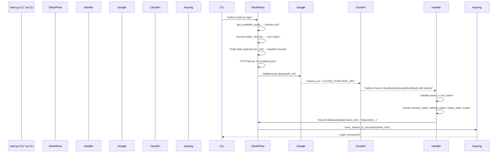
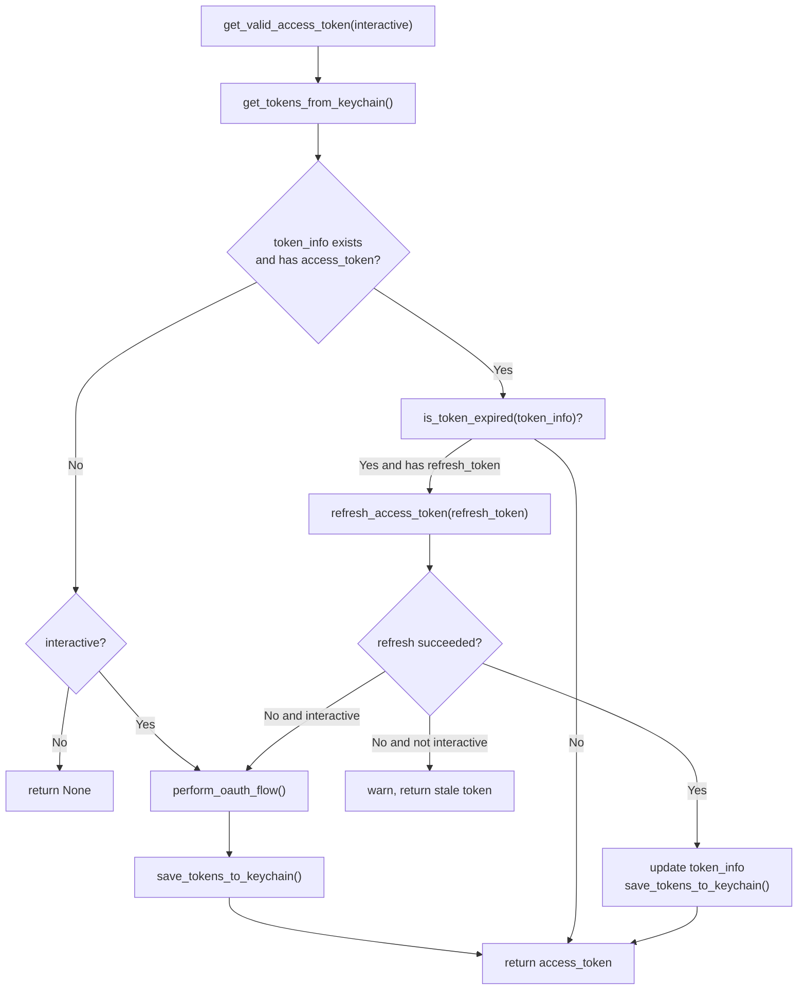
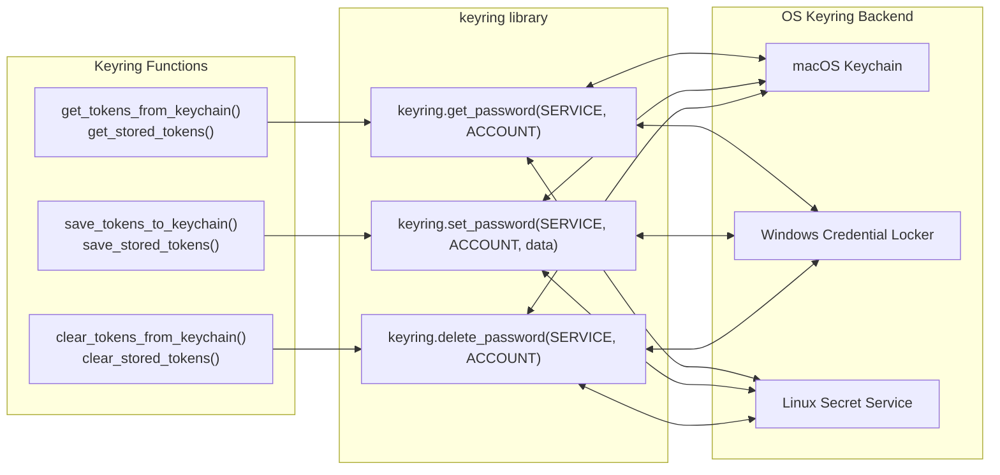

<!-- source: DeepWiki mcp.deepwiki.com · repo sanjay3290/ai-skills · page 5.1 Shared Authentication · fetched 2026-10-26 -->

# Shared Authentication

<details>
<summary>Relevant source files</summary>

The following files were used as context for generating this wiki page:

- [skills/gmail/SKILL.md](skills/gmail/SKILL.md)
- [skills/google-chat/SKILL.md](skills/google-chat/SKILL.md)
- [skills/google-drive/SKILL.md](skills/google-drive/SKILL.md)
- [skills/google-sheets/SKILL.md](skills/google-sheets/SKILL.md)
- [skills/google-slides/SKILL.md](skills/google-slides/SKILL.md)

</details>


This page documents the OAuth 2.0 authentication infrastructure that is shared across all seven Google Workspace skills: Gmail, Google Calendar, Google Chat, Google Docs, Google Drive, Google Sheets, and Google Slides. Each skill bundles its own copy of `auth.py` with identical logic and different per-service constants. For information on how individual skills use this authentication to call their respective APIs, see pages [5.2](#5.2) through [5.8](#5.8). For configuration steps and keyring setup guidance, see [6.2](#6.2).

---

## Overview

Every Google Workspace skill authenticates via OAuth 2.0 using a browser-based consent flow. The resulting tokens are persisted in the system keyring (macOS Keychain, Windows Credential Locker, Linux Secret Service). A cloud function hosted at `https://google-workspace-extension.geminicli.com` handles the OAuth client secret and token refresh, keeping the secret off the local machine.

The public interface consumed by skill scripts is a single function: `get_valid_access_token()`. All token management — checking expiry, refreshing, and triggering a new login — is hidden inside it.

---

## File Structure

Each Google Workspace skill contains its own `auth.py` in its `scripts/` directory. The files are structurally identical, differing only in `KEYCHAIN_SERVICE` and `SCOPES`.

| Skill | `auth.py` location | `KEYCHAIN_SERVICE` value |
|---|---|---|
| Gmail | `skills/gmail/scripts/auth.py` | `gmail-skill-oauth` |
| Google Calendar | `skills/google-calendar/scripts/auth.py` | `google-calendar-skill-oauth` |
| Google Drive | `skills/google-drive/scripts/auth.py` | `google-drive-skill-oauth` |
| Google Sheets | `skills/google-sheets/scripts/auth.py` | `google-sheets-skill-oauth` |
| Google Slides | `skills/google-slides/scripts/auth.py` | `google-slides-skill-oauth` |

Sources: [skills/gmail/scripts/auth.py:28-30](), [skills/google-calendar/scripts/auth.py:29-31](), [skills/google-drive/scripts/auth.py:30-32](), [skills/google-sheets/scripts/auth.py:29-31](), [skills/google-slides/scripts/auth.py:29-31]()

---

## Shared Constants

All `auth.py` files define these three constants identically:

```
CLIENT_ID    = "338689075775-o75k922vn5fdl18qergr96rp8g63e4d7.apps.googleusercontent.com"
CLOUD_FUNCTION_URL = "https://google-workspace-extension.geminicli.com"
REFRESH_ENDPOINT   = f"{CLOUD_FUNCTION_URL}/refreshToken"
```

`KEYCHAIN_ACCOUNT` is always `"main-account"` across all skills. `TOKEN_EXPIRY_BUFFER_MS` is always `5 * 60 * 1000` (5 minutes in milliseconds).

Sources: [skills/google-drive/scripts/auth.py:24-38](), [skills/gmail/scripts/auth.py:23-38]()

---

## OAuth Scopes Per Skill

Each skill requests only the scopes it needs:

| Skill | Scopes |
|---|---|
| Gmail | `gmail.modify`, `userinfo.profile` |
| Google Calendar | `calendar`, `userinfo.profile` |
| Google Drive | `drive`, `userinfo.profile` |
| Google Sheets | `spreadsheets`, `drive`, `userinfo.profile` |
| Google Slides | `presentations`, `drive`, `userinfo.profile` |

Sources: [skills/gmail/scripts/auth.py:33-36](), [skills/google-calendar/scripts/auth.py:33-37](), [skills/google-drive/scripts/auth.py:34-37](), [skills/google-sheets/scripts/auth.py:34-38](), [skills/google-slides/scripts/auth.py:34-38]()

---

## Data Model

All `auth.py` files define a `TokenInfo` dataclass:

```
@dataclass
class TokenInfo:
    access_token: str
    refresh_token: Optional[str]
    expires_at: Optional[int]   # Unix epoch milliseconds
    scope: Optional[str]
```

`expires_at` is stored in milliseconds. The `is_token_expired()` function compares `expires_at` against the current time plus the 5-minute buffer, meaning tokens are proactively refreshed before they actually expire.

Sources: [skills/google-drive/scripts/auth.py:43-48](), [skills/google-drive/scripts/auth.py:112-117]()

---

## Authentication Flow

**Initial login flow diagram**



Sources: [skills/google-drive/scripts/auth.py:208-259](), [skills/gmail/scripts/auth.py:199-250]()

**Token retrieval flow diagram (`get_valid_access_token`)**



Sources: [skills/google-drive/scripts/auth.py:262-309](), [skills/gmail/scripts/auth.py:253-300]()

---

## CSRF Protection

During `perform_oauth_flow()`, a 64-character hex token is generated with `secrets.token_hex(32)`. It is embedded in a JSON payload alongside the local redirect URI, then base64-encoded and sent as the OAuth `state` parameter.

The `state` payload structure:

```python
{
    "uri": "http://localhost:<port>/oauth2callback",
    "manual": False,
    "csrf": "<64-hex-char token>"
}
```

When Google redirects back via the cloud function, `OAuthCallbackHandler.do_GET()` reads the `state` query parameter and compares it against `OAuthCallbackHandler.csrf_token`. A mismatch causes the handler to reject the callback with HTTP 400 and set `error = "State mismatch - possible CSRF attack"`.

Sources: [skills/google-drive/scripts/auth.py:208-235](), [skills/google-drive/scripts/auth.py:149-167]()

---

## Local Callback Server

`OAuthCallbackHandler` extends `http.server.BaseHTTPRequestHandler`. It is started on a dynamically chosen port (via `get_available_port()`) and listens only on `localhost`. The server's `timeout` is 300 seconds (5 minutes).

The main loop in `perform_oauth_flow()` calls `server.handle_request()` in a loop until `OAuthCallbackHandler.token_info` or `OAuthCallbackHandler.error` is set:

```python
while OAuthCallbackHandler.token_info is None and OAuthCallbackHandler.error is None:
    server.handle_request()
```

The callback path is `/oauth2callback`. Any other path returns HTTP 404.

Sources: [skills/google-drive/scripts/auth.py:138-259](), [skills/google-drive/scripts/auth.py:104-110]()

---

## Token Storage

Tokens are stored in the system keyring using the `keyring` library. The required dependency is declared in each skill's `requirements.txt` as `keyring>=24.0.0`.

The stored JSON structure:

```json
{
    "serverName": "main-account",
    "token": {
        "accessToken": "...",
        "refreshToken": "...",
        "tokenType": "Bearer",
        "scope": "...",
        "expiresAt": 1700000000000
    },
    "updatedAt": 1700000000000
}
```

This object is serialized as a JSON string and stored in the keyring under `(KEYCHAIN_SERVICE, "main-account")`.

**Keyring operations by function**



Sources: [skills/google-drive/scripts/auth.py:54-99](), [skills/gmail/requirements.txt:1](), [skills/google-calendar/requirements.txt:1]()

---

## Token Refresh via Cloud Function

When `is_token_expired()` returns `True` and a `refresh_token` is available, `refresh_access_token()` sends a POST to `https://google-workspace-extension.geminicli.com/refreshToken`:

- Request body: `{"refresh_token": "<token>"}`
- Response contains: `access_token`, `expiry_date`

The cloud function holds the OAuth client secret, so the local skill code never sees it. If the refresh call fails (network error, expired refresh token), and `interactive=True`, the code falls back to a full `perform_oauth_flow()`. If `interactive=False`, a warning is printed to stderr and the existing (possibly stale) token is returned.

Sources: [skills/google-drive/scripts/auth.py:120-135](), [skills/google-drive/scripts/auth.py:287-309]()

---

## CLI Interface

Every `auth.py` exposes four subcommands when run directly:

| Command | Behavior |
|---|---|
| `python auth.py login` | Runs `perform_oauth_flow()`, saves tokens to keyring |
| `python auth.py logout` | Calls `clear_tokens_from_keychain()` |
| `python auth.py token` | Calls `get_valid_access_token(interactive=False)`, prints token |
| `python auth.py status` | Reads keyring, prints auth status and minutes until expiry |

The `login` command is what users must run once per skill before the skill can be used by an AI agent. The skill scripts themselves call `get_valid_access_token()` without arguments (which defaults to `interactive=True`), so they will also auto-trigger the login flow if no token is found.

Sources: [skills/google-drive/scripts/auth.py:317-373](), [skills/gmail/scripts/auth.py:308-366]()

---

## How Skill Scripts Consume Authentication

Every skill's main script imports and calls `get_valid_access_token` at the start of each API request:

```python
from auth import get_valid_access_token

def api_request(method, endpoint, data=None, params=None):
    token = get_valid_access_token()
    if not token:
        return {"error": "Failed to get access token"}
    headers = {"Authorization": f"Bearer {token}", ...}
    ...
```

This means authentication state is checked on every API call, not just at startup.

Sources: [skills/gmail/scripts/gmail.py:19-27](), [skills/google-chat/scripts/chat.py:17-27](), [skills/google-drive/scripts/drive.py:17-43](), [skills/google-sheets/scripts/sheets.py:16-30](), [skills/google-slides/scripts/slides.py:16-38]()

---

