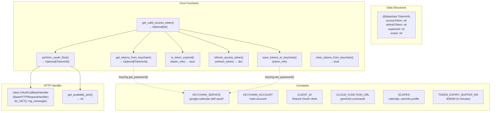
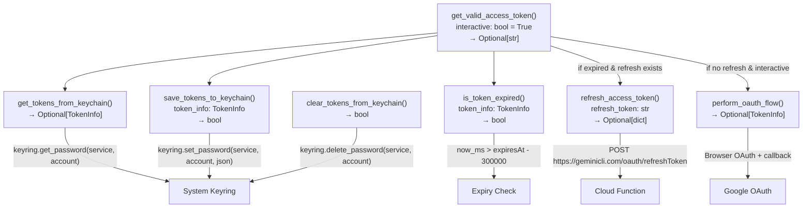
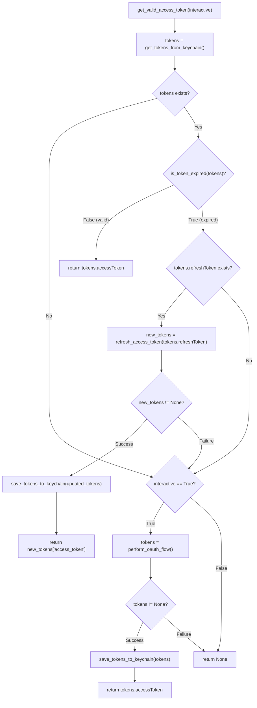
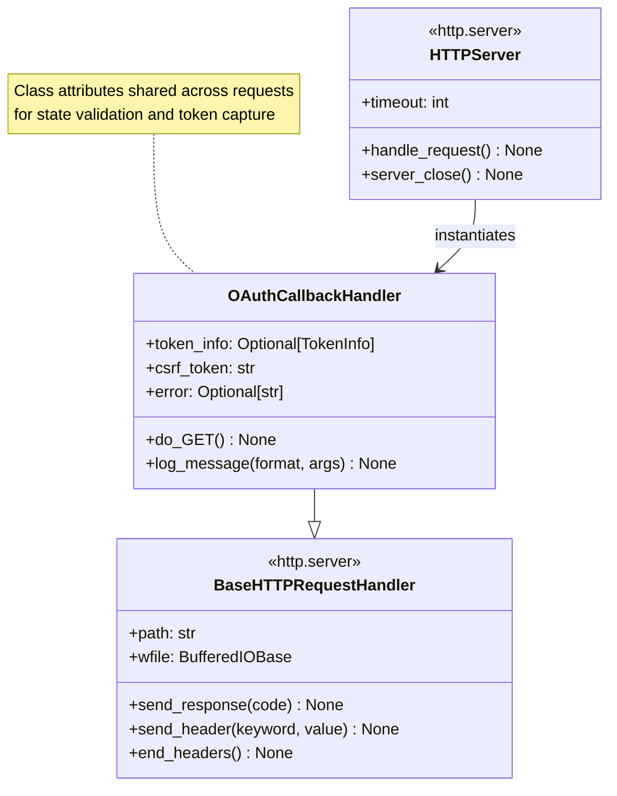
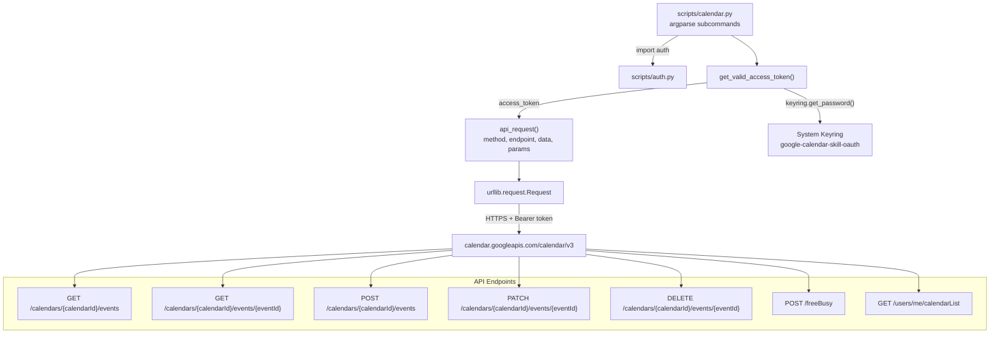
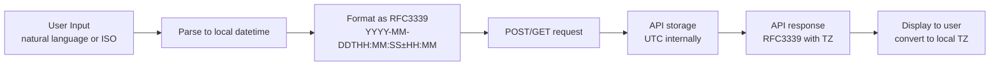
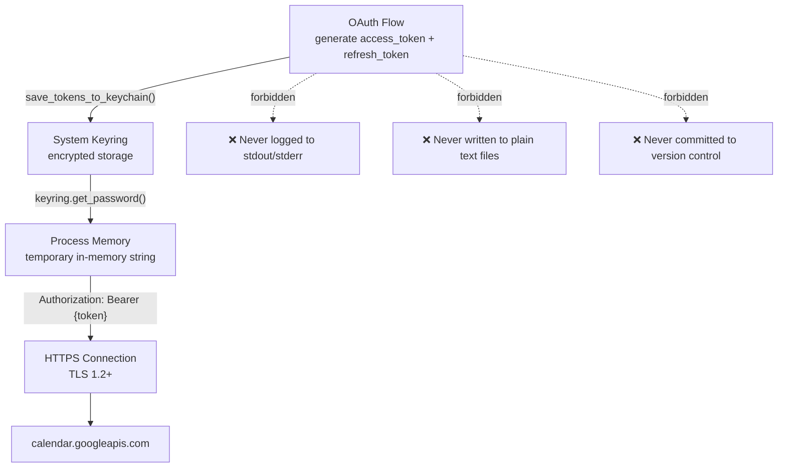

<!-- source: DeepWiki mcp.deepwiki.com · repo sanjay3290/ai-skills · page 5.3 Google Calendar · fetched 2026-10-26 -->

# Google Calendar

<details>
<summary>Relevant source files</summary>

The following files were used as context for generating this wiki page:

- [README.md](README.md)
- [skills/gmail/SKILL.md](skills/gmail/SKILL.md)
- [skills/google-sheets/SKILL.md](skills/google-sheets/SKILL.md)
- [skills/jules/SKILL.md](skills/jules/SKILL.md)
- [skills/manus/SKILL.md](skills/manus/SKILL.md)

</details>


The `google-calendar` skill provides Calendar API operations for AI coding assistants through OAuth-authenticated requests. It enables event management, scheduling queries, and availability lookups without requiring an MCP server.

For other Google Workspace skills, see [Shared Authentication](#5.1), [Gmail](#5.2), [Google Chat](#5.4), [Google Docs](#5.5), [Google Drive](#5.6), [Google Sheets](#5.7), and [Google Slides](#5.8).

---

## Overview

The google-calendar skill is one of seven Google Workspace skills that share identical OAuth infrastructure. It provides calendar operations including:

- **Event queries** - List events by time range, calendar ID, or search criteria
- **Event creation** - Add events with attendees, reminders, and recurrence rules
- **Event updates** - Modify or delete existing events  
- **Free/busy lookups** - Check availability for scheduling
- **Timezone handling** - Cross-timezone event management
- **Multiple calendars** - Access primary and secondary calendars

**Technical characteristics:**
- Standalone OAuth (no MCP server dependency)
- System keyring token storage (macOS Keychain, Windows Credential Locker, Linux Secret Service)
- Automatic token refresh via `https://geminicli.com/oauth/refreshToken`
- Requires Google Workspace account (personal Gmail unsupported)

Sources: [README.md:43-60](), [README.md:280]()

---

## Authentication Architecture

### OAuth Flow with Keyring Storage

Title: **Google Calendar OAuth Flow and Token Management**

```mermaid
sequenceDiagram
    participant User
    participant CalendarScript["scripts/calendar.py"]
    participant AuthModule["scripts/auth.py"]
    participant Browser
    participant GoogleOAuth["accounts.google.com"]
    participant CloudFunction["geminicli.com/oauth"]
    participant Keyring["System Keyring<br/>service: google-calendar-skill-oauth<br/>account: main-account"]

    User->>CalendarScript: python calendar.py list
    CalendarScript->>AuthModule: get_valid_access_token()
    AuthModule->>Keyring: keyring.get_password()
    
    alt No tokens stored
        Keyring-->>AuthModule: None
        AuthModule->>AuthModule: perform_oauth_flow()
        AuthModule->>AuthModule: get_available_port()
        AuthModule->>Browser: Open OAuth URL with state
        Note over Browser,GoogleOAuth: Scopes: calendar, userinfo.profile
        Browser->>GoogleOAuth: User authorizes
        GoogleOAuth->>CloudFunction: POST /exchangeCode
        CloudFunction-->>Browser: Redirect with tokens
        Browser->>AuthModule: http://localhost:PORT/oauth2callback
        AuthModule->>AuthModule: Validate CSRF state
        AuthModule->>Keyring: keyring.set_password(TokenInfo)
        AuthModule-->>CalendarScript: access_token
    else Tokens exist, not expired
        Keyring-->>AuthModule: TokenInfo JSON
        AuthModule->>AuthModule: is_token_expired() → False
        AuthModule-->>CalendarScript: access_token
    else Tokens expired, refresh available
        Keyring-->>AuthModule: TokenInfo (expired)
        AuthModule->>AuthModule: is_token_expired() → True
        AuthModule->>CloudFunction: POST /refreshToken
        CloudFunction-->>AuthModule: New access_token + expiresAt
        AuthModule->>Keyring: Update TokenInfo
        AuthModule-->>CalendarScript: access_token
    end
    
    CalendarScript->>GoogleOAuth: GET /calendar/v3/calendars/primary/events<br/>Authorization: Bearer {token}
    GoogleOAuth-->>CalendarScript: Event list JSON
```

**Token storage structure:**
- **Service identifier**: `google-calendar-skill-oauth` (unique per skill)
- **Account identifier**: `main-account` (constant across all users)
- **Storage format**: JSON string with fields:
  - `accessToken` - Short-lived bearer token (typically 1 hour)
  - `refreshToken` - Long-lived token for renewal
  - `expiresAt` - Unix timestamp (milliseconds)
  - `scope` - Granted permissions string
- **Platform implementations**:
  - macOS: Keychain Access (`security` command-line tool)
  - Windows: Windows Credential Locker (`cmdkey`)
  - Linux: Secret Service API (GNOME Keyring, KDE Wallet, `secret-tool`)

Sources: [README.md:280](), [README.md:283-286](), [skills/gmail/SKILL.md:176-183]()

---

### Authentication Components

Title: **auth.py Module Structure**



| Component | Type | Purpose |
|-----------|------|---------|
| `KEYCHAIN_SERVICE` | Constant | Unique service identifier for keyring storage |
| `KEYCHAIN_ACCOUNT` | Constant | Account identifier (same for all users) |
| `CLIENT_ID` | Constant | Shared OAuth client ID across all 7 Google skills |
| `CLOUD_FUNCTION_URL` | Constant | Base URL for token exchange/refresh proxy |
| `SCOPES` | List[str] | Required API permissions (calendar, userinfo.profile) |
| `TOKEN_EXPIRY_BUFFER_MS` | Constant | Safety margin before considering token expired (5 min) |
| `TokenInfo` | Dataclass | Token storage structure with 4 fields |
| `OAuthCallbackHandler` | Class | HTTP request handler for OAuth redirect |
| `get_valid_access_token()` | Function | Main entry point - returns valid access token or triggers auth |
| `perform_oauth_flow()` | Function | Browser-based OAuth flow with local HTTP server |
| `refresh_access_token()` | Function | Exchange refresh token for new access token |
| `get_available_port()` | Function | Find unused port for OAuth callback server |

Sources: [README.md:280](), [skills/gmail/SKILL.md:176-183]()

---

## Setup and Configuration

### Prerequisites

```bash
# Install keyring library (required for token storage)
pip install keyring
```

The `keyring` library provides cross-platform secure storage:
- **macOS**: Uses Keychain Access (no additional setup)
- **Windows**: Uses Windows Credential Locker (built-in)
- **Linux**: Requires Secret Service API (GNOME Keyring, KDE Wallet, or `gnome-keyring` package)

Sources: [README.md:270-271](), [README.md:283-286]()

---

### Initial Authentication

```bash
# Authenticate with Google (opens browser)
python ~/.claude/skills/google-calendar/scripts/auth.py login

# Alternative: Auto-authenticate on first API call
# Skills automatically trigger OAuth flow if no tokens exist
python scripts/calendar.py list
```

**OAuth Flow Steps:**

1. **Port allocation**: `get_available_port()` finds unused localhost port
2. **Browser launch**: Opens `accounts.google.com` OAuth consent screen
3. **State generation**: 64-character hex CSRF token generated
4. **User consent**: User grants `calendar` and `userinfo.profile` scopes
5. **Code exchange**: Google redirects to `http://localhost:<port>/oauth2callback?code=...&state=...`
6. **CSRF validation**: `OAuthCallbackHandler.do_GET()` validates `state` parameter
7. **Token exchange**: Cloud function exchanges code for tokens (handles `client_secret`)
8. **Keyring storage**: `save_tokens_to_keychain()` persists `TokenInfo` as JSON
9. **Success response**: Browser displays "Authentication successful" with auto-close script

Sources: [README.md:270-282]()

---

## Authentication CLI Reference

The `scripts/auth.py` module provides management commands when executed directly:

| Command | Function | Description | Exit Code |
|---------|----------|-------------|-----------|
| `login` | `perform_oauth_flow()` | Initiate browser OAuth flow, save tokens to keyring | 1 on failure, 0 on success |
| `logout` | `clear_tokens_from_keychain()` | Remove tokens from keyring | 0 always |
| `token` | `get_valid_access_token()` | Print current access token (auto-refresh if expired) | 1 if not authenticated |
| `status` | `get_tokens_from_keychain()` | Show authentication state, expiry time | 1 if not authenticated |

**Usage Examples:**

```bash
# Check authentication status
python scripts/auth.py status
# Output: Status: Authenticated
#         Token expired: False
#         Expires in: 54.3 minutes
#         Storage: System keyring (google-calendar-skill-oauth)

# Get current access token (for debugging API calls)
python scripts/auth.py token
# Output: ya29.a0AfB_byC...

# Force re-authentication (clear old tokens first)
python scripts/auth.py logout
python scripts/auth.py login
```

Sources: [README.md:270-282](), [skills/gmail/SKILL.md:22-35]()

---

## Token Management Functions

### Core Function Call Graph

Title: **Token Lifecycle Management in auth.py**



**Function Reference Table:**

| Function | Parameters | Return Type | Purpose | Called By |
|----------|------------|-------------|---------|-----------|
| `get_valid_access_token()` | `interactive: bool = True` | `Optional[str]` | Main entry point for token retrieval with auto-refresh | `calendar.py`, CLI commands |
| `get_tokens_from_keychain()` | None | `Optional[TokenInfo]` | Retrieve and deserialize `TokenInfo` from keyring | `get_valid_access_token()`, `status` command |
| `save_tokens_to_keychain()` | `token_info: TokenInfo` | `bool` | Serialize and persist `TokenInfo` to keyring | `get_valid_access_token()`, `perform_oauth_flow()` |
| `is_token_expired()` | `token_info: TokenInfo` | `bool` | Check if token expires within 5 minutes | `get_valid_access_token()` |
| `refresh_access_token()` | `refresh_token: str` | `Optional[dict]` | Exchange refresh token for new access token via cloud function | `get_valid_access_token()` |
| `perform_oauth_flow()` | None | `Optional[TokenInfo]` | Full browser-based OAuth with local callback server | `get_valid_access_token()`, `login` command |
| `clear_tokens_from_keychain()` | None | `bool` | Delete tokens from keyring | `logout` command |

Sources: [README.md:270-282](), [skills/gmail/SKILL.md:176-183]()

---

## Token Refresh Mechanism

Title: **Token Refresh Logic in get_valid_access_token()**



**Refresh Protocol:**

1. **Expiry check**: Compare `(expiresAt - TOKEN_EXPIRY_BUFFER_MS)` vs `current_time_ms()`
2. **Refresh attempt**: POST to `https://geminicli.com/oauth/refreshToken` with JSON body:
   ```json
   {"refresh_token": "<refresh_token>"}
   ```
3. **Cloud function response**:
   ```json
   {
     "access_token": "ya29.a0AfB_...",
     "expiry_date": 1704123456789,
     "token_type": "Bearer"
   }
   ```
4. **Keyring update**: Merge new `accessToken` and `expiresAt` into `TokenInfo`, preserve `refreshToken`
5. **Fallback**: If refresh fails and `interactive=True`, trigger `perform_oauth_flow()`

Sources: [README.md:270-282](), [skills/gmail/SKILL.md:176-183]()

---

## OAuth Callback Handler

### OAuthCallbackHandler Implementation

Title: **Local HTTP Server for OAuth Callback**



**Handler Flow:**

```python
# In perform_oauth_flow():
csrf_token = secrets.token_hex(32)  # 64-character hex
OAuthCallbackHandler.csrf_token = csrf_token
OAuthCallbackHandler.token_info = None
OAuthCallbackHandler.error = None

# Build OAuth URL with state
state = {"uri": f"http://localhost:{port}/oauth2callback", "manual": False, "csrf": csrf_token}
auth_url = f"https://accounts.google.com/o/oauth2/v2/auth?client_id={CLIENT_ID}&redirect_uri=...&state={json.dumps(state)}"

# Start HTTP server
server = HTTPServer(('localhost', port), OAuthCallbackHandler)
server.timeout = 300  # 5 minute timeout
server.handle_request()  # Blocks until request received

# Check result
if OAuthCallbackHandler.token_info:
    return OAuthCallbackHandler.token_info
elif OAuthCallbackHandler.error:
    print(f"OAuth error: {OAuthCallbackHandler.error}")
    return None
```

**OAuthCallbackHandler.do_GET() Responsibilities:**

1. **Parse query parameters** from `self.path`
2. **CSRF validation**: Extract `state.csrf` and compare to `OAuthCallbackHandler.csrf_token`
3. **Error extraction**: Check for `error` and `error_description` parameters
4. **Token extraction**: Parse `access_token`, `refresh_token`, `expiry_date`, `scope` from URL fragment
5. **Store result**: Set `OAuthCallbackHandler.token_info` or `OAuthCallbackHandler.error`
6. **Send HTML response**: Display success page with JavaScript auto-close after 2 seconds

**Success Response HTML:**
```html
<html>
<body>
<h1>Authentication successful!</h1>
<p>You can close this window.</p>
<script>setTimeout(() => window.close(), 2000);</script>
</body>
</html>
```

Sources: [README.md:270-282]()

---

## Calendar API Operations

### Command-Line Interface

The `scripts/calendar.py` module follows the same pattern as other Google Workspace skills, providing subcommands for calendar operations:

**Expected Operations** (based on Google Calendar API v3):

| Subcommand | API Endpoint | Description |
|------------|--------------|-------------|
| `list` | `GET /calendars/{calendarId}/events` | Query events by time range, calendar, or search |
| `get` | `GET /calendars/{calendarId}/events/{eventId}` | Retrieve single event details |
| `create` | `POST /calendars/{calendarId}/events` | Create event with attendees, recurrence, reminders |
| `update` | `PUT /calendars/{calendarId}/events/{eventId}` | Modify existing event properties |
| `delete` | `DELETE /calendars/{calendarId}/events/{eventId}` | Remove event from calendar |
| `freebusy` | `POST /freeBusy` | Check availability across multiple calendars |
| `list-calendars` | `GET /users/me/calendarList` | Enumerate accessible calendars |

**Common Parameters:**
- `--calendar-id <id>`: Target calendar (default: `primary`)
- `--time-min <rfc3339>`: Start of time range (e.g., `2024-01-15T00:00:00Z`)
- `--time-max <rfc3339>`: End of time range
- `--timezone <tz>`: Display timezone (e.g., `America/Los_Angeles`)
- `--max-results <n>`: Result limit (default: 10)
- `--single-events`: Expand recurring events into individual instances

**Usage Pattern:**
```bash
# List events for next 7 days
python scripts/calendar.py list --time-min "2024-01-15T00:00:00Z" --time-max "2024-01-22T00:00:00Z"

# Get event details
python scripts/calendar.py get <event_id> --calendar-id primary

# Create all-day event
python scripts/calendar.py create --summary "Team Meeting" --date "2024-01-20"

# Check free/busy for scheduling
python scripts/calendar.py freebusy --time-min "2024-01-15T09:00:00Z" --time-max "2024-01-15T17:00:00Z"
```

Sources: [README.md:58](), [README.md:361](), [skills/gmail/SKILL.md:37-68]()

---

## API Request Architecture

Title: **calendar.py Request Flow to Google Calendar API**



**API Request Function** (expected implementation following Gmail pattern):

```python
import urllib.request
import urllib.parse
import json
from typing import Optional

CALENDAR_API_BASE = "https://www.googleapis.com/calendar/v3"

def api_request(method: str, endpoint: str, 
                data: Optional[dict] = None, 
                params: Optional[dict] = None) -> dict:
    """Make authenticated API request to Google Calendar API."""
    token = auth.get_valid_access_token()
    if not token:
        return {"error": "Failed to get access token"}
    
    url = f"{CALENDAR_API_BASE}/{endpoint}"
    if params:
        url += "?" + urllib.parse.urlencode(params)
    
    headers = {
        "Authorization": f"Bearer {token}",
        "Content-Type": "application/json"
    }
    
    body = json.dumps(data).encode('utf-8') if data else None
    request = urllib.request.Request(url, data=body, headers=headers, method=method)
    
    try:
        with urllib.request.urlopen(request, timeout=30) as response:
            return json.loads(response.read().decode('utf-8'))
    except urllib.error.HTTPError as e:
        error_body = e.read().decode('utf-8')
        return {"error": f"HTTP {e.code}", "details": error_body}
```

**Request Headers:**
- `Authorization: Bearer ya29.a0AfB_byC...` (auto-refreshed token)
- `Content-Type: application/json` (for POST/PATCH requests)

**HTTP Timeouts:**
- Connection timeout: 30 seconds (standard across Google skills)

Sources: [skills/gmail/SKILL.md:37-68](), [README.md:361]()

---

## Event Data Structures

### Event Resource Schema

The Google Calendar API v3 Event resource contains these key fields:

| Field | Type | Description | Example |
|-------|------|-------------|---------|
| `id` | string | Opaque identifier for event | `"abc123xyz"` |
| `summary` | string | Event title | `"Team Standup"` |
| `description` | string | Event description (supports HTML) | `"Daily sync meeting"` |
| `start` | object | Start time with `dateTime` or `date` | `{"dateTime": "2024-01-15T10:00:00-08:00", "timeZone": "America/Los_Angeles"}` |
| `end` | object | End time with `dateTime` or `date` | `{"dateTime": "2024-01-15T11:00:00-08:00"}` |
| `attendees` | array | List of attendee objects | `[{"email": "user@example.com", "responseStatus": "accepted"}]` |
| `location` | string | Location description | `"Conference Room A"` |
| `recurrence` | array | RRULE strings (RFC 5545 format) | `["RRULE:FREQ=WEEKLY;BYDAY=MO,WE,FR"]` |
| `reminders` | object | Reminder configuration | `{"useDefault": false, "overrides": [{"method": "popup", "minutes": 10}]}` |
| `creator` | object | Event creator info | `{"email": "creator@example.com"}` |
| `organizer` | object | Event organizer info | `{"email": "organizer@example.com"}` |
| `status` | string | Event status | `"confirmed"`, `"tentative"`, `"cancelled"` |
| `visibility` | string | Visibility level | `"default"`, `"public"`, `"private"` |

**All-Day Events:**
- Use `start.date` and `end.date` instead of `start.dateTime` and `end.dateTime`
- Format: `YYYY-MM-DD` (e.g., `"2024-01-15"`)
- No `timeZone` field needed

**Recurring Events:**
- `recurrence` field contains RRULE strings (iCalendar format)
- Examples:
  - Weekly on Monday/Wednesday: `RRULE:FREQ=WEEKLY;BYDAY=MO,WE`
  - Daily for 30 occurrences: `RRULE:FREQ=DAILY;COUNT=30`
  - Monthly on 15th: `RRULE:FREQ=MONTHLY;BYMONTHDAY=15`

### Free/Busy Query Structure

```json
{
  "timeMin": "2024-01-15T00:00:00Z",
  "timeMax": "2024-01-22T00:00:00Z",
  "items": [
    {"id": "primary"},
    {"id": "user2@example.com"}
  ],
  "timeZone": "America/Los_Angeles"
}
```

**Free/Busy Response:**
```json
{
  "calendars": {
    "primary": {
      "busy": [
        {"start": "2024-01-15T10:00:00Z", "end": "2024-01-15T11:00:00Z"},
        {"start": "2024-01-15T14:00:00Z", "end": "2024-01-15T15:00:00Z"}
      ]
    }
  }
}
```

Sources: [README.md:58](), [README.md:361]()

---

## Timezone Handling

### RFC3339 Format and Timezone Conversions

Title: **Datetime Flow in Calendar API Requests**



**RFC3339 Examples:**
- With timezone offset: `2024-01-15T10:00:00-08:00` (Pacific Standard Time)
- UTC timezone: `2024-01-15T18:00:00Z` (same moment as above)
- All-day event: `2024-01-15` (date-only format, no time component)

**Timezone Considerations:**

| Scenario | API Field | Format | Example |
|----------|-----------|--------|---------|
| Timed event | `start.dateTime`, `end.dateTime` | RFC3339 with offset or Z | `2024-01-15T10:00:00-08:00` |
| All-day event | `start.date`, `end.date` | YYYY-MM-DD | `2024-01-15` |
| Recurring event | Inherits from first occurrence | Same as first event | TZ preserved across instances |
| Free/busy query | `timeMin`, `timeMax`, `timeZone` | RFC3339 + optional `timeZone` param | Request in UTC, response in specified TZ |

**Daylight Saving Time (DST):**
- Google Calendar API handles DST transitions automatically
- Events store timezone name (e.g., `America/Los_Angeles`), not fixed offset
- Recurring events adjust automatically during DST transitions

Sources: [README.md:58](), [README.md:361]()

---

## Error Handling

### HTTP Error Codes and Resolutions

| HTTP Code | Error Type | Common Causes | Resolution Steps |
|-----------|------------|---------------|------------------|
| **401** | Unauthorized | Invalid or expired access token | Token auto-refreshes; if persists, run `python scripts/auth.py login` |
| **403** | Forbidden | Missing `calendar` scope or Google Workspace account required | Re-authenticate: `python scripts/auth.py logout && python scripts/auth.py login` |
| **404** | Not Found | Invalid event ID or calendar ID | Verify event exists: `python scripts/calendar.py list` |
| **400** | Bad Request | Malformed RFC3339 datetime or invalid parameter | Check datetime format: `2024-01-15T10:00:00-08:00` |
| **429** | Rate Limit | Too many requests (default quota: 1M queries/day) | Implement exponential backoff (1s, 2s, 4s, 8s) |
| **500** | Server Error | Transient Google API error | Retry with exponential backoff |

**Error Response Structure:**
```json
{
  "error": {
    "code": 403,
    "message": "The caller does not have permission",
    "errors": [
      {
        "domain": "global",
        "reason": "forbidden",
        "message": "The caller does not have permission"
      }
    ],
    "status": "PERMISSION_DENIED"
  }
}
```

**Personal Gmail Account Error:**
When attempting to use a personal Gmail account (not Google Workspace):
```json
{
  "error": {
    "code": 403,
    "message": "Access Not Configured. Calendar API has not been used in project...",
    "status": "PERMISSION_DENIED"
  }
}
```
**Resolution**: Switch to Google Workspace account or use different authentication method.

Sources: [README.md:49](), [skills/gmail/SKILL.md:1-8]()

---

## Integration with AI Assistants

### SKILL.md Activation Pattern

The `SKILL.md` file defines when AI assistants should activate this skill through the `description` field:

**Expected SKILL.md Frontmatter:**
```yaml
---
name: google-calendar
description: |
  Interact with Google Calendar - list events, create events, update events, check availability,
  find free time slots. Use when user asks to: check calendar, schedule meeting, create event,
  update event, cancel event, check availability, find free time, or manage appointments.
  Lightweight alternative to full Google Workspace MCP server with standalone OAuth authentication.
license: Apache-2.0
metadata:
  author: sanjay3290
  version: "1.0"
---
```

**Natural Language Triggers:**

| User Intent | Example Queries | Activated Command |
|-------------|----------------|-------------------|
| List events | "What's on my calendar tomorrow?", "Show my meetings this week" | `python scripts/calendar.py list --time-min ... --time-max ...` |
| Event details | "What time is my standup?", "Show details for event abc123" | `python scripts/calendar.py get <event_id>` |
| Create event | "Schedule a meeting with John next Tuesday at 2pm", "Add dentist appointment Friday at 3pm" | `python scripts/calendar.py create --summary "Meeting with John" --start ...` |
| Check availability | "When am I free this afternoon?", "Am I busy tomorrow at 10am?" | `python scripts/calendar.py freebusy --time-min ... --time-max ...` |
| Update event | "Move my 3pm meeting to 4pm", "Add Alice to standup meeting" | `python scripts/calendar.py update <event_id> --start ...` |
| Delete event | "Cancel my 3pm meeting", "Delete tomorrow's standup" | `python scripts/calendar.py delete <event_id>` |

**AI Assistant Execution Pattern:**
1. AI parses user intent from natural language
2. Checks `SKILL.md` description for keyword matches (calendar, event, schedule, meeting, etc.)
3. Constructs appropriate `calendar.py` command with parameters
4. Executes script and returns formatted results to user

Sources: [README.md:361](), [skills/gmail/SKILL.md:1-12](), [skills/jules/SKILL.md:1-8]()

---

## Security Considerations

### Token Storage and Transmission Security

Title: **Token Security Flow**



**Security Layers:**

| Layer | Mechanism | Implementation |
|-------|-----------|----------------|
| **Storage encryption** | Platform keyring | macOS Keychain (encrypted with user password), Windows Credential Locker (DPAPI), Linux Secret Service (encrypted DB) |
| **Transport security** | HTTPS/TLS 1.2+ | All API calls to `*.googleapis.com` and `geminicli.com` use encrypted connections |
| **Token expiry** | 5-minute buffer | `is_token_expired()` checks `(expiresAt - 300000) < now_ms()` to prevent expired token usage |
| **CSRF protection** | 64-char hex token | `secrets.token_hex(32)` generates random state, validated in callback |
| **Minimal logging** | Silent token handling | `OAuthCallbackHandler.log_message()` suppressed to prevent token leaks in logs |

**OAuth Scopes** (principle of least privilege):
- `https://www.googleapis.com/auth/calendar` - Full calendar read/write access
- `https://www.googleapis.com/auth/userinfo.profile` - User profile info (for account identification)

**Threat Mitigations:**
- **Token theft from filesystem**: Prevented by keyring encryption (not stored in plain text)
- **Token theft from logs**: Prevented by suppressing HTTP request logging
- **Man-in-the-middle**: Prevented by HTTPS enforcement
- **CSRF attacks**: Prevented by state parameter validation
- **Expired token usage**: Prevented by expiry buffer and automatic refresh

Sources: [README.md:283-286](), [skills/gmail/SKILL.md:176-183]()

---

## Troubleshooting

### Common Issues and Resolutions

| Issue | Symptoms | Diagnostic Command | Resolution |
|-------|----------|-------------------|------------|
| **No tokens stored** | `No OAuth tokens found` error on API call | `python scripts/auth.py status` | Run `python scripts/auth.py login` to initiate OAuth flow |
| **Token refresh failure** | Repeated 401 errors despite auto-refresh | `python scripts/auth.py token` | Clear and re-authenticate: `python scripts/auth.py logout && python scripts/auth.py login` |
| **Keyring access denied** | `keyring.errors.KeyringLocked` or permission error | Platform-specific check (see below) | Unlock keyring or grant permissions |
| **OAuth browser timeout** | Browser doesn't open or OAuth flow stalls | Check stderr output | Copy URL manually or check firewall blocking `localhost` |
| **Port conflict** | `OSError: [Errno 48] Address already in use` | `lsof -i :PORT` | Kill process using port or wait for auto-selected port |
| **Personal Gmail account** | 403 Forbidden with "not configured" message | Check account type | Switch to Google Workspace account (required) |
| **Event not found** | 404 error when getting/updating event | `python scripts/calendar.py list` | Verify event ID and calendar access |

### Diagnostic Commands

**Check authentication status:**
```bash
python scripts/auth.py status
# Expected output:
# Status: Authenticated
# Token expired: False
# Expires in: 54.3 minutes
# Storage: System keyring (google-calendar-skill-oauth)
```

**Get current access token (for debugging API calls):**
```bash
python scripts/auth.py token
# Output: ya29.a0AfB_byC...
```

**Force re-authentication:**
```bash
python scripts/auth.py logout
python scripts/auth.py login
```

**Verify keyring access (macOS):**
```bash
security find-generic-password -s google-calendar-skill-oauth -a main-account -w
# Should output token JSON if stored
```

**Verify keyring access (Linux):**
```bash
secret-tool lookup service google-calendar-skill-oauth account main-account
# Should output token JSON if stored
```

**Verify keyring access (Windows PowerShell):**
```powershell
cmdkey /list | Select-String "google-calendar-skill-oauth"
# Should show credential entry
```

**Test API connectivity:**
```bash
# List calendars (simple API test)
python scripts/calendar.py list-calendars

# Check free/busy for today
python scripts/calendar.py freebusy --time-min "$(date -u +%Y-%m-%dT00:00:00Z)" --time-max "$(date -u +%Y-%m-%dT23:59:59Z)"
```

Sources: [README.md:270-282](), [README.md:283-286](), [skills/gmail/SKILL.md:22-35]()

---

## File Structure

```
skills/google-calendar/
├── SKILL.md              # AI agent instructions with YAML frontmatter
├── README.md             # Human-readable documentation
├── requirements.txt      # Python dependencies (keyring)
└── scripts/
    ├── auth.py           # OAuth flow, token management, keyring storage
    └── calendar.py       # Calendar API operations (list, create, update, delete, freebusy)
```

**Key Components:**

| File | Lines (approx) | Purpose |
|------|----------------|---------|
| `SKILL.md` | ~100 | Agent-facing instructions, usage examples, command reference |
| `README.md` | ~150 | Human documentation, setup guide, troubleshooting |
| `requirements.txt` | 1 | Single dependency: `keyring` (cross-platform secure storage) |
| `scripts/auth.py` | ~400 | OAuth 2.0 flow, token refresh, keyring persistence, CLI commands |
| `scripts/calendar.py` | ~300-500 | Calendar API wrapper, subcommand parser, response formatting |

**Shared Pattern:**
All seven Google Workspace skills use identical `auth.py` structure with only two differences:
1. `KEYCHAIN_SERVICE` constant (unique per skill: `google-calendar-skill-oauth`)
2. `SCOPES` list (service-specific: `calendar` for this skill)

Sources: [README.md:270-282](), [skills/gmail/SKILL.md:1-184]()

---

## Comparison with Other Google Skills

| Feature | google-calendar | gmail | google-drive |
|---------|----------------|-------|--------------|
| **Keyring service** | `google-calendar-skill-oauth` | `gmail-skill-oauth` | `google-drive-skill-oauth` |
| **Primary scope** | `.../auth/calendar` | `.../auth/gmail.modify` | `.../auth/drive` |
| **Auth module** | Identical pattern | Identical pattern | Identical pattern |
| **Token refresh** | Shared cloud function | Shared cloud function | Shared cloud function |
| **Client ID** | Shared across all 7 skills | Shared across all 7 skills | Shared across all 7 skills |

All seven Google Workspace skills use the same `auth.py` implementation with only two differences:
1. `KEYCHAIN_SERVICE` identifier (unique per skill)
2. `SCOPES` list (service-specific API permissions)

Sources: [skills/google-calendar/scripts/auth.py:30](), [skills/gmail/scripts/auth.py:29](), [README.md:43-57]()

---

