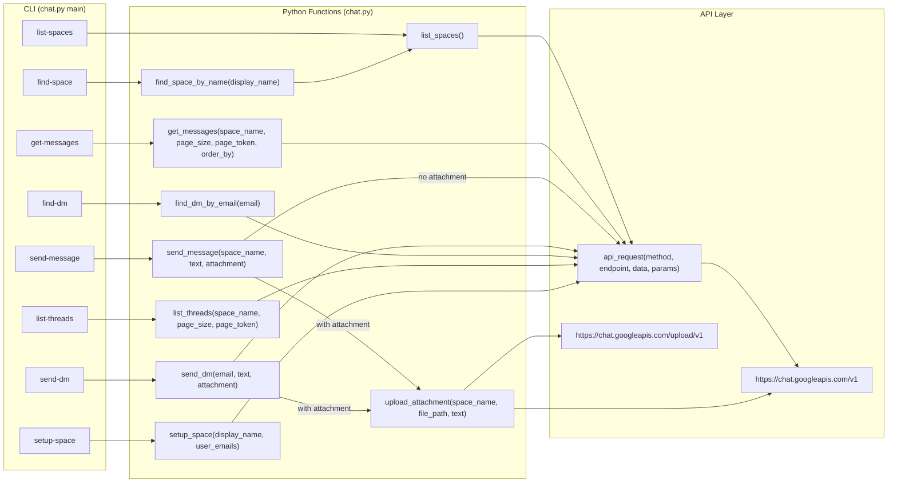
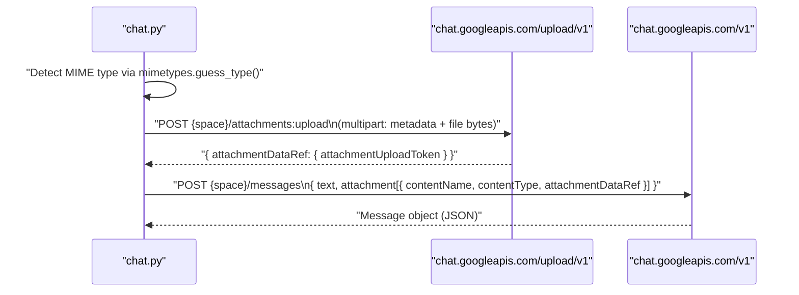
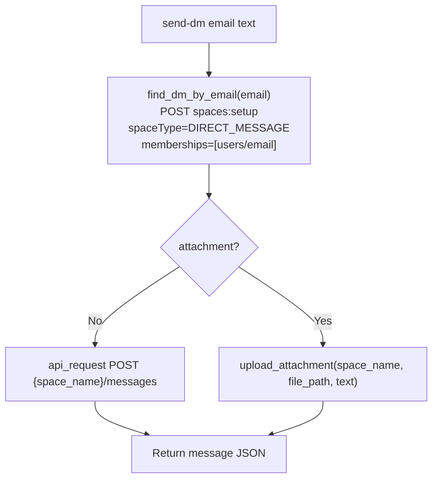
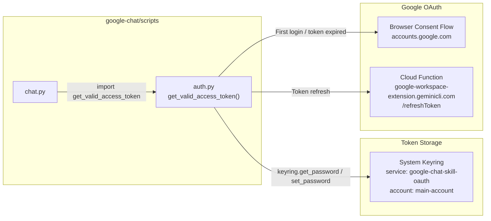

<!-- source: DeepWiki mcp.deepwiki.com · repo sanjay3290/ai-skills · page 5.4 Google Chat · fetched 2026-10-26 -->

# Google Chat

<details>
<summary>Relevant source files</summary>

The following files were used as context for generating this wiki page:

- [skills/google-chat/SKILL.md](skills/google-chat/SKILL.md)
- [skills/google-chat/requirements.txt](skills/google-chat/requirements.txt)
- [skills/google-chat/scripts/chat.py](skills/google-chat/scripts/chat.py)
- [skills/google-sheets/scripts/auth.py](skills/google-sheets/scripts/auth.py)
- [skills/google-sheets/scripts/sheets.py](skills/google-sheets/scripts/sheets.py)

</details>


This page documents the `google-chat` skill: its commands, authentication setup, space ID conventions, and the file attachment upload process. For the shared OAuth authentication infrastructure used by this skill and the other six Google Workspace skills, see [Shared Authentication](#5.1). For account requirements and troubleshooting, see [Troubleshooting](#8).

---

## Overview

The `google-chat` skill provides a standalone CLI interface to the Google Chat REST API. It requires no MCP server. All operations are exposed through `scripts/chat.py`, and authentication is managed by `scripts/auth.py`.

> **Requires a Google Workspace account.** Personal Gmail accounts are not supported by the Google Chat API scopes used here.

**Keychain service name:** `google-chat-skill-oauth`

**Dependencies:** `keyring>=24.0.0` ([skills/google-chat/requirements.txt:1-1]())

---

## Authentication Setup

Authentication follows the shared OAuth 2.0 browser-consent flow. Tokens are stored in the system keyring under the service name `google-chat-skill-oauth`.

```bash
# Initiate OAuth flow (opens browser)
python scripts/auth.py login

# Check token status
python scripts/auth.py status

# Remove stored tokens
python scripts/auth.py logout
```

`chat.py` calls `get_valid_access_token()` from `auth.py` at the start of every operation. If no token exists, it will automatically trigger the OAuth flow interactively.

**Token storage by platform:**

| Platform | Storage Backend |
|----------|----------------|
| macOS | Keychain |
| Windows | Windows Credential Locker |
| Linux | Secret Service API (GNOME Keyring, KDE Wallet) |

Sources: [skills/google-chat/SKILL.md:79-86]()

---

## Commands

All operations go through `scripts/chat.py` as subcommands. The script outputs JSON to stdout and exits with code `1` on error.

**Command Reference:**

| Command | Required Args | Optional Args | Description |
|---------|--------------|---------------|-------------|
| `list-spaces` | — | — | List all spaces the authenticated user belongs to |
| `find-space` | `name` | — | Search spaces by display name (exact match) |
| `get-messages` | `space` | `--limit`, `--page-token` | Retrieve messages from a space |
| `send-message` | `space`, `text` | `--attachment` | Send a message, optionally with a file |
| `send-dm` | `email`, `text` | `--attachment` | Send a direct message to a user by email |
| `find-dm` | `email` | — | Find or create a DM space with a user |
| `list-threads` | `space` | `--limit` | List threads (one message per thread) in a space |
| `setup-space` | `name`, `emails...` | — | Create a named space and add members |

### Usage Examples

```bash
# List spaces
python scripts/chat.py list-spaces

# Find a space by name
python scripts/chat.py find-space "Project Alpha"

# Retrieve up to 10 messages
python scripts/chat.py get-messages spaces/AAAA123 --limit 10

# Send a message
python scripts/chat.py send-message spaces/AAAA123 "Hello team!"

# Send a message with a file
python scripts/chat.py send-message spaces/AAAA123 "Report attached" --attachment /path/to/report.pdf

# Send a direct message
python scripts/chat.py send-dm user@example.com "Quick question..."

# Find or create a DM space
python scripts/chat.py find-dm user@example.com

# List threads in a space
python scripts/chat.py list-threads spaces/AAAA123

# Create a new space with members
python scripts/chat.py setup-space "New Project" user1@example.com user2@example.com
```

Sources: [skills/google-chat/scripts/chat.py:225-296](), [skills/google-chat/SKILL.md:41-71]()

---

## Space ID Format

Google Chat identifies spaces with resource names in the format `spaces/AAAA123`. This string is required wherever a `space` argument appears in `chat.py`. The easiest way to get a space name is via `list-spaces` or `find-space`.

**Command-to-function mapping diagram:**



Sources: [skills/google-chat/scripts/chat.py:121-222](), [skills/google-chat/scripts/chat.py:225-296]()

---

## File Attachment Process

Sending a file attachment is a two-step process implemented in `upload_attachment()`. The `--attachment` flag on both `send-message` and `send-dm` triggers this path.

**Attachment Upload Sequence:**



**Step details:**

1. **Upload** ([skills/google-chat/scripts/chat.py:71-91]()): Posts multipart form data to `{CHAT_UPLOAD_BASE}/{space_name}/attachments:upload` with `uploadType=multipart`. The body has two parts: a JSON metadata part with `filename`, and the raw file bytes with the detected MIME type. If MIME type cannot be determined, defaults to `application/octet-stream`.

2. **Send** ([skills/google-chat/scripts/chat.py:94-118]()): Posts to `{CHAT_API_BASE}/{space_name}/messages` with the `attachmentUploadToken` extracted from the upload response's `attachmentDataRef` field.

The `upload_attachment` function uses the `requests` library (imported as `req_lib` at runtime) rather than `urllib`, as multipart form upload requires it. This is the only place in the skill where `requests` is used.

Sources: [skills/google-chat/scripts/chat.py:53-118]()

---

## Direct Message Resolution

`send-dm` and `find-dm` both resolve DM spaces by calling `spaces:setup` with `spaceType: DIRECT_MESSAGE`. This endpoint is idempotent — it returns the existing DM space if one already exists with that user.

**DM flow:**



The member reference format is `users/{email}` with `type: HUMAN`, as seen in `send_dm()` and `find_dm_by_email()` at [skills/google-chat/scripts/chat.py:156-184]().

Sources: [skills/google-chat/scripts/chat.py:156-184]()

---

## Thread Listing

`list_threads()` does not call a dedicated threads endpoint. It fetches messages from `{space_name}/messages` ordered by `createTime desc`, then groups them by the `thread.name` field in each message object. Only the first message seen per thread is included in the output, producing one representative message per thread.

The result shape is:

```json
{
  "threads": [ /* one message object per unique thread */ ],
  "nextPageToken": "..."
}
```

Sources: [skills/google-chat/scripts/chat.py:187-209]()

---

## API Request Internals

All non-attachment API calls go through `api_request()` ([skills/google-chat/scripts/chat.py:23-50]()), which:

- Calls `get_valid_access_token()` from `auth.py` to obtain a bearer token
- Constructs the URL from `CHAT_API_BASE = "https://chat.googleapis.com/v1"` and an `endpoint` path
- Appends query parameters with `urllib.parse.urlencode`
- Uses `urllib.request.Request` with a 30-second timeout
- Returns parsed JSON on success, or a `{"error": "..."}` dict on HTTP errors, network errors, or JSON decode failures

**Constants:**

| Name | Value |
|------|-------|
| `CHAT_API_BASE` | `https://chat.googleapis.com/v1` |
| `CHAT_UPLOAD_BASE` | `https://chat.googleapis.com/upload/v1` |
| Keychain service | `google-chat-skill-oauth` |

Sources: [skills/google-chat/scripts/chat.py:19-50](), [skills/google-chat/SKILL.md:84]()

---

## Authentication Flow Reference

The diagram below shows how `chat.py` connects to the shared auth infrastructure:



For full details on the OAuth flow, CSRF protection, token expiry buffer, and the `OAuthCallbackHandler` local HTTP server, see [Shared Authentication](#5.1).

Sources: [skills/google-chat/SKILL.md:79-86](), [skills/google-chat/scripts/chat.py:17]()

---

