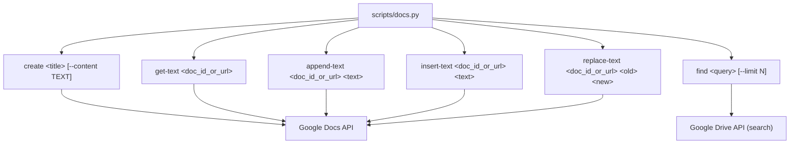
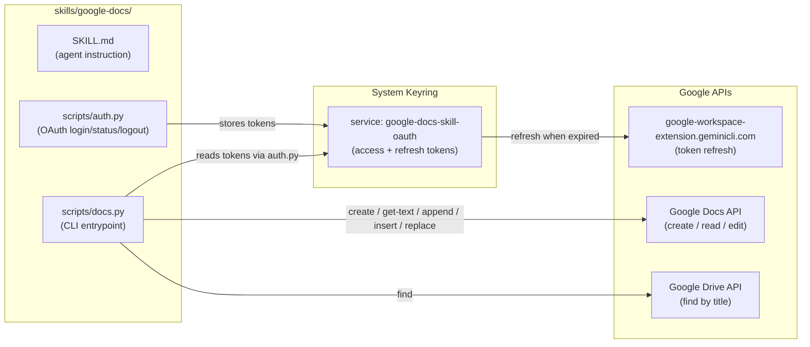
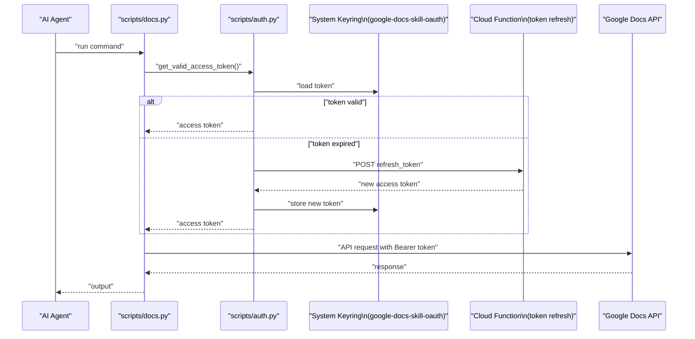

<!-- source: DeepWiki mcp.deepwiki.com · repo sanjay3290/ai-skills · page 5.5 Google Docs · fetched 2026-10-26 -->

# Google Docs

<details>
<summary>Relevant source files</summary>

The following files were used as context for generating this wiki page:

- [README.md](README.md)
- [skills/google-drive/SKILL.md](skills/google-drive/SKILL.md)
- [skills/google-slides/SKILL.md](skills/google-slides/SKILL.md)
- [skills/jules/SKILL.md](skills/jules/SKILL.md)
- [skills/manus/SKILL.md](skills/manus/SKILL.md)

</details>


This page documents the `google-docs` skill: its CLI commands, authentication setup, document ID handling, and integration with the shared Google Workspace OAuth infrastructure. For the authentication mechanism shared across all Google Workspace skills, see [Shared Authentication](#5.1). For managing files in Google Drive (including locating document IDs), see [Google Drive](#5.6).

---

## Overview

The `google-docs` skill provides a lightweight interface to the Google Docs API via `scripts/docs.py`. It supports creating, searching, reading, and editing documents without requiring the full Google Workspace MCP server.

> **⚠️ Requires a Google Workspace account.** Personal Gmail accounts (`@gmail.com`) are not supported.

---

## Authentication Setup

Authentication follows the shared OAuth 2.0 pattern described in [Shared Authentication](#5.1). Tokens are stored in the system keyring under the service name `google-docs-skill-oauth`.

| Platform | Keyring Backend |
|---|---|
| macOS | Keychain |
| Windows | Windows Credential Locker |
| Linux | Secret Service API (GNOME Keyring, KDE Wallet, etc.) |

**Setup commands:**

```bash
# First-time login (opens browser for OAuth consent)
python scripts/auth.py login

# Check token status
python scripts/auth.py status

# Revoke token
python scripts/auth.py logout
```

`docs.py` will auto-authenticate on first use if no valid token is found.

Sources: [skills/google-docs/SKILL.md:22-35](), [skills/google-docs/README.md:18-36]()

---

## Document ID Format

Every Google Doc has a unique alphanumeric document ID embedded in its URL:

```
https://docs.google.com/document/d/1BxiMVs0XRA5nFMdKvBdBZjgmUUqptlbs74OgvE2upms/edit
                                    ^^^^^^^^^^^^^^^^^^^^^^^^^^^^^^^^^^^^^^^^^^^^^^^^
                                    document ID
```

`docs.py` accepts either the full URL or the bare document ID for any command that takes a document reference. The ID is extracted automatically from the URL. Document IDs can also be retrieved from the output of the `find` command.

Sources: [skills/google-docs/SKILL.md:67-73](), [skills/google-docs/README.md:77-83]()

---

## Command Reference

All operations are performed via `scripts/docs.py`.

| Command | Arguments | Description |
|---|---|---|
| `create <title>` | `title`, `--content` | Create a new document, optionally with initial content |
| `find <query>` | `query`, `--limit` | Search documents by title |
| `get-text <id>` | document ID or URL | Extract plain text content from a document |
| `append-text <id> <text>` | document ID, text | Append text to the end of the document |
| `insert-text <id> <text>` | document ID, text | Insert text at the beginning of the document |
| `replace-text <id> <old> <new>` | document ID, old text, new text | Replace all occurrences of a string |

Sources: [skills/google-docs/README.md:67-75](), [skills/google-docs/SKILL.md:38-65]()

---

**Command flow diagram — `docs.py` entrypoints**



Sources: [skills/google-docs/SKILL.md:38-65](), [skills/google-docs/README.md:39-64]()

---

## Usage Examples

```bash
# Create a blank document
python scripts/docs.py create "Meeting Notes"

# Create a document with initial content
python scripts/docs.py create "Project Plan" --content "# Overview\n\nThis is the project plan."

# Find documents by title keyword
python scripts/docs.py find "meeting" --limit 10

# Read a document's text (by ID)
python scripts/docs.py get-text 1BxiMVs0XRA5nFMdKvBdBZjgmUUqptlbs74OgvE2upms

# Read a document's text (by URL)
python scripts/docs.py get-text "https://docs.google.com/document/d/1BxiMVs0XRA5nFMdKvBdBZjgmUUqptlbs74OgvE2upms/edit"

# Append text to end of document
python scripts/docs.py append-text 1BxiMVs0XRA5nFMdKvBdBZjgmUUqptlbs74OgvE2upms "New paragraph at the end."

# Insert text at the beginning
python scripts/docs.py insert-text 1BxiMVs0XRA5nFMdKvBdBZjgmUUqptlbs74OgvE2upms "Text at the beginning.\n\n"

# Replace text
python scripts/docs.py replace-text 1BxiMVs0XRA5nFMdKvBdBZjgmUUqptlbs74OgvE2upms "old text" "new text"
```

Sources: [skills/google-docs/SKILL.md:41-65](), [skills/google-docs/README.md:40-64]()

---

## System Architecture

The diagram below maps natural-language operations to code entities and external APIs.

**`google-docs` skill — component map**



Sources: [skills/google-docs/SKILL.md:76-83](), [skills/google-docs/README.md:85-91]()

---

## Token Lifecycle



Sources: [skills/google-docs/SKILL.md:75-83](), [skills/google-docs/README.md:85-91]()

---

## Troubleshooting

| Error | Cause | Resolution |
|---|---|---|
| `Failed to get access token` | Not authenticated or token invalid | Run `python scripts/auth.py login` |
| `Document not found` | Incorrect document ID or no access | Verify the ID with `find`; check sharing settings |
| `Permission denied` | Missing edit access on the document | Request edit access from the document owner |

For keyring-level issues (token storage failures, missing keyring backend on Linux), see [Troubleshooting](#8).

Sources: [skills/google-docs/README.md:93-103]()

---

