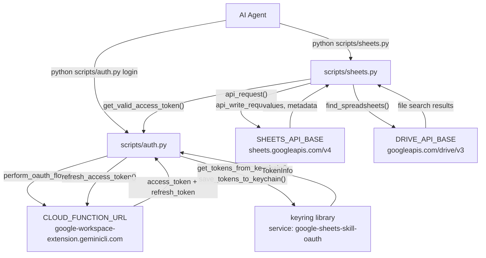
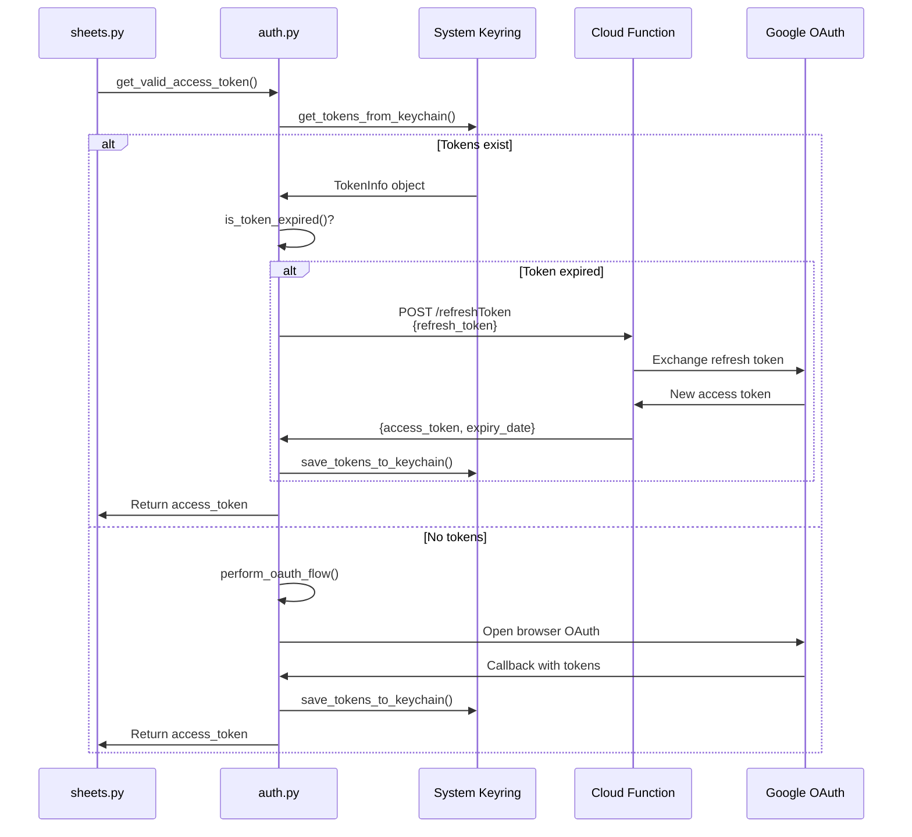
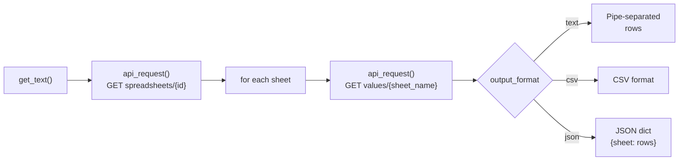
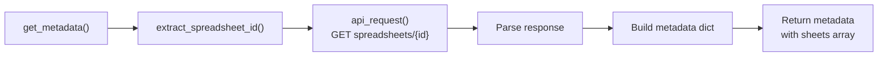
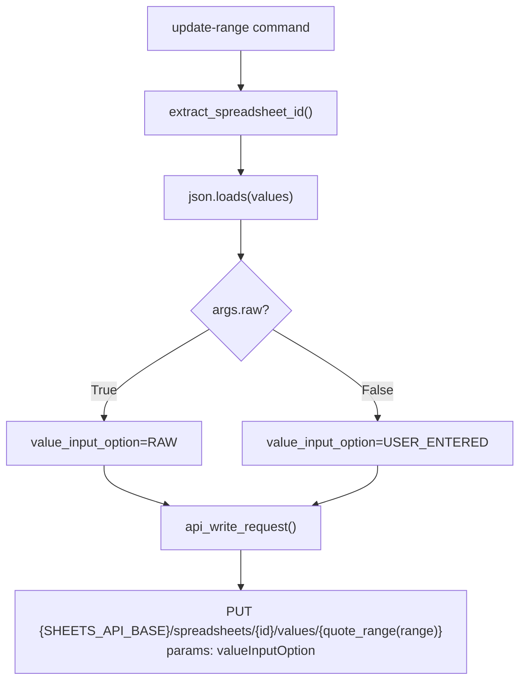
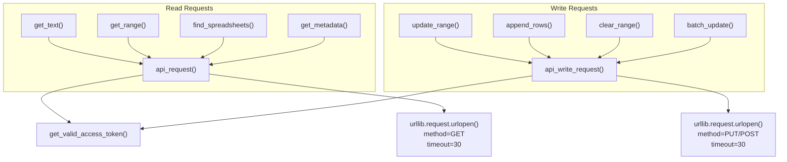
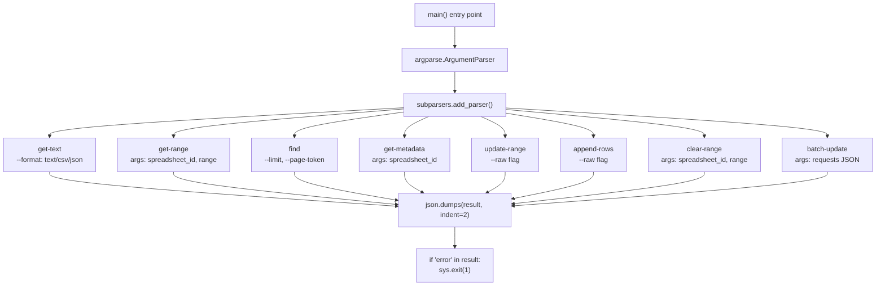

<!-- source: DeepWiki mcp.deepwiki.com · repo sanjay3290/ai-skills · page 5.7 Google Sheets · fetched 2026-10-26 -->

# Google Sheets

<details>
<summary>Relevant source files</summary>

The following files were used as context for generating this wiki page:

- [skills/gmail/SKILL.md](skills/gmail/SKILL.md)
- [skills/google-chat/requirements.txt](skills/google-chat/requirements.txt)
- [skills/google-chat/scripts/chat.py](skills/google-chat/scripts/chat.py)
- [skills/google-sheets/SKILL.md](skills/google-sheets/SKILL.md)
- [skills/google-sheets/scripts/auth.py](skills/google-sheets/scripts/auth.py)
- [skills/google-sheets/scripts/sheets.py](skills/google-sheets/scripts/sheets.py)

</details>


This page documents the **google-sheets** skill, which provides full read/write access to Google Sheets spreadsheets through OAuth-authenticated API calls. This skill enables reading spreadsheet content in multiple formats (text, CSV, JSON), updating cell ranges, appending rows, and executing batch operations.

This is one of seven Google Workspace skills covered in [Google Workspace Skills](#5). For shared OAuth infrastructure, see [Shared Authentication](#5.1). For other Google services, see [Gmail](#5.2), [Google Calendar](#5.3), [Google Chat](#5.4), [Google Docs](#5.5), [Google Drive](#5.6), and [Google Slides](#5.8).

**Sources:** [skills/google-sheets/SKILL.md:1-17]()

---

## Architecture Overview



**Architecture: Google Sheets skill module interactions and API endpoints**

The google-sheets skill uses a two-module architecture with shared authentication infrastructure:

1. **scripts/auth.py** [auth.py:1-367](): Manages OAuth 2.0 authentication, stores tokens in system keyring via the `keyring` library, and automatically refreshes expired tokens using the cloud function at `CLOUD_FUNCTION_URL` [auth.py:26]().

2. **scripts/sheets.py** [sheets.py:1-440](): Provides eight command-line operations for reading and writing spreadsheet data. Auto-authenticates by calling `get_valid_access_token()` [auth.py:255-302]() from the auth module. Communicates with two Google APIs:
   - `SHEETS_API_BASE = "https://sheets.googleapis.com/v4"` [sheets.py:18]()
   - `DRIVE_API_BASE = "https://www.googleapis.com/drive/v3"` [sheets.py:19]()

**Dependencies:**
- `keyring>=24.0.0` - Cross-platform secure credential storage

**Sources:** [skills/google-sheets/scripts/auth.py:1-367](), [skills/google-sheets/scripts/sheets.py:1-440](), [skills/google-sheets/scripts/auth.py:26](), [skills/google-sheets/scripts/sheets.py:18-19]()

---

## Authentication Setup

### Initial Login

Authentication uses browser-based OAuth flow with tokens stored in the system keyring:

```bash
# Authenticate with Google (opens browser)
python scripts/auth.py login

# Check authentication status
python scripts/auth.py status

# Logout when needed
python scripts/auth.py logout
```

### OAuth Configuration

| Component | Value |
|-----------|-------|
| **Client ID** | `338689075775-o75k922vn5fdl18qergr96rp8g63e4d7.apps.googleusercontent.com` |
| **Cloud Function** | `https://google-workspace-extension.geminicli.com` |
| **Keyring Service** | `google-sheets-skill-oauth` |
| **Keyring Account** | `main-account` |

Required scopes:
- `https://www.googleapis.com/auth/spreadsheets` (read/write access)
- `https://www.googleapis.com/auth/drive` (search/metadata)
- `https://www.googleapis.com/auth/userinfo.profile` (user info)

**Sources:** [skills/google-sheets/scripts/auth.py:24-38](), [skills/google-sheets/SKILL.md:20-35]()

### Token Management Flow



**Diagram: Token retrieval and automatic refresh flow**

The `get_valid_access_token()` function [auth.py:255-302]() implements automatic token refresh with a 5-minute expiry buffer (`TOKEN_EXPIRY_BUFFER_MS = 5 * 60 * 1000`). If refresh fails, it falls back to re-authentication.

**Sources:** [skills/google-sheets/scripts/auth.py:255-302](), [skills/google-sheets/scripts/auth.py:113-129]()

---

## Spreadsheet Identification

The skill accepts both spreadsheet IDs and full URLs:

```python
# Spreadsheet ID
python scripts/sheets.py get-text "1BxiMVs0XRA5nFMdKvBdBZjgmUUqptlbs74OgvE2upms"

# Full URL (automatically extracts ID)
python scripts/sheets.py get-text "https://docs.google.com/spreadsheets/d/1BxiMVs0XRA5nFMdKvBdBZjgmUUqptlbs74OgvE2upms/edit"
```

### ID Extraction

The `extract_spreadsheet_id()` function [sheets.py:54-67]() uses regex pattern `docs\.google\.com/spreadsheets/d/([a-zA-Z0-9_-]+)` to parse URLs and extract the 44-character spreadsheet ID.

**Sources:** [skills/google-sheets/scripts/sheets.py:54-67](), [skills/google-sheets/SKILL.md:82-88]()

---

## Read Operations

### Get Text Content



**Diagram: get_text() operation flow with format branching**

The `get_text()` function [sheets.py:98-170]() retrieves all content from a spreadsheet:

```bash
# Get content as plain text (default)
python scripts/sheets.py get-text SPREADSHEET_ID

# Get as CSV
python scripts/sheets.py get-text SPREADSHEET_ID --format csv

# Get as JSON
python scripts/sheets.py get-text SPREADSHEET_ID --format json
```

**Output Format Examples:**

| Format | Example Output |
|--------|---------------|
| **text** | `Spreadsheet Title: Sales Data\nSheet Name: Q1\nName \| Revenue \| Units\nProduct A \| 10000 \| 50` |
| **csv** | `Name,Revenue,Units\nProduct A,10000,50` |
| **json** | `{"Q1": [["Name", "Revenue", "Units"], ["Product A", "10000", "50"]]}` |

**Sources:** [skills/google-sheets/scripts/sheets.py:98-170](), [skills/google-sheets/SKILL.md:42-119]()

### Get Range

Retrieve values from specific cell ranges using A1 notation:

```bash
# Get range from specific sheet
python scripts/sheets.py get-range SPREADSHEET_ID "Sheet1!A1:D10"

# Get range from default sheet
python scripts/sheets.py get-range SPREADSHEET_ID "A1:C5"
```

The `get_range()` function [sheets.py:173-191]() calls `GET spreadsheets/{spreadsheet_id}/values/{range}` and returns:

```json
{
  "range": "Sheet1!A1:D10",
  "values": [
    ["Header1", "Header2", "Header3"],
    ["Value1", "Value2", "Value3"]
  ]
}
```

**Sources:** [skills/google-sheets/scripts/sheets.py:173-191](), [skills/google-sheets/SKILL.md:52-54]()

### Find Spreadsheets

Search for spreadsheets by name or content using the Drive API:

```bash
# Find by name/content
python scripts/sheets.py find "budget 2024"

# Limit results
python scripts/sheets.py find "sales report" --limit 5

# Pagination
python scripts/sheets.py find "Q1" --page-token TOKEN_STRING
```

The `find_spreadsheets()` function [sheets.py:194-224]() constructs a Drive API query:

```python
search_query = f"mimeType='{SHEETS_MIME_TYPE}' and (name contains '{query}' or fullText contains '{query}')"
```

Where `SHEETS_MIME_TYPE = "application/vnd.google-apps.spreadsheet"` [sheets.py:22]().

**Sources:** [skills/google-sheets/scripts/sheets.py:194-224](), [skills/google-sheets/SKILL.md:56-58]()

### Get Metadata

Retrieve spreadsheet structure without cell data:

```bash
python scripts/sheets.py get-metadata SPREADSHEET_ID
```

**Metadata retrieval flow:**



The `get_metadata()` function [sheets.py:227-262]() calls `api_request()` with `includeGridData=false` parameter [sheets.py:236-238]() and returns:

```json
{
  "spreadsheetId": "1BxiM...",
  "title": "Sales Data",
  "locale": "en_US",
  "timeZone": "America/Los_Angeles",
  "sheets": [
    {
      "sheetId": 0,
      "title": "Sheet1",
      "index": 0,
      "rowCount": 1000,
      "columnCount": 26
    }
  ]
}
```

The function extracts sheet properties including `sheetId`, `title`, `index`, and grid dimensions (`rowCount`, `columnCount`) from the `gridProperties` object [sheets.py:251-260]().

**Sources:** [skills/google-sheets/scripts/sheets.py:227-262](), [skills/google-sheets/SKILL.md:59-61]()

---

## Write Operations

### Update Range



**Update range operation with value input option branching**

Update cell values with a 2D array:

```bash
# Update with formula parsing (default)
python scripts/sheets.py update-range SPREADSHEET_ID "Sheet1!A1:B2" '[["Hello","World"],["Foo","Bar"]]'

# Update with RAW input (no formula parsing)
python scripts/sheets.py update-range SPREADSHEET_ID "Sheet1!A1:B1" '[["=SUM(A1:A5)","text"]]' --raw
```

The `update_range()` function [sheets.py:270-292]() calls `api_write_request()` [sheets.py:25-51]() with:
- `method="PUT"` [sheets.py:290]()
- `params={"valueInputOption": value_input_option}` [sheets.py:291]()
- Range is URL-encoded via `quote_range()` [sheets.py:288]()

**Value input options:**

| Option | Behavior | Code Reference |
|--------|----------|----------------|
| **USER_ENTERED** (default) | Parses numbers, dates, and formulas as if typed by a user | [sheets.py:270]() |
| **RAW** (with `--raw` flag) | Stores values literally without parsing | [sheets.py:418]() |

**Sources:** [skills/google-sheets/scripts/sheets.py:270-292](), [skills/google-sheets/scripts/sheets.py:25-51](), [skills/google-sheets/SKILL.md:66-71]()

### Append Rows

Append data after the last row with content:

```bash
python scripts/sheets.py append-rows SPREADSHEET_ID "Sheet1!A:Z" '[["New Row Col A","New Row Col B"]]'

# With RAW input
python scripts/sheets.py append-rows SPREADSHEET_ID "Sheet1!A:Z" '[["Data1","Data2"]]' --raw
```

The `append_rows()` function [sheets.py:295-320]() calls `POST spreadsheets/{id}/values/{range}:append` with `insertDataOption=INSERT_ROWS`, which automatically finds the first empty row.

**Sources:** [skills/google-sheets/scripts/sheets.py:295-320](), [skills/google-sheets/SKILL.md:73-74]()

### Clear Range

Remove values while preserving formatting:

```bash
python scripts/sheets.py clear-range SPREADSHEET_ID "Sheet1!A1:B10"
```

The `clear_range()` function [sheets.py:323-337]() calls `POST spreadsheets/{id}/values/{range}:clear` with empty request body.

**Sources:** [skills/google-sheets/scripts/sheets.py:323-337](), [skills/google-sheets/SKILL.md:76-77]()

### Batch Update

Execute advanced operations (formatting, merging, conditional formatting, etc.):

```bash
python scripts/sheets.py batch-update SPREADSHEET_ID '[{"updateCells":{"range":{"sheetId":0},"fields":"userEnteredValue"}}]'
```

The `batch_update()` function [sheets.py:340-354]() calls `POST spreadsheets/{id}:batchUpdate` and accepts raw Google Sheets API request objects. This enables operations not available through simpler endpoints.

**Sources:** [skills/google-sheets/scripts/sheets.py:340-354](), [skills/google-sheets/SKILL.md:79-80]()

---

## A1 Notation Reference

A1 notation specifies cell ranges in spreadsheets:

| Notation | Description | Example |
|----------|-------------|---------|
| `Sheet1!A1:B10` | Range on specific sheet | First 10 rows, columns A-B |
| `A1:C5` | Range on first sheet | First 5 rows, columns A-C |
| `Sheet1!A:A` | Entire column | All rows in column A |
| `Sheet1!1:1` | Entire row | All columns in row 1 |
| `Sheet1!A1` | Single cell | Cell A1 only |

The `quote_range()` function [sheets.py:265-267]() URL-encodes range notations using `urllib.parse.quote()` to handle special characters in sheet names.

**Sources:** [skills/google-sheets/SKILL.md:122-127](), [skills/google-sheets/scripts/sheets.py:265-267]()

---

## Value Input Options

The `valueInputOption` parameter controls how Google Sheets interprets cell values:

### USER_ENTERED (Default)

Values are parsed as if typed by a user:

```bash
# Numbers, dates, and formulas are interpreted
python scripts/sheets.py update-range SHEET_ID "A1:A3" '[["42"],["2024-01-15"],["=SUM(A1:A2)"]]'
```

Result:
- `42` → Number
- `2024-01-15` → Date
- `=SUM(A1:A2)` → Formula that evaluates

### RAW

Values are stored exactly as provided:

```bash
# Everything stored as literal text
python scripts/sheets.py update-range SHEET_ID "A1:A3" '[["42"],["2024-01-15"],["=SUM(A1:A2)"]]' --raw
```

Result:
- `42` → Text "42"
- `2024-01-15` → Text "2024-01-15"
- `=SUM(A1:A2)` → Text "=SUM(A1:A2)" (not evaluated)

Both `update_range()` and `append_rows()` support the `--raw` flag to switch to RAW mode [sheets.py:386-388](), [sheets.py:394]().

**Sources:** [skills/google-sheets/SKILL.md:129-132](), [skills/google-sheets/scripts/sheets.py:270-292]()

---

## API Request Implementation

### Request Function Architecture



**API request architecture showing read/write function routing**

### Read Operations

The `api_request()` function [sheets.py:70-95]() handles authenticated GET requests:

**Key steps:**
1. Obtains access token via `get_valid_access_token()` [sheets.py:72]()
2. Constructs URL with `urllib.parse.urlencode()` for query params [sheets.py:78]()
3. Sets `Authorization: Bearer {token}` header [sheets.py:81]()
4. Uses `method="GET"` with 30-second timeout [sheets.py:86-87]()
5. Returns JSON-decoded response [sheets.py:88]()

**API Base URLs:**
- `SHEETS_API_BASE = "https://sheets.googleapis.com/v4"` [sheets.py:18]()
- `DRIVE_API_BASE = "https://www.googleapis.com/drive/v3"` [sheets.py:19]()

**Error handling:** Returns `{"error": "HTTP {code}: {body}"}` on HTTP errors [sheets.py:91]()

### Write Operations

The `api_write_request()` function [sheets.py:25-51]() handles PUT/POST requests:

**Differences from read operations:**
1. Accepts `data` dict parameter [sheets.py:25]()
2. Supports `method="PUT"` or `method="POST"` [sheets.py:25]()
3. Encodes data as JSON in request body via `json.dumps(data).encode()` [sheets.py:41]()
4. Same authentication and timeout behavior as `api_request()`

**Usage by write operations:**
- `update_range()`: Uses `method="PUT"` [sheets.py:290]()
- `append_rows()`: Uses `method="POST"` with `:append` endpoint [sheets.py:313]()
- `clear_range()`: Uses `method="POST"` with `:clear` endpoint [sheets.py:335]()
- `batch_update()`: Uses `method="POST"` with `:batchUpdate` endpoint [sheets.py:351]()

**Sources:** [skills/google-sheets/scripts/sheets.py:18-51](), [skills/google-sheets/scripts/sheets.py:70-95](), [skills/google-sheets/scripts/sheets.py:270-354]()

---

## Command-Line Interface



**CLI command routing and output flow**

The main CLI entry point [sheets.py:357-439]() uses `argparse` with subparsers [sheets.py:359]():

| Command | Function | Arguments | Description |
|---------|----------|-----------|-------------|
| `get-text` | `get_text()` | `spreadsheet_id`, `--format` | Retrieve all spreadsheet content [sheets.py:362-365]() |
| `get-range` | `get_range()` | `spreadsheet_id`, `range` | Get specific range values [sheets.py:368-370]() |
| `find` | `find_spreadsheets()` | `query`, `--limit`, `--page-token` | Search for spreadsheets [sheets.py:373-376]() |
| `get-metadata` | `get_metadata()` | `spreadsheet_id` | Get spreadsheet structure [sheets.py:379-380]() |
| `update-range` | `update_range()` | `spreadsheet_id`, `range`, `values`, `--raw` | Update cell values [sheets.py:383-387]() |
| `append-rows` | `append_rows()` | `spreadsheet_id`, `range`, `values`, `--raw` | Append rows to sheet [sheets.py:390-394]() |
| `clear-range` | `clear_range()` | `spreadsheet_id`, `range` | Clear cell values [sheets.py:397-399]() |
| `batch-update` | `batch_update()` | `spreadsheet_id`, `requests` | Execute batch operations [sheets.py:402-404]() |

**Output behavior:**
- All commands output JSON to stdout via `json.dumps(result, indent=2)` [sheets.py:432]()
- Exit with code 1 when `"error"` key present in result [sheets.py:434-435]()

**Command dispatch logic** [sheets.py:408-430](): The CLI uses `if/elif` chain to route `args.command` to the appropriate function, with JSON input parsing for write operations (e.g., `json.loads(args.values)` [sheets.py:417]()).

**Sources:** [skills/google-sheets/scripts/sheets.py:357-439]()

---

## Token Storage and Security

### Keyring Integration

The skill uses the `keyring` library [auth.py:22]() for cross-platform secure storage:

| Platform | Storage Mechanism |
|----------|-------------------|
| **macOS** | Keychain |
| **Windows** | Windows Credential Locker |
| **Linux** | Secret Service API (GNOME Keyring, KDE Wallet) |

### Token Structure

The `TokenInfo` dataclass [auth.py:43-48]() stores:

```python
@dataclass
class TokenInfo:
    access_token: str
    refresh_token: Optional[str]
    expires_at: Optional[int]  # Unix timestamp in milliseconds
    scope: Optional[str]
```

Stored in keyring as JSON [auth.py:76-93]():

```json
{
  "serverName": "main-account",
  "token": {
    "accessToken": "ya29.a0...",
    "refreshToken": "1//0g...",
    "tokenType": "Bearer",
    "scope": "https://www.googleapis.com/auth/spreadsheets ...",
    "expiresAt": 1704067200000
  },
  "updatedAt": 1704063600000
}
```

### OAuth Flow

The `perform_oauth_flow()` function [auth.py:201-252]() implements:

1. **Local callback server**: Starts HTTP server on random port [auth.py:203-234]()
2. **CSRF protection**: Generates 32-byte hex token [auth.py:205]()
3. **State payload**: Base64-encoded JSON with redirect URI and CSRF token [auth.py:207-213]()
4. **Browser authentication**: Opens Google OAuth consent screen [auth.py:239]()
5. **Token extraction**: Callback handler parses tokens from query params [auth.py:172-184]()

**Sources:** [skills/google-sheets/scripts/auth.py:201-252](), [skills/google-sheets/scripts/auth.py:43-93](), [skills/google-sheets/SKILL.md:134-142]()

---

## Common Workflows

### Reading and Processing Data

```bash
# 1. Find a spreadsheet
python scripts/sheets.py find "Q1 Sales" --limit 1

# 2. Get metadata to see sheet structure
python scripts/sheets.py get-metadata SPREADSHEET_ID

# 3. Export specific range as JSON
python scripts/sheets.py get-range SPREADSHEET_ID "Sheet1!A1:E100" > data.json

# 4. Export all sheets as CSV
python scripts/sheets.py get-text SPREADSHEET_ID --format csv > export.csv
```

### Updating Data

```bash
# 1. Update header row
python scripts/sheets.py update-range SPREADSHEET_ID "Sheet1!A1:C1" '[["Name","Email","Status"]]'

# 2. Append new records
python scripts/sheets.py append-rows SPREADSHEET_ID "Sheet1!A:C" '[["John Doe","john@example.com","Active"]]'

# 3. Update formulas
python scripts/sheets.py update-range SPREADSHEET_ID "D2:D100" '[["=SUM(B2:C2)"],["=SUM(B3:C3)"]]'

# 4. Clear old data
python scripts/sheets.py clear-range SPREADSHEET_ID "Sheet1!A2:Z1000"
```

### Error Handling

All functions return error objects with `"error"` key [sheets.py:46-51]():

```json
{
  "error": "HTTP 404: Requested entity was not found."
}
```

The main CLI exits with code 1 when errors occur [sheets.py:434-435](), enabling shell error detection:

```bash
if ! python scripts/sheets.py get-text INVALID_ID; then
    echo "Failed to read spreadsheet"
fi
```

**Sources:** [skills/google-sheets/scripts/sheets.py:406-435](), [skills/google-sheets/SKILL.md:42-80]()

---

## Skill Registration

The SKILL.md file defines how AI assistants discover and invoke this skill:

**YAML Frontmatter** [SKILL.md:1-12]():
```yaml
name: google-sheets
description: |
  Read and write Google Sheets spreadsheets - get content, update cells, append rows, fetch specific ranges,
  search for spreadsheets, and view metadata. Use when user asks to: read a spreadsheet, update cells,
  add data to Google Sheets, find a spreadsheet, check sheet contents, export spreadsheet data, or get cell values.
license: Apache-2.0
metadata:
  author: sanjay3290
  version: "1.0"
```

The `description` field defines trigger conditions for AI assistants to match user intent to this skill.

**Sources:** [skills/google-sheets/SKILL.md:1-12]()

---

