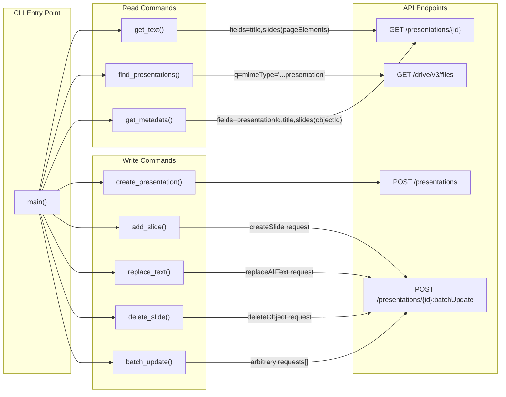
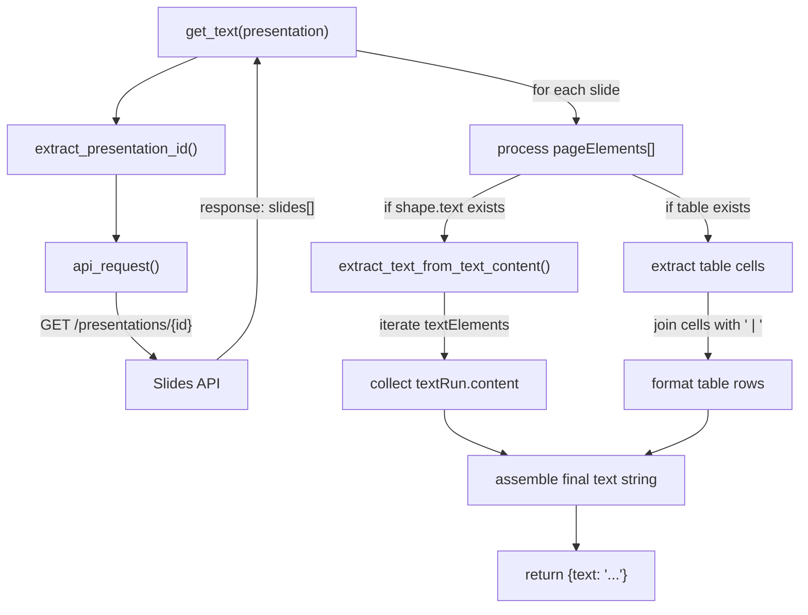
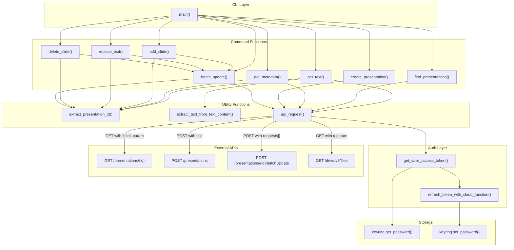
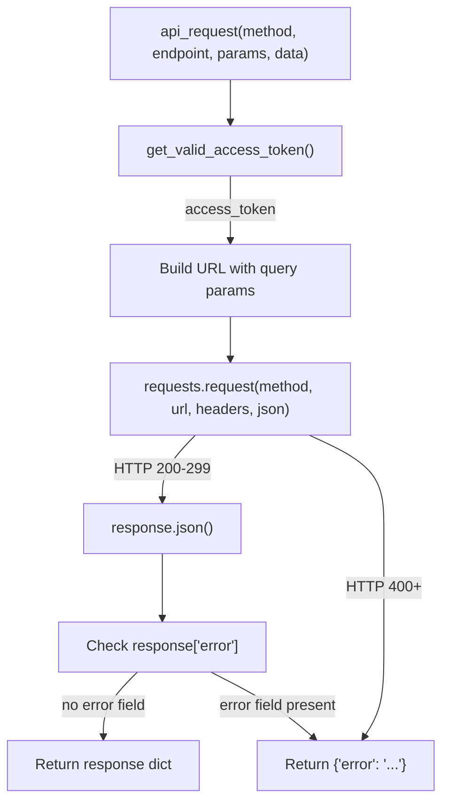

<!-- source: DeepWiki mcp.deepwiki.com · repo sanjay3290/ai-skills · page 5.8 Google Slides · fetched 2026-10-26 -->

# Google Slides

<details>
<summary>Relevant source files</summary>

The following files were used as context for generating this wiki page:

- [skills/google-drive/SKILL.md](skills/google-drive/SKILL.md)
- [skills/google-slides/SKILL.md](skills/google-slides/SKILL.md)

</details>


This page documents the `google-slides` skill: its CLI commands, authentication setup, presentation ID format, available slide layouts, and output structures. It covers the two scripts in `skills/google-slides/scripts/`: `auth.py` (OAuth token management) and `slides.py` (all presentation operations).

For the shared OAuth pattern used by all Google Workspace skills, see [Shared Authentication](#5.1). For file-level operations on presentations stored in Drive, see [Google Drive](#5.6).

> **Requires a Google Workspace account.** Personal Gmail accounts are not supported.

---

## Overview

The `google-slides` skill provides read/write access to the Google Slides API v1 and the Google Drive API v3 (for search). It exposes two scripts:

| Script | Purpose |
|---|---|
| `scripts/auth.py` | OAuth 2.0 token lifecycle management with cloud function refresh |
| `scripts/slides.py` | All presentation operations: read, write, search, batch updates |

All commands output JSON to stdout. No MCP server dependency.

**API bases:**
- Slides: `https://slides.googleapis.com/v1`
- Drive: `https://www.googleapis.com/drive/v3`

Sources: [skills/google-slides/SKILL.md:1-16](), [skills/google-slides/scripts/slides.py:18-20]()

---

## Authentication

Authentication follows the shared Google Workspace OAuth 2.0 pattern. The `auth.py` script manages the full token lifecycle.

### OAuth Scopes

The Slides skill requests three OAuth scopes:

[skills/google-slides/scripts/auth.py:34-38]()

| Scope | Purpose |
|---|---|
| `https://www.googleapis.com/auth/presentations` | Read/write access to presentations |
| `https://www.googleapis.com/auth/drive` | Used by the `find` command to search Drive |
| `https://www.googleapis.com/auth/userinfo.profile` | User identity |

### Keychain Service Name

Tokens are stored under the service name `google-slides-skill-oauth` in the system keyring.

[skills/google-slides/scripts/auth.py:30-31]()

| Platform | Storage Location |
|---|---|
| macOS | Keychain |
| Windows | Windows Credential Locker |
| Linux | Secret Service API (GNOME Keyring, KDE Wallet, etc.) |

### Auth Commands

```bash
# First-time login (opens browser)
python scripts/auth.py login

# Check token status
python scripts/auth.py status

# Print raw access token
python scripts/auth.py token

# Remove stored tokens
python scripts/auth.py logout
```

Sources: [skills/google-slides/scripts/auth.py:1-50](), [skills/google-slides/scripts/auth.py:310-366]()

---

## Presentation ID Format

`slides.py` accepts either a raw presentation ID or a full Google Slides URL wherever a `presentation` argument is required. The function `extract_presentation_id` handles both forms.

[skills/google-slides/scripts/slides.py:22-33]()

| Input Form | Example |
|---|---|
| Raw ID | `1abc123xyz789` |
| Slides URL | `https://docs.google.com/presentation/d/1abc123xyz789/edit` |
| Drive URL | `https://drive.google.com/.../d/1abc123xyz789` |

The regex patterns matched are:
- `docs.google.com/presentation/d/([a-zA-Z0-9_-]+)`
- `drive.google.com/.*?/d/([a-zA-Z0-9_-]+)`

Sources: [skills/google-slides/scripts/slides.py:22-33]()

---

## Command Reference

**Command flow: CLI subcommands to API endpoints**



Sources: [skills/google-slides/scripts/slides.py:276-351](), [skills/google-slides/scripts/slides.py:18-20]()

---

### `get-text`

Extracts all text content from every slide in a presentation.

```bash
python scripts/slides.py get-text "1abc123xyz789"
python scripts/slides.py get-text "https://docs.google.com/presentation/d/1abc123xyz789/edit"
```

Implemented by `get_text()` [skills/google-slides/scripts/slides.py:65-125](). Issues a `GET` to `presentations/{id}` with `fields=title,slides(pageElements(shape(text),table))` to minimize payload size.

**Text extraction flow:**



The `extract_text_from_text_content()` function [skills/google-slides/scripts/slides.py:128-156]() iterates `textElements` arrays within shape text content, extracting `textRun.content` fields and concatenating them.

**Output format:**

```json
{
  "text": "Presentation Title: My Report\n\n--- Slide 1 ---\nTitle text\nBody text\n\n--- Slide 2 ---\n..."
}
```

Tables are rendered with cells joined by ` | ` per row, with rows separated by newlines.

Sources: [skills/google-slides/scripts/slides.py:65-125](), [skills/google-slides/scripts/slides.py:128-156]()

---

### `find`

Searches for presentations by name or content using the Drive API.

```bash
python scripts/slides.py find "quarterly report"
python scripts/slides.py find "project proposal" --limit 5
python scripts/slides.py find "budget" --page-token "TOKEN"
```

| Argument | Default | Description |
|---|---|---|
| `query` | (required) | Free-text search against name and full text |
| `--limit` | `10` | Maximum number of results |
| `--page-token` | none | Resume a previous paginated query |

Implemented by `find_presentations`. The Drive query filters on `mimeType='application/vnd.google-apps.presentation'` and `trashed=false`.

**Output format:**

```json
{
  "presentations": [
    {"id": "1abc...", "name": "Q4 Report", "modifiedTime": "2024-01-15T10:00:00Z"}
  ],
  "nextPageToken": "TOKEN_OR_NULL"
}
```

Sources: [skills/google-slides/scripts/slides.py:128-156]()

---

### `get-metadata`

Returns structural metadata about a presentation without fetching slide content.

```bash
python scripts/slides.py get-metadata "1abc123xyz789"
```

Implemented by `get_metadata`. Requests `presentationId`, `title`, `slides(objectId)`, `pageSize`, `notesMaster`, `masters`, and `layouts` fields.

**Output format:**

```json
{
  "presentationId": "1abc...",
  "title": "My Presentation",
  "slideCount": 15,
  "pageSize": {"width": {...}, "height": {...}},
  "hasMasters": true,
  "hasLayouts": true,
  "hasNotesMaster": false
}
```

The `slides(objectId)` values returned by the API are not surfaced directly in this output, but the raw slide object IDs are needed for `delete-slide`. Run `get-metadata` and inspect the raw API response, or use the API directly, to find them.

Sources: [skills/google-slides/scripts/slides.py:159-182]()

---

### `create`

Creates a new, empty presentation.

```bash
python scripts/slides.py create "Q4 Sales Report"
```

Implemented by `create_presentation`. Issues a `POST` to `presentations` with `{"title": "..."}`. Returns the full presentation object from the API.

Sources: [skills/google-slides/scripts/slides.py:185-188]()

---

### `add-slide`

Appends or inserts a slide with a specified layout.

```bash
# Append a blank slide
python scripts/slides.py add-slide "1abc123xyz789"

# Append with a specific layout
python scripts/slides.py add-slide "1abc123xyz789" --layout TITLE_AND_BODY

# Insert at a specific position (0-based)
python scripts/slides.py add-slide "1abc123xyz789" --layout TITLE --at 0
```

| Argument | Default | Description |
|---|---|---|
| `--layout` | `BLANK` | Predefined layout name |
| `--at` | (append) | 0-based insertion index |

Implemented by `add_slide`. Issues a `batchUpdate` request with a single `createSlide` entry.

**Available layouts:**

| Layout Name | Description |
|---|---|
| `BLANK` | Empty slide (default) |
| `TITLE` | Title slide |
| `TITLE_AND_BODY` | Title with body text |
| `TITLE_AND_TWO_COLUMNS` | Title with two text columns |
| `TITLE_ONLY` | Title bar only |
| `SECTION_HEADER` | Section divider |
| `ONE_COLUMN_TEXT` | Single column text |
| `MAIN_POINT` | Main point highlight |
| `BIG_NUMBER` | Large number display |

Sources: [skills/google-slides/scripts/slides.py:191-216](), [skills/google-slides/SKILL.md:82-91]()

---

### `replace-text`

Finds and replaces text across all slides in a presentation.

```bash
python scripts/slides.py replace-text "1abc123xyz789" "Draft" "Final"
python scripts/slides.py replace-text "1abc123xyz789" "Draft" "Final" --match-case
```

| Argument | Default | Description |
|---|---|---|
| `find` | (required) | Text to search for |
| `replace` | (required) | Replacement string |
| `--match-case` | `false` | Enable case-sensitive matching |

Implemented by `replace_text`. Issues a `batchUpdate` with a `replaceAllText` request.

Sources: [skills/google-slides/scripts/slides.py:219-242]()

---

### `delete-slide`

Deletes a single slide by its object ID.

```bash
python scripts/slides.py delete-slide "1abc123xyz789" "g123abc456"
```

The `slide_id` argument is the slide's object ID, not its position index. Object IDs can be found by calling the Slides API directly via `get-metadata`'s raw response (the `slides` array contains `objectId` fields).

Implemented by `delete_slide`. Issues a `batchUpdate` with a `deleteObject` request.

Sources: [skills/google-slides/scripts/slides.py:245-260]()

---

### `batch-update`

Sends an arbitrary array of Slides API `batchUpdate` request objects. Intended for advanced operations not covered by the named commands (e.g., inserting images, applying formatting, creating shapes).

```bash
python scripts/slides.py batch-update "1abc123xyz789" \
  '[{"replaceAllText":{"containsText":{"text":"foo"},"replaceText":"bar"}}]'
```

Implemented by `batch_update()` [skills/google-slides/scripts/slides.py:263-273](). The `requests` argument is a JSON string parsed with `json.loads` before being forwarded to `POST /presentations/{id}:batchUpdate`.

**Request structure:**

```json
{
  "requests": [
    {"createSlide": {...}},
    {"replaceAllText": {...}},
    {"deleteObject": {...}},
    {"updateShapeProperties": {...}}
  ]
}
```

All write commands (`add_slide`, `replace_text`, `delete_slide`) internally use `batch_update()` with a single-element requests array. This command exposes the full batch API for complex multi-operation updates.

Sources: [skills/google-slides/scripts/slides.py:263-273](), [skills/google-slides/scripts/slides.py:191-260]()

---

## Internal Architecture

**Code entity map: function call graph and API routing**



Sources: [skills/google-slides/scripts/slides.py:1-351](), [skills/google-slides/scripts/auth.py:1-366]()

---

### Shared Components

All write commands (`add_slide`, `replace_text`, `delete_slide`) delegate to `batch_update()`, which constructs a single-element `requests` array:

| Command | Request Type | Example |
|---|---|---|
| `add_slide` | `createSlide` | `{"createSlide": {"objectId": "...", "insertionIndex": 0}}` |
| `replace_text` | `replaceAllText` | `{"replaceAllText": {"containsText": {...}, "replaceText": "..."}}` |
| `delete_slide` | `deleteObject` | `{"deleteObject": {"objectId": "..."}}` |

This reduces code duplication and centralizes error handling for all write operations.

Sources: [skills/google-slides/scripts/slides.py:191-273]()

---

### `api_request`

All HTTP calls go through `api_request()` [skills/google-slides/scripts/slides.py:36-62](). Execution flow:



**Key behaviors:**
1. Calls `get_valid_access_token()` from `auth.py`, which triggers browser OAuth if no token exists
2. Appends query params if `params` dict is provided
3. Serializes `data` dict as JSON for request body
4. Returns parsed JSON response, or `{"error": "..."}` on failure
5. The `main()` function checks for `error` key and exits with code 1 if present

Sources: [skills/google-slides/scripts/slides.py:36-62](), [skills/google-slides/scripts/slides.py:276-351]()

---

## Related Skills

| Skill | Relationship |
|---|---|
| [Google Drive](#5.6) | `find` internally queries the Drive API; the Drive skill manages file-level operations on the same presentation files |
| [Google Docs](#5.5) | Parallel structure — same auth pattern, same `SKILL.md`/`scripts/` layout |
| [Google Sheets](#5.7) | Parallel structure — same auth pattern, similar `batchUpdate` design |
| [Shared Authentication](#5.1) | Full description of the OAuth flow, token refresh cloud function, and keyring storage used by this skill |

---

