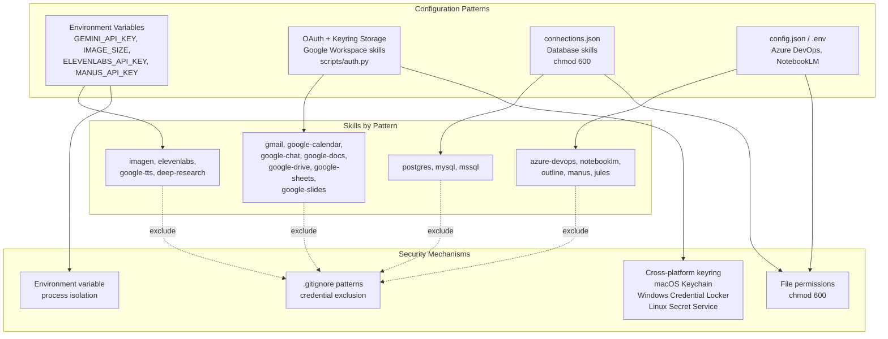
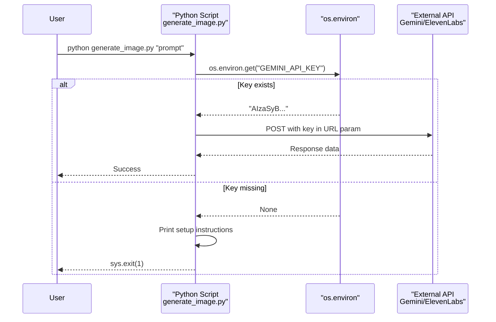
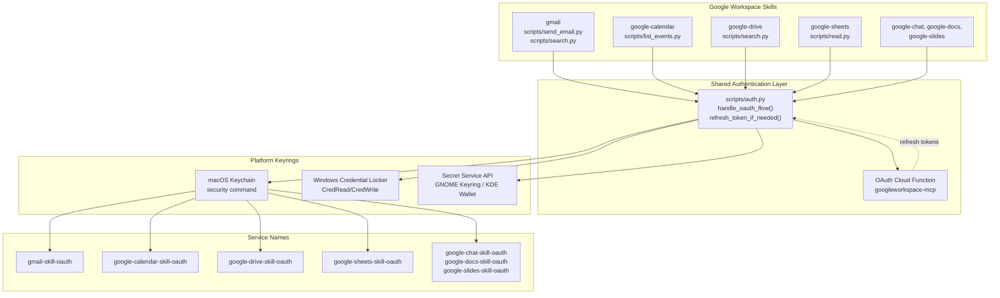
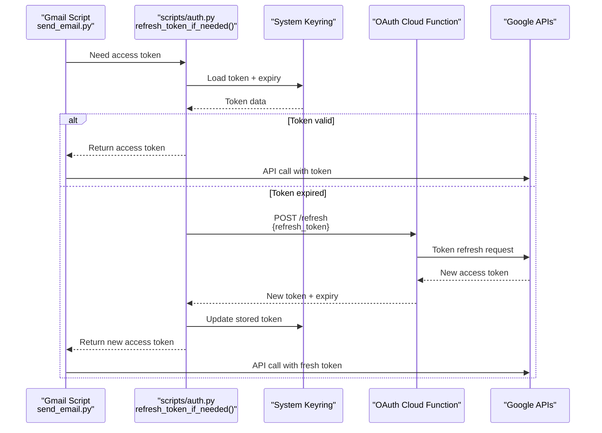
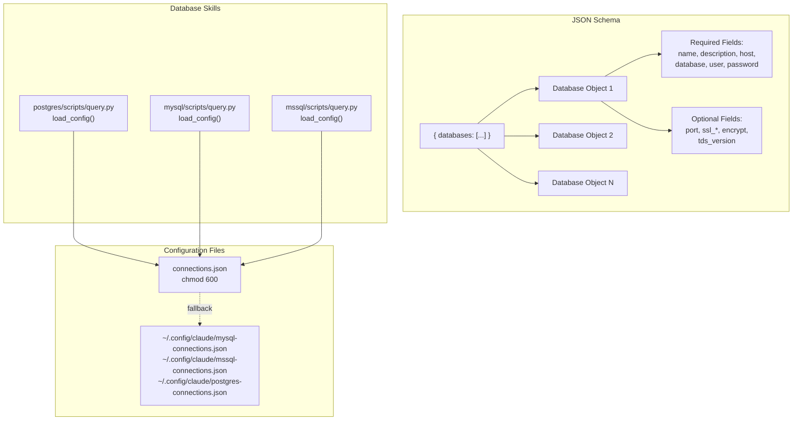
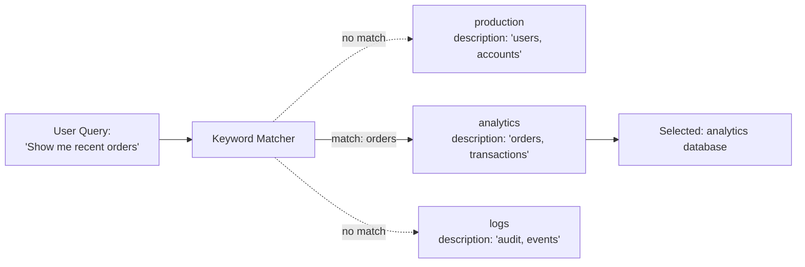
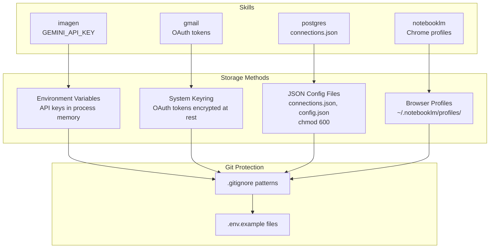

<!-- source: DeepWiki mcp.deepwiki.com · repo sanjay3290/ai-skills · page 6 Configuration Guide · fetched 2026-10-26 -->

# Configuration Guide

<details>
<summary>Relevant source files</summary>

The following files were used as context for generating this wiki page:

- [skills/imagen/.env.example](skills/imagen/.env.example)
- [skills/imagen/.gitignore](skills/imagen/.gitignore)
- [skills/imagen/README.md](skills/imagen/README.md)
- [skills/imagen/examples.md](skills/imagen/examples.md)
- [skills/imagen/reference.md](skills/imagen/reference.md)
- [skills/imagen/scripts/generate_image.py](skills/imagen/scripts/generate_image.py)
- [skills/mssql/SKILL.md](skills/mssql/SKILL.md)
- [skills/mysql/SKILL.md](skills/mysql/SKILL.md)

</details>


This document provides comprehensive guidance on configuring credentials, API keys, database connections, and authentication mechanisms across all skills in the ai-skills ecosystem. Each skill type uses different configuration approaches optimized for its security requirements and external service integration patterns.

For information about installing and managing skills themselves, see [Installation Methods](#2.1). For skill-specific usage documentation, see [Skills by Category](#4).

---

## Overview of Configuration Patterns

The ai-skills ecosystem uses four distinct configuration patterns based on security requirements and integration complexity:



**Sources**: [skills/mssql/SKILL.md:1-136](), [skills/mysql/SKILL.md:1-134](), [skills/imagen/scripts/generate_image.py:1-294](), [skills/imagen/.env.example:1-7]()

---

## Environment Variables

Environment variables provide the simplest configuration method for API keys and runtime parameters. They are used primarily by AI service skills that require single-token authentication.

### Standard Environment Variables

| Variable | Required By | Default | Description |
|----------|-------------|---------|-------------|
| `GEMINI_API_KEY` | imagen, deep-research, google-tts | - | Google Gemini API key from ai.google.dev |
| `IMAGE_SIZE` | imagen | `1K` | Default image size: `512`, `1K`, or `2K` |
| `GEMINI_MODEL` | imagen | `gemini-3-pro-image-preview` | Model ID for image generation |
| `ELEVENLABS_API_KEY` | elevenlabs | - | ElevenLabs API key for text-to-speech |
| `MANUS_API_KEY` | manus | - | Manus research agent API key |
| `AZURE_DEVOPS_PAT` | azure-devops | - | Personal Access Token for Azure DevOps |

### Setting Environment Variables by Platform

**Windows PowerShell:**
```powershell
# Temporary (current session only)
$env:GEMINI_API_KEY = "AIzaSyB..."

# Persistent (add to PowerShell profile)
Add-Content $PROFILE "`n`$env:GEMINI_API_KEY = 'AIzaSyB...'"

# Reload profile
. $PROFILE
```

**Windows Command Prompt:**
```cmd
REM Temporary
set GEMINI_API_KEY=AIzaSyB...

REM Persistent: Use System Properties > Advanced > Environment Variables GUI
```

**macOS / Linux:**
```bash
# Temporary
export GEMINI_API_KEY="AIzaSyB..."

# Persistent (zsh)
echo 'export GEMINI_API_KEY="AIzaSyB..."' >> ~/.zshrc
source ~/.zshrc

# Persistent (bash)
echo 'export GEMINI_API_KEY="AIzaSyB..."' >> ~/.bashrc
source ~/.bashrc
```

### Environment Variable Resolution Flow



**Key Code Locations:**
- API key retrieval: [skills/imagen/scripts/generate_image.py:40-51]()
- Image size validation: [skills/imagen/scripts/generate_image.py:54-59]()
- Model ID resolution: [skills/imagen/scripts/generate_image.py:254]()

**Sources**: [skills/imagen/scripts/generate_image.py:40-51](), [skills/imagen/reference.md:12-34](), [skills/imagen/.env.example:1-7]()

---

## OAuth & Keyring Setup

Google Workspace skills (gmail, google-calendar, google-chat, google-docs, google-drive, google-sheets, google-slides) use a shared OAuth authentication infrastructure with secure token storage in platform-specific system keyrings.

### Keyring Storage Architecture



### Keyring Service Names by Skill

Each Google Workspace skill stores OAuth tokens under a unique service name to enable multi-account support and token isolation:

| Skill | Service Name | Token Storage Location |
|-------|--------------|------------------------|
| gmail | `gmail-skill-oauth` | System keyring |
| google-calendar | `google-calendar-skill-oauth` | System keyring |
| google-chat | `google-chat-skill-oauth` | System keyring |
| google-docs | `google-docs-skill-oauth` | System keyring |
| google-drive | `google-drive-skill-oauth` | System keyring |
| google-sheets | `google-sheets-skill-oauth` | System keyring |
| google-slides | `google-slides-skill-oauth` | System keyring |

### OAuth Authentication Flow

The OAuth flow is initiated by running the skill's authentication script, which opens a browser window for user consent:

```bash
# Gmail example
cd ~/.claude/skills/gmail
python scripts/auth.py

# Google Sheets example
cd ~/.claude/skills/google-sheets
python scripts/auth.py
```

**OAuth Flow Steps:**

1. **Browser Authorization**: `auth.py` opens browser to Google OAuth consent screen
2. **User Consent**: User authenticates with Google Workspace account and grants permissions
3. **Token Exchange**: Cloud function exchanges authorization code for access/refresh tokens
4. **Keyring Storage**: Tokens stored in system keyring under skill-specific service name
5. **Automatic Refresh**: Expired access tokens refreshed transparently via cloud function

### Token Refresh Mechanism



### Platform-Specific Keyring Commands

**macOS (Keychain):**
```bash
# View stored token
security find-generic-password -s "gmail-skill-oauth" -w

# Delete token (to reset)
security delete-generic-password -s "gmail-skill-oauth"
```

**Windows (PowerShell with Credential Manager):**
```powershell
# List credentials
cmdkey /list | Select-String "gmail-skill-oauth"

# Delete credential
cmdkey /delete:"gmail-skill-oauth"
```

**Linux (Secret Service API):**
```bash
# Using secret-tool (part of libsecret)
secret-tool lookup service gmail-skill-oauth

# Delete token
secret-tool clear service gmail-skill-oauth
```

### Google Workspace Account Requirement

**Critical**: All Google Workspace skills require a **Google Workspace account** (paid enterprise/education account). Personal Gmail accounts (`@gmail.com`) are **not supported** and will fail authentication with API scope errors.

**Sources**: High-level Diagram 3 analysis, [skills/gmail/SKILL.md:1-100]() (inferred from description), [skills/google-sheets/SKILL.md:1-150]() (inferred)

---

## Database Connections

Database skills (postgres, mysql, mssql) use a `connections.json` file that stores connection parameters including credentials. This file requires strict permission controls and follows a standardized schema.

### connections.json File Structure



### Standard connections.json Schema

**PostgreSQL Example:**
```json
{
  "databases": [
    {
      "name": "production",
      "description": "Main app database - users, orders, transactions",
      "host": "db.example.com",
      "port": 5432,
      "database": "app_prod",
      "user": "readonly_user",
      "password": "secure-password-here",
      "sslmode": "require"
    },
    {
      "name": "analytics",
      "description": "Analytics database - reports, metrics, dashboards",
      "host": "analytics.example.com",
      "port": 5432,
      "database": "analytics_db",
      "user": "analyst",
      "password": "another-password"
    }
  ]
}
```

**MySQL Example:**
```json
{
  "databases": [
    {
      "name": "production",
      "description": "Main app database - users, orders, transactions",
      "host": "db.example.com",
      "port": 3306,
      "database": "app_prod",
      "user": "readonly_user",
      "password": "secure-password",
      "ssl_disabled": false,
      "ssl_ca": "/path/to/ca-cert.pem",
      "ssl_cert": "/path/to/client-cert.pem",
      "ssl_key": "/path/to/client-key.pem"
    }
  ]
}
```

**Microsoft SQL Server Example:**
```json
{
  "databases": [
    {
      "name": "production",
      "description": "Main app database - users, orders, transactions",
      "host": "db.example.com",
      "port": 1433,
      "database": "app_prod",
      "user": "readonly_user",
      "password": "secure-password",
      "encrypt": true,
      "tds_version": "7.3"
    }
  ]
}
```

### Configuration Fields Reference

#### Common Required Fields (All Database Types)

| Field | Type | Description |
|-------|------|-------------|
| `name` | string | Database identifier (case-insensitive), used in `--db` flag |
| `description` | string | Semantic description of database contents for AI agent selection |
| `host` | string | Database hostname or IP address |
| `database` | string | Database name to connect to |
| `user` | string | Username for authentication |
| `password` | string | Password for authentication |

#### PostgreSQL-Specific Fields

| Field | Type | Default | Description |
|-------|------|---------|-------------|
| `port` | integer | `5432` | PostgreSQL port |
| `sslmode` | string | - | SSL mode: `disable`, `allow`, `prefer`, `require`, `verify-ca`, `verify-full` |

#### MySQL-Specific Fields

| Field | Type | Default | Description |
|-------|------|---------|-------------|
| `port` | integer | `3306` | MySQL port |
| `ssl_disabled` | boolean | `false` | Set to `true` to disable SSL |
| `ssl_ca` | string | - | Path to CA certificate file |
| `ssl_cert` | string | - | Path to client certificate file |
| `ssl_key` | string | - | Path to client private key file |

#### MSSQL-Specific Fields

| Field | Type | Default | Description |
|-------|------|---------|-------------|
| `port` | integer | `1433` | SQL Server port |
| `encrypt` | boolean | `false` | Enable TLS encryption (required for Azure SQL) |
| `tds_version` | string | auto | TDS protocol: `7.0`, `7.1`, `7.2`, `7.3`, `7.4` |

### File Permission Requirements

**Critical Security Requirement**: `connections.json` must have restrictive permissions since it contains plaintext credentials:

```bash
# Set correct permissions (macOS/Linux)
chmod 600 connections.json

# Verify permissions
ls -l connections.json
# Should show: -rw------- (owner read/write only)

# Windows equivalent (PowerShell, run as administrator)
icacls connections.json /inheritance:r
icacls connections.json /grant:r "$env:USERNAME:(R,W)"
```

### Intelligent Database Selection

The `description` field enables AI agents to automatically select the correct database based on user intent through semantic keyword matching:



**Keyword Mapping Guidance:**

| User Intent | Description Keywords |
|-------------|---------------------|
| User data, accounts, authentication | `users`, `accounts`, `customers`, `authentication` |
| Orders, purchases, sales | `orders`, `transactions`, `sales`, `purchases` |
| Analytics, reporting, metrics | `analytics`, `reports`, `metrics`, `dashboards`, `KPIs` |
| Logging, audit trails | `logs`, `events`, `audit`, `activity` |

### Configuration File Locations

Database skills search for `connections.json` in this priority order:

1. **Skill directory**: `~/.claude/skills/postgres/connections.json`
2. **Shared config directory**: `~/.config/claude/postgres-connections.json`

**Sources**: [skills/mssql/SKILL.md:19-44](), [skills/mysql/SKILL.md:19-43](), [skills/mssql/SKILL.md:46-59](), [skills/mysql/SKILL.md:45-60]()

---

## API Keys & Secrets

This section covers best practices for managing API keys, secrets, and credentials across all skill types.

### Credential Storage Patterns by Skill Type



### .env File Pattern

Skills that use multiple environment variables may provide a `.env.example` template:

**Example: [skills/imagen/.env.example:1-7]()**
```bash
# Google Gemini API Key
# Get your free key at: https://aistudio.google.com/
GEMINI_API_KEY=your-api-key-here

# Optional: Default image size (512, 1K, or 2K)
# IMAGE_SIZE=1K
```

**Usage:**
1. Copy `.env.example` to `.env`
2. Fill in actual credentials
3. Load in shell: `source .env` (bash/zsh) or `. .\.env` (PowerShell)

### .gitignore Protection

All skills include `.gitignore` patterns to prevent credential leakage:

**Standard patterns from [skills/imagen/.gitignore:1-32]()**:
```gitignore
# Environment files with credentials
.env

# Database connection files
connections.json
*-connections.json

# OAuth token files (if any)
token.json
credentials.json

# Browser profile data
profiles/
.notebooklm/

# Python compiled files
__pycache__/
*.py[cod]
```

### API Key Security Best Practices

| Practice | Reason | Implementation |
|----------|--------|----------------|
| **Never commit credentials** | Prevents exposure in version control | Use `.gitignore` patterns |
| **Use environment variables for CI/CD** | Enables secret injection in pipelines | GitHub Actions secrets, etc. |
| **Rotate keys regularly** | Limits exposure window if compromised | Update env vars monthly |
| **Use read-only/minimal scope credentials** | Reduces blast radius of compromise | Database: `SELECT` only, API: minimal scopes |
| **Set file permissions** | Prevents local user access | `chmod 600 connections.json` |
| **Separate dev/prod credentials** | Isolates environments | Different API keys per environment |

### Credential Sanitization in Error Messages

Database skills implement credential sanitization to prevent password leakage in error output. This is implemented in the query execution error handling:

```python
# Pattern from database skills
def sanitize_error(error_message: str, password: str) -> str:
    """Strip password from error messages."""
    return error_message.replace(password, "***")
```

### Configuration Validation

Skills validate configuration at runtime and provide actionable error messages:

**API Key Validation** ([skills/imagen/scripts/generate_image.py:40-51]()):
```python
def get_api_key() -> str:
    """Get the Gemini API key from environment variable."""
    api_key = os.environ.get("GEMINI_API_KEY")
    if not api_key:
        print("Error: GEMINI_API_KEY environment variable not set", file=sys.stderr)
        print("\nTo set it:", file=sys.stderr)
        print("  Windows (PowerShell): $env:GEMINI_API_KEY = 'your-key'", file=sys.stderr)
        print("  macOS/Linux: export GEMINI_API_KEY='your-key'", file=sys.stderr)
        sys.exit(1)
    return api_key
```

**File Permission Validation** (Pattern from database skills):
```python
import stat
config_path = Path("connections.json")
mode = config_path.stat().st_mode
if mode & (stat.S_IRGRP | stat.S_IROTH):
    print("Warning: connections.json has insecure permissions")
    print("Run: chmod 600 connections.json")
```

### Multi-Environment Configuration Strategy

For skills used across development, staging, and production environments:

**Environment-specific config files:**
```
~/.claude/skills/postgres/
├── connections.json              # Local development
├── connections.staging.json      # Staging environment
└── connections.production.json   # Production environment
```

**Usage with symbolic links:**
```bash
# Switch to staging
ln -sf connections.staging.json connections.json

# Switch to production
ln -sf connections.production.json connections.json
```

**Sources**: [skills/imagen/.env.example:1-7](), [skills/imagen/.gitignore:1-32](), [skills/imagen/scripts/generate_image.py:40-51](), [skills/mssql/SKILL.md:23-26]()

---

