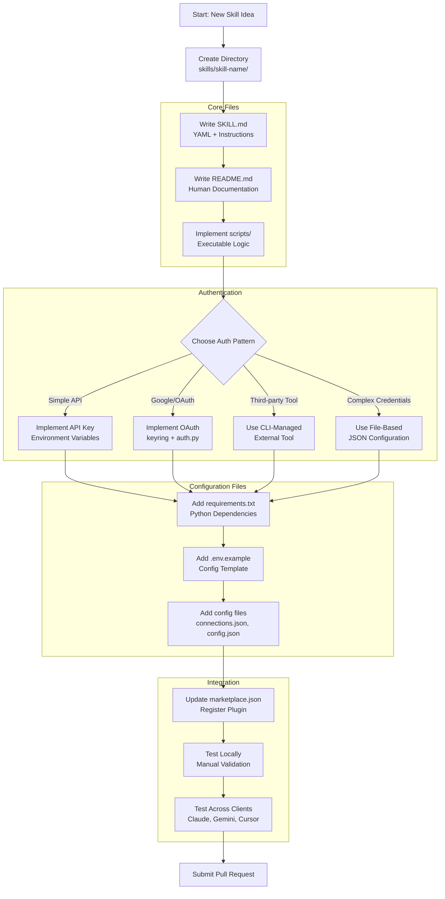

<!-- source: DeepWiki mcp.deepwiki.com · repo sanjay3290/ai-skills · page 7.1 Creating a New Skill · fetched 2026-10-26 -->

# Creating a New Skill

<details>
<summary>Relevant source files</summary>

The following files were used as context for generating this wiki page:

- [README.md](README.md)
- [skills/jules/SKILL.md](skills/jules/SKILL.md)
- [skills/manus/SKILL.md](skills/manus/SKILL.md)

</details>


This document provides a step-by-step guide for developers to create new skills that conform to the Agent Skills Standard and work across all supported AI clients. It covers directory structure, SKILL.md format, script implementation patterns, authentication approaches, and marketplace registration.

For information about configuring existing skills, see [Configuration Guide](#6). For testing infrastructure details, see [Testing & CI](#7.2).

---

## Skill Development Workflow

The following diagram illustrates the complete workflow for creating and deploying a new skill:

**Skill Creation and Deployment Process**



Sources: [README.md:292-316](), [.claude-plugin/marketplace.json]()

---

## Directory Structure Requirements

Every skill must follow the standard directory structure defined by the Agent Skills Standard:

| File | Required | Purpose |
|------|----------|---------|
| `SKILL.md` | ✅ Yes | AI-facing instructions with YAML frontmatter. Parsed by AI clients to understand when and how to use the skill. |
| `README.md` | ✅ Yes | Human-readable documentation. Explains setup, usage examples, and requirements for developers. |
| `scripts/` | ✅ Yes | Directory containing executable scripts. Entry point must be executable and handle command-line arguments. |
| `requirements.txt` | ⚠️ Conditional | Python dependencies. Required if skill uses Python libraries beyond standard library. |
| `.env.example` | ⚠️ Conditional | Environment variable template. Required if skill needs API keys or environment configuration. |
| `connections.json` | ❌ Optional | Structured configuration for complex credentials (e.g., database connection strings). |
| `config.json` | ❌ Optional | Runtime configuration options (e.g., default model parameters, API endpoints). |
| `auth.py` | ❌ Optional | Standalone authentication script for OAuth flows (Google Workspace pattern). |

**Standard Skill Directory Structure**

```
skills/skill-name/
├── SKILL.md              # AI agent instructions (required)
├── README.md             # Human documentation (required)
├── requirements.txt      # Python dependencies (if needed)
├── .env.example          # Config template (if needed)
├── connections.json      # Structured credentials (optional)
├── config.json           # Runtime config (optional)
└── scripts/              # Executable scripts (required)
    ├── main.py           # Primary entry point
    ├── auth.py           # Authentication logic (if OAuth)
    └── utils.py          # Helper functions (if needed)
```

Sources: [README.md:292-304]()

---

## SKILL.md Format

The `SKILL.md` file is the interface between the AI client and your skill. It uses YAML frontmatter for metadata and natural language for instructions.

### YAML Frontmatter Structure

The frontmatter fields used across the repository:

```yaml
---
name: skill-name
description: "When to use this skill — trigger phrases and use case summary"
license: Apache-2.0
metadata:
  author: your-github-username
  version: "1.0"
---
```

**YAML Frontmatter Field Requirements**

| Field | Required | Format | Purpose | Example |
|-------|----------|--------|---------|---------|
| `name` | ✅ Yes | Kebab-case string | Unique skill identifier matching directory name | `postgres`, `imagen`, `deep-research` |
| `description` | ✅ Yes | Single string | AI uses this to decide when to activate skill; include trigger phrases | `"Use when user says 'use manus', or when tasks require deep web research"` |
| `license` | ⚠️ Recommended | SPDX identifier | License declaration | `Apache-2.0` |
| `metadata.author` | ⚠️ Recommended | GitHub username | Skill author | `sanjay3290` |
| `metadata.version` | ⚠️ Recommended | Quoted string | Skill version | `"1.0"` |

Sources: [skills/manus/SKILL.md:1-8](), [skills/jules/SKILL.md:1-8]()
</thinking>

Sources: [skills/manus/SKILL.md:1-8](), [skills/jules/SKILL.md:1-8]()

### Natural Language Instructions

After the frontmatter, provide natural language instructions that guide the AI on:

1. **Setup steps** - How to authenticate, configure, install dependencies
2. **Usage patterns** - Common commands, parameter formats, expected workflows
3. **Output handling** - What the script returns, how to interpret results
4. **Error scenarios** - Common failures and how to resolve them
5. **Limitations** - What the skill cannot do, safety constraints

**SKILL.md Parsing and Activation Flow**

```mermaid
graph LR
    subgraph "AI Client Initialization"
        ClientStart["AI Client Starts"]
        ScanDir["Scan Skills Directory<br/>~/.claude/skills/"]
        FindSkills["Discover skill-name/<br/>Directories"]
    end
    
    subgraph "SKILL.md Processing"
        LoadFile["Load SKILL.md"]
        ParseYAML["Parse YAML Frontmatter<br/>Extract name, description, license, metadata"]
        ParseInstructions["Parse Natural Language<br/>Instructions Section"]
        IndexSkill["Index Skill<br/>description → skill mapping"]
    end
</thinking>

Sources: [skills/manus/SKILL.md:1-8](), [skills/jules/SKILL.md:1-8]()
    
    subgraph "Runtime Activation"
        UserPrompt["User Issues Prompt<br/>'Generate an image of sunset'"]
        MatchDesc["Match Prompt Against<br/>Skill Descriptions"]
        SelectSkill["Select Best Match<br/>imagen skill"]
        ReadInstructions["Load Full Instructions<br/>From SKILL.md"]
        ExecuteScript["Execute scripts/main.py<br/>Following Instructions"]
    end
    
    ClientStart --> ScanDir
    ScanDir --> FindSkills
    FindSkills --> LoadFile
    LoadFile --> ParseYAML
    ParseYAML --> ParseInstructions
    ParseInstructions --> IndexSkill
    
    IndexSkill -.->|"Runtime"| UserPrompt
    UserPrompt --> MatchDesc
    MatchDesc --> SelectSkill
    SelectSkill --> ReadInstructions
    ReadInstructions --> ExecuteScript
```

Sources: [README.md:306-315]()

---

## Scripts Implementation Patterns

Skills use three primary execution patterns. Choose based on your operation's latency and complexity requirements.

### Execution Pattern Selection

| Pattern | Use Case | Execution Time | Return Behavior | Examples |
|---------|----------|----------------|-----------------|----------|
| **Synchronous** | Quick API calls, database queries, file operations | < 30 seconds | Direct results | `postgres`, `imagen`, `outline`, `elevenlabs`, Google Workspace skills |
| **Asynchronous Delegation** | Long-running AI tasks, complex research, multi-step workflows | 2-10 minutes | Task ID + polling endpoint | `jules`, `manus`, `deep-research` |
| **Browser Automation** | Web interfaces without APIs, interactive authentication | 30-90 seconds | Extracted data from DOM | `notebooklm` |

### Synchronous Pattern

Entry point script executes operation and returns results immediately:

```python
# scripts/main.py
import sys
import json

def execute_operation(args):
    """Execute synchronous operation"""
    # Parse arguments
    # Make API call / query database
    # Return formatted results
    return {"status": "success", "data": results}

if __name__ == "__main__":
    args = sys.argv[1:]
    result = execute_operation(args)
    print(json.dumps(result))
```

**Key characteristics:**
- Single script execution completes operation
- Results printed to stdout as JSON
- Errors handled with appropriate exit codes
- AI client waits for completion

Sources: Referenced pattern from skills like `imagen`, `postgres`, `outline`

### Asynchronous Delegation Pattern

Entry point creates task and returns immediately, separate script polls for results:

```python
# scripts/create_task.py
def create_task(description):
    """Create long-running task and return task ID"""
    response = api.create_task(description=description)
    return {"task_id": response.id, "status": "pending"}

# scripts/check_status.py
def check_status(task_id):
    """Poll for task completion"""
    response = api.get_task(task_id)
    if response.status == "complete":
        return {"status": "complete", "results": response.output}
    return {"status": "pending", "progress": response.progress}
```

**Key characteristics:**
- Two-phase operation: create + poll
- Task ID returned immediately
- Background processing by external service
- Explicit status checking required

Sources: Referenced pattern from `jules`, `manus`, `deep-research` skills

### Browser Automation Pattern

Uses Playwright to interact with web interfaces:

```python
# scripts/main.py
from playwright.sync_api import sync_playwright

def browser_operation(url, query):
    """Execute operation via browser automation"""
    with sync_playwright() as p:
        browser = p.chromium.launch(headless=True)
        page = browser.new_page()
        page.goto(url)
        # Navigate, click, extract data
        result = page.locator(".result").inner_text()
        browser.close()
        return {"data": result}
```

**Key characteristics:**
- Requires `playwright` and browser installation
- Simulates user interactions
- Extracts data from DOM elements
- Higher latency than API calls

Sources: Referenced pattern from `notebooklm` skill

---

## Authentication Implementation

Choose an authentication pattern based on your integration requirements:

**Authentication Pattern Decision Matrix**

| Pattern | Use When | Security Level | Complexity | Skill Examples |
|---------|----------|----------------|------------|----------------|
| **API Key (Environment Variable)** | Service provides API tokens | Medium | Low | `imagen`, `outline`, `manus`, `elevenlabs` |
| **OAuth + Keyring** | OAuth 2.0 required, need persistent tokens | High | High | All Google Workspace skills |
| **CLI-Managed** | External tool handles authentication | High | Low (for skill) | `jules` |
| **File-Based Config** | Complex credentials or multiple connection strings | Medium | Medium | `postgres`, `elevenlabs` (optional) |

### API Key Pattern

Store API key in environment variable, read at runtime:

**.env.example Template**
```bash
# API Key for [Service Name]
# Get your key at: https://service.example.com/settings
SKILL_NAME_API_KEY=your-api-key-here

# Optional configuration
SKILL_NAME_ENDPOINT=https://api.service.com
```

**scripts/main.py Implementation**
```python
import os
import sys

def get_api_key():
    """Retrieve API key from environment"""
    api_key = os.getenv('SKILL_NAME_API_KEY')
    if not api_key:
        print(json.dumps({
            "error": "SKILL_NAME_API_KEY not set",
            "setup": "export SKILL_NAME_API_KEY=your-key"
        }))
        sys.exit(1)
    return api_key

def main():
    api_key = get_api_key()
    # Use api_key for API calls
```

Sources: Pattern from `imagen`, `outline`, `manus`, `elevenlabs` skills

### OAuth + Keyring Pattern

Use `keyring` library for secure cross-platform token storage. Requires separate `auth.py` script:

**scripts/auth.py Structure**
```python
import keyring
import webbrowser
from google.oauth2.credentials import Credentials
from google_auth_oauthlib.flow import Flow

SERVICE_NAME = "skill-name-oauth"  # Unique per skill
SCOPES = ['https://www.googleapis.com/auth/service.readonly']

def login():
    """Open browser for OAuth flow, store tokens in keyring"""
    flow = Flow.from_client_config(client_config, SCOPES)
    flow.redirect_uri = 'https://oauth-endpoint.example.com/callback'
    
    auth_url, _ = flow.authorization_url(prompt='consent')
    webbrowser.open(auth_url)
    
    # After callback, exchange code for tokens
    tokens = flow.fetch_token(code=auth_code)
    keyring.set_password(SERVICE_NAME, "access_token", tokens['access_token'])
    keyring.set_password(SERVICE_NAME, "refresh_token", tokens['refresh_token'])

def logout():
    """Remove tokens from keyring"""
    keyring.delete_password(SERVICE_NAME, "access_token")
    keyring.delete_password(SERVICE_NAME, "refresh_token")

def get_credentials():
    """Retrieve stored credentials"""
    access_token = keyring.get_password(SERVICE_NAME, "access_token")
    refresh_token = keyring.get_password(SERVICE_NAME, "refresh_token")
    
    if not access_token:
        raise Exception("Not authenticated. Run: python scripts/auth.py login")
    
    return Credentials(token=access_token, refresh_token=refresh_token)
```

**Service Name Uniqueness**: Each skill must use a unique `SERVICE_NAME` constant to prevent keyring collisions:
- `gmail`: `"gmail-skill-oauth"`
- `google-chat`: `"chat-skill-oauth"`
- `google-docs`: `"docs-skill-oauth"`
- `google-sheets`: `"sheets-skill-oauth"`
- `google-slides`: `"slides-skill-oauth"`
- `google-drive`: `"drive-skill-oauth"`
- `google-calendar`: `"cal-skill-oauth"`

Sources: Pattern from Google Workspace skills (`gmail`, `google-chat`, `google-docs`, `google-sheets`, `google-slides`, `google-drive`, `google-calendar`)

### CLI-Managed Pattern

Delegate authentication to external CLI tool:

**SKILL.md Authentication Instructions**
```markdown
## Setup

1. Install the CLI tool:
   ```bash
   npm install -g @service/cli
   ```

2. Authenticate (opens browser):
   ```bash
   service-cli login
   ```

3. Verify authentication:
   ```bash
   service-cli status
   ```

The CLI manages tokens automatically. This skill invokes CLI commands.
```

**scripts/main.py - CLI Invocation**
```python
import subprocess
import json

def execute_via_cli(command, args):
    """Execute operation through CLI tool"""
    cmd = ['service-cli', command] + args
    result = subprocess.run(cmd, capture_output=True, text=True)
    
    if result.returncode != 0:
        return {"error": result.stderr}
    
    return json.loads(result.stdout)
```

Sources: Pattern from `jules` skill (uses `@google/jules` CLI)

### File-Based Config Pattern

Store structured credentials in JSON file:

**connections.json Structure**
```json
{
  "databases": [
    {
      "name": "production",
      "description": "Production database",
      "host": "db.example.com",
      "port": 5432,
      "database": "app_prod",
      "user": "readonly_user",
      "password": "secret",
      "read_only": true
    }
  ]
}
```

**scripts/main.py - Config Loading**
```python
import json
import os

def load_config():
    """Load configuration from JSON file"""
    config_path = os.path.join(
        os.path.dirname(__file__), 
        '..', 
        'connections.json'
    )
    
    if not os.path.exists(config_path):
        raise FileNotFoundError(
            f"Config not found: {config_path}\n"
            f"Copy connections.example.json and fill in credentials"
        )
    
    with open(config_path) as f:
        return json.load(f)
```

Sources: Pattern from `postgres` skill ([skills/postgres/connections.json]()), `elevenlabs` skill ([skills/elevenlabs/config.json]())

---

## Marketplace Registration

After creating your skill, register it in the marketplace to make it discoverable by the Skills CLI.

### marketplace.json Entry Format

Add an entry to [.claude-plugin/marketplace.json:10-131]():

```json
{
  "name": "skill-name",
  "description": "Brief description of what the skill does. Mention key capabilities and use cases.",
  "source": "./",
  "skills": [
    "./skills/skill-name"
  ]
}
```

**Field Requirements**

| Field | Type | Required | Description | Example |
|-------|------|----------|-------------|---------|
| `name` | string | ✅ Yes | Skill identifier, must match directory name | `"postgres"`, `"imagen"` |
| `description` | string | ✅ Yes | User-facing description for `npx skills add --list` | `"Execute read-only SQL queries against PostgreSQL databases"` |
| `source` | string | ✅ Yes | Source path, always `"./"` for this repo | `"./"` |
| `skills` | array | ✅ Yes | Array with single path to skill directory | `["./skills/postgres"]` |

**Example Entry from Existing Skills**

```json
{
  "name": "imagen",
  "description": "Generate images using Google Gemini's AI image generation model. Cross-platform support for Windows, macOS, and Linux. Create UI mockups, icons, illustrations, diagrams, and more.",
  "source": "./",
  "skills": [
    "./skills/imagen"
  ]
}
```

Sources: [.claude-plugin/marketplace.json:20-26]()

---

## Testing Your Skill

### Manual Testing Workflow

1. **Install skill locally** using one of the installation methods:
   ```bash
   # Symlink for development
   ln -s /path/to/ai-skills/skills/your-skill ~/.claude/skills/your-skill
   ```

2. **Verify file structure**:
   ```bash
   ls -la ~/.claude/skills/your-skill
   # Should show: SKILL.md, README.md, scripts/
   ```

3. **Test SKILL.md parsing**:
   - Open AI client (Claude Code, Gemini CLI, etc.)
   - Issue prompt that should activate your skill
   - Verify skill is discovered and activated

4. **Test script execution**:
   ```bash
   # Direct script invocation
   cd ~/.claude/skills/your-skill
   python scripts/main.py arg1 arg2
   ```

5. **Test authentication**:
   ```bash
   # For OAuth skills
   python scripts/auth.py login
   python scripts/auth.py status
   
   # For API key skills
   export SKILL_NAME_API_KEY=test-key
   python scripts/main.py
   ```

6. **Test across multiple clients**:
   - Install in Gemini CLI: `~/.gemini/skills/your-skill`
   - Install in Cursor: `~/.cursor/skills/your-skill`
   - Verify consistent behavior

### Smoke Testing

Basic validation checks before submitting:

| Check | Command | Expected Result |
|-------|---------|-----------------|
| **YAML Validity** | `python -c "import yaml; yaml.safe_load(open('SKILL.md').read().split('---')[1])"` | No syntax errors |
| **Script Executable** | `python scripts/main.py --help` | Help message or usage info |
| **Dependencies** | `pip install -r requirements.txt` | All packages install successfully |
| **Auth Flow** | `python scripts/auth.py login` (if OAuth) | Browser opens, tokens stored |
| **Error Handling** | Run with invalid inputs | Graceful error messages |

Sources: Testing approach referenced from skills like `notebooklm` (which has CI workflows)

---

## Skill Development Checklist

Before submitting your new skill:

- [ ] Created `skills/skill-name/` directory
- [ ] Written `SKILL.md` with valid YAML frontmatter
- [ ] Written comprehensive `README.md` with setup instructions
- [ ] Implemented `scripts/` with entry point
- [ ] Added `requirements.txt` if using Python dependencies
- [ ] Added `.env.example` if using environment variables
- [ ] Implemented appropriate authentication pattern
- [ ] Added entry to `.claude-plugin/marketplace.json`
- [ ] Tested skill locally in at least one AI client
- [ ] Verified skill works across multiple clients
- [ ] Documented all configuration requirements
- [ ] Included error handling for common failure modes
- [ ] Added usage examples to SKILL.md instructions

Sources: Synthesized from [README.md:317-323]() contributing guidelines

---

## File Path Reference

Key files to examine when creating a new skill:

| File Path | Purpose |
|-----------|---------|
| [skills/postgres/SKILL.md]() | Example of file-based config authentication |
| [skills/imagen/SKILL.md]() | Example of API key authentication |
| [skills/gmail/scripts/auth.py]() | Example of OAuth + keyring implementation |
| [skills/notebooklm/scripts/main.py]() | Example of browser automation pattern |
| [skills/jules/SKILL.md]() | Example of CLI-managed authentication |
| [skills/manus/scripts/main.py]() | Example of asynchronous delegation pattern |
| [.claude-plugin/marketplace.json]() | Marketplace registration format |
| [README.md:292-304]() | Standard skill structure definition |

---

