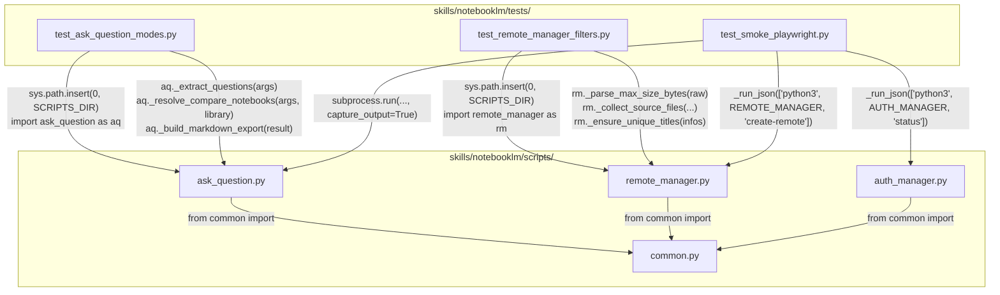
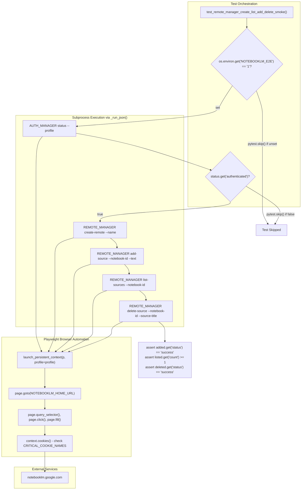
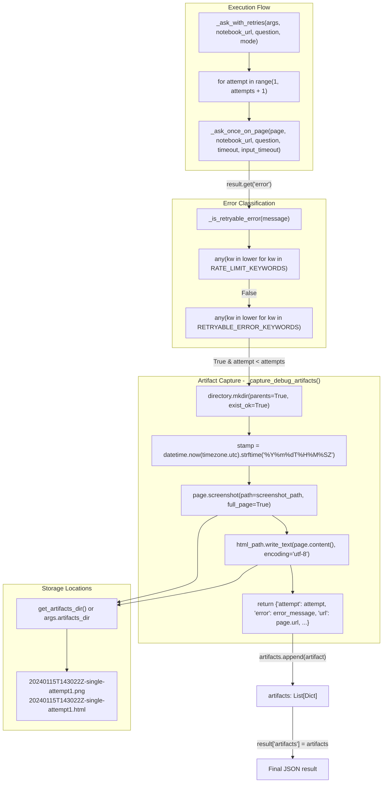

<!-- source: DeepWiki mcp.deepwiki.com · repo sanjay3290/ai-skills · page 7.2 Testing & CI · fetched 2026-10-26 -->

# Testing & CI

<details>
<summary>Relevant source files</summary>

The following files were used as context for generating this wiki page:

- [skills/notebooklm/scripts/ask_question.py](skills/notebooklm/scripts/ask_question.py)
- [skills/notebooklm/scripts/auth_manager.py](skills/notebooklm/scripts/auth_manager.py)
- [skills/notebooklm/tests/test_ask_question_modes.py](skills/notebooklm/tests/test_ask_question_modes.py)
- [skills/notebooklm/tests/test_remote_manager_filters.py](skills/notebooklm/tests/test_remote_manager_filters.py)
- [skills/notebooklm/tests/test_smoke_playwright.py](skills/notebooklm/tests/test_smoke_playwright.py)

</details>


This document describes the testing infrastructure and continuous integration practices for the AI Agent Skills repository. It covers the test organization, execution patterns, debugging facilities, and CI workflows, with the NotebookLM skill serving as the primary reference implementation for comprehensive testing practices.

For information about creating new skills with proper testing, see [Creating a New Skill](#7.1). For troubleshooting test failures, see [Troubleshooting](#8).

---

## Testing Strategy Overview

The repository implements a multi-layered testing approach focused on ensuring skill reliability across different execution environments and authentication states:

**Testing Layers:**

| Layer | Purpose | Gating | Example Skills |
|-------|---------|--------|----------------|
| **Unit Tests** | Validate isolated functions and logic | None (always run) | notebooklm |
| **Smoke Tests** | End-to-end validation with real services | Environment variables | notebooklm |
| **Integration Tests** | Verify cross-skill interactions | Manual/scheduled | (future) |

**Test Distribution:**
- **NotebookLM**: Comprehensive test suite with 3 test files (unit + smoke)
- **Other Skills**: Minimal or no automated tests (manual verification)
- **Common Infrastructure**: Shared utilities tested through skill-level tests

The testing philosophy prioritizes:
1. **Browser Automation Reliability** - Extensive retry logic and artifact capture for Playwright-based skills
2. **Authentication State Management** - Profile-based isolation to prevent test interference
3. **Selective E2E Testing** - Smoke tests gated to avoid rate limits and authentication requirements

Sources: [skills/notebooklm/tests/test_ask_question_modes.py:1-67](), [skills/notebooklm/tests/test_remote_manager_filters.py:1-92](), [skills/notebooklm/tests/test_smoke_playwright.py:1-112]()

---

## Unit Testing Infrastructure

### Test File Organization



**Test Module Import Pattern:**

The test files use a consistent pattern to import scripts as modules for white-box testing:

```python
# Pattern from test_ask_question_modes.py:4-10
SCRIPTS_DIR = Path(__file__).resolve().parents[1] / "scripts"
sys.path.insert(0, str(SCRIPTS_DIR))
import ask_question as aq
```

This `sys.path` manipulation allows tests to:
1. Import script files as Python modules (e.g., `ask_question.py` becomes `aq` module)
2. Access internal functions prefixed with `_` (e.g., `aq._extract_questions()`)
3. Test logic units without invoking the full CLI parser or subprocess overhead

The pattern is used in both [skills/notebooklm/tests/test_ask_question_modes.py:4-10]() and [skills/notebooklm/tests/test_remote_manager_filters.py:7-13]().

Sources: [skills/notebooklm/tests/test_ask_question_modes.py:4-10](), [skills/notebooklm/tests/test_remote_manager_filters.py:7-13]()

---

### Unit Test Coverage by Module

#### test_ask_question_modes.py

Tests the question extraction and result formatting logic from `ask_question.py`:

| Test Function | Target Function | Validates |
|---------------|----------------|-----------|
| `test_extract_questions_single` | `_extract_questions` | Single `--question` argument parsing |
| `test_extract_questions_mixed` | `_extract_questions` | Combined sources: `--question`, `--questions` with `\|\|` separator, `--questions-file` |
| `test_resolve_compare_notebooks_from_library` | `_resolve_compare_notebooks` | Multi-notebook comparison mode with ID and URL resolution |
| `test_build_markdown_export_single` | `_build_markdown_export` | Markdown export formatting with citations |

**Key Test Pattern - Synthetic Arguments:**

```python
# From test_ask_question_modes.py:14-17
args = SimpleNamespace(question="What is this?", questions=None, questions_file=None)
questions, error = aq._extract_questions(args)
assert error is None
assert questions == ["What is this?"]
```

Tests use `SimpleNamespace` to create mock `argparse` argument objects, avoiding the need to invoke the full CLI parser.

Sources: [skills/notebooklm/tests/test_ask_question_modes.py:13-67]()

#### test_remote_manager_filters.py

Tests file filtering and validation logic from `remote_manager.py`:

| Test Function | Target Function | Validates |
|---------------|----------------|-----------|
| `test_parse_max_size_bytes` | `_parse_max_size_bytes` | Human-readable size parsing (KB/MB/GB) |
| `test_parse_max_size_bytes_invalid` | `_parse_max_size_bytes` | Invalid format rejection |
| `test_parse_modified_since_epoch_relative` | `_parse_modified_since_epoch` | Relative time parsing (1d, 2w) |
| `test_collect_source_files_filters` | `_collect_source_files` | Multi-criteria filtering (extension, size, patterns) |
| `test_ensure_unique_titles_detects_duplicates` | `_ensure_unique_titles` | Duplicate source title detection |

**Test Pattern - Filesystem Fixtures:**

Tests use pytest's `tmp_path` fixture to create temporary filesystem hierarchies for realistic file filtering scenarios:

```python
# Pattern from test_remote_manager_filters.py:35-57
def test_collect_source_files_filters(tmp_path: Path) -> None:
    keep = tmp_path / "keep.md"
    skip_ext = tmp_path / "skip.txt"
    skip_size = tmp_path / "big.md"
    
    keep.write_text("hello", encoding="utf-8")
    skip_ext.write_text("skip", encoding="utf-8")
    skip_size.write_text("x" * 4096, encoding="utf-8")
    
    files, filtered = rm._collect_source_files(...)
```

Sources: [skills/notebooklm/tests/test_remote_manager_filters.py:16-92]()

---

## Smoke Testing & E2E Tests

### Smoke Test Architecture



**Execution Gating Logic:**

The `test_remote_manager_create_list_add_delete_smoke()` function implements two-stage gating:

```python
# Stage 1: E2E flag gate (test_smoke_playwright.py:35-36)
if os.environ.get("NOTEBOOKLM_E2E") != "1":
    pytest.skip("Set NOTEBOOKLM_E2E=1 to run live smoke tests")

# Stage 2: Authentication gate (test_smoke_playwright.py:38-48)
profile = os.environ.get("NOTEBOOKLM_SMOKE_PROFILE", "default")
status = _run_json([
    "python3",
    str(AUTH_MANAGER),
    "status",
    "--profile",
    profile,
])
if not status.get("authenticated"):
    pytest.skip(f"NotebookLM profile '{profile}' is not authenticated")
```

**Gating Stages:**

| Stage | Check | Purpose |
|-------|-------|---------|
| 1. Environment Variable | `os.environ.get("NOTEBOOKLM_E2E") != "1"` | Explicit opt-in to prevent accidental runs |
| 2. Authentication State | `status.get("authenticated")` from `auth_manager.py status` | Verify profile has valid cookies |

Both gates use `pytest.skip()` rather than `pytest.fail()`, treating missing setup as expected states rather than test failures. This ensures smoke tests don't fail CI pipelines where authentication isn't configured.

Sources: [skills/notebooklm/tests/test_smoke_playwright.py:35-48]()

---

### Smoke Test Subprocess Pattern

The smoke test uses the `_run_json()` helper to execute CLI commands as black-box subprocess invocations:

```python
# Helper from test_smoke_playwright.py:17-30
def _run_json(command: list[str]) -> dict:
    proc = subprocess.run(
        command,
        cwd=str(SKILL_DIR),        # Execute from skill directory
        check=False,               # Don't raise on non-zero exit
        text=True,                 # Decode stdout/stderr as text
        capture_output=True,       # Capture both streams
    )
    if proc.returncode != 0:
        raise AssertionError(f"Command failed ({proc.returncode}): ...")
    try:
        return json.loads(proc.stdout)  # Parse JSON response
    except json.JSONDecodeError as exc:
        raise AssertionError(f"Invalid JSON output...") from exc
```

**Key Design Choices:**

- `cwd=str(SKILL_DIR)`: Ensures scripts can find relative imports (e.g., `from common import`)
- `check=False`: Manual exit code handling for better error messages
- `capture_output=True`: Captures stdout/stderr for JSON parsing and error diagnostics
- `text=True`: Automatic UTF-8 decoding (vs. bytes in Python 3)

This pattern validates the complete CLI interface including:
1. Argument parsing via `argparse`
2. JSON serialization of results
3. Exit code conventions (0=success, 1=error)
4. Error message formatting

**Full E2E Flow:**

```python
# Simplified from test_smoke_playwright.py:51-111
notebook_name = f"Codex Smoke {int(time.time())}"
created = _run_json([
    "python3", str(REMOTE_MANAGER), "create-remote",
    "--name", notebook_name,
    "--profile", profile,
])
notebook_id = created["library_notebook"]["id"]

added = _run_json([
    "python3", str(REMOTE_MANAGER), "add-source",
    "--notebook-id", notebook_id,
    "--text", f"smoke source {int(time.time())}",
    "--profile", profile,
])

listed = _run_json([
    "python3", str(REMOTE_MANAGER), "list-sources",
    "--notebook-id", notebook_id,
    "--profile", profile,
])

deleted = _run_json([
    "python3", str(REMOTE_MANAGER), "delete-source",
    "--notebook-id", notebook_id,
    "--source-title", listed["sources"][0]["title"],
    "--all-matches",
    "--profile", profile,
])
```

This approach validates the complete skill workflow including CLI parsing, authentication, browser automation, and API interaction.

Sources: [skills/notebooklm/tests/test_smoke_playwright.py:17-112]()

---

## Debug Artifact System

The NotebookLM skill implements a comprehensive debug artifact capture system for troubleshooting browser automation failures.

### Artifact Capture Architecture



**Artifact Capture Implementation:**

```python
# From ask_question.py:97-118
def _capture_debug_artifacts(page: Page, args, mode: str, attempt: int, error_message: str) -> Optional[Dict]:
    try:
        directory = _artifact_dir(args)
        directory.mkdir(parents=True, exist_ok=True)
        stamp = datetime.now(timezone.utc).strftime("%Y%m%dT%H%M%SZ")
        prefix = f"{stamp}-{_safe_name(mode)}-attempt{attempt}"
        
        screenshot_path = directory / f"{prefix}.png"
        html_path = directory / f"{prefix}.html"
        
        page.screenshot(path=str(screenshot_path), full_page=True)
        html_path.write_text(page.content(), encoding="utf-8")
        
        return {
            "attempt": attempt,
            "error": error_message,
            "url": page.url,
            "screenshot": str(screenshot_path),
            "html": str(html_path),
        }
    except Exception:
        return None
```

**Error Classification Constants and Logic:**

```python
# Non-retryable errors (ask_question.py:47-53)
RATE_LIMIT_KEYWORDS = [
    "rate limit",
    "limit exceeded",
    "quota exhausted",
    "daily limit",
    "too many requests",
]

# Retryable transient errors (ask_question.py:73-83)
RETRYABLE_ERROR_KEYWORDS = [
    "timeout",
    "timed out",
    "connection",
    "target closed",
    "context closed",
    "execution context was destroyed",
    "protocol error",
    "page crashed",
    "browser has been closed",
]

# Classification function (ask_question.py:121-126)
def _is_retryable_error(message: str) -> bool:
    lower = message.lower().strip()
    if any(keyword in lower for keyword in RATE_LIMIT_KEYWORDS):
        return False  # Rate limits should fail immediately
    return any(keyword in lower for keyword in RETRYABLE_ERROR_KEYWORDS)
```

**Classification Decision Tree:**

| Error Type | Contains Keyword | Retryable? | Rationale |
|------------|------------------|------------|-----------|
| Rate limit | `RATE_LIMIT_KEYWORDS` | No | Retrying worsens quota violations |
| Network timeout | `RETRYABLE_ERROR_KEYWORDS` | Yes | Transient network issues |
| Browser crash | `RETRYABLE_ERROR_KEYWORDS` | Yes | Playwright process issues |
| Invalid credentials | (none) | No | Requires user intervention |

The explicit rate limit check prevents retry storms that could exhaust API quotas or trigger longer cooldown periods.

Sources: [skills/notebooklm/scripts/ask_question.py:47-53](), [skills/notebooklm/scripts/ask_question.py:73-83](), [skills/notebooklm/scripts/ask_question.py:121-126]()

---

### Retry Logic with Artifact Accumulation

The retry mechanism captures artifacts on each failed attempt and accumulates them in the final result:

```python
# Simplified from ask_question.py:425-498
def _ask_with_retries(args, notebook_url: str, question: str, mode: str) -> Dict:
    attempts = max(1, int(args.retries or 1))
    errors: List[str] = []
    artifacts: List[Dict] = []
    
    for attempt in range(1, attempts + 1):
        with sync_playwright() as p:
            context = launch_persistent_context(...)
            page = context.new_page()
            try:
                result = _ask_once_on_page(...)
                
                if result.get("error"):
                    error_message = str(result["error"])
                    if attempt < attempts and _is_retryable_error(error_message):
                        errors.append(error_message)
                        artifact = _capture_debug_artifacts(page, args, mode, attempt, error_message)
                        if artifact:
                            artifacts.append(artifact)
                        time.sleep(min(attempt * 1.5, 5.0))
                        continue
                    
                    # Final attempt or non-retryable: attach metadata
                    if errors:
                        result.setdefault("previous_errors", errors)
                    if artifacts:
                        result.setdefault("artifacts", artifacts)
                    return result
```

**Artifact Output Example:**

When errors occur, the JSON result includes an `artifacts` array with paths to debug files:

```json
{
  "error": "Timed out waiting for answer after 120s",
  "attempts": 2,
  "previous_errors": [
    "timeout waiting for selector",
    "Timed out waiting for answer after 120s"
  ],
  "artifacts": [
    {
      "attempt": 1,
      "error": "timeout waiting for selector",
      "url": "https://notebooklm.google.com/notebook/...",
      "screenshot": "/home/user/.local/share/notebooklm/artifacts/20240115T143022Z-single-attempt1.png",
      "html": "/home/user/.local/share/notebooklm/artifacts/20240115T143022Z-single-attempt1.html"
    }
  ]
}
```

Sources: [skills/notebooklm/scripts/ask_question.py:425-498]()

---

## Test Execution

### Running Tests Locally

**Unit Tests (Always Safe):**

```bash
# Run all unit tests
cd skills/notebooklm
pytest tests/test_ask_question_modes.py tests/test_remote_manager_filters.py

# Run specific test
pytest tests/test_ask_question_modes.py::test_extract_questions_mixed -v
```

**Smoke Tests (Requires Setup):**

```bash
# 1. Authenticate profile
cd skills/notebooklm
python scripts/auth_manager.py setup --profile smoke-test

# 2. Enable E2E tests and run
export NOTEBOOKLM_E2E=1
export NOTEBOOKLM_SMOKE_PROFILE=smoke-test
pytest tests/test_smoke_playwright.py -v -s
```

**Custom Artifact Directory:**

```bash
# Override default artifact location for debugging
cd skills/notebooklm
python scripts/ask_question.py \
  --question "Test query" \
  --notebook-url "https://notebooklm.google.com/notebook/..." \
  --artifacts-dir ./debug-artifacts \
  --retries 3
```

Sources: [skills/notebooklm/tests/test_smoke_playwright.py:33-112](), [skills/notebooklm/scripts/ask_question.py:836-840]()

---

### CI/CD Integration

**Current State:**

The repository does not include GitHub Actions workflow files (`.github/workflows/`) in the provided codebase. The test infrastructure is designed to support CI integration, but implementation is left to repository maintainers.

**Recommended CI Configuration:**

Based on the test gating mechanisms, a recommended workflow structure would separate unit and smoke tests:

```yaml
# .github/workflows/test.yml (hypothetical - not present in repo)
name: Test Skills

on: [push, pull_request]

jobs:
  unit-tests:
    runs-on: ubuntu-latest
    steps:
      - uses: actions/checkout@v3
      - uses: actions/setup-python@v4
        with:
          python-version: '3.11'
      - name: Install dependencies
        run: |
          cd skills/notebooklm
          pip install -r requirements.txt
          playwright install chromium
      - name: Run unit tests
        run: |
          cd skills/notebooklm
          pytest tests/test_ask_question_modes.py tests/test_remote_manager_filters.py -v
  
  smoke-tests:
    runs-on: ubuntu-latest
    # Conditional: only on schedule or manual trigger
    if: github.event_name == 'schedule' || github.event_name == 'workflow_dispatch'
    steps:
      - name: Setup Playwright profile
        run: |
          # Would require storing Google credentials in GitHub Secrets
          # and custom auth setup via auth_manager.py
      - name: Run smoke tests
        env:
          NOTEBOOKLM_E2E: "1"
          NOTEBOOKLM_SMOKE_PROFILE: "ci-profile"
        run: |
          cd skills/notebooklm
          pytest tests/test_smoke_playwright.py -v --tb=short
      - name: Upload artifacts on failure
        if: failure()
        uses: actions/upload-artifact@v3
        with:
          name: smoke-test-artifacts
          path: ~/.local/share/notebooklm/artifacts/
```

**Integration Considerations:**

| Component | Requirement | Notes |
|-----------|-------------|-------|
| **Unit Tests** | `pytest`, `playwright` package | Run on every commit; no authentication needed |
| **Smoke Tests** | `NOTEBOOKLM_E2E=1`, authenticated profile | Run on schedule; requires Google account secrets |
| **Browser Binaries** | `playwright install chromium` | ~100MB download; should be cached between runs |
| **Artifact Upload** | `actions/upload-artifact` on failure | Preserves debug screenshots/HTML for investigation |
| **Profile Management** | Custom `auth_manager.py setup` automation | Non-interactive authentication would require headless OAuth flow |

The two-tier gating (`NOTEBOOKLM_E2E` + profile authentication) allows unit tests to run freely while restricting smoke tests to controlled environments where rate limits and authentication can be managed.

---

## Testing Best Practices

### For Skill Developers

When creating tests for new skills (see [Creating a New Skill](#7.1)):

**1. Separate Unit and E2E Tests:**

```python
# Unit tests - test_skill_logic.py
def test_parse_config():
    """Test configuration parsing without external calls"""
    config = parse_config({"key": "value"})
    assert config.key == "value"

# E2E tests - test_skill_smoke.py
@pytest.mark.smoke
def test_full_workflow():
    """Test complete skill execution"""
    if not os.environ.get("SKILL_E2E"):
        pytest.skip("Set SKILL_E2E=1 for live tests")
```

**2. Use pytest Fixtures for Shared Setup:**

```python
# conftest.py
import pytest

@pytest.fixture
def temp_skill_dir(tmp_path):
    """Create temporary skill directory structure"""
    (tmp_path / "scripts").mkdir()
    (tmp_path / "artifacts").mkdir()
    return tmp_path
```

**3. Mock External Services in Unit Tests:**

```python
from unittest.mock import Mock, patch

def test_api_call_error_handling():
    """Test error handling without calling real API"""
    with patch('skill.api_client.request') as mock_request:
        mock_request.side_effect = TimeoutError("Connection failed")
        result = skill.execute_with_retry()
        assert result["error"] == "Timed out after 3 attempts"
```

**4. Parametrize Tests for Multiple Scenarios:**

```python
import pytest

@pytest.mark.parametrize("size_str,expected", [
    ("1024", 1024),
    ("1kb", 1024),
    ("2MB", 2 * 1024 * 1024),
])
def test_parse_size(size_str, expected):
    assert parse_max_size_bytes(size_str) == expected
```

Sources: [skills/notebooklm/tests/test_remote_manager_filters.py:23-27]()

---

### Authentication Profile Isolation

For skills requiring authentication, use profile-based isolation to prevent test interference:

**Profile Management Pattern:**

```python
# Critical cookie check (auth_manager.py:28-36)
CRITICAL_COOKIE_NAMES = {
    "SID",
    "HSID",
    "SSID",
    "APISID",
    "SAPISID",
    "__Secure-1PSID",
    "__Secure-3PSID",
}

# Authentication status check (auth_manager.py:41-61)
def _auth_status(profile: str) -> Dict:
    ensure_data_dirs()
    with sync_playwright() as p:
        context = launch_persistent_context(p, headless=True, profile=profile)
        page = context.new_page()
        try:
            page.goto(NOTEBOOKLM_HOME_URL, wait_until="domcontentloaded", timeout=60000)
            page.wait_for_timeout(1500)
            cookies = context.cookies()
            critical = [c for c in cookies if c.get("name") in CRITICAL_COOKIE_NAMES]
            current_url = page.url
            authenticated = len(critical) > 0 and "accounts.google.com" not in current_url
            return {
                "authenticated": authenticated,
                "profile": profile,
                "profileDir": str(get_profile_dir(profile)),
                "criticalCookieCount": len(critical),
                "currentUrl": current_url,
            }
        finally:
            context.close()
```

**Authentication Validation Logic:**

The `_auth_status()` function validates authentication through two checks:

1. **Cookie Presence**: Counts cookies matching `CRITICAL_COOKIE_NAMES` (Google session identifiers)
2. **No Redirect**: Verifies `page.url` doesn't contain `accounts.google.com` (login redirect)

Both conditions must be true for `authenticated: true` status. This approach:
- Detects expired sessions (cookies present but redirected to login)
- Identifies missing credentials (no cookies)
- Works in headless mode (no browser UI required)

**Test Profile Usage:**

```python
# From test_smoke_playwright.py:38-48
profile = os.environ.get("NOTEBOOKLM_SMOKE_PROFILE", "default")
status = _run_json([
    "python3", str(AUTH_MANAGER), "status",
    "--profile", profile,
])
```

This allows:
- **Parallel Testing**: Multiple test runs with different profiles
- **Environment Separation**: Separate dev/CI/production credentials
- **Credential Rotation**: Update one profile without affecting others

Sources: [skills/notebooklm/scripts/auth_manager.py:41-61](), [skills/notebooklm/tests/test_smoke_playwright.py:38-48]()

---

### Debugging Failed Tests

**Step 1: Check Artifacts Directory**

When a test fails, examine the debug artifacts:

```bash
# Default location
ls -lh ~/.local/share/notebooklm/artifacts/

# Example output
20240115T143022Z-single-attempt1.png  # Screenshot at failure
20240115T143022Z-single-attempt1.html # Page HTML at failure
```

**Step 2: Review HTML Dump**

The HTML dump captures the exact page state, useful for selector debugging:

```bash
# Open in browser to inspect
firefox ~/.local/share/notebooklm/artifacts/20240115T143022Z-single-attempt1.html

# Or search for specific selectors
grep -i "query-box-input" ~/.local/share/notebooklm/artifacts/*.html
```

**Step 3: Enable Browser Visibility**

Run with `--show-browser` to watch execution:

```bash
python scripts/ask_question.py \
  --question "Test" \
  --notebook-url "..." \
  --show-browser
```

**Step 4: Increase Timeouts**

If tests are timing out on slow networks:

```bash
python scripts/ask_question.py \
  --timeout 180 \
  --input-timeout 60 \
  --retries 3
```

Sources: [skills/notebooklm/scripts/ask_question.py:97-118](), [skills/notebooklm/scripts/ask_question.py:827-836]()

---

