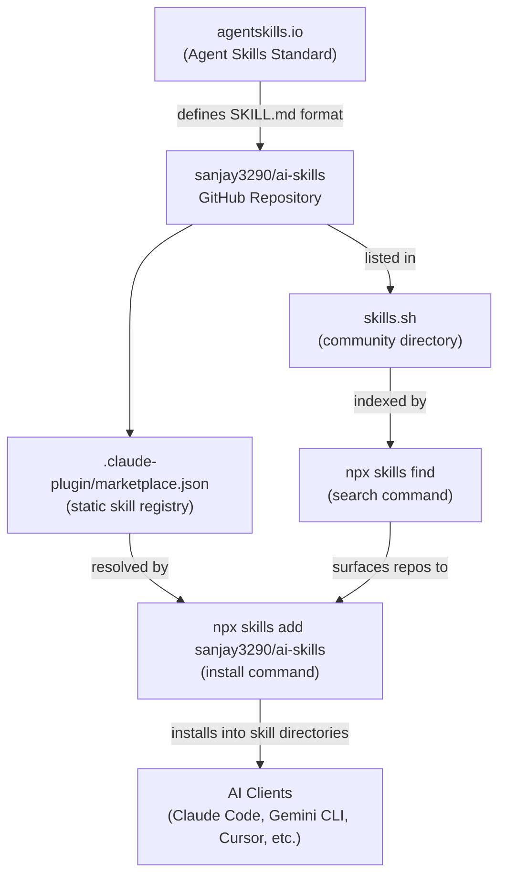
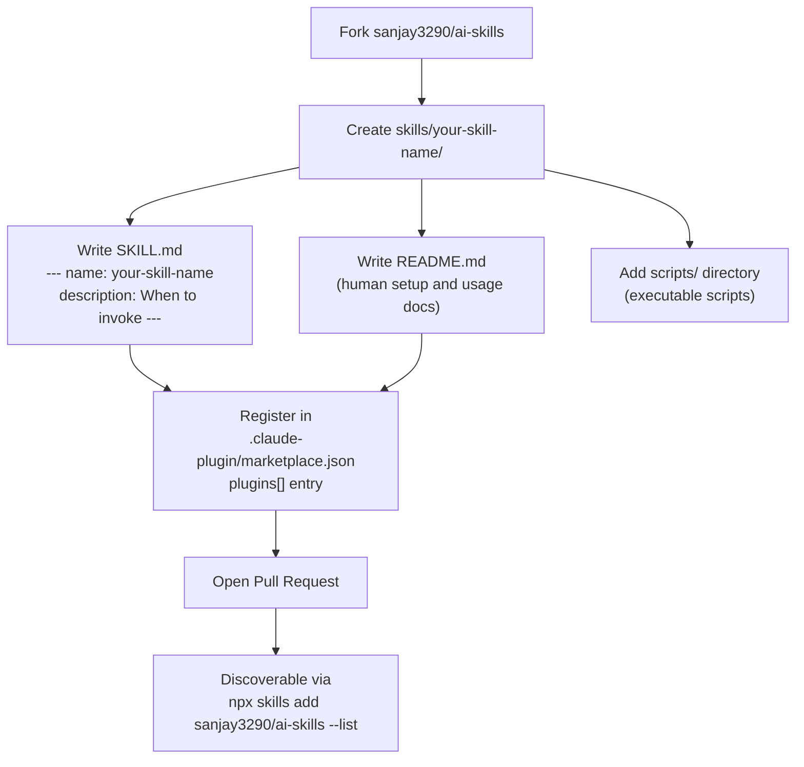
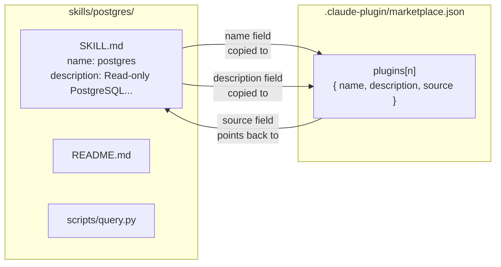

<!-- source: DeepWiki mcp.deepwiki.com · repo sanjay3290/ai-skills · page 7.3 Contributing to the Ecosystem · fetched 2026-10-26 -->

# Contributing to the Ecosystem

<details>
<summary>Relevant source files</summary>

The following files were used as context for generating this wiki page:

- [.gitignore](.gitignore)
- [README.md](README.md)
- [skills/jules/SKILL.md](skills/jules/SKILL.md)
- [skills/manus/SKILL.md](skills/manus/SKILL.md)

</details>


This page explains how to contribute skills to the `sanjay3290/ai-skills` repository and to the broader Agent Skills ecosystem. It covers the pull request workflow for this repository, skill naming conventions, how to register a new skill in the marketplace manifest, and how to use `npx skills find` for discovery.

For instructions on creating the files a skill requires from scratch, see [Creating a New Skill](#7.1). For CI and testing practices, see [Testing & CI](#7.2). For the Agent Skills Standard itself, see [Agent Skills Standard](#3.1).

---

## The Ecosystem

This repository participates in two overlapping distribution layers:

1. **agentskills.io** — the open standard that defines the `SKILL.md` format and directory convention. Any compliant repository can be installed by `npx skills`.
2. **skills.sh** — a community directory where published skill repositories are listed and searchable.

**Ecosystem relationship diagram**



Sources: [README.md:1-6](), [README.md:62-63](), [README.md:141-151]()

---

## Skill Discovery via `npx skills find`

Before contributing a new skill, check whether a similar one already exists in the community:

```bash
# Search the skills.sh directory by keyword
npx skills find postgres

# Browse all community skills
npx skills find
```

This queries the [skills.sh](https://skills.sh) directory, which aggregates skill repositories from the community. If a skill already exists, consider contributing improvements to the existing one rather than creating a duplicate.

Sources: [README.md:141-151]()

---

## Contributing to This Repository

### Pull Request Checklist

The steps to contribute a skill to `sanjay3290/ai-skills` are:

| Step | Action | Required File / Location |
|------|--------|--------------------------|
| 1 | Fork the repository | — |
| 2 | Create the skill directory | `skills/your-skill-name/` |
| 3 | Write agent instructions | `skills/your-skill-name/SKILL.md` |
| 4 | Write human documentation | `skills/your-skill-name/README.md` |
| 5 | Register in the manifest | `.claude-plugin/marketplace.json` |
| 6 | Submit a pull request | — |

Sources: [README.md:371-378]()

### Contribution flow diagram

The diagram below maps each pull request step to the specific code entities that must be created or modified.



Sources: [README.md:347-378](), [README.md:62-78]()

---

## Skill Naming Conventions

All 18 existing skills follow consistent naming patterns. The `name` field in `SKILL.md` frontmatter and the skill's directory name must match.

| Pattern | Examples | Rule |
|---------|----------|------|
| Single lowercase word | `postgres`, `mysql`, `manus`, `jules`, `imagen`, `outline` | Prefer when unambiguous |
| Hyphenated lowercase | `deep-research`, `mssql`, `notebooklm` | Use hyphens, never underscores or camelCase |
| Provider-prefixed | `google-tts`, `google-chat`, `google-docs`, `google-drive`, `google-calendar`, `google-sheets`, `google-slides`, `azure-devops` | Prefix with provider name when the skill is platform-specific |
| API/brand name | `elevenlabs` | Use the official product name, normalized to lowercase |

**Rules summary:**

- All lowercase letters and hyphens only.
- Match the directory name exactly: `skills/your-skill-name/` → `name: your-skill-name`.
- Prefix with the provider name when the skill is tightly coupled to a single vendor platform (e.g., `google-*`, `azure-*`).
- Be specific enough that `npx skills find your-skill-name` returns meaningful results.

Sources: [README.md:29-58](), [README.md:347-369]()

---

## Registering a Skill in the Marketplace Manifest

Every skill must have a corresponding entry in `.claude-plugin/marketplace.json` under the `plugins` array. This is the static registry that `npx skills` reads when resolving `sanjay3290/ai-skills`.

The manifest structure and field meanings are documented in detail at [Marketplace & Plugin System](#3.3). For contributing purposes, the essential rule is: **the `source` path in your new `plugins` entry must resolve to your skill's directory** (e.g., `skills/your-skill-name/`), and `name` must match the `name` field in your `SKILL.md` frontmatter.

**Manifest ↔ SKILL.md relationship diagram**



Sources: [README.md:347-378]()

---

## Contributing to the Broader Ecosystem

Beyond this repository, skills can be published independently to the community ecosystem.

### Publishing a Standalone Skill Repository

Any GitHub repository that follows the Agent Skills Standard (valid `SKILL.md` in each skill directory) can be installed directly:

```bash
npx skills add your-github-username/your-skills-repo --skill your-skill-name
```

The `npx skills` CLI resolves skill directories from any compliant public repository, not just `sanjay3290/ai-skills`.

### Submitting to skills.sh

Once published, a repository can be submitted to [skills.sh](https://skills.sh) for community discovery. After submission, skills become searchable via `npx skills find`.

### Awesome Lists

The repository's `README.md` [README.md:387-409]() documents several community-maintained "awesome list" repositories that accept pull requests for newly published skills. These are categorized by functional domain:

| Category | Skills from this repo |
|----------|-----------------------|
| Data & Analysis | `postgres`, `mysql`, `mssql`, `deep-research`, `manus` |
| Creative & Media | `imagen`, `elevenlabs`, `google-tts` |
| Development & Automation | `jules`, `azure-devops` |
| Collaboration & Project Management | `outline`, `google-chat`, `google-docs`, `google-sheets`, `google-slides`, `google-drive`, `google-calendar`, `gmail` |

When submitting to an awesome list, include your skill in the appropriate category row and follow the list's formatting conventions.

Sources: [README.md:387-409](), [README.md:141-151]()

---

