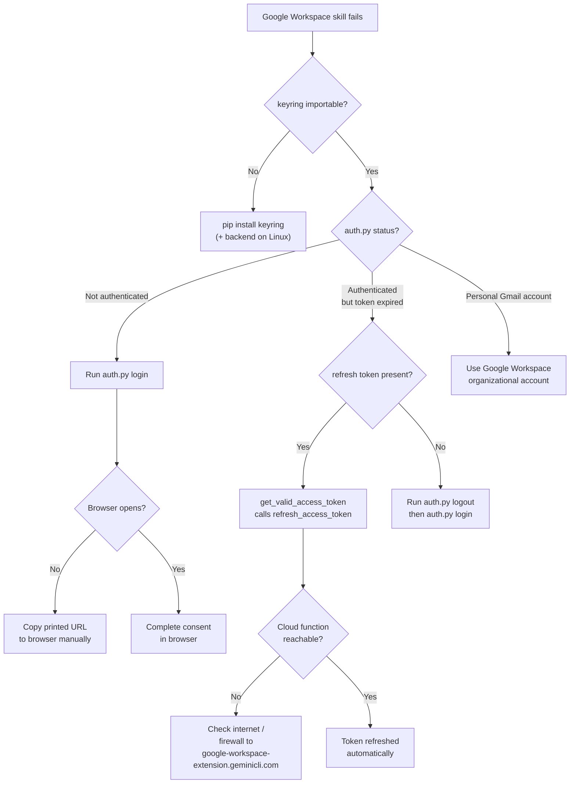
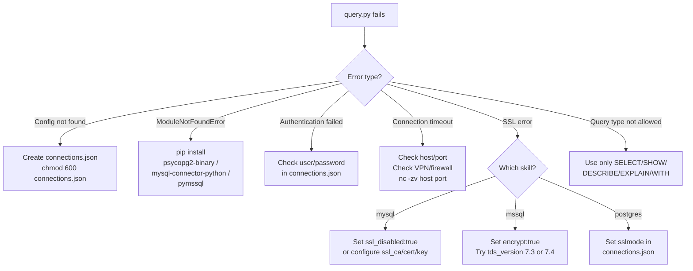

<!-- source: DeepWiki mcp.deepwiki.com · repo sanjay3290/ai-skills · page 8 Troubleshooting · fetched 2026-10-26 -->

# Troubleshooting

<details>
<summary>Relevant source files</summary>

The following files were used as context for generating this wiki page:

- [skills/azure-devops/SKILL.md](skills/azure-devops/SKILL.md)
- [skills/deep-research/SKILL.md](skills/deep-research/SKILL.md)
- [skills/elevenlabs/SKILL.md](skills/elevenlabs/SKILL.md)
- [skills/imagen/.env.example](skills/imagen/.env.example)
- [skills/imagen/.gitignore](skills/imagen/.gitignore)
- [skills/imagen/README.md](skills/imagen/README.md)
- [skills/imagen/examples.md](skills/imagen/examples.md)
- [skills/imagen/reference.md](skills/imagen/reference.md)
- [skills/imagen/scripts/generate_image.py](skills/imagen/scripts/generate_image.py)
- [skills/mssql/SKILL.md](skills/mssql/SKILL.md)
- [skills/mysql/SKILL.md](skills/mysql/SKILL.md)
- [skills/notebooklm/scripts/ask_question.py](skills/notebooklm/scripts/ask_question.py)
- [skills/notebooklm/scripts/auth_manager.py](skills/notebooklm/scripts/auth_manager.py)

</details>


This page covers resolution steps for the most common runtime errors across all skills in this repository. It is organized by skill category. For background on how authentication is designed, see [Authentication Patterns](#3.4). For configuration reference (environment variables, connections files, API keys), see [Configuration Guide](#6).

---

## Google Workspace Skills

All seven Google Workspace skills share the same OAuth infrastructure. Issues generally fall into three categories: the `keyring` library is missing or inaccessible, the OAuth flow itself failed, or the token refresh failed silently.

### Keyring not installed or inaccessible

**Symptom:** `ModuleNotFoundError: No module named 'keyring'` or `keyring.errors.KeyringError` on any Google Workspace command.

**Fix:**
```bash
pip install keyring
```

On Linux, a backend must also be present. The most common options:

| Desktop | Backend package |
|---------|----------------|
| GNOME | `gnome-keyring` (usually pre-installed) |
| KDE | `ksecretsservice` |
| Headless / CI | `pip install keyrings.alt` (file-based fallback) |

The `keyring` library is the only dependency listed in each skill's `requirements.txt`, e.g. [skills/gmail/requirements.txt:1-1]().

---

### No tokens stored — must re-authenticate

**Symptom:** `No OAuth tokens found. Starting authentication...` printed to stderr, or the skill hangs waiting for a browser callback.

**Fix:** Run the `login` command for the affected skill. Each skill has its own `auth.py`:

```bash
python ~/.claude/skills/ai-skills/skills/gmail/scripts/auth.py login
python ~/.claude/skills/ai-skills/skills/google-calendar/scripts/auth.py login
# ... repeat for each skill
```

The `perform_oauth_flow` function opens a browser, starts a local HTTP server on a random port to receive the callback, and validates a CSRF token [skills/gmail/scripts/auth.py:199-250]().

If a browser cannot open (headless environment), the full URL is printed to stderr:
```
If browser doesn't open, visit: https://accounts.google.com/o/oauth2/v2/auth?...
```

---

### Token refresh failure

**Symptom:** `Token refresh failed. Re-authenticating...` or `Warning: Failed to refresh token.` printed to stderr, followed by a failure or another browser prompt.

**Cause:** The cloud function at `https://google-workspace-extension.geminicli.com/refreshToken` could not be reached, or the stored refresh token was revoked.

The `refresh_access_token` function [skills/gmail/scripts/auth.py:111-126]() makes a POST to `REFRESH_ENDPOINT`. If this call fails, `get_valid_access_token` falls back to a new OAuth flow when running interactively [skills/gmail/scripts/auth.py:289-298]().

**Fix:**
1. Check your internet connection.
2. Verify the cloud function endpoint is reachable: `curl -I https://google-workspace-extension.geminicli.com`
3. Re-run `auth.py login` for the affected skill.
4. If the issue persists, run `auth.py logout` then `auth.py login` to clear stale tokens.

```bash
python skills/gmail/scripts/auth.py logout
python skills/gmail/scripts/auth.py login
```

---

### Checking auth status

```bash
python skills/gmail/scripts/auth.py status
```

Output shows whether a token is stored, whether it is expired, and how many minutes remain. Each skill stores tokens under a distinct keychain service name:

| Skill | `KEYCHAIN_SERVICE` constant |
|-------|-----------------------------|
| Gmail | `gmail-skill-oauth` |
| Google Calendar | `google-calendar-skill-oauth` |
| Google Chat | `google-chat-skill-oauth` |
| Google Docs | `google-docs-skill-oauth` |
| Google Drive | `google-drive-skill-oauth` |
| Google Sheets | `google-sheets-skill-oauth` |
| Google Slides | `google-slides-skill-oauth` |

See [skills/gmail/scripts/auth.py:29-30]() and [skills/google-calendar/scripts/auth.py:31-32]() for examples.

---

### Personal Gmail account error

**Symptom:** Authentication completes but all API calls return HTTP 403, or the consent screen shows an error about account type.

**Cause:** All Google Workspace skills require a **Google Workspace account** (a managed organizational account). Personal `@gmail.com` accounts are not supported. This is a constraint of the underlying OAuth app and API scopes.

**Fix:** Use a Google Workspace account (one issued by an organization through Google Admin).

---

**OAuth issue diagnosis flowchart:**



Sources: [skills/gmail/scripts/auth.py:1-367](), [skills/google-calendar/scripts/auth.py:1-400](), [README.md:256-274]()

---

## Database Skills (PostgreSQL, MySQL, MSSQL)

All three database skills use the same `connections.json` configuration file and the same `query.py` CLI interface. See [Database Skills](#4.2) for full documentation.

### `connections.json` not found

**Symptom:** `Config not found` error on any `query.py` command.

**Fix:** Create `connections.json` in the skill directory (e.g. `skills/postgres/connections.json`) or at the global path `~/.config/claude/<skill>-connections.json`. Set restrictive permissions:

```bash
chmod 600 connections.json
```

The `.gitignore` at the repo root explicitly excludes `connections.json` and `**/connections.json` [.gitignore:2-3]() — never commit this file.

---

### Authentication failure

**Symptom:** `Authentication failed` or the driver raises a credentials error.

**Fix:** Check the `user` and `password` fields in `connections.json`. Ensure the database user exists and has the required privileges. For read-only use, assigning the `db_datareader` role (MSSQL) or a `SELECT`-only grant (Postgres/MySQL) is sufficient and recommended.

---

### Connection timeout

**Symptom:** `Connection timeout` or the script hangs then exits with an error.

**Fix:**
1. Verify the `host` and `port` fields are correct.
2. Confirm network access: check VPN, firewall rules, and security group/ACL settings.
3. Test connectivity independently: `nc -zv <host> <port>`

---

### SSL / TLS errors

Per-database resolution:

| Skill | Error | Fix |
|-------|-------|-----|
| MySQL | SSL handshake fails | Set `"ssl_disabled": true` for local/dev databases [skills/mysql/SKILL.md:56-60]() |
| MySQL | Need custom CA | Set `ssl_ca`, `ssl_cert`, `ssl_key` paths in `connections.json` |
| MSSQL | Encryption error | Set `"encrypt": true` for Azure SQL; try `"tds_version": "7.3"` or `"7.4"` if TDS negotiation fails [skills/mssql/SKILL.md:121-123]() |
| MSSQL | TDS version error | Explicitly set `"tds_version"` in `connections.json` |
| PostgreSQL | SSL required | Set `"sslmode": "require"` or `"verify-full"` in `connections.json` |

---

### Python driver not installed

**Symptom:** `ModuleNotFoundError: No module named 'psycopg2'` (or `mysql.connector`, `pymssql`).

**Fix:**
```bash
pip install psycopg2-binary      # PostgreSQL
pip install mysql-connector-python  # MySQL
pip install pymssql               # MSSQL
```

---

### Query blocked by validation

**Symptom:** `Error: Query type not allowed` or similar.

**Cause:** The skill's query validator only permits `SELECT`, `SHOW`, `DESCRIBE`, `EXPLAIN`, and `WITH` statements. Any write operation (`INSERT`, `UPDATE`, `DELETE`, `DROP`, `CREATE`, etc.) is blocked by design. Multiple statements in a single query are also rejected.

**Fix:** Use only read-only SQL. See [Execution & Safety Features](#3.5) for the full list of allowed statement types.

---

**Database error diagnosis diagram:**



Sources: [skills/mysql/SKILL.md:113-121](), [skills/mssql/SKILL.md:114-123](), [README.md:183-189]()

---

## API Key Errors

Several skills use a simple API key rather than OAuth. The HTTP error handling is most explicit in the ElevenLabs skill; the same error codes apply to other API-key-based skills (Manus, Imagen, Outline, Google TTS).

### HTTP 401 — Invalid API key

**Symptom:** `ERROR: Invalid ElevenLabs API key` or equivalent `HTTP 401` error from any skill.

**Cause:** The key is missing, malformed, or has been revoked.

The `handle_http_error` function in [skills/elevenlabs/scripts/elevenlabs.py:118-164]() prints an explicit diagnostic for 401 responses. The `get_api_key` function [skills/elevenlabs/scripts/elevenlabs.py:66-84]() checks `ELEVENLABS_API_KEY` environment variable first, then `config.json`.

**Fix:**
1. Verify the environment variable is set: `echo $ELEVENLABS_API_KEY` (or `$MANUS_API_KEY`, `$GEMINI_API_KEY`, etc.)
2. Check the key has not been regenerated in the provider's dashboard.
3. Confirm `config.json` is present and contains a valid `"api_key"` field (see `skills/elevenlabs/config.example.json`).

---

### HTTP 429 — Rate limit exceeded

**Symptom:** `ERROR: ElevenLabs rate limit exceeded` or similar.

**Cause:** The API plan's request rate or character quota has been exhausted.

**Fix:**
- Wait and retry. For ElevenLabs, check the character quota in the dashboard.
- For Manus, the `SKILL.md` notes: wait and retry [skills/manus/SKILL.md:177-179]().
- For Imagen / Deep Research, note that Deep Research tasks cost approximately $2–5 per query [README.md:199]().

---

### HTTP 422 — Invalid request parameters

**Symptom:** `ERROR: Invalid request` with HTTP 422.

**Cause:** One or more request parameters were rejected by the API (e.g. an unsupported voice ID, invalid model name, or malformed JSON body).

**Fix:**
- For ElevenLabs `tts`: run `python elevenlabs.py voices` to list valid voice IDs.
- For ElevenLabs `podcast`: ensure the script JSON is a non-empty array with `"speaker"` and `"text"` fields.
- For Imagen: check the `--model` and `--size` arguments against supported values.

---

### Skill-specific API key environment variables

| Skill | Environment variable | Config file alternative |
|-------|---------------------|------------------------|
| ElevenLabs | `ELEVENLABS_API_KEY` | `skills/elevenlabs/config.json` → `api_key` |
| Google TTS | `GOOGLE_TTS_API_KEY` | `skills/google-tts/config.json` → `api_key` |
| Imagen / Deep Research | `GEMINI_API_KEY` | — |
| Manus | `MANUS_API_KEY` | — |
| Outline | `OUTLINE_API_KEY` | — |

Sources: [skills/elevenlabs/scripts/elevenlabs.py:66-84](), [skills/elevenlabs/scripts/elevenlabs.py:118-164](), [skills/manus/SKILL.md:177-179](), [README.md:192-220]()

---

## NotebookLM (Playwright Automation)

The NotebookLM skill uses Playwright to control a Chrome browser. Failures here are typically caused by a missing Playwright installation, missing Chrome, or authentication not being set up.

### Playwright not installed

**Symptom:** `ModuleNotFoundError: No module named 'playwright'` or `playwright._impl._api_types.Error: Executable doesn't exist`.

**Fix:**
```bash
pip install -r skills/notebooklm/requirements.txt
python -m playwright install chromium
```

The second command downloads the Chromium browser binary that Playwright controls.

---

### Authentication not set up

**Symptom:** The browser opens the NotebookLM login page and then the script times out or exits with an error.

**Fix:** Run the one-time setup command:

```bash
python skills/notebooklm/scripts/auth_manager.py setup --profile work
```

This stores a persistent Chrome profile so subsequent runs reuse the authenticated session. Profile data is stored at `~/.config/claude/notebooklm-skill/` by default (override with `NOTEBOOKLM_DATA_DIR`).

Verify auth status:
```bash
python skills/notebooklm/scripts/auth_manager.py status --profile work
```

---

### Transient browser automation failures

**Symptom:** Intermittent errors during `ask_question.py` or `remote_manager.py` commands; scripts fail mid-operation.

**Fix:**
- Retry with `--retries N` (e.g. `--retries 3`). On failure, screenshot and HTML artifacts are captured automatically for diagnosis.
- Use `--show-browser` to watch the browser in real time and identify where the automation stalls.
- If `NOTEBOOKLM_DATA_DIR` is set, check that the directory is writable.

These flags are noted in [skills/notebooklm/SKILL.md:25-32]().

---

### Browser fails in headless environment (CI/server)

**Symptom:** `playwright._impl._errors.Error: Browser closed unexpectedly` or similar on a server without a display.

**Fix:** Playwright's Chromium can run headless (the default) but requires certain system libraries.

On Debian/Ubuntu:
```bash
sudo apt-get install -y libgbm-dev libasound2 libatk-bridge2.0-0 libgtk-3-0
```

Alternatively, run `python -m playwright install-deps chromium` which installs the required system packages.

---

Sources: [skills/notebooklm/SKILL.md:1-54](), [README.md:239-243]()

---

## TTS Skills (ElevenLabs and Google TTS)

Both TTS skills use `ffmpeg` to concatenate audio chunks. The `check_ffmpeg` function in [skills/elevenlabs/scripts/elevenlabs.py:214-216]() calls `shutil.which("ffmpeg")` to detect availability; the `concat_audio` function [skills/elevenlabs/scripts/elevenlabs.py:219-250]() exits with an error if ffmpeg is absent and more than one chunk is needed.

### ffmpeg not installed

**Symptom:** `Error: ffmpeg is required for multi-chunk audio concatenation.` when converting documents longer than ~4000 characters, or when generating podcasts with more than one segment.

**Fix:**

| OS | Command |
|----|---------|
| macOS | `brew install ffmpeg` |
| Ubuntu / Debian | `sudo apt install ffmpeg` |
| Windows | Download from ffmpeg.org or `choco install ffmpeg` |

Short texts (under the chunk size limit) do not require ffmpeg because a single audio file is written directly without concatenation.

---

### PDF / DOCX extraction fails

**Symptom:** `Error: PyPDF2 is required for PDF extraction.` or `Error: python-docx is required for DOCX extraction.`

**Fix:**
```bash
pip install -r skills/elevenlabs/requirements.txt
# Contains: PyPDF2>=3.0.0 and python-docx>=1.0.0
```

The `extract_pdf` and `extract_docx` functions in [skills/elevenlabs/scripts/extract.py:22-65]() import these libraries at call time and print install instructions if they are absent.

For Google TTS:
```bash
pip install PyPDF2 python-docx
```

---

### No text extracted from document

**Symptom:** `Warning: No text extracted from <file>` and the output audio is empty.

**Cause:** The PDF may be image-based (scanned) rather than containing embedded text. `PyPDF2` only extracts machine-readable text layers.

**Fix:** Use an OCR tool (e.g. `ocrmypdf`) to add a text layer to the PDF before passing it to the TTS skill.

---

Sources: [skills/elevenlabs/scripts/elevenlabs.py:214-250](), [skills/elevenlabs/scripts/extract.py:22-65](), [skills/elevenlabs/requirements.txt:1-2](), [README.md:224-236]()

---

## Quick Reference: Common Errors

| Error message | Skill(s) | Fix |
|--------------|----------|-----|
| `No module named 'keyring'` | All Google Workspace | `pip install keyring` |
| `No OAuth tokens found` | All Google Workspace | Run `auth.py login` |
| `Token refresh failed` | All Google Workspace | Check connectivity to `google-workspace-extension.geminicli.com`; re-run `auth.py login` |
| HTTP 403 on Google API calls | All Google Workspace | Must use a Google Workspace account, not personal Gmail |
| `Config not found` | postgres, mysql, mssql | Create `connections.json` in skill directory |
| `Authentication failed` | postgres, mysql, mssql | Check `user`/`password` in `connections.json` |
| `Connection timeout` | postgres, mysql, mssql | Verify host/port; check firewall/VPN |
| `SSL error` | postgres, mysql, mssql | See SSL table above |
| HTTP 401 | ElevenLabs, Manus, Imagen, Google TTS, Outline | Invalid or missing API key |
| HTTP 429 | ElevenLabs, Manus, Imagen | Rate limit; wait and retry |
| HTTP 422 | ElevenLabs | Invalid parameter (voice ID, model, script format) |
| `No module named 'playwright'` | NotebookLM | `pip install -r requirements.txt && python -m playwright install chromium` |
| `ffmpeg is required` | elevenlabs, google-tts | `brew install ffmpeg` / `apt install ffmpeg` |
| `PyPDF2 is required` | elevenlabs, google-tts | `pip install PyPDF2` |
| `Query type not allowed` | postgres, mysql, mssql | Only read-only SQL allowed (SELECT, SHOW, DESCRIBE, EXPLAIN, WITH) |