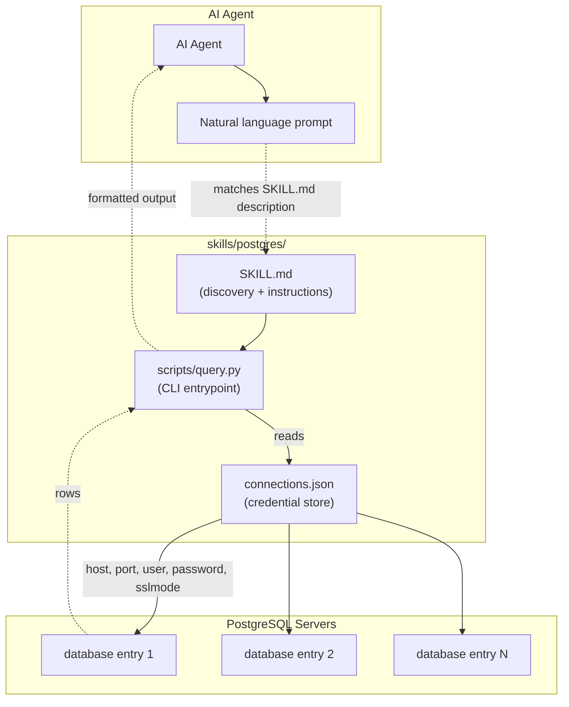
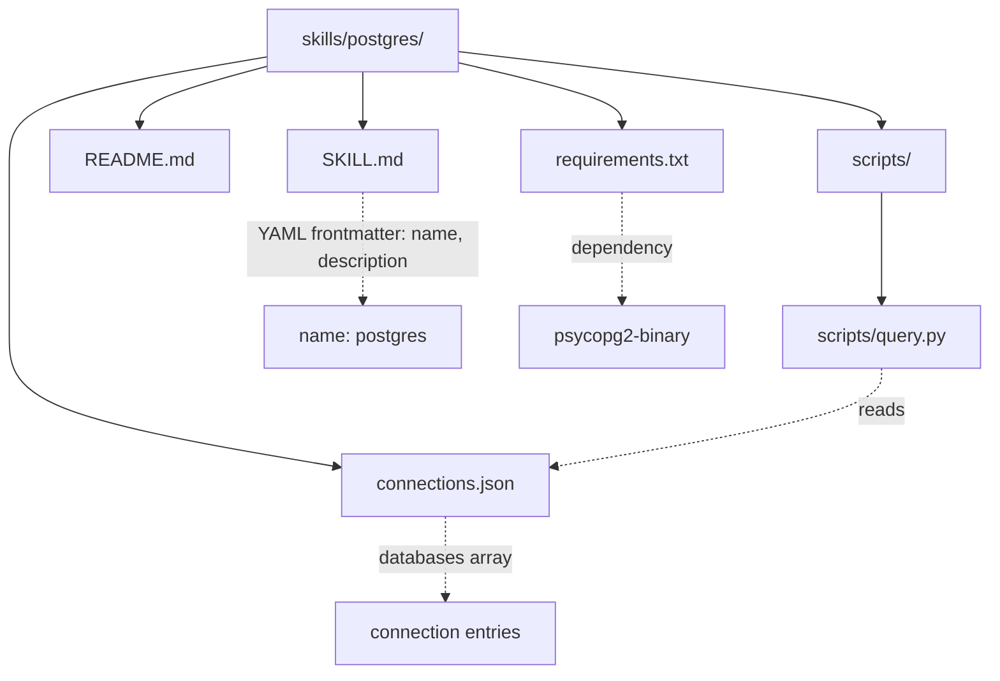
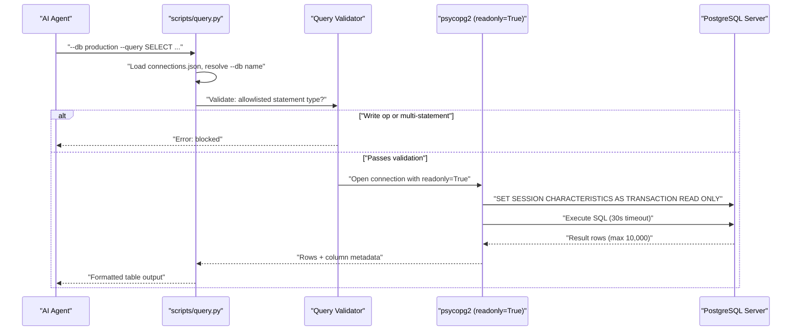

<!-- source: DeepWiki mcp.deepwiki.com · repo sanjay3290/ai-skills · extra page PostgreSQL · fetched 2026-10-26 -->

# PostgreSQL

<details>
<summary>Relevant source files</summary>

The following files were used as context for generating this wiki page:

- [README.md](README.md)
- [skills/jules/SKILL.md](skills/jules/SKILL.md)
- [skills/manus/SKILL.md](skills/manus/SKILL.md)
- [skills/mssql/SKILL.md](skills/mssql/SKILL.md)
- [skills/mysql/SKILL.md](skills/mysql/SKILL.md)

</details>


This page documents the `postgres` skill, which provides read-only SQL query execution against multiple PostgreSQL database connections. The skill implements defense-in-depth safety constraints to prevent data modification while enabling intelligent database selection based on natural language descriptions.

For information about all three database skills and their shared design, see page 4.2. For safety feature details that apply across all database skills, see page 3.5.

## Overview

The postgres skill enables AI agents to execute SQL queries against PostgreSQL databases with built-in safety guarantees. The skill supports multiple database connections with intelligent selection, blocks all write operations at multiple layers, and provides schema introspection capabilities.

**Key Capabilities:**
- Read-only query execution across multiple databases
- Intelligent database selection based on natural language descriptions
- Schema inspection and metadata queries
- Multi-layer write operation prevention
- Structured error handling and validation

**Execution Pattern:** Synchronous - queries execute immediately and return results within the AI agent's interaction flow (typically < 30 seconds).

Sources: [skills/postgres/SKILL.md:1-8]()

## System Architecture

**Skill component map: `skills/postgres/`**



**Execution flow:**

1. Agent matches user prompt against the `description` field in `SKILL.md` YAML frontmatter
2. `scripts/query.py` reads `connections.json` and resolves the `--db` argument to a connection entry
3. SQL query passes validation (allowlist + single-statement check)
4. `psycopg2` opens a connection with `readonly=True` and executes the query
5. Results are formatted and returned to the agent

Sources: [skills/postgres/SKILL.md:1-8](), [skills/postgres/SKILL.md:98-107]()

## Skill Directory Structure

**File layout: `skills/postgres/`**



| File | Purpose |
|------|---------|
| `SKILL.md` | AI-facing instructions; YAML frontmatter with `name` and `description` |
| `README.md` | Human-readable setup and usage documentation |
| `requirements.txt` | Python dependency: `psycopg2-binary` |
| `connections.json` | Database credentials and descriptions (or `~/.config/claude/postgres-connections.json`) |
| `scripts/query.py` | CLI entrypoint: query execution, schema inspection, safety validation |

Sources: [skills/postgres/SKILL.md:14-21]()

## Configuration: `connections.json`

**File locations (checked in order):**

1. `skills/postgres/connections.json` — skill-local config
2. `~/.config/claude/postgres-connections.json` — global config

After creating the file, restrict permissions to prevent credential exposure:

```bash
chmod 600 connections.json
```

**JSON structure:**

```json
{
  "databases": [
    {
      "name": "production",
      "description": "Main app database - users, orders, transactions",
      "host": "db.example.com",
      "port": 5432,
      "database": "app_prod",
      "user": "readonly_user",
      "password": "your-password",
      "sslmode": "require"
    }
  ]
}
```

The top-level key is `databases` (an array). Each entry represents one addressable connection.

**Field reference:**

| Field | Required | Default | Description |
|-------|----------|---------|-------------|
| `name` | Yes | — | Case-insensitive identifier; passed to `--db` |
| `description` | Yes | — | Natural language summary; used by the agent for auto-selection |
| `host` | Yes | — | PostgreSQL server hostname or IP |
| `port` | No | `5432` | PostgreSQL server port |
| `database` | Yes | — | Database name on the server |
| `user` | Yes | — | Database username |
| `password` | Yes | — | Database password |
| `sslmode` | No | `prefer` | One of: `disable`, `allow`, `prefer`, `require`, `verify-ca`, `verify-full` |

**Recommendations:**
- Use a database account granted only `SELECT` privileges.
- Write `description` fields that capture the data domain (e.g. `"users, orders, transactions"`) so the agent can auto-select correctly.
- Add `connections.json` to `.gitignore` to avoid committing credentials.

Sources: [skills/postgres/SKILL.md:19-57]()

## CLI Commands: `scripts/query.py`

All interaction with the skill goes through `scripts/query.py`. The `--db` argument takes the `name` value from a `databases` entry in `connections.json`.

**Command reference:**

| Command | Description |
|---------|-------------|
| `python3 scripts/query.py --list` | List all configured database connections |
| `python3 scripts/query.py --db <name> --query "<SQL>"` | Execute a SQL query |
| `python3 scripts/query.py --db <name> --tables` | List all tables in the database |
| `python3 scripts/query.py --db <name> --schema` | Show full schema for all tables |
| `python3 scripts/query.py --db <name> --query "<SQL>" --limit <N>` | Limit rows returned (overrides default cap) |

**Examples from SKILL.md:**

```bash
# List available databases
python3 scripts/query.py --list

# Run a query against the "production" connection
python3 scripts/query.py --db production --query "SELECT * FROM users LIMIT 10"

# Explore table structure
python3 scripts/query.py --db production --tables
python3 scripts/query.py --db production --schema

# Cap result rows explicitly
python3 scripts/query.py --db production --query "SELECT * FROM orders" --limit 100
```

## Database Auto-Selection

The agent uses the `description` field from each `databases` entry to map user intent to a connection. Running `--list` exposes these descriptions. If intent is ambiguous, `--list` output should be shown to the user.

| User asks about | Look for `description` containing |
|-----------------|----------------------------------|
| users, accounts | users, accounts, customers |
| orders, sales | orders, transactions, sales |
| analytics, metrics | analytics, metrics, reports |
| logs, events | logs, events, audit |

Sources: [skills/postgres/SKILL.md:58-130]()

## Query Execution Flow

**`scripts/query.py` execution path:**



**Validation rules enforced before execution:**

- Statement type must be one of: `SELECT`, `SHOW`, `EXPLAIN`, `WITH`
- Only one statement per call (semicolon-separated multi-statements rejected)
- `readonly=True` on the `psycopg2` connection is the primary enforcement layer

Sources: [skills/postgres/SKILL.md:98-107]()

## Safety Features

The postgres skill uses several layered mechanisms to prevent data modification and resource exhaustion.

| Mechanism | Implementation |
|-----------|---------------|
| Read-only session | `psycopg2` connection opened with `readonly=True` (primary protection) |
| Query validation | Only `SELECT`, `SHOW`, `EXPLAIN`, `WITH` statements allowed |
| Single-statement restriction | Queries with multiple statements (`;`-separated) are rejected |
| SSL support | Configurable `sslmode` per connection entry |
| Query timeout | 30-second statement timeout enforced server-side |
| Memory cap | Maximum 10,000 rows per query result |
| Column width cap | Column values truncated to 100 characters for readable output |
| Credential sanitization | Error messages do not include passwords or connection strings |

The `readonly=True` psycopg2 connection flag is the primary enforcement layer. Query validation provides a secondary check. Configuring a database-level read-only role in PostgreSQL is also recommended for defense in depth.

Sources: [skills/postgres/SKILL.md:98-107]()

## Schema Introspection

`--tables` and `--schema` flags in `scripts/query.py` expose database structure without writing custom SQL.

| Command | What it returns |
|---------|----------------|
| `--tables` | All table names in the database |
| `--schema` | Column names, types, and nullability for all tables |

Agents should run `--tables` or `--schema` before constructing `--query` commands to understand the available data model.

Sources: [skills/postgres/SKILL.md:72-83]()

## Recommended Agent Workflow

The `SKILL.md` documents the intended agent workflow:

1. Run `--list` to display configured databases and their descriptions
2. Match user intent to a database `description`; if ambiguous, ask the user
3. Run `--tables` or `--schema` to understand the data model
4. Execute `--query` with an explicit `LIMIT` or use the `--limit` flag

Sources: [skills/postgres/SKILL.md:124-130]()

## Troubleshooting

| Error | Cause | Resolution |
|-------|-------|------------|
| Config not found | No `connections.json` in skill dir or `~/.config/claude/` | Create the file at one of the two locations |
| Authentication failed | Wrong `user` or `password` in config | Verify credentials |
| Connection timeout | Unreachable `host`/`port` | Check firewall rules, VPN, and host value |
| SSL error | `sslmode` mismatch | Try `"sslmode": "disable"` for local databases |
| Permission warning | File readable by other users | Run `chmod 600 connections.json` |

**Exit codes:**

| Code | Meaning |
|------|---------|
| `0` | Success |
| `1` | Error (config missing, auth failed, invalid query, database error) |

Sources: [skills/postgres/SKILL.md:109-130]()

## Dependencies

| Dependency | Purpose |
|-----------|---------|
| Python 3.8+ | Runtime |
| `psycopg2-binary` | PostgreSQL adapter (`pip install -r requirements.txt`) |

```bash
pip install -r skills/postgres/requirements.txt
```

Sources: [skills/postgres/SKILL.md:14-17]()

## Integration with Other Skills

The postgres skill can be combined with other skills in the repository for enhanced workflows:

- **[deep-research](#4.4):** Research results can be stored in PostgreSQL for historical tracking
- **[google-sheets](#5.6):** Export query results to Google Sheets for sharing and analysis
- **[outline](#4.7):** Query database statistics and embed in wiki documentation
- **[imagen](#4.3):** Generate visualizations based on query result data

Sources: [README.md:27-54]()

## Comparison to Alternative Approaches

**postgres Skill vs. Other Database Access Methods:**

| Approach | Pros | Cons |
|----------|------|------|
| **postgres skill** | • Read-only safety<br/>• Multi-database support<br/>• Intelligent selection | • Configuration required<br/>• PostgreSQL only |
| **Direct AI SQL** | • No setup<br/>• Multi-engine support | • No safety constraints<br/>• Risk of write operations |
| **MCP Database Server** | • Full feature set<br/>• Multiple engines | • Complex setup<br/>• Overhead for simple queries |
| **Database Admin Tools** | • Full control<br/>• Advanced features | • Manual execution<br/>• No AI integration |

Sources: [.claude-plugin/marketplace.json:12-18]()

## File References

Key files for the postgres skill:

- Skill definition: [skills/postgres/SKILL.md]()
- Main executor: [skills/postgres/scripts/main.py]()
- Configuration: [skills/postgres/connections.json]()
- Dependencies: [skills/postgres/requirements.txt]()
- Documentation: [skills/postgres/README.md]()
- Registry entry: [.claude-plugin/marketplace.json:12-18]()

Sources: All sections

---

