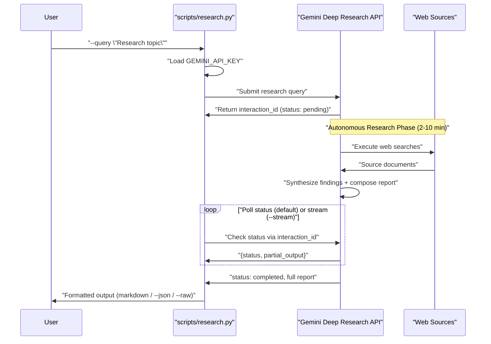
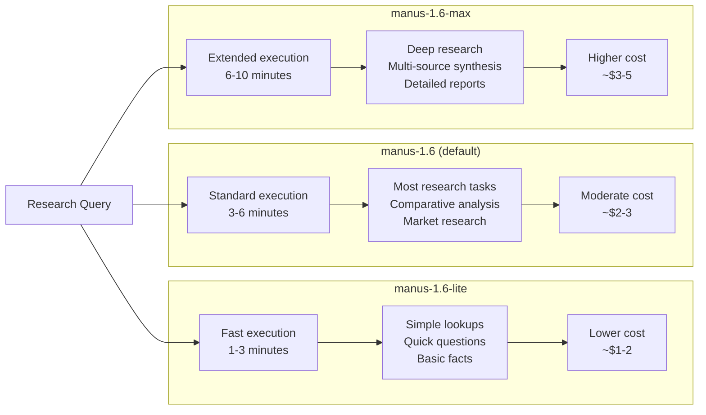
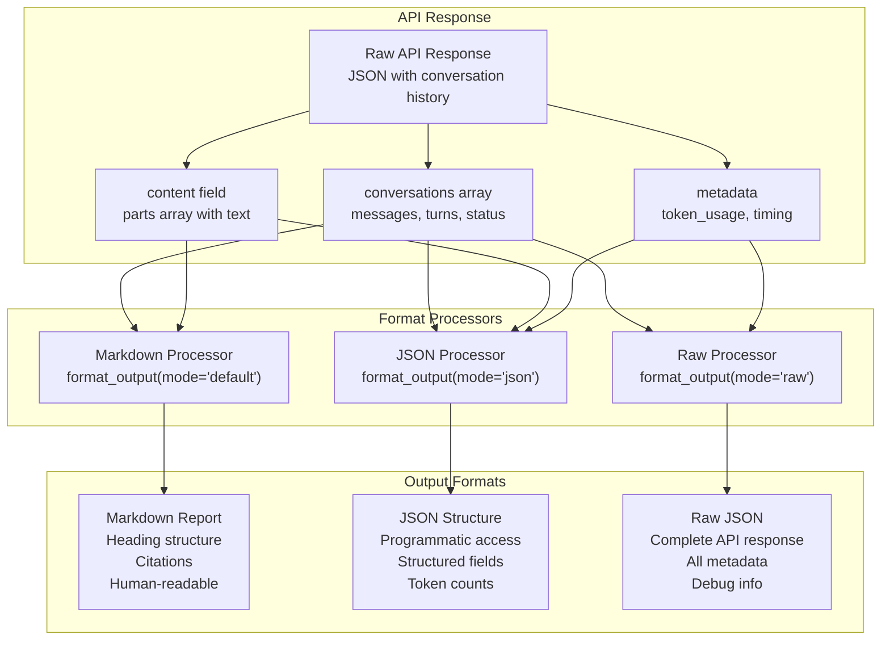
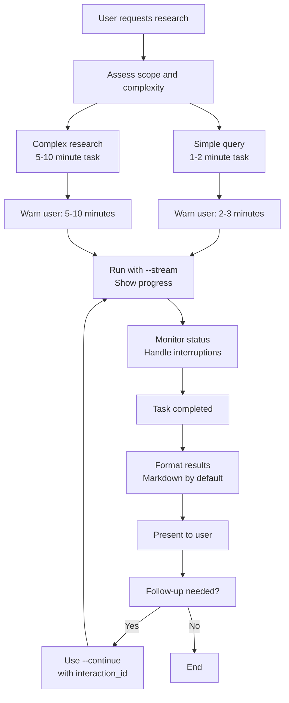

<!-- source: DeepWiki mcp.deepwiki.com · repo sanjay3290/ai-skills · extra page Deep Research · fetched 2026-10-26 -->

# Deep Research

<details>
<summary>Relevant source files</summary>

The following files were used as context for generating this wiki page:

- [skills/azure-devops/SKILL.md](skills/azure-devops/SKILL.md)
- [skills/deep-research/SKILL.md](skills/deep-research/SKILL.md)
- [skills/elevenlabs/SKILL.md](skills/elevenlabs/SKILL.md)

</details>


The Deep Research skill enables autonomous multi-step research tasks using Google Gemini's Deep Research Agent. The agent autonomously plans, searches the web, reads sources, and synthesizes information into comprehensive reports. This skill handles research tasks that require 2-10 minutes of processing time and generate detailed, cited reports.

For delegating complex research tasks to alternative agents, see [Manus (Research Agent)](#4.4.2). For simple image generation using Gemini, see [Imagen (Image Generation)](#4.3.1). For Google Workspace integrations, see [Google Workspace Skills](#5).

## Overview

The Deep Research skill wraps Gemini's Deep Research Agent API, providing asynchronous task execution with status polling, streaming progress updates, and multi-format output. Unlike synchronous API calls, research tasks run autonomously for several minutes while the agent performs web searches, reads sources, and composes a comprehensive report.

### Key Characteristics

| Characteristic | Value |
|---------------|-------|
| **Execution Time** | 2-10 minutes per task |
| **Cost per Task** | $2-5 (usage-based) |
| **Input Token Usage** | 250,000-900,000 tokens |
| **Output Token Usage** | 60,000-80,000 tokens |
| **API Base** | `https://generativelanguage.googleapis.com/v1beta` |
| **Authentication** | `GEMINI_API_KEY` environment variable |
| **Execution Pattern** | Asynchronous with polling |

**Sources:** [skills/deep-research/SKILL.md:79-84]()

## Architecture

### Research Task Lifecycle

**Diagram: Lifecycle of a `scripts/research.py` invocation**



Sources: [skills/deep-research/SKILL.md:29-100]()

### CLI Command Mapping

**Diagram: `scripts/research.py` CLI flags to execution modes**

```mermaid
graph TB
    CLI["scripts/research.py"]

    CLI --> NewQuery["--query \"...\"<br/>(start new research)"]
    CLI --> StatusCheck["--status &lt;interaction_id&gt;<br/>(one-time poll)"]
    CLI --> WaitCmd["--wait &lt;interaction_id&gt;<br/>(block until complete)"]
    CLI --> ListCmd["--list<br/>(recent tasks)"]
    CLI --> ContinueCmd["--query \"...\" --continue &lt;interaction_id&gt;<br/>(follow-up on prior research)"]

    NewQuery --> ModeFlags["Execution mode flags"]
    ModeFlags --> DefaultMode["(default) block + poll"]
    ModeFlags --> StreamFlag["--stream: real-time progress"]
    ModeFlags --> NoWaitFlag["--no-wait: return interaction_id immediately"]

    NewQuery --> FormatFlags["Output format flags"]
    FormatFlags --> MarkdownOut["(default) markdown report"]
    FormatFlags --> JsonFlag["--json: structured data"]
    FormatFlags --> RawFlag["--raw: full API response"]

    NewQuery --> StructureFlag["--format \"1. Exec Summary\\n2. ...\"<br/>(guide report structure)"]
```

Sources: [skills/deep-research/SKILL.md:29-76]()
</thinking>

## Authentication Setup

The Deep Research skill requires a Gemini API key for authentication. The key must have access to the Gemini v1beta API with Deep Research Agent capabilities enabled.

### Environment Variable Configuration

```bash
# Set API key in shell
export GEMINI_API_KEY=your-api-key-here

# Or create .env file in skill directory
echo "GEMINI_API_KEY=your-api-key-here" > skills/deep-research/.env
```

API keys can be obtained from [Google AI Studio](https://aistudio.google.com/). The skill reads the key from the `GEMINI_API_KEY` environment variable at runtime.

**Sources:** [skills/deep-research/SKILL.md:14-26](), [README.md:192-197]()

## Core Workflow

### Starting a Research Task

The primary command initiates an autonomous research task:

```bash
python scripts/research.py --query "Research the history of Kubernetes"
```

The script performs the following operations:
1. Reads `GEMINI_API_KEY` from environment
2. Creates a cached content context via `POST /v1beta/cachedContents`
3. Submits research query to `POST /v1beta/models/gemini-2.0-flash-thinking-exp-01-21:generateContent`
4. Returns `interaction_id` for status tracking
5. Polls status endpoint until completion
6. Formats and returns final report

**Sources:** [skills/deep-research/SKILL.md:31-34]()

### Asynchronous Execution Modes

The skill supports multiple execution modes for different workflow requirements:

| Mode | Command | Behavior |
|------|---------|----------|
| **Synchronous (default)** | `--query "..."` | Blocks until completion, polls status |
| **Fire-and-forget** | `--query "..." --no-wait` | Returns interaction_id immediately |
| **Streaming** | `--query "..." --stream` | Real-time progress updates |
| **Status check** | `--status <interaction_id>` | One-time status query |
| **Wait for existing** | `--wait <interaction_id>` | Block until task completes |

**Sources:** [skills/deep-research/SKILL.md:42-60]()

### Status Polling and Progress Monitoring

```bash
# Check status once
python scripts/research.py --status abc123interaction

# Stream progress updates
python scripts/research.py --query "Analyze EV battery market" --stream

# Wait for completion of existing task
python scripts/research.py --wait abc123interaction
```

Status polling hits the `GET /v1beta/conversations/{conversation_id}` endpoint at regular intervals (typically 5-10 seconds) until the task reaches a terminal state (`completed` or `failed`).

**Sources:** [skills/deep-research/SKILL.md:52-60]()

## Agent Profiles

The Deep Research Agent offers three execution profiles with different performance and cost characteristics:

### Agent Profile Comparison



The agent profile is specified when creating a research task. The default profile (`manus-1.6`) is suitable for most research tasks. Use `manus-1.6-lite` for simple queries and `manus-1.6-max` for comprehensive research requiring deep analysis.

**Note:** The SKILL.md references Manus agent profiles, but these are conceptual guidance. The actual Deep Research implementation uses Gemini's Deep Research Agent without explicit profile selection in the API calls.

**Sources:** [skills/manus/SKILL.md:68-71]()

## Command Reference

### Query Execution

```bash
# Basic research query
python scripts/research.py --query "Research topic"

# With structured output format
python scripts/research.py --query "Compare Python web frameworks" \
  --format "1. Executive Summary\n2. Comparison Table\n3. Recommendations"

# Stream progress in real-time
python scripts/research.py --query "Analyze EV battery market" --stream

# Start without waiting for completion
python scripts/research.py --query "Research topic" --no-wait
```

**Sources:** [skills/deep-research/SKILL.md:31-50]()

### Task Management

```bash
# Check status of running research
python scripts/research.py --status <interaction_id>

# Wait for completion
python scripts/research.py --wait <interaction_id>

# List recent research tasks
python scripts/research.py --list

# Continue from previous research (follow-up)
python scripts/research.py --query "Elaborate on point 2" --continue <interaction_id>
```

**Sources:** [skills/deep-research/SKILL.md:52-70]()

### Output Format Options

```bash
# Default markdown output
python scripts/research.py --query "..." 

# JSON structured data
python scripts/research.py --query "..." --json

# Raw API response
python scripts/research.py --query "..." --raw
```

**Sources:** [skills/deep-research/SKILL.md:72-76]()

## Output Formats and Data Extraction

### Output Format Transformation Pipeline



### Format Specifications

| Format | Use Case | Content |
|--------|----------|---------|
| **Markdown (default)** | Human reading, documentation | Formatted report with headings, bullet points, citations |
| **JSON** | Programmatic processing | Structured data with fields: `query`, `response`, `sources`, `token_usage` |
| **Raw** | Debugging, audit | Complete API response including conversation history, metadata |

**Sources:** [skills/deep-research/SKILL.md:72-76]()

## Multi-Turn Conversations

The Deep Research skill supports follow-up queries on existing research tasks:

```bash
# Initial research
python scripts/research.py --query "Research Kubernetes architecture"
# Returns interaction_id: abc123

# Follow-up question
python scripts/research.py --query "What are the security implications?" --continue abc123
```

The `--continue` flag includes the previous research context, allowing the agent to reference prior findings and provide more targeted answers.

**Sources:** [skills/deep-research/SKILL.md:62-65]()

## Use Cases and Best Practices

### Recommended Use Cases

The Deep Research skill excels at tasks requiring autonomous web research and synthesis:

- **Market Analysis** - Competitive landscaping, market size estimation, trend analysis
- **Technical Research** - Literature reviews, technology comparisons, best practices
- **Due Diligence** - Company research, financial analysis, regulatory compliance
- **Historical Research** - Timeline construction, event analysis, historiography
- **Comparative Analysis** - Framework comparisons, product evaluations, feature matrices

**Sources:** [skills/deep-research/SKILL.md:86-93]()

### Workflow Best Practices



### Cost and Performance Guidelines

| Task Complexity | Expected Time | Token Usage | Estimated Cost |
|----------------|---------------|-------------|----------------|
| Simple lookup | 2-3 minutes | 250k-400k input | $1-2 |
| Standard research | 3-6 minutes | 400k-600k input | $2-3 |
| Deep analysis | 6-10 minutes | 600k-900k input | $3-5 |

**Best Practices:**
1. Inform users of expected wait time (2-10 minutes) before starting
2. Use `--stream` for real-time progress visibility
3. Save `interaction_id` for follow-up queries with `--continue`
4. Structure queries with clear scope and desired output format
5. Use follow-up queries for refinement rather than re-running full research

**Sources:** [skills/deep-research/SKILL.md:79-84](), [skills/deep-research/SKILL.md:94-100](), [README.md:197]()

## Error Handling and Exit Codes

The `scripts/research.py` script uses standard exit codes:

| Exit Code | Meaning | Common Causes |
|-----------|---------|---------------|
| **0** | Success | Task completed successfully |
| **1** | Error | API error, missing API key, timeout, invalid interaction_id |
| **130** | User cancellation | Ctrl+C during execution |

Common error scenarios:
- **Missing API key** - `GEMINI_API_KEY` not set in environment
- **Invalid interaction_id** - Non-existent task ID passed to `--status`, `--wait`, or `--continue`
- **API timeout** - Network issues or API service interruption
- **Task failed** - Agent encountered errors during research (check response for details)

**Sources:** [skills/deep-research/SKILL.md:102-106]()

## Integration with AI Assistants

The SKILL.md description field defines when AI assistants should invoke this skill:

```yaml
description: "Execute autonomous multi-step research using Google Gemini Deep Research Agent. Use for: market analysis, competitive landscaping, literature reviews, technical research, due diligence. Takes 2-10 minutes but produces detailed, cited reports. Costs $2-5 per task."
```

AI assistants match user queries containing phrases like:
- "research the competitive landscape"
- "analyze the market for"
- "compare frameworks"
- "what are the latest developments in"
- "conduct research on"

When invoked, the assistant should:
1. Warn the user about execution time (2-10 minutes)
2. Inform about estimated cost ($2-5)
3. Use `--stream` for progress visibility
4. Format results appropriately (markdown for presentation, JSON for programmatic use)
5. Offer follow-up queries with `--continue` if needed

**Sources:** [skills/deep-research/SKILL.md:1-7](), [README.md:284-288]()

---

