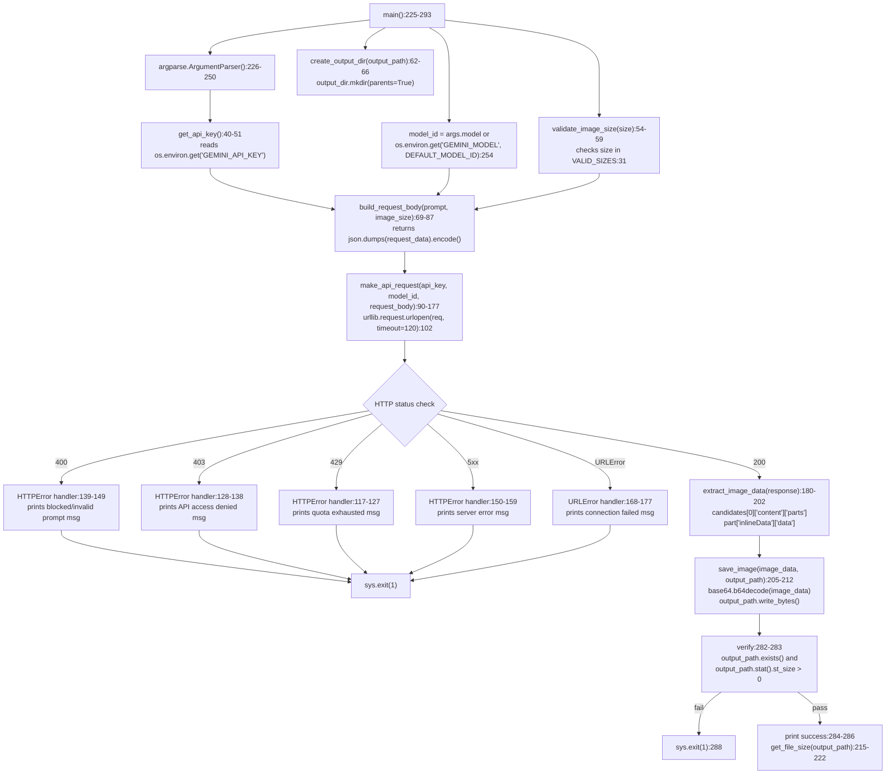
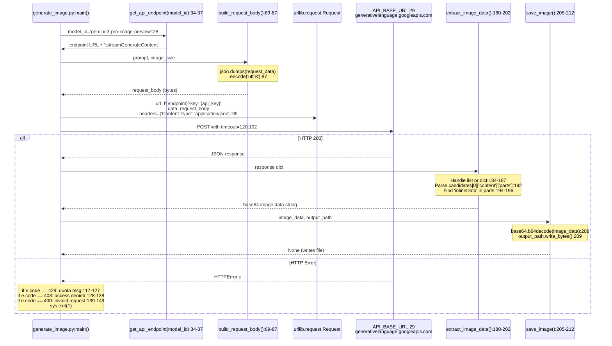
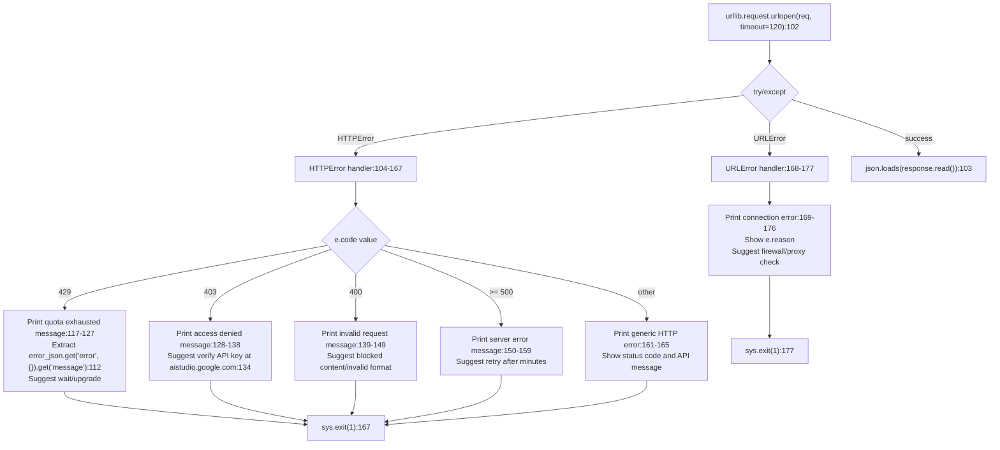

<!-- source: DeepWiki mcp.deepwiki.com · repo sanjay3290/ai-skills · extra page Imagen (Image Generation) · fetched 2026-10-26 -->

# Imagen (Image Generation)

<details>
<summary>Relevant source files</summary>

The following files were used as context for generating this wiki page:

- [skills/imagen/.env.example](skills/imagen/.env.example)
- [skills/imagen/.gitignore](skills/imagen/.gitignore)
- [skills/imagen/README.md](skills/imagen/README.md)
- [skills/imagen/examples.md](skills/imagen/examples.md)
- [skills/imagen/reference.md](skills/imagen/reference.md)
- [skills/imagen/scripts/generate_image.py](skills/imagen/scripts/generate_image.py)

</details>


This page documents the `imagen` skill: its purpose, configuration, script interface, API integration details, and prompting patterns. The skill uses a single Python script with no external dependencies to call the Google Gemini image generation API. For general information about how skills are discovered and installed, see [3.2](#3.2). For environment variable configuration across all skills, see [6.1](#6.1).

---

## Overview

The `imagen` skill enables AI agents to generate PNG images by calling the Google Gemini `streamGenerateContent` endpoint. The skill consists of one executable script (`scripts/generate_image.py`) and no third-party Python packages — it relies entirely on the standard library.

**Primary use cases defined in `SKILL.md`:**
- UI mockups and placeholder images during frontend development
- Documentation illustrations and architecture diagrams
- Icons, logos, and UI assets
- Concept art and visual representations

---

## File Structure

```
skills/imagen/
├── SKILL.md                     # Agent-readable skill definition (YAML frontmatter)
├── README.md                    # Human documentation
├── reference.md                 # API and parameter reference
├── examples.md                  # Example prompts and Claude invocation patterns
├── .env.example                 # Environment variable template
└── scripts/
    └── generate_image.py        # Single entrypoint script
```

Sources: [skills/imagen/README.md:124-133]()

---

## Setup

### 1. Obtain a Gemini API Key

Get a free key from Google AI Studio. The key must be set as the `GEMINI_API_KEY` environment variable before running the script.

| Platform | Command |
|---|---|
| macOS / Linux | `export GEMINI_API_KEY="your-key-here"` |
| Windows (PowerShell) | `$env:GEMINI_API_KEY = "your-key-here"` |
| Windows (CMD) | `set GEMINI_API_KEY=your-key-here` |

To persist across sessions, add the export to `~/.zshrc` or `~/.bashrc` on macOS/Linux, or to `$PROFILE` on PowerShell.

Sources: [skills/imagen/reference.md:1-35](), [skills/imagen/.env.example:1-6]()

---

## Script Interface

The single entrypoint is `scripts/generate_image.py`. It requires Python 3.6+ and no installed packages.

### Positional and Named Arguments

| Argument | Type | Required | Default | Description |
|---|---|---|---|---|
| `prompt` | positional | Yes | — | Text description of the image to generate |
| `output` | positional | No | `./generated-image.png` | File path where the PNG is saved |
| `--size` | flag | No | `1K` | Image size: `512`, `1K`, or `2K` |
| `--model` / `-m` | flag | No | `gemini-3-pro-image-preview` | Gemini model ID |

Sources: [skills/imagen/scripts/generate_image.py:226-256]()

### Environment Variable Overrides

| Variable | Default | Description |
|---|---|---|
| `GEMINI_API_KEY` | *(required)* | Google Gemini API key |
| `IMAGE_SIZE` | `1K` | Overrideable by `--size` flag |
| `GEMINI_MODEL` | `gemini-3-pro-image-preview` | Overrideable by `--model` flag |

The `--size` flag takes precedence over `IMAGE_SIZE`. The `--model` flag takes precedence over `GEMINI_MODEL`.

Sources: [skills/imagen/scripts/generate_image.py:252-256]()

### Usage Examples

```bash
# Basic generation, output to ./generated-image.png
python scripts/generate_image.py "A futuristic city skyline at sunset"

# Custom output path
python scripts/generate_image.py "Minimalist app icon" "./assets/icons/app.png"

# High-resolution output
python scripts/generate_image.py --size 2K "Detailed landscape" "./wallpaper.png"

# Small thumbnail
python scripts/generate_image.py --size 512 "Simple checkmark icon" "./icons/check.png"

# Explicit model
python scripts/generate_image.py --model gemini-3-pro-image-preview "A logo" "./logo.png"
```

Sources: [skills/imagen/scripts/generate_image.py:229-241](), [skills/imagen/examples.md:125-136]()

---

## Image Sizes

| Size Token | Resolution | Typical Use |
|---|---|---|
| `512` | 512 × 512 px | Icons, thumbnails, quick previews |
| `1K` | 1024 × 1024 px | General web images (default) |
| `2K` | 2048 × 2048 px | High-res, retina displays, print |

`VALID_SIZES` is defined at [skills/imagen/scripts/generate_image.py:31]() as `{"512", "1K", "2K"}`. An unrecognized value falls back to `DEFAULT_IMAGE_SIZE` (`"1K"`) with a warning on stderr.

Sources: [skills/imagen/reference.md:44-49](), [skills/imagen/scripts/generate_image.py:28-32]()

---

## Internal Execution Flow

**Diagram: Script execution flow with code entity mapping**



Sources: [skills/imagen/scripts/generate_image.py:225-293](), [skills/imagen/scripts/generate_image.py:40-51](), [skills/imagen/scripts/generate_image.py:54-59](), [skills/imagen/scripts/generate_image.py:69-87](), [skills/imagen/scripts/generate_image.py:90-177](), [skills/imagen/scripts/generate_image.py:180-202](), [skills/imagen/scripts/generate_image.py:205-212]()

---

## API Integration

**Diagram: API call structure with code entities**



### Endpoint Construction

`get_api_endpoint(model_id)` at [skills/imagen/scripts/generate_image.py:34-37]() constructs:

```python
f"{API_BASE_URL}/{model_id}:streamGenerateContent"
```

Where `API_BASE_URL` is defined at [skills/imagen/scripts/generate_image.py:29]():

```python
API_BASE_URL = "https://generativelanguage.googleapis.com/v1beta/models"
```

The full URL at [skills/imagen/scripts/generate_image.py:93]() becomes:

```python
url = f"{endpoint}?key={api_key}"
```

### Request Body Structure

`build_request_body(prompt, image_size)` at [skills/imagen/scripts/generate_image.py:69-87]() constructs:

```json
{
  "contents": [
    {
      "role": "user",
      "parts": [{"text": "<prompt>"}]
    }
  ],
  "generationConfig": {
    "responseModalities": ["IMAGE", "TEXT"],
    "imageConfig": {
      "image_size": "<size>"
    }
  }
}
```

This is serialized via `json.dumps(request_data).encode("utf-8")` at [skills/imagen/scripts/generate_image.py:87]().

### Response Parsing Logic

`extract_image_data(response)` at [skills/imagen/scripts/generate_image.py:180-202]() implements the following logic:

1. **Handle response type** [skills/imagen/scripts/generate_image.py:184-187](): Check if response is `list` or `dict`
2. **Extract candidates** [skills/imagen/scripts/generate_image.py:186-189](): Get `candidates` array
3. **Traverse parts** [skills/imagen/scripts/generate_image.py:192](): Iterate through `candidates[0]["content"]["parts"]`
4. **Find image data** [skills/imagen/scripts/generate_image.py:194-196](): Look for part containing `"inlineData"` key
5. **Return base64 string** [skills/imagen/scripts/generate_image.py:196](): Extract `part["inlineData"]["data"]`

The base64 string is then decoded via `base64.b64decode(image_data)` at [skills/imagen/scripts/generate_image.py:208]() and written to disk via `output_path.write_bytes(image_bytes)` at [skills/imagen/scripts/generate_image.py:209]().

Sources: [skills/imagen/scripts/generate_image.py:34-37](), [skills/imagen/scripts/generate_image.py:29](), [skills/imagen/scripts/generate_image.py:69-87](), [skills/imagen/scripts/generate_image.py:93](), [skills/imagen/scripts/generate_image.py:180-202](), [skills/imagen/scripts/generate_image.py:205-212](), [skills/imagen/reference.md:39-42]()

---

## Error Handling

**Diagram: Error handling flow with code references**



`make_api_request()` at [skills/imagen/scripts/generate_image.py:90-177]() implements structured error handling:

| HTTP Status | Handler Lines | Printed Message | Suggested Action |
|---|---|---|---|
| `400` | [skills/imagen/scripts/generate_image.py:139-149]() | "Invalid request to Gemini API" | Rephrase prompt; check for blocked content |
| `403` | [skills/imagen/scripts/generate_image.py:128-138]() | "API access denied" | Verify key at `https://aistudio.google.com/` |
| `429` | [skills/imagen/scripts/generate_image.py:117-127]() | "Quota exhausted" | Wait for daily reset or upgrade plan |
| `5xx` | [skills/imagen/scripts/generate_image.py:150-159]() | "Server error" | Wait and retry in a few minutes |
| `URLError` | [skills/imagen/scripts/generate_image.py:168-177]() | "Failed to connect" | Check internet/firewall/proxy |

### Error Message Extraction

For HTTP errors, the script attempts to extract structured error details at [skills/imagen/scripts/generate_image.py:105-114]():

```python
error_body = e.read().decode("utf-8") if e.fp else ""
if error_body:
    try:
        error_json = json.loads(error_body)
        error_detail = error_json.get("error", {}).get("message", "")
```

This extracted `error_detail` is then appended to the user-facing message at [skills/imagen/scripts/generate_image.py:126-127](), [skills/imagen/scripts/generate_image.py:137-138](), etc.

Sources: [skills/imagen/scripts/generate_image.py:90-177](), [skills/imagen/scripts/generate_image.py:104-167](), [skills/imagen/scripts/generate_image.py:168-177](), [skills/imagen/scripts/generate_image.py:105-114]()

---

## Prompting Patterns

`reference.md` and `examples.md` document recommended prompt structures. Below is a summary by category.

### General Techniques

| Technique | Example |
|---|---|
| Style specification | `"flat design"`, `"watercolor"`, `"photorealistic"` |
| Color direction | `"blue and orange gradient"`, `"monochrome"` |
| Lighting | `"golden hour lighting"`, `"three-point studio lighting"` |
| Composition | `"chest-up framing"`, `"3/4 body shot"`, `"rule of thirds"` |

### Advanced Photography Techniques

These patterns appear in [skills/imagen/reference.md:109-154]() and [skills/imagen/examples.md:73-113]():

| Technique | Example phrase |
|---|---|
| Lens specification | `"85mm f/1.4 lens, shallow depth of field"` |
| Film stock reference | `"Kodak Portra 400 color tones, authentic film grain"` |
| Era aesthetic | `"early-2000s digital camera look"` |
| Texture detail | `"natural skin texture with visible pores"` |
| Face preservation | `"keep facial features exactly consistent"` |

### Example Prompts by Use Case

| Use Case | Sample Prompt Fragment |
|---|---|
| UI hero image | `"abstract flowing gradients in blue and purple, clean minimalist style"` |
| App icon | `"stylized sun partially behind a cloud, rounded square suitable for iOS/Android"` |
| Architecture diagram | `"boxes connected by arrows, services labeled, white background, professional"` |
| Corporate headshot | `"85mm f/2.8 lens, three-point studio lighting, neutral gray backdrop, catchlights"` |
| E-commerce product | `"100mm macro lens, soft diffused lighting, clean white background, subtle reflection"` |

Sources: [skills/imagen/reference.md:98-180](), [skills/imagen/examples.md:1-137]()

---

## Agent Activation

The `SKILL.md` frontmatter instructs AI agents to automatically activate this skill when a user requests any form of image creation. The `description` field lists trigger scenarios:

> "Use this skill when the user needs to create, generate, or produce images for any purpose including UI mockups, icons, illustrations, diagrams, concept art, placeholder images, or visual representations."

Once activated, the agent constructs a `generate_image.py` invocation with an appropriate prompt, size flag, and output path derived from project context.

Sources: [skills/imagen/SKILL.md:1-12](), [skills/imagen/SKILL.md:34-47]()

---

## Requirements

- **Python 3.6+** — no `pip install` required; all imports (`argparse`, `base64`, `json`, `os`, `sys`, `urllib`) are from the standard library.
- **`GEMINI_API_KEY`** — mandatory environment variable.
- **Write access** to the output directory — `create_output_dir()` will create missing parent directories automatically.

Sources: [skills/imagen/SKILL.md:56-57](), [skills/imagen/README.md:136-138]()

---

