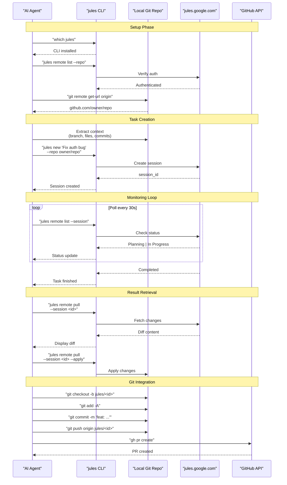
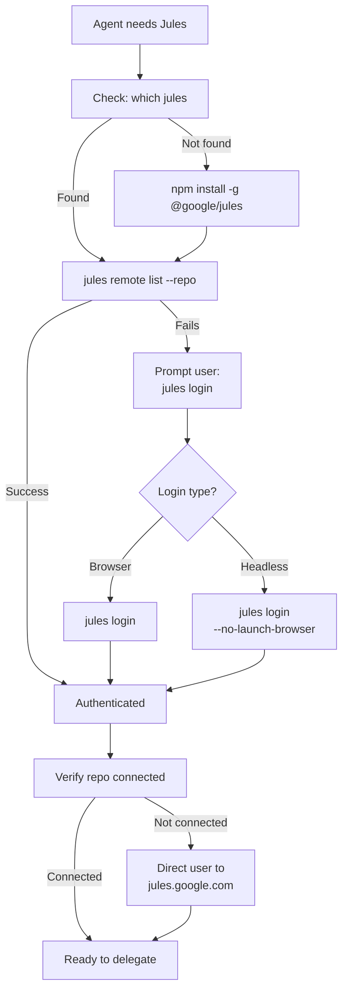
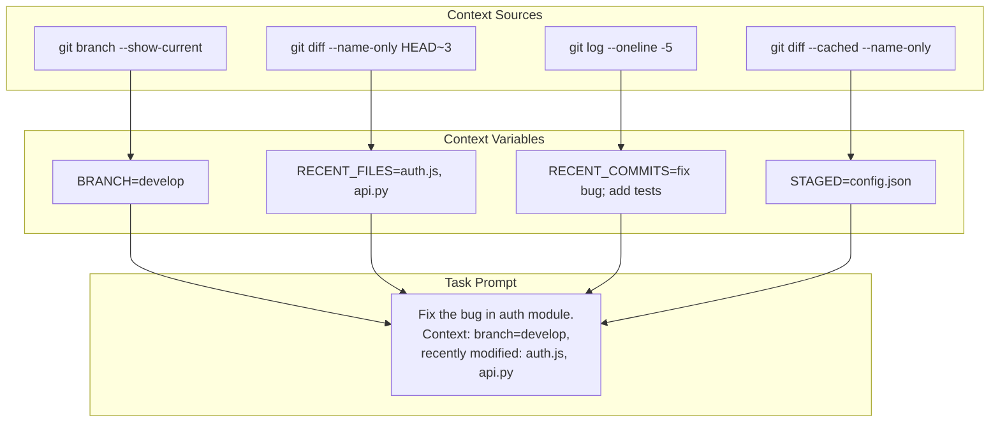
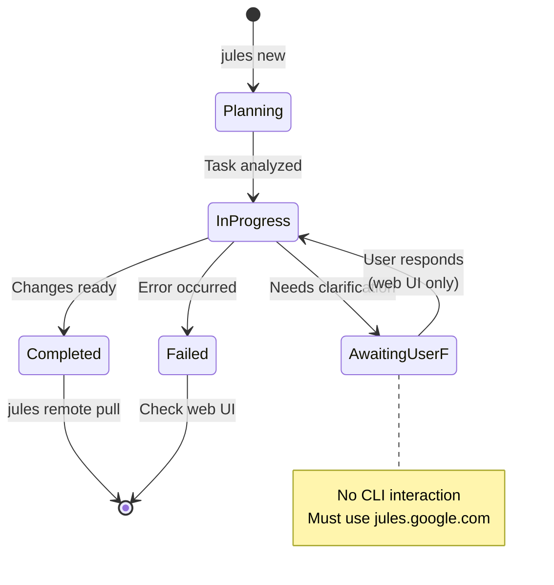
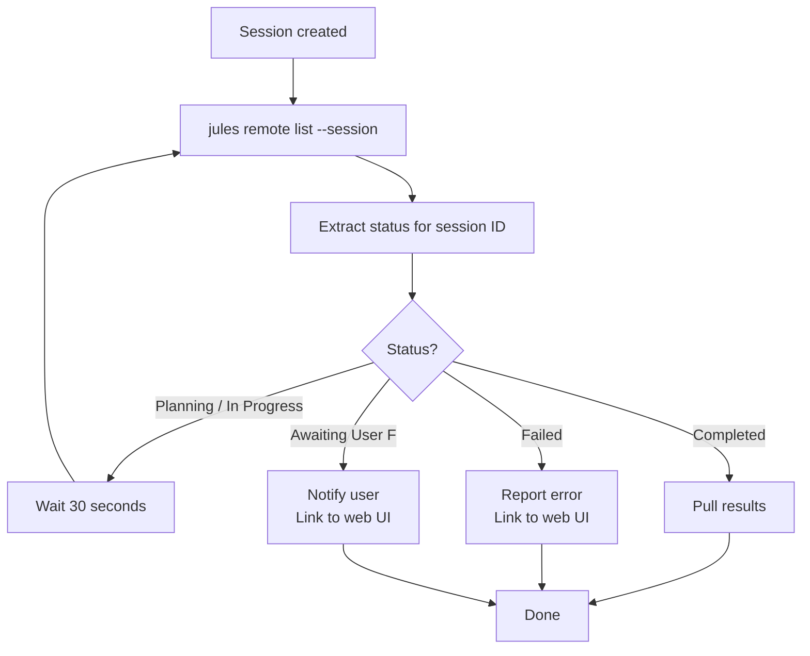
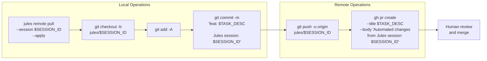

<!-- source: DeepWiki mcp.deepwiki.com · repo sanjay3290/ai-skills · extra page Jules (GitHub Agent) · fetched 2026-10-26 -->

# Jules (GitHub Agent)

<details>
<summary>Relevant source files</summary>

The following files were used as context for generating this wiki page:

- [README.md](README.md)
- [skills/jules/SKILL.md](skills/jules/SKILL.md)
- [skills/manus/SKILL.md](skills/manus/SKILL.md)

</details>


This document describes the Jules skill, which delegates coding tasks to Google's Jules AI agent for asynchronous execution on GitHub repositories. Jules specializes in bug fixes, test generation, documentation, refactoring, code reviews, and feature implementation.

For asynchronous research and analysis tasks (non-coding), see [Manus (Research Agent)](#4.4.2). For general information on agent delegation patterns, see [Agent Delegation](#4.4).

**Sources**: [skills/jules/SKILL.md:1-201](), [README.md:37-37](), [README.md:209-216]()

---

## Purpose and Scope

Jules is an asynchronous coding agent that accepts natural language task descriptions, executes them autonomously on GitHub repositories, and returns code changes as git diffs. Unlike synchronous code assistance tools, Jules operates in a fire-and-forget model: tasks are submitted immediately, execute in the background (typically 5-30 minutes), and results are retrieved when ready.

The skill provides a CLI wrapper around the `@google/jules` tool, enabling AI agents to:
- Delegate coding tasks with rich context injection
- Monitor session progress through polling
- Retrieve and apply code changes locally
- Automatically create branches and pull requests

**Sources**: [skills/jules/SKILL.md:1-12](), [README.md:209-216]()

---

## Architecture Overview

Jules uses a session-based asynchronous workflow where the AI agent acts as an orchestrator between the local repository and the remote Jules service.

### End-to-End Workflow



**Key architectural characteristics**:
- **Asynchronous delegation**: Task creation returns immediately with a session ID
- **Stateless polling**: Session status checked via `jules remote list --session`
- **Idempotent retrieval**: `jules remote pull` can be called multiple times
- **Optional application**: `--apply` flag controls whether changes are written to disk
- **Git-first workflow**: Results are diffs designed for git branch workflows

**Sources**: [skills/jules/SKILL.md:14-58](), [skills/jules/SKILL.md:109-128]()

---

## Prerequisites and Authentication

### CLI Installation

Jules requires the `@google/jules` npm package:

```bash
which jules || npm install -g @google/jules
```

The skill checks for CLI presence before executing commands using [skills/jules/SKILL.md:17-19]().

**Sources**: [skills/jules/SKILL.md:16-19](), [README.md:210-211]()

### Authentication Flow



Authentication is verified by attempting to list repositories with `jules remote list --repo` ([skills/jules/SKILL.md:22-25]()). If authentication fails, the user must run `jules login` manually, which opens a browser for Google OAuth.

**Repository connection** is required before task creation. Users must connect their GitHub repositories at [jules.google.com](https://jules.google.com) ([skills/jules/SKILL.md:33-34](), [README.md:216]()).

**Sources**: [skills/jules/SKILL.md:14-34](), [README.md:213-214]()

---

## Task Creation

### Command Structure

The `jules new` command creates a new coding session:

| Flag | Purpose | Example |
|------|---------|---------|
| (none) | Task description | `jules new "Fix auth bug"` |
| `--repo owner/repo` | Specify repository | `jules new --repo myorg/api "Add tests"` |
| `--parallel N` | Create N parallel sessions | `jules new --parallel 3 "Implement X"` |
| (stdin) | Read task from stdin | `cat task.md \| jules new --repo owner/repo` |

**Auto-detection**: If no `--repo` flag is provided, Jules extracts the repository from the current git remote using [skills/jules/SKILL.md:27-30]():

```bash
git remote get-url origin 2>/dev/null | sed -E 's#.*(github\.com)[/:]([^/]+/[^/.]+)(\.git)?#\2#'
```

This regex extracts `owner/repo` from URLs like:
- `https://github.com/owner/repo.git`
- `git@github.com:owner/repo.git`

**Sources**: [skills/jules/SKILL.md:36-44]()

### Context Injection

Jules performs better when provided with repository context. The skill extracts context from git metadata and injects it into task prompts:



The context extraction commands are defined at [skills/jules/SKILL.md:69-73]():

```bash
BRANCH=$(git branch --show-current)
RECENT_FILES=$(git diff --name-only HEAD~3 2>/dev/null | head -10 | tr '\n' ', ')
RECENT_COMMITS=$(git log --oneline -5 | tr '\n' '; ')
STAGED=$(git diff --cached --name-only | tr '\n' ', ')
```

This context is then injected into the task prompt at [skills/jules/SKILL.md:76-79]():

```bash
jules new --repo owner/repo "Fix the bug in auth module. Context: branch=$BRANCH, recently modified: $RECENT_FILES"
```

**Sources**: [skills/jules/SKILL.md:65-79]()

---

## Session Management

### Session States

Jules sessions progress through multiple states during execution:



State definitions from [skills/jules/SKILL.md:186-194]():

| Status | Meaning | Action |
|--------|---------|--------|
| `Planning` | Jules is analyzing the task | Wait |
| `In Progress` | Jules is making code changes | Wait |
| `Awaiting User F` | Jules needs clarification | Respond at web UI |
| `Completed` | Changes are ready | Pull results |
| `Failed` | Task encountered an error | Check web UI |

**Sources**: [skills/jules/SKILL.md:186-194]()

### Listing Sessions

Two primary listing commands are available:

```bash
# List all sessions (current and past)
jules remote list --session

# List connected repositories
jules remote list --repo
```

The `--session` output format is parsed by the skill to extract session ID and status ([skills/jules/SKILL.md:47-50]()).

**Latest session shortcut** ([skills/jules/SKILL.md:60-63]()):
```bash
LATEST=$(jules remote list --session 2>/dev/null | awk 'NR==2 {print $1}')
jules remote pull --session $LATEST
```

**Sources**: [skills/jules/SKILL.md:46-63]()

### Polling Pattern

The skill implements a polling loop to wait for session completion:



The polling implementation is at [skills/jules/SKILL.md:132-154]():

```bash
SESSION_ID="<id>"
while true; do
  STATUS=$(jules remote list --session 2>/dev/null | grep "$SESSION_ID" | awk '{print $NF}')
  case "$STATUS" in
    Completed)
      echo "Done!"
      jules remote pull --session "$SESSION_ID"
      break ;;
    Failed)
      echo "Failed. Check: https://jules.google.com/session/$SESSION_ID"
      break ;;
    *User*)
      echo "Needs input: https://jules.google.com/session/$SESSION_ID"
      break ;;
    *)
      echo "Status: $STATUS - waiting 30s..."
      sleep 30 ;;
  esac
done
```

**Polling interval**: 30 seconds ([skills/jules/SKILL.md:150]())

**Sources**: [skills/jules/SKILL.md:130-154]()

---

## Result Retrieval

### Pull Commands

Three retrieval modes are available:

| Command | Behavior |
|---------|----------|
| `jules remote pull --session <id>` | Display diff (no changes to disk) |
| `jules remote pull --session <id> --apply` | Apply changes to local files |
| `jules teleport <id>` | Clone repo + apply changes (fresh checkout) |

The `--apply` flag determines whether changes are written to disk ([skills/jules/SKILL.md:53-57]()).

**Sources**: [skills/jules/SKILL.md:52-57]()

### Diff Format

The `jules remote pull` command outputs a git-style diff that can be reviewed before application. The diff shows:
- Files modified
- Lines added/removed
- Full context around changes

This allows the AI agent to validate changes before applying them with `--apply`.

**Sources**: [skills/jules/SKILL.md:52-57]()

---

## Git Integration Patterns

### Branch Creation and PR Workflow

The skill implements a complete git workflow for integrating Jules changes:



The complete integration script is at [skills/jules/SKILL.md:111-128]():

```bash
SESSION_ID="<id>"
TASK_DESC="<brief description>"

# Create branch, apply, commit
git checkout -b "jules/$SESSION_ID"
jules remote pull --session "$SESSION_ID" --apply
git add -A
git commit -m "feat: $TASK_DESC

Jules session: $SESSION_ID"

# Optional: push and create PR
git push -u origin "jules/$SESSION_ID"
gh pr create --title "$TASK_DESC" --body "Automated changes from Jules session $SESSION_ID"
```

**Branch naming convention**: `jules/<session_id>` for easy identification ([skills/jules/SKILL.md:118]())

**Commit message format** ([skills/jules/SKILL.md:121-123]()):
- Conventional commit prefix (`feat:`, `fix:`, etc.)
- Brief task description
- Session ID for traceability

**Sources**: [skills/jules/SKILL.md:109-128]()

---

## Template Prompts

The skill provides pre-built templates for common coding tasks, with automatic context extraction:

### Add Unit Tests

```bash
FILES=$(git diff --name-only HEAD~3 2>/dev/null | grep -E '\.(js|ts|py|go|java)$' | head -5 | tr '\n' ', ')
jules new "Add unit tests for recently modified files: $FILES. Include edge cases and mocks where needed."
```

This template:
1. Finds recently modified code files (last 3 commits)
2. Filters to supported languages
3. Includes file list in the prompt

**Sources**: [skills/jules/SKILL.md:85-89]()

### Add Documentation

```bash
FILES=$(git diff --name-only HEAD~3 2>/dev/null | grep -E '\.(js|ts|py|go|java)$' | head -5 | tr '\n' ', ')
jules new "Add documentation comments to: $FILES. Include function descriptions, parameters, return values, and examples."
```

Uses the same file detection as the test template, but focuses on documentation comments.

**Sources**: [skills/jules/SKILL.md:91-95]()

### Fix Lint Errors

```bash
jules new "Fix all linting errors in the codebase. Run the linter, identify issues, and fix them while maintaining code functionality."
```

This template relies on Jules to discover and run the project's linter automatically.

**Sources**: [skills/jules/SKILL.md:97-100]()

### Review Pull Request

```bash
PR_NUM=123
PR_INFO=$(gh pr view $PR_NUM --json title,body,files --jq '"\(.title)\n\(.body)\nFiles: \(.files[].path)"')
jules new "Review this PR for bugs, security issues, and improvements: $PR_INFO"
```

This template:
1. Uses GitHub CLI (`gh`) to fetch PR details
2. Extracts title, description, and file list
3. Injects into a review prompt

**Sources**: [skills/jules/SKILL.md:102-107]()

---

## AGENTS.md Configuration

Jules reads an `AGENTS.md` file from the repository root to understand project conventions. This improves task execution by providing context about:
- Tech stack
- Code conventions
- Testing requirements
- Build/deploy commands

### Template Structure

The recommended template is at [skills/jules/SKILL.md:156-184]():

```markdown
# AGENTS.md

## Project Overview
[Brief description]

## Tech Stack
- Language: [TypeScript/Python/Go/etc.]
- Framework: [React/FastAPI/Gin/etc.]
- Testing: [Jest/pytest/go test/etc.]

## Code Conventions
- [Linter/formatter used]
- [Naming conventions]
- [File organization]

## Testing Requirements
- Unit tests for new features
- Integration tests for APIs
- Coverage target: [X]%

## Build & Deploy
- Build: `[command]`
- Test: `[command]`
```

**Location**: Repository root (e.g., `/AGENTS.md`)

**Purpose**: Jules automatically reads this file during task execution to align with project standards.

**Sources**: [skills/jules/SKILL.md:156-200]()

---

## Best Practices

### Context Injection Strategies

1. **Always include branch name** to help Jules understand the development context
2. **Include recently modified files** (last 3 commits) for focused changes
3. **Reference specific line numbers or functions** when fixing bugs
4. **Include error messages** or stack traces for debugging tasks

**Sources**: [skills/jules/SKILL.md:65-79]()

### Polling Intervals

- **Standard polling**: 30 seconds ([skills/jules/SKILL.md:150]())
- Avoid more frequent polling to reduce API load
- Jules sessions typically take 5-30 minutes to complete

**Sources**: [skills/jules/SKILL.md:130-154]()

### Error Handling

Common failure modes:

| Issue | Detection | Resolution |
|-------|-----------|------------|
| Not authenticated | `jules remote list --repo` fails | Run `jules login` |
| Repo not connected | Repo missing from `--repo` list | Visit jules.google.com |
| Task failed | Status = `Failed` | Check web UI for details |
| Needs user input | Status contains `User` | Respond at web UI |

**Sources**: [skills/jules/SKILL.md:22-34](), [skills/jules/SKILL.md:186-194]()

### Session Management

- **Track session IDs** for later retrieval
- **Use descriptive task names** to identify sessions easily
- **Create AGENTS.md** once per repository for consistent results
- **Review diffs before applying** with `jules remote pull` (no `--apply`)

**Sources**: [skills/jules/SKILL.md:53-57](), [skills/jules/SKILL.md:156-184]()

---

## Limitations

### Platform Support

- **GitHub only**: GitLab, Bitbucket, and other platforms are not supported ([skills/jules/SKILL.md:199]())
- Repository must be connected at jules.google.com before task creation

**Sources**: [skills/jules/SKILL.md:195-200]()

### CLI Interaction Constraints

- **No bidirectional conversation**: Jules cannot ask follow-up questions via CLI ([skills/jules/SKILL.md:197]())
- **Web UI required for feedback**: When Jules needs clarification (status `Awaiting User F`), responses must be provided at [jules.google.com](https://jules.google.com)
- **No CLI cancellation**: Sessions must be cancelled through the web interface ([skills/jules/SKILL.md:198]())

**Sources**: [skills/jules/SKILL.md:195-200]()

### Repository Access

Users must manually connect repositories at [jules.google.com](https://jules.google.com) before delegating tasks. The skill cannot automate this connection process.

**Sources**: [skills/jules/SKILL.md:33-34](), [README.md:216]()

---

