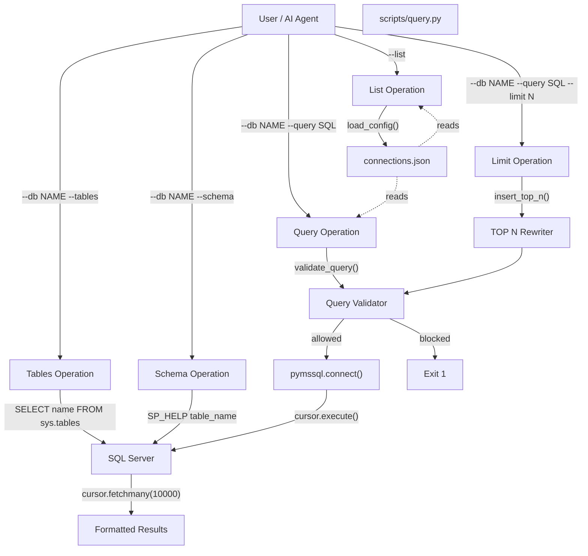
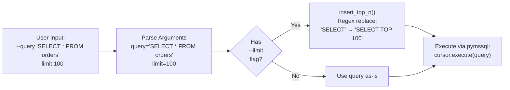
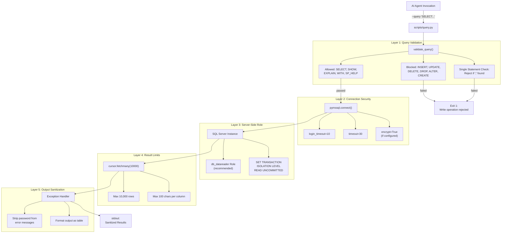
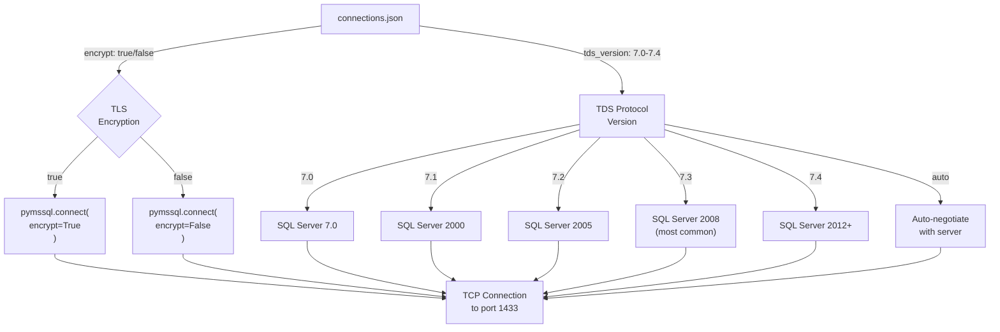

<!-- source: DeepWiki mcp.deepwiki.com · repo sanjay3290/ai-skills · extra page Microsoft SQL Server · fetched 2026-10-26 -->

# Microsoft SQL Server

<details>
<summary>Relevant source files</summary>

The following files were used as context for generating this wiki page:

- [skills/mssql/.gitignore](skills/mssql/.gitignore)
- [skills/mssql/README.md](skills/mssql/README.md)
- [skills/mssql/SKILL.md](skills/mssql/SKILL.md)
- [skills/mysql/SKILL.md](skills/mysql/SKILL.md)

</details>


This page documents the `mssql` skill, which allows AI agents to execute read-only queries against Microsoft SQL Server databases. It covers connection configuration, CLI usage, the `--limit` to `TOP N` translation, and safety enforcement. For shared design patterns across all three database skills, see [Database Skills](#4.2). For PostgreSQL-specific documentation, see [PostgreSQL](#4.2.1). For MySQL-specific documentation, see [MySQL](#4.2.2).

---

## Overview

The `mssql` skill is located at [skills/mssql/](). It uses the `pymssql` Python library to connect to SQL Server instances via the Tabular Data Stream (TDS) protocol and enforces read-only access through query validation combined with server-side role enforcement.

**Key distinctions from other database skills:**

| Feature | MSSQL | PostgreSQL | MySQL |
|---------|-------|------------|-------|
| LIMIT syntax | `SELECT TOP N` (auto-converted from `--limit`) | `LIMIT N` | `LIMIT N` |
| Encryption config | `encrypt` + `tds_version` | `sslmode` | `ssl_ca`, `ssl_cert`, `ssl_key` |
| Read-only enforcement | Query validation + `db_datareader` role | Query validation + read-only user | `SET SESSION TRANSACTION READ ONLY` |
| Protocol | TDS (Tabular Data Stream) | Native PostgreSQL | Native MySQL |
| Default port | `1433` | `5432` | `3306` |

The `--limit` flag automatically rewrites queries to insert `SELECT TOP N` syntax, as SQL Server does not support the `LIMIT` clause. The skill also exposes TDS protocol version control, allowing compatibility tuning for different SQL Server versions (7.0 through 2012+).

Sources: [skills/mssql/SKILL.md:1-13](), [skills/mssql/README.md:1-5]()

---

## Skill File Layout

```
skills/mssql/
├── SKILL.md                   # Agent-readable skill definition (YAML frontmatter + instructions)
├── README.md                  # Human-readable setup guide
├── connections.json           # Credential file (gitignored, created by user)
├── connections.example.json   # Template for connections.json
├── requirements.txt           # Python dependencies (pymssql)
├── scripts/
│   └── query.py               # Main CLI entrypoint
└── .gitignore                 # Excludes connections.json from version control
```

Sources: [skills/mssql/SKILL.md:1-8](), [skills/mssql/README.md:1-10](), [skills/mssql/.gitignore:1-3]()

---

## Dependency

The skill requires `pymssql`, declared in `requirements.txt`. Install it before use:

```bash
pip install -r requirements.txt
# or directly:
pip install pymssql
```

This is the only external Python dependency. `pymssql` provides the DB-API 2.0 interface to SQL Server, including query timeout and login timeout parameters.

Sources: [skills/mssql/SKILL.md:16-18](), [skills/mssql/README.md:78-81]()

---

## Configuration

### File Location

The credential file can be placed in one of two locations. The skill checks them in order:

| Priority | Path |
|----------|------|
| 1st | `skills/mssql/connections.json` (skill directory) |
| 2nd | `~/.config/claude/mssql-connections.json` (global) |

Always set file permissions to `600` to protect credentials:

```bash
chmod 600 connections.json
```

Sources: [skills/mssql/SKILL.md:20-26]()

### `connections.json` Format

```json
{
  "databases": [
    {
      "name": "production",
      "description": "Main app database - users, orders, transactions",
      "host": "db.example.com",
      "port": 1433,
      "database": "app_prod",
      "user": "readonly_user",
      "password": "your-password",
      "encrypt": true,
      "tds_version": "7.3"
    }
  ]
}
```

### Connection Fields Reference

| Field | Required | Default | Description |
|-------|----------|---------|-------------|
| `name` | Yes | — | Identifier used with `--db` flag (case-insensitive) |
| `description` | Yes | — | Human-readable description; used by AI agents for auto-selection |
| `host` | Yes | — | Database server hostname or IP |
| `port` | No | `1433` | TCP port |
| `database` | Yes | — | Database name to connect to |
| `user` | Yes | — | SQL Server login username |
| `password` | Yes | — | SQL Server login password |
| `encrypt` | No | `false` | Enable TLS encryption; set `true` for Azure SQL or production |
| `tds_version` | No | auto | TDS protocol version: `7.0`, `7.1`, `7.2`, `7.3`, `7.4` |

Sources: [skills/mssql/SKILL.md:47-58](), [skills/mssql/README.md:55-68]()

---

## CLI Reference (`scripts/query.py`)

All operations are performed through [skills/mssql/scripts/query.py](). The script provides five primary operations:

**Diagram: scripts/query.py Command Flow**



Sources: [skills/mssql/SKILL.md:62-88](), [skills/mssql/README.md:37-53]()

### Command Examples

**List configured databases:**
```bash
python3 scripts/query.py --list
```

**Run a query:**
```bash
python3 scripts/query.py --db production --query "SELECT TOP 10 * FROM users"
```

**List tables:**
```bash
python3 scripts/query.py --db production --tables
```

**Show schema:**
```bash
python3 scripts/query.py --db production --schema
```

**Limit results (auto-converts to TOP N):**
```bash
python3 scripts/query.py --db production --query "SELECT * FROM orders" --limit 100
```

Sources: [skills/mssql/SKILL.md:62-88]()

---

## `TOP N` Translation

SQL Server does not support the `LIMIT` keyword used by PostgreSQL and MySQL. Instead, it uses `SELECT TOP N` syntax. The `--limit` flag in [scripts/query.py]() automatically handles this by rewriting queries before execution.

**Diagram: TOP N Query Rewriting Process**



**Transformation Examples:**

| Input query | `--limit` value | Executed query | Notes |
|-------------|-----------------|----------------|-------|
| `SELECT * FROM orders` | `100` | `SELECT TOP 100 * FROM orders` | Simple case |
| `SELECT id, name FROM users` | `50` | `SELECT TOP 50 id, name FROM users` | With column list |
| `SELECT * FROM products WHERE active=1` | `25` | `SELECT TOP 25 * FROM products WHERE active=1` | With WHERE clause |
| `SELECT TOP 10 * FROM logs` | (none) | `SELECT TOP 10 * FROM logs` | Manual TOP preserved |

**Implementation Details:**

The rewriter uses a regex pattern to locate the `SELECT` keyword and insert `TOP N` immediately after it. This occurs before query validation, ensuring the modified query passes through the same safety checks as any manually-written query.

Sources: [skills/mssql/SKILL.md:87-88](), [skills/mssql/README.md:47-52]()

---

## Safety & Read-Only Enforcement

Unlike the MySQL skill (which uses `SET SESSION TRANSACTION READ ONLY` at the connection level), the MSSQL skill enforces read-only access primarily through query validation in [scripts/query.py](). Server-side protection is achieved by using a `db_datareader` database role for the connecting user.

**Diagram: Multi-Layer Read-Only Enforcement Architecture**



### Allowed Statement Types

The `validate_query()` function in [scripts/query.py]() uses an allowlist approach. Only the following statement types reach the database:

| Statement | Purpose | Example |
|-----------|---------|---------|
| `SELECT` | Data retrieval | `SELECT * FROM users WHERE active=1` |
| `SHOW` | Object metadata | `SHOW TABLES`, `SHOW COLUMNS FROM users` |
| `EXPLAIN` | Query plan analysis | `EXPLAIN SELECT * FROM orders` |
| `WITH` | Common Table Expressions | `WITH cte AS (SELECT ...) SELECT * FROM cte` |
| `SP_HELP` | SQL Server object info | `SP_HELP users` (used by `--schema` flag) |

All other statements (INSERT, UPDATE, DELETE, DROP, ALTER, CREATE, TRUNCATE, GRANT, etc.) are blocked at validation time before any network connection is established.

### Safety Features Summary

| Layer | Feature | Implementation | Code Location |
|-------|---------|----------------|---------------|
| 1 | Query validation | Allowlist + single-statement check | [scripts/query.py]() `validate_query()` |
| 1 | Write operation blocking | Reject INSERT/UPDATE/DELETE/DROP/ALTER | [scripts/query.py]() `validate_query()` |
| 2 | Query timeout | 30 seconds | [scripts/query.py]() `pymssql.connect(timeout=30)` |
| 2 | Login timeout | 10 seconds | [scripts/query.py]() `pymssql.connect(login_timeout=10)` |
| 2 | TLS encryption | Optional via `encrypt` flag | [connections.json]() |
| 3 | Server-side role | Recommended `db_datareader` | SQL Server configuration |
| 3 | Read-only transaction | `SET TRANSACTION ISOLATION LEVEL READ UNCOMMITTED` | [scripts/query.py]() |
| 4 | Row memory cap | Max 10,000 rows | [scripts/query.py]() `cursor.fetchmany(10000)` |
| 4 | Column width cap | 100 characters per column | [scripts/query.py]() formatting logic |
| 5 | Credential sanitization | Strip passwords from error messages | [scripts/query.py]() exception handler |

Sources: [skills/mssql/SKILL.md:103-112](), [skills/mssql/README.md:69-77]()

---

## Encryption & TDS Protocol

The MSSQL skill exposes two connection-level security settings specific to SQL Server and not present in other database skills: `encrypt` for TLS and `tds_version` for protocol compatibility.

**Diagram: TDS Protocol and Encryption Configuration Flow**



### `encrypt` Field

Enables TLS encryption on the connection. This wraps the TDS protocol stream in a TLS tunnel.

| Value | Behavior | Use Case |
|-------|----------|----------|
| `true` | TLS encryption enabled | **Required** for Azure SQL Database; recommended for all production servers |
| `false` | Plaintext connection | Local development only; never use over untrusted networks |

### `tds_version` Field

Specifies the Tabular Data Stream protocol version used by `pymssql`. TDS is the application-layer protocol that SQL Server uses for client communication. Version mismatches can cause authentication or query execution failures.

| Version | SQL Server | Common Issues | Recommendation |
|---------|------------|---------------|----------------|
| `7.0` | SQL Server 7.0 | Very old; limited feature support | Legacy systems only |
| `7.1` | SQL Server 2000 | Character encoding issues | Legacy systems only |
| `7.2` | SQL Server 2005 | Deprecated; connection failures | Upgrade server if possible |
| `7.3` | SQL Server 2008 | **Most compatible** | **Default for most environments** |
| `7.4` | SQL Server 2012+ | Required for some 2012+ features | Use for modern servers |
| `auto` | Auto-detect | May fail with version negotiation | Try explicit version if errors occur |

**Troubleshooting TDS Errors:**

If you encounter errors like `"TDS version not supported"` or `"Login failed"`, try:
1. Set `"tds_version": "7.3"` (most compatible)
2. If still failing, try `"7.4"` for SQL Server 2012+
3. Check that the SQL Server version matches the TDS version

**Azure SQL Database Requirements:**

Azure SQL Database requires both settings:
```json
{
  "encrypt": true,
  "tds_version": "7.3"
}
```

Sources: [skills/mssql/SKILL.md:37-41, 56-58](), [skills/mssql/README.md:20-29, 64-67]()

---

## Database Auto-Selection

The AI agent uses the `description` field in `connections.json` to automatically select the appropriate database based on the user's query intent.

| User asks about | Look for `description` containing |
|-----------------|-----------------------------------|
| users, accounts | users, accounts, customers |
| orders, sales | orders, transactions, sales |
| analytics, metrics | analytics, metrics, reports |
| logs, events | logs, events, audit |

If the intent is ambiguous, the agent should run `--list` to display all configured databases and ask the user to choose.

Sources: [skills/mssql/SKILL.md:89-101]()

---

## Troubleshooting

| Error | Solution |
|-------|----------|
| Config not found | Create `connections.json` in `skills/mssql/` or `~/.config/claude/mssql-connections.json` |
| Authentication failed | Verify `user` and `password` fields in `connections.json` |
| Connection timeout | Check `host`/`port`, firewall rules, and VPN access |
| TDS version error | Set `"tds_version": "7.3"` or `"7.4"` explicitly |
| Encryption error | Set `"encrypt": true` (required for Azure SQL) |
| Permission warning | Run `chmod 600 connections.json` |

For general database connection configuration guidance, see [Configuration Guide: Database Connections](#6.3).

Sources: [skills/mssql/SKILL.md:114-123]()

---

## Exit Codes

| Code | Meaning |
|------|---------|
| `0` | Success |
| `1` | Error (config missing, auth failed, invalid query, database error) |

Sources: [skills/mssql/SKILL.md:125-128]()

---

