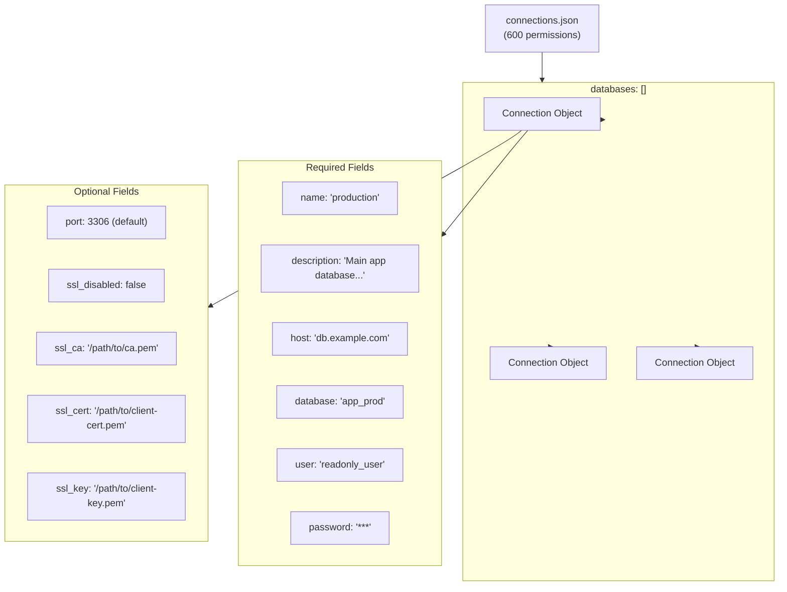
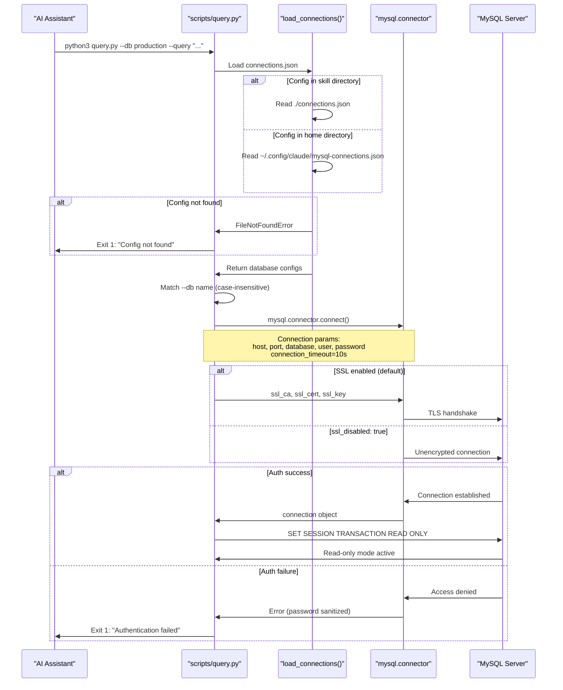
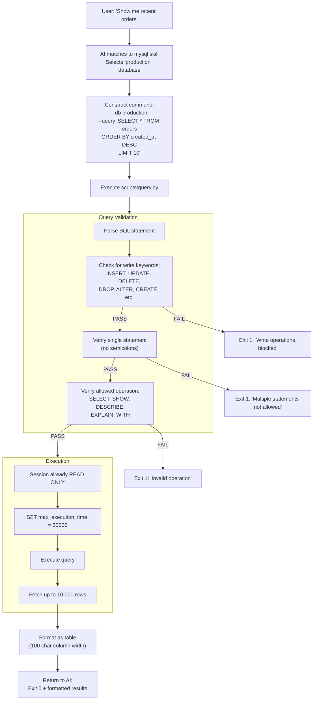
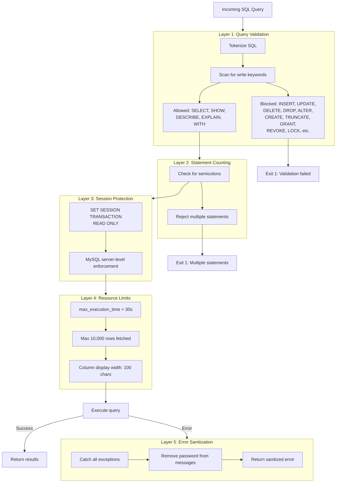
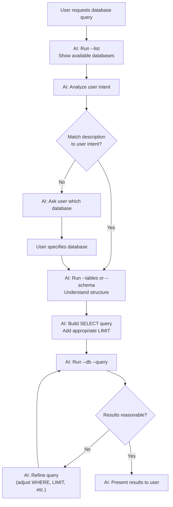

<!-- source: DeepWiki mcp.deepwiki.com · repo sanjay3290/ai-skills · extra page MySQL · fetched 2026-10-26 -->

# MySQL

<details>
<summary>Relevant source files</summary>

The following files were used as context for generating this wiki page:

- [skills/mssql/SKILL.md](skills/mssql/SKILL.md)
- [skills/mysql/SKILL.md](skills/mysql/SKILL.md)

</details>


This page provides a complete reference for the **mysql skill**, which enables read-only SQL queries against multiple MySQL database connections. The skill supports intelligent database auto-selection, SSL/TLS connections, and comprehensive safety features to prevent accidental write operations.

For other database skills, see [PostgreSQL](#4.2.1) and [Microsoft SQL Server](#4.2.3). For the general database skills pattern, see [Database Skills](#4.2).

## Overview

The mysql skill wraps MySQL database access with read-only guarantees, supporting multiple named connections configured in [connections.json](). Each connection includes a semantic description field that enables AI assistants to automatically select the appropriate database based on user intent.

**Key Capabilities:**
- Execute SELECT queries against MySQL 5.7.8+ and MariaDB 10.1.1+
- Schema exploration (list tables, show structure)
- Multiple connection management with auto-selection
- SSL/TLS encryption support
- Enforced read-only mode at both session and validation layers

**Technology Stack:**
- Python 3.8+
- `mysql-connector-python` library
- [scripts/query.py]() as the main executable

Sources: [skills/mysql/SKILL.md:1-17]()

## Configuration Structure

### connections.json Schema

The skill requires a `connections.json` file located either in the skill directory or at `~/.config/claude/mysql-connections.json`. The file defines an array of database connection objects with authentication credentials and SSL settings.



**Configuration Fields**

| Field | Required | Type | Description |
|-------|----------|------|-------------|
| `name` | Yes | string | Case-insensitive identifier for connection selection |
| `description` | Yes | string | Semantic description for AI-driven auto-selection |
| `host` | Yes | string | MySQL server hostname or IP address |
| `port` | No | integer | Server port (default: 3306) |
| `database` | Yes | string | Database/schema name to connect to |
| `user` | Yes | string | MySQL username (recommend read-only role) |
| `password` | Yes | string | User password (sanitized from error messages) |
| `ssl_disabled` | No | boolean | Set `true` to disable SSL (default: false) |
| `ssl_ca` | No | string | Path to CA certificate for SSL verification |
| `ssl_cert` | No | string | Path to client certificate for mutual TLS |
| `ssl_key` | No | string | Path to client private key for mutual TLS |

**File Permissions:** Must be set to `600` to prevent credential exposure:
```bash
chmod 600 connections.json
```

Sources: [skills/mysql/SKILL.md:20-60]()

### Database Selection Logic

The `description` field enables semantic matching between user queries and appropriate databases. The AI assistant compares user intent against all connection descriptions to select the correct target.

**Matching Patterns:**

| User Intent | Description Keywords |
|-------------|---------------------|
| Users, accounts, customers | `users`, `accounts`, `customers` |
| Orders, sales, transactions | `orders`, `transactions`, `sales` |
| Analytics, metrics, reports | `analytics`, `metrics`, `reports` |
| Logs, events, audit trails | `logs`, `events`, `audit` |

**Fallback:** If the AI cannot determine the appropriate database, it runs `--list` and prompts the user to specify which connection to use.

Sources: [skills/mysql/SKILL.md:88-100]()

## Authentication and Connection

### Connection Establishment Flow



**Connection Timeouts:**
- **Login timeout:** 10 seconds ([connection_timeout]() parameter)
- **Query timeout:** 30 seconds (enforced via [max_execution_time]() session variable)

**Read-Only Enforcement:** The connection immediately executes `SET SESSION TRANSACTION READ ONLY` after establishment, providing MySQL server-level protection against writes before any user query executes.

Sources: [skills/mysql/SKILL.md:102-122]()

## Commands and Usage

### Command Reference

The skill exposes five primary operations through [scripts/query.py]():

**List Databases**
```bash
python3 scripts/query.py --list
```
Outputs all configured connections with their names and descriptions.

**Execute Query**
```bash
python3 scripts/query.py --db production --query "SELECT * FROM users LIMIT 10"
```
Runs a read-only SQL query against the specified database.

**List Tables**
```bash
python3 scripts/query.py --db production --tables
```
Enumerates all tables in the connected database schema.

**Show Schema**
```bash
python3 scripts/query.py --db production --schema
```
Displays complete schema information including table structures, column types, and constraints.

**Limit Results**
```bash
python3 scripts/query.py --db production --query "SELECT * FROM orders" --limit 100
```
Appends `LIMIT` clause to the query (unlike MSSQL which requires `TOP N` conversion).

Sources: [skills/mysql/SKILL.md:61-86]()

### Query Execution Workflow



Sources: [skills/mysql/SKILL.md:61-134]()

## Safety Features

### Multi-Layer Protection Architecture

The mysql skill implements defense-in-depth to prevent accidental or malicious write operations:



**Safety Guarantees:**

1. **Read-Only Session (Primary Protection):** MySQL's `SET SESSION TRANSACTION READ ONLY` prevents all write operations at the database server level, even if validation is bypassed.

2. **Query Validation:** Pre-execution scanning blocks queries containing write keywords. This provides fast failure without network round-trips.

3. **Single Statement:** Multiple statements separated by semicolons are rejected, preventing injection of additional commands.

4. **SSL/TLS Support:** Configurable encryption protects credentials and data in transit. CA certificate validation available for production environments.

5. **Query Timeout:** MySQL 5.7.8+ and MariaDB 10.1.1+ enforce `max_execution_time` to terminate runaway queries at 30 seconds.

6. **Memory Protection:** The script limits fetches to 10,000 rows to prevent out-of-memory errors from unbounded result sets.

7. **Column Width Capping:** Output formatting truncates columns at 100 characters for readable terminal display.

8. **Credential Sanitization:** All error messages strip password values before returning to the AI assistant, preventing accidental credential leakage in logs or conversation history.

Sources: [skills/mysql/SKILL.md:101-111]()

### LIMIT Clause Handling

**MySQL vs MSSQL Difference:**

Unlike the MSSQL skill which must convert `--limit` to `TOP N` clauses, MySQL natively supports the `LIMIT` keyword in SQL syntax. The `--limit` flag in [scripts/query.py]() appends `LIMIT <n>` directly to the query string.

**Example:**
```bash
# User provides query without LIMIT
python3 scripts/query.py --db production --query "SELECT * FROM orders" --limit 100

# Script internally transforms to:
# "SELECT * FROM orders LIMIT 100"
```

This differs from MSSQL which requires injection of `TOP N` after the `SELECT` keyword. See [Microsoft SQL Server](#4.2.3) for TOP N conversion logic.

Sources: [skills/mysql/SKILL.md:83-86](), [skills/mssql/SKILL.md:83-88]()

## Error Handling and Troubleshooting

### Exit Codes

The [scripts/query.py]() executable uses standard exit codes for success/failure signaling:

- **Exit 0:** Query executed successfully, results returned
- **Exit 1:** Error occurred (configuration missing, authentication failed, invalid query, database error)

### Common Issues and Solutions

| Error Condition | Root Cause | Solution |
|----------------|------------|----------|
| Config not found | `connections.json` missing | Create file in skill directory or `~/.config/claude/mysql-connections.json` |
| Authentication failed | Invalid username/password | Verify credentials in `connections.json` |
| Connection timeout | Network connectivity issue | Check host/port, verify firewall rules, ensure VPN connection |
| SSL error | SSL/TLS negotiation failure | Try `"ssl_disabled": true` for local/dev databases |
| Permission warning | File permissions too open | Run `chmod 600 connections.json` to secure credentials |
| max_execution_time not supported | MySQL version < 5.7.8 | Upgrade to MySQL 5.7.8+ or MariaDB 10.1.1+ |

### Diagnostic Commands

**Test Configuration:**
```bash
python3 scripts/query.py --list
```
Validates `connections.json` syntax and displays all configured databases. If this fails, the configuration file has parsing errors.

**Test Connection:**
```bash
python3 scripts/query.py --db production --query "SELECT 1"
```
Minimal query to verify authentication and connectivity. Success confirms credentials and network path are correct.

**Verify Read-Only Mode:**
```bash
python3 scripts/query.py --db production --query "SELECT @@session.transaction_read_only"
```
Returns `1` if read-only mode is active at the session level.

Sources: [skills/mysql/SKILL.md:113-134]()

## SSL/TLS Configuration

### Encryption Modes

The mysql skill supports three SSL/TLS configurations:

**1. Default Encrypted Connection (Recommended)**
```json
{
  "name": "production",
  "host": "db.example.com",
  "ssl_disabled": false
}
```
Uses MySQL's default SSL settings with basic encryption.

**2. CA-Verified Connection (Production)**
```json
{
  "name": "production",
  "host": "db.example.com",
  "ssl_ca": "/path/to/ca-cert.pem"
}
```
Validates server certificate against specified CA for enhanced security.

**3. Mutual TLS (mTLS)**
```json
{
  "name": "production",
  "host": "db.example.com",
  "ssl_ca": "/path/to/ca-cert.pem",
  "ssl_cert": "/path/to/client-cert.pem",
  "ssl_key": "/path/to/client-key.pem"
}
```
Client also presents certificate to server for bidirectional authentication.

**4. Disabled (Local/Dev Only)**
```json
{
  "name": "local",
  "host": "localhost",
  "ssl_disabled": true
}
```
Disables encryption for local databases where security is not required.

Sources: [skills/mysql/SKILL.md:45-60]()

## Integration with AI Assistants

### Skill Trigger Mechanism

The mysql skill registers with AI assistants through its YAML frontmatter description:

```yaml
description: "Execute read-only SQL queries against multiple MySQL databases. 
Use when: (1) querying MySQL databases, (2) exploring database schemas/tables, 
(3) running SELECT queries for data analysis, (4) checking database contents."
```

**Trigger Conditions:**
- User mentions "MySQL" or "database"
- User requests SQL query execution
- User asks about database schema or table structure
- User wants to analyze data in a database

**Auto-Selection Example:**
```
User: "Show me the top 10 customers by order volume"
AI: Matches mysql skill → Selects database with "orders" in description → 
    Constructs: python3 scripts/query.py --db production 
    --query "SELECT customer_id, COUNT(*) as order_count 
    FROM orders GROUP BY customer_id ORDER BY order_count DESC LIMIT 10"
```

Sources: [skills/mysql/SKILL.md:1-8]()

### Recommended Workflow



**Best Practices:**

1. **Start with `--list`:** Always enumerate available databases before querying, especially in multi-database environments.

2. **Use `--schema`:** Explore table structures before writing queries to ensure correct column names and data types.

3. **Apply `--limit`:** Start with small limits (10-100 rows) for exploratory queries, then increase if needed.

4. **Leverage descriptions:** Ensure `connections.json` has detailed descriptions to enable accurate auto-selection.

5. **Monitor timeouts:** For slow queries, consider adding WHERE clauses or indexes rather than increasing timeout limits.

Sources: [skills/mysql/SKILL.md:129-134]()

---

