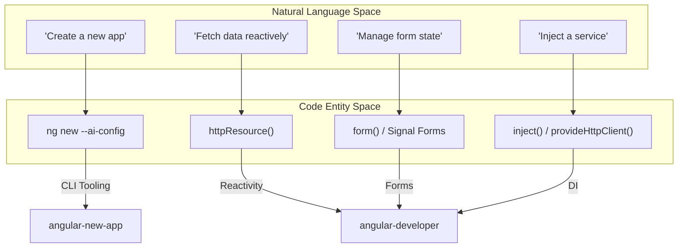
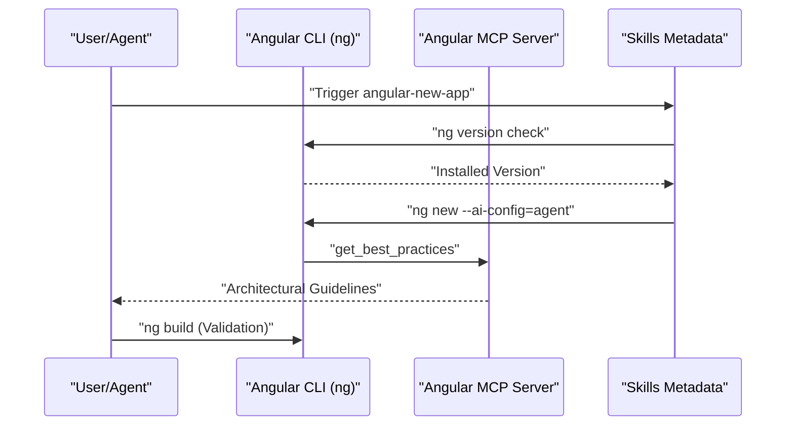

<!-- source: DeepWiki mcp.deepwiki.com · repo angular/skills · page 1 Overview · fetched 2026-10-26 -->

# Overview

Relevant source files

The following files were used as context for generating this wiki page:

- [BUILD_INFO](BUILD_INFO)
- [README.md](README.md)
- [angular-developer/SKILL.md](angular-developer/SKILL.md)
- [angular-developer/references/http-client.md](angular-developer/references/http-client.md)
- [angular-new-app/SKILL.md](angular-new-app/SKILL.md)

The **Angular Skills** repository is a comprehensive collection of architectural guidelines, best practices, and automated instructions designed for technical users and **agentic coding tools** (such as Gemini CLI, Cursor, or Antigravity). These skills enable agents to generate idiomatic Angular code, scaffold modern projects, and manage complex application state using the latest framework features (v19+).

For information on how to add these skills to your environment, see the [README.md:10-18]().

### Core Capabilities
*   **Architectural Guidance**: Standards for reactivity, dependency injection, and routing.
*   **Modern Scaffolding**: Automated project creation using `ng new` with AI-optimized configurations.
*   **Best Practices**: Implementation of Signal-based reactivity, Signal Forms, and headless accessibility patterns.
*   **Tooling Integration**: Built-in support for the Angular CLI and MCP (Model Context Protocol) servers.

Sources: [README.md:1-9](), [angular-developer/SKILL.md:2-8]()

---

## Skill Architecture

The repository is organized into two primary skill sets that bridge natural language requirements to specific code entities and CLI commands.

### Skill Mapping: Natural Language to Code Entities

The following diagram illustrates how user intent maps to the underlying Angular primitives and services defined in this repository.

**Diagram: User Intent to Angular Entity Mapping**

Sources: [angular-developer/SKILL.md:2-8](), [angular-new-app/SKILL.md:27-31](), [angular-developer/references/http-client.md:92-98]()

---

## Primary Skills

### 1.1 angular-developer Skill
The `angular-developer` skill is the primary engine for code generation and architectural decision-making. It covers the full lifecycle of component development, reactivity management, and testing. It enforces the "Intent over Role" naming philosophy and prioritizes Signal-based APIs over legacy RxJS patterns where appropriate.

**Key Responsibilities:**
*   **Reactivity**: Implementing `signal()`, `computed()`, and `resource()` [angular-developer/SKILL.md:58-63]().
*   **HTTP**: Configuring `provideHttpClient` and utilizing `httpResource` for eager data fetching [angular-developer/references/http-client.md:87-108]().
*   **Dependency Injection**: Managing `inject()` contexts and hierarchical injectors [angular-developer/SKILL.md:82-90]().

For details, see [angular-developer Skill](#1.1).

### 1.2 angular-new-app Skill
The `angular-new-app` skill focuses on the initial scaffolding and environment setup. It ensures that new projects are created with the correct CLI flags and AI-specific configurations to maximize the effectiveness of coding agents.

**Key Responsibilities:**
*   **Prerequisite Checks**: Verifying `ng` installation via `which` or `gcm` [angular-new-app/SKILL.md:17-24]().
*   **Project Scaffolding**: Executing `npx ng new` with `--ai-config` to load agent-specific context [angular-new-app/SKILL.md:27-31]().
*   **Feature Integration**: Automated setup of Tailwind CSS via `ng add tailwindcss` [angular-new-app/SKILL.md:60-60]().

For details, see [angular-new-app Skill](#1.2).

---

## System Integration

The skills interact with the local environment and external tools through a defined execution flow.

**Diagram: Skill Execution Flow**

Sources: [angular-new-app/SKILL.md:25-33](), [angular-developer/SKILL.md:16-17](), [README.md:10-18]()

---

## Reference Topics Summary

| Domain | Modern Approach (v19+) | Reference Source |
| :--- | :--- | :--- |
| **State** | Signals (`signal`, `computed`, `linkedSignal`) | `signals-overview.md` |
| **Data Fetching** | `httpResource` and `resource` | `http-client.md` |
| **Forms** | Signal Forms (v22+) | `signal-forms.md` |
| **Naming** | Intent over Role (suffixless files) | `naming-conventions.md` |
| **DI** | `inject()` function | `di-fundamentals.md` |
| **Tooling** | MCP Server (`ng mcp`) | `SKILL.md` |

Sources: [angular-developer/SKILL.md:44-101](), [angular-developer/references/http-client.md:87-90]()

---

