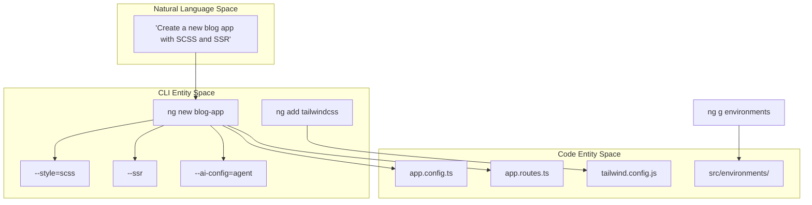
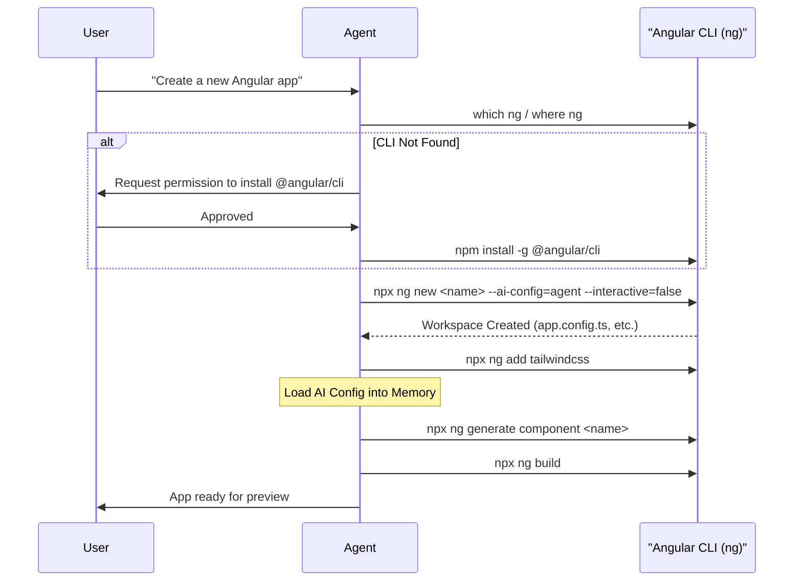

<!-- source: DeepWiki mcp.deepwiki.com · repo angular/skills · page 1.2 angular-new-app Skill · fetched 2026-10-26 -->

# angular-new-app Skill

Relevant source files

The following files were used as context for generating this wiki page:

- [angular-developer/references/cli.md](angular-developer/references/cli.md)
- [angular-developer/references/injection-context.md](angular-developer/references/injection-context.md)
- [angular-new-app/SKILL.md](angular-new-app/SKILL.md)

The `angular-new-app` skill provides a standardized workflow for creating and configuring modern Angular applications. It emphasizes the use of the Angular CLI for all scaffolding tasks to ensure adherence to framework best practices, including specific configurations for AI-assisted development environments and modern styling utilities like Tailwind CSS.

## Application Scaffolding Workflow

Creating a new application follows a strict sequence to ensure the environment is correctly configured before any code is generated.

### 1. Prerequisite Verification
Before initiating a project, the system must verify the presence of the Angular CLI (`ng`). The verification method depends on the operating system:
*   **\*nix systems**: `which ng` [angular-new-app/SKILL.md:18-18]()
*   **Windows systems**: `where ng` (or `gcm ng` in PowerShell) [angular-new-app/SKILL.md:19-19]()

If the CLI is missing, the user is prompted to install it globally via `npm install -g @angular/cli` [angular-new-app/SKILL.md:21-23]().

### 2. The `ng new` Command
Applications are created using `npx ng new <app-name>` with specific flags to ensure a non-interactive, AI-optimized setup.

| Flag | Purpose | Recommended Values |
| :--- | :--- | :--- |
| `--interactive` | Disables prompts for automated environments | `false` |
| `--ai-config` | Injects AI-specific context/rules into the workspace | `agent`, `gemini`, `claude`, `copilot`, `cursor`, `jetbrains`, `windsurf` |
| `--style` | Sets the stylesheet format | `scss`, `css`, `less` |
| `--routing` | Generates a routing module configuration | Boolean |
| `--ssr` | Enables Server-Side Rendering | Boolean |
| `--prefix` | Sets the component selector prefix | User-defined string |

**Sources:** [angular-new-app/SKILL.md:27-41]()

### 3. AI Configuration Integration
The `--ai-config` flag is critical for modern development. When set (e.g., `--ai-config=gemini`), the system loads the resulting configuration into memory to ensure all subsequent code generation aligns with modern Angular best practices [angular-new-app/SKILL.md:29-33]().

## Code Generation & Modification

Once the workspace is scaffolded, all new entities should be generated via `ng generate` (or `ng g`) rather than manual file creation. This ensures that metadata is correctly registered and files are placed in the appropriate directory structure [angular-developer/references/cli.md:21-24]().

### Standard Generation Commands

| Entity | CLI Command |
| :--- | :--- |
| **Component** | `npx ng generate component <name>` |
| **Service** | `npx ng generate service <name>` |
| **Pipe** | `npx ng generate pipe <name>` |
| **Directive** | `npx ng generate directive <name>` |
| **Guard** | `npx ng generate guard <name>` |
| **Interceptor** | `npx ng generate interceptor <name>` |
| **Resolver** | `npx ng generate resolver <name>` |
| **Environments** | `ng g environments` |

**Sources:** [angular-new-app/SKILL.md:44-55](), [angular-developer/references/cli.md:25-32]()

### Modern Best Practices
*   **Tailwind CSS**: Integration is handled via `npx ng add tailwindcss`, which configures the workspace for Tailwind v4 [angular-new-app/SKILL.md:60-60]().
*   **Best Practices Tooling**: The Angular CLI includes an MCP (Model Context Protocol) server. Agents should utilize `npx ng mcp` and the `get_best_practices` tool to retrieve up-to-date framework recommendations [angular-new-app/SKILL.md:62-62]().

## System Flow: Natural Language to CLI Execution

The following diagram illustrates how user intent for a "new app" is translated into specific code entities and CLI commands.

**Natural Language to Workspace Entity Mapping**

**Sources:** [angular-new-app/SKILL.md:27-39](), [angular-developer/references/cli.md:32-32](), [angular-new-app/SKILL.md:60-60]()

## Dependency Management

The skill distinguishes between standard `npm` installs and Angular-specific integrations.

*   **`ng add`**: This command MUST be used for Angular libraries (e.g., `@angular/material`, `tailwindcss`). It performs both the package installation and the necessary schematic updates to `angular.json` and root providers [angular-developer/references/cli.md:5-13]().
*   **`ng update`**: Used to migrate the application and its dependencies, automatically running code migrations to keep the project current with the latest Angular version [angular-developer/references/cli.md:15-19]().

## Execution Context and Lifecycle

The lifecycle of a new application project involves scaffolding, verification, and iterative generation.

**Project Initiation Lifecycle**

**Sources:** [angular-new-app/SKILL.md:17-33](), [angular-new-app/SKILL.md:42-42](), [angular-new-app/SKILL.md:60-60]()

## Build and Test Commands

*   **Development**: `ng serve` starts the local server with HMR (Hot Module Replacement) [angular-developer/references/cli.md:38-41]().
*   **Production**: `ng build` uses the `@angular/build:application` (esbuild-based) builder, enabling AOT (Ahead-of-Time) compilation and minification by default [angular-developer/references/cli.md:64-70]().
*   **Testing**: `ng test` for unit tests and `ng e2e` for end-to-end testing [angular-developer/references/cli.md:73-77]().

**Sources:** [angular-developer/references/cli.md:38-77]()

---

