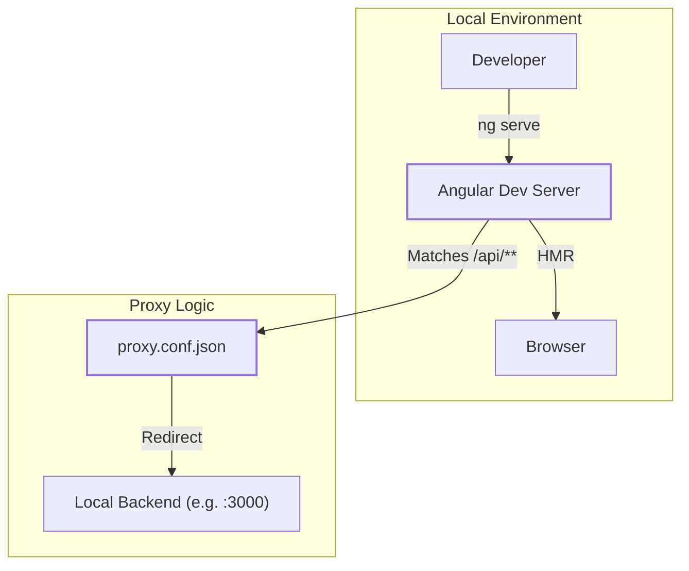
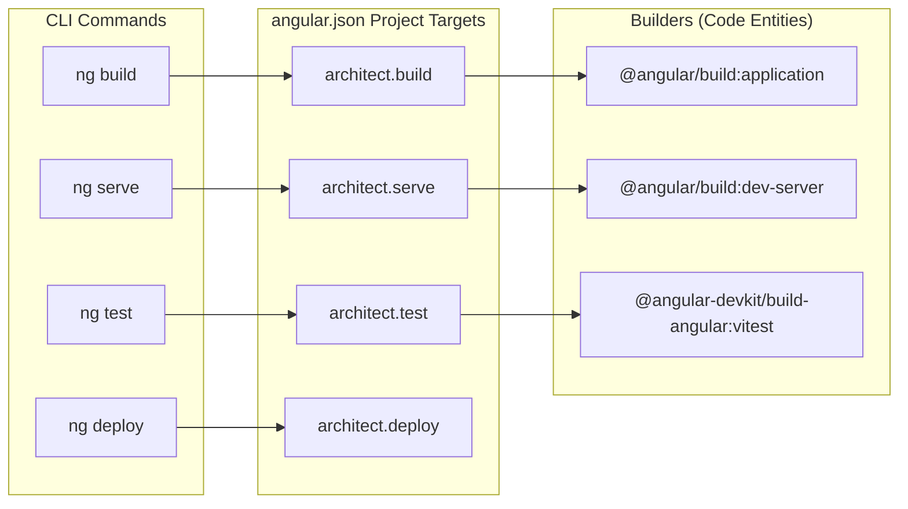

<!-- source: DeepWiki mcp.deepwiki.com · repo angular/skills · page 10.1 Angular CLI · fetched 2026-10-26 -->

# Angular CLI

Relevant source files

The following files were used as context for generating this wiki page:

- [angular-developer/references/cli.md](angular-developer/references/cli.md)
- [angular-developer/references/injection-context.md](angular-developer/references/injection-context.md)

The Angular CLI (`ng`) is the primary command-line interface for managing the lifecycle of an Angular application, from initialization and development to testing and deployment. It ensures that workspace modifications adhere to Angular standards and automatically handles complex configuration updates that manual file editing might miss.

## 1. Dependency Management and `ng add`

For Angular-specific libraries, `ng add` is the mandatory alternative to `npm install`. While `npm install` only downloads the package, `ng add` executes initialization schematics that automate the integration process, such as updating `angular.json`, configuring root providers, and scaffolding initial files [angular-developer/references/cli.md:7-13]().

### Common `ng add` Targets
| Library | Purpose |
| :--- | :--- |
| `@angular/material` | Adds Angular Material components, themes, and typography. |
| `tailwindcss` | Configures Tailwind CSS post-processors and `tailwind.config.js`. |
| `@angular/fire` | Integrates Firebase SDKs and configures environment variables. |

To keep the workspace up to date, `ng update` is used to upgrade `@angular/core` and `@angular/cli`. This command is critical because it triggers automated code migrations to align the codebase with new framework versions [angular-developer/references/cli.md:15-19]().

## 2. Code Generation (`ng generate`)

The `ng generate` (or `ng g`) command is the standard for scaffolding new entities. It ensures that files follow the project's naming conventions and are correctly registered in the application's dependency graph.

### Core Generators
| Target | Command | Implementation Details |
| :--- | :--- | :--- |
| **Component** | `ng g c <name>` | Scaffolds a standalone component. Supports `--inline-style` (`-s`) and `--inline-template` (`-t`) [angular-developer/references/cli.md:27-27](). |
| **Service** | `ng g s <name>` | Creates a class decorated with `@Injectable` (often referred to as `@Service` in internal documentation) [angular-developer/references/cli.md:28-28](). |
| **Guard** | `ng g g <name>` | Generates a **functional** route guard (e.g., `CanActivateFn`) [angular-developer/references/cli.md:31-31](). |
| **Pipe** | `ng g p <name>` | Creates a custom data transformation pipe [angular-developer/references/cli.md:30-30](). |
| **Environments** | `ng g environments` | Scaffolds the `src/environments/` directory and updates `angular.json` with file replacement configurations [angular-developer/references/cli.md:32-32](). |

*Note: The CLI does not provide a generator for route definitions. These must be manually added to the `Routes` array, typically found in `app.routes.ts` [angular-developer/references/cli.md:34-34]().*

## 3. Development Server and Proxy Configuration

The `ng serve` command launches a local development server. Modern versions of the CLI support **Hot Module Replacement (HMR)** by default, allowing for instant UI updates without a full browser refresh [angular-developer/references/cli.md:38-42]().

### Backend API Proxying
To resolve Cross-Origin Resource Sharing (CORS) issues during development, the CLI can proxy requests to a backend server via a `proxy.conf.json` file.

**Proxy Data Flow and Configuration**
1. **Definition**: Create `src/proxy.conf.json` to map local paths to remote targets [angular-developer/references/cli.md:48-53]().
2. **Registration**: Reference the file in `angular.json` under the `serve` target options [angular-developer/references/cli.md:54-60]().

### CLI Development Workflow

**Sources:** [angular-developer/references/cli.md:38-60]()

## 4. Build and Deployment

### The Build Pipeline
Angular uses the `@angular/build:application` builder, which is based on **esbuild**. Running `ng build` defaults to the `production` configuration, which enforces several optimizations:
*   **Ahead-of-Time (AOT) Compilation**: Translates templates and components into efficient JavaScript before the browser downloads them [angular-developer/references/cli.md:70-70]().
*   **Tree-shaking**: Removes unused code from the final bundle.
*   **Minification**: Reduces file size for production delivery.

Custom build targets (e.g., `staging`) defined in `angular.json` can be invoked using the `--configuration` flag [angular-developer/references/cli.md:71-71]().

### Deployment
Deployment is a two-step process in the CLI:
1.  **Add Builder**: Install a deployment-specific package (e.g., `ng add @angular/fire` or `ng add @azure/ng-deploy`) [angular-developer/references/cli.md:83-84]().
2.  **Execute**: Run `ng deploy` to trigger the build and upload the artifacts to the hosting provider [angular-developer/references/cli.md:85-85]().

## 5. Workspace Configuration: `angular.json`

The `angular.json` file is the central manifest for the workspace. It defines the project structure, build targets, and tool configurations.

### Key Configuration Entities
| Entity | Code Identifier | Description |
| :--- | :--- | :--- |
| **Builder** | `builder` | Specifies the engine used for a target (e.g., `@angular/build:application`) [angular-developer/references/cli.md:57-57](). |
| **File Replacements** | `fileReplacements` | Swaps files (like `environment.ts`) based on the active configuration [angular-developer/references/cli.md:32-32](). |
| **Proxy Config** | `proxyConfig` | Path to the JSON file handling API redirection [angular-developer/references/cli.md:58-58](). |

### Workspace Entity Mapping
The following diagram maps CLI commands to the underlying `angular.json` targets they execute.

**Sources:** [angular-developer/references/cli.md:54-75](), [angular-developer/references/cli.md:80-86]()

## 6. Testing Integration

The CLI provides a unified interface for different testing layers:
*   **Unit Tests**: `ng test` executes the configured runner. The project supports modern runners like Vitest or traditional ones like Karma [angular-developer/references/cli.md:75-75]().
*   **End-to-End (E2E)**: `ng e2e` manages integration tests. If no framework is present, the CLI facilitates the installation of Cypress, Playwright, or Puppeteer [angular-developer/references/cli.md:76-76]().

**Sources:**
- [angular-developer/references/cli.md:1-86]()
- [angular-developer/references/injection-context.md:1-63]()

---

