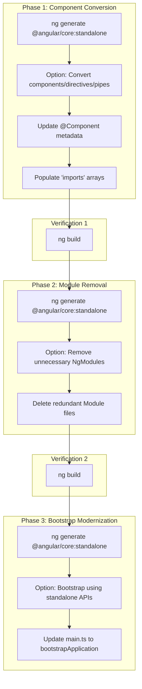
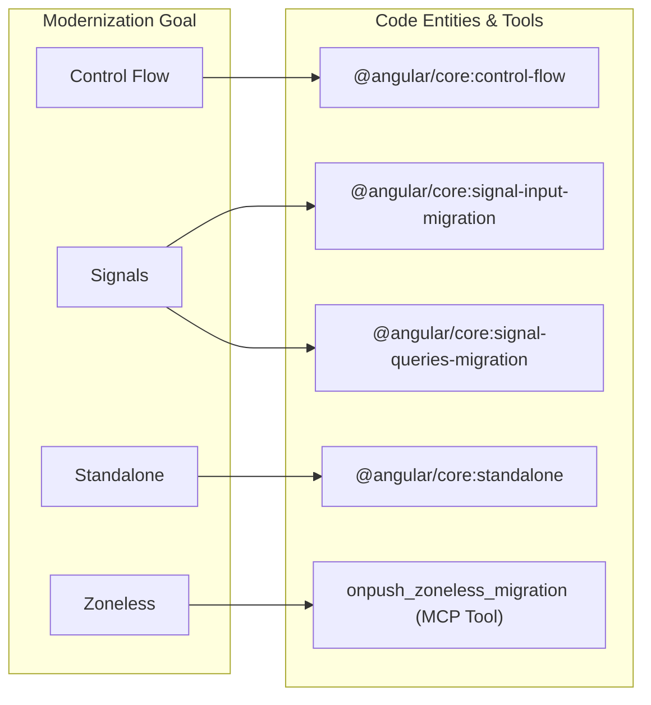

<!-- source: DeepWiki mcp.deepwiki.com · repo angular/skills · page 10.2 Automated Migrations · fetched 2026-10-26 -->

# Automated Migrations

Relevant source files

The following files were used as context for generating this wiki page:

- [angular-developer/references/mcp.md](angular-developer/references/mcp.md)
- [angular-developer/references/migrations.md](angular-developer/references/migrations.md)

Angular provides a suite of automated schematics within the `@angular/core` package to facilitate code modernization. These tools leverage the Angular CLI's schematic engine to perform complex AST (Abstract Syntax Tree) transformations, ensuring that migrations to modern features like Signals, Control Flow, and Standalone components are handled with higher precision than manual refactoring [angular-developer/references/migrations.md:1-4]().

## Discovery and Execution

To identify all available modernization schematics for the currently installed version of the framework, use the help flag with the core schematic collection:

`ng generate @angular/core: --help` [angular-developer/references/migrations.md:7-8]()

### Scoping Migrations
Migrations can be scoped to specific areas of a workspace to manage large-scale refactors incrementally:
*   `--project <name>`: Limits the migration to a specific application or library defined in `angular.json` [angular-developer/references/migrations.md:12]().
*   `--path <dir>`: Limits the transformation to a specific directory [angular-developer/references/migrations.md:12]().

## Modernization Schematics Reference

The following table maps legacy Angular features to their modern equivalents and the corresponding schematic command:

| Feature to Modernize | Command to Execute | Description |
| :--- | :--- | :--- |
| **Built-in Control Flow** | `ng generate @angular/core:control-flow` | Converts `*ngIf`, `*ngFor`, and `*ngSwitch` to `@if`, `@for`, and `@switch` blocks [angular-developer/references/migrations.md:16](). |
| **Signal-based Inputs** | `ng generate @angular/core:signal-input-migration` | Converts `@Input()` properties to `input()` signals [angular-developer/references/migrations.md:17](). |
| **Signal Queries** | `ng generate @angular/core:signal-queries-migration` | Converts `@ViewChild`, `@ViewChildren`, `@ContentChild`, and `@ContentChildren` to signal-based queries [angular-developer/references/migrations.md:18](). |
| **Functional Outputs** | `ng generate @angular/core:output-migration` | Migrates `@Output()` EventEmitter properties to the new `output()` API [angular-developer/references/migrations.md:19](). |
| **`inject()` Function** | `ng generate @angular/core:inject` | Converts constructor-based dependency injection to the `inject()` function pattern [angular-developer/references/migrations.md:20](). |
| **Self-Closing Tags** | `ng generate @angular/core:self-closing-tag` | Updates templates to use self-closing syntax for components where applicable [angular-developer/references/migrations.md:21](). |
| **Standalone** | `ng generate @angular/core:standalone` | Multi-phase migration to remove `NgModules` [angular-developer/references/migrations.md:22](). |

**Sources:**
* [angular-developer/references/migrations.md:7-22]()

## Standalone Migration Workflow

The migration from `NgModule`-based architecture to Standalone components is a complex, non-atomic operation. It must be executed in three discrete phases, with verification steps between each to ensure application stability [angular-developer/references/migrations.md:24-26]().

### Three-Phase Execution Plan

1.  **Phase 1: Component Conversion**
    *   **Action**: Run `ng generate @angular/core:standalone` and select **Convert all components, directives, and pipes to standalone**.
    *   **Result**: Adds `standalone: true` to decorators and populates the `imports` array of components with their dependencies [angular-developer/references/migrations.md:28]().
2.  **Phase 2: Module Cleanup**
    *   **Verification**: Run `ng build` to ensure the conversion was successful.
    *   **Action**: Run the schematic again and select **Remove unnecessary NgModule classes**.
    *   **Result**: Deletes `NgModule` files that no longer serve as containers for components or providers [angular-developer/references/migrations.md:29]().
3.  **Phase 3: Bootstrap Update**
    *   **Verification**: Run `ng build`.
    *   **Action**: Run the schematic a final time and select **Bootstrap the project using standalone APIs**.
    *   **Result**: Updates `main.ts` to use `bootstrapApplication` instead of `platformBrowserDynamic().bootstrapModule()` [angular-developer/references/migrations.md:30]().

### Standalone Migration Data Flow

**Sources:**
* [angular-developer/references/migrations.md:24-30]()

## AI-Assisted Migrations (MCP)

For complex refactoring tasks, the Angular CLI Model Context Protocol (MCP) server provides tools that allow AI agents to assist in the migration process. Specifically, the `onpush_zoneless_migration` tool helps prepare a codebase for zoneless reactivity, which often follows the modernization of inputs and queries [angular-developer/references/mcp.md:1-17]().

### Migration Tool Mapping

The following diagram bridges the high-level migration goals to the specific CLI and MCP tools used to execute them.

**Sources:**
* [angular-developer/references/migrations.md:14-22]()
* [angular-developer/references/mcp.md:17-17]()

---

