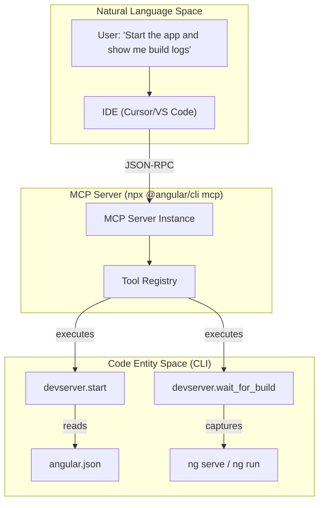
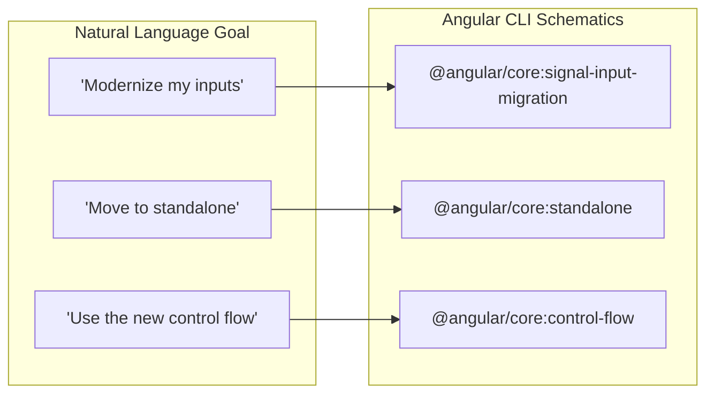

<!-- source: DeepWiki mcp.deepwiki.com · repo angular/skills · page 10.3 Angular MCP Server · fetched 2026-10-26 -->

# Angular MCP Server

Relevant source files

The following files were used as context for generating this wiki page:

- [angular-developer/references/mcp.md](angular-developer/references/mcp.md)
- [angular-developer/references/migrations.md](angular-developer/references/migrations.md)

The Angular CLI includes a Model Context Protocol (MCP) server that enables AI assistants—such as Cursor, Gemini CLI, JetBrains AI, and others—to interact directly with the Angular CLI [angular-developer/references/mcp.md:1-3](). By exposing a standardized set of tools, the MCP server allows AI agents to perform project analysis, execute builds, manage development servers, and guide developers through modernizing their codebases [angular-developer/references/mcp.md:3-7]().

## Available Tools

The MCP server provides a suite of tools that bridge the gap between natural language requests and CLI execution. These tools are categorized by their function, ranging from documentation search to active project modification [angular-developer/references/mcp.md:9-19]().

| Tool Name | Description |
| :--- | :--- |
| `ai_tutor` | Launches an interactive AI-powered Angular tutor [angular-developer/references/mcp.md:11](). |
| `devserver.start` | Asynchronously starts a development server via `ng serve` and returns immediately [angular-developer/references/mcp.md:12](). |
| `devserver.stop` | Terminates the running development server [angular-developer/references/mcp.md:13](). |
| `devserver.wait_for_build` | Returns logs from the most recent build in an active development server [angular-developer/references/mcp.md:14](). |
| `get_best_practices` | Retrieves the Angular Best Practices Guide, essential for standalone components and typed forms [angular-developer/references/mcp.md:15](). |
| `list_projects` | Lists all applications and libraries in the workspace by parsing `angular.json` [angular-developer/references/mcp.md:16](). |
| `onpush_zoneless_migration` | Analyzes code to provide a migration plan for `OnPush` change detection, a prerequisite for zoneless Angular [angular-developer/references/mcp.md:17](). |
| `run_target` | Executes a specific configured target within the workspace [angular-developer/references/mcp.md:18](). |
| `search_documentation` | Performs a search against the official documentation at `https://angular.dev` [angular-developer/references/mcp.md:19](). |

### Data Flow: Natural Language to CLI Execution
The following diagram illustrates how a user request through an IDE is translated into CLI actions via the MCP server.

**MCP Tool Resolution Flow**

**Sources:** [angular-developer/references/mcp.md:1-19]()

## Configuration

To activate the MCP server, the host environment must be configured to execute `npx @angular/cli mcp` [angular-developer/references/mcp.md:23](). Configuration is typically handled via a JSON file in the project root or global settings.

### IDE and CLI Setup

The configuration format varies slightly depending on the tool being used:

*   **Antigravity IDE**: Uses `.antigravity/mcp.json` [angular-developer/references/mcp.md:27-38]().
*   **Gemini CLI**: Uses `.gemini/settings.json` [angular-developer/references/mcp.md:42-53]().
*   **Cursor**: Uses `.cursor/mcp.json` (local or global) [angular-developer/references/mcp.md:57-68]().
*   **VS Code**: Uses `.vscode/mcp.json` [angular-developer/references/mcp.md:72-83]().

### Command Options

The MCP server behavior can be restricted using flags passed in the `args` array [angular-developer/references/mcp.md:85-87]():

*   `--read-only`: Registers only tools that do not modify the project files [angular-developer/references/mcp.md:89]().
*   `--local-only`: Disables tools that require an internet connection (e.g., `search_documentation`) [angular-developer/references/mcp.md:90]().

**Sources:** [angular-developer/references/mcp.md:21-96]()

## Integration with Migrations

The MCP server facilitates modernizing Angular applications by providing a gateway to automated schematics. While the `onpush_zoneless_migration` is a specific MCP tool, the server also enables agents to execute standard `@angular/core` migrations via the `run_target` or general CLI interaction [angular-developer/references/migrations.md:1-5]().

### Automated Schematic Mapping
The following diagram maps high-level modernization goals to the specific schematics executed by the CLI, which the MCP server can orchestrate.

**Migration Mapping**

**Sources:** [angular-developer/references/migrations.md:10-22]()

### Standalone Migration Workflow
When the MCP server or an AI agent triggers a standalone migration, it must follow a strict three-phase sequence to ensure project stability [angular-developer/references/migrations.md:24-27]():

1.  **Phase 1**: Convert components, directives, and pipes to standalone [angular-developer/references/migrations.md:28]().
2.  **Phase 2**: Remove unnecessary `NgModule` classes [angular-developer/references/migrations.md:29]().
3.  **Phase 3**: Bootstrap the project using standalone APIs [angular-developer/references/migrations.md:30]().

**Sources:** [angular-developer/references/migrations.md:24-30]()

---

