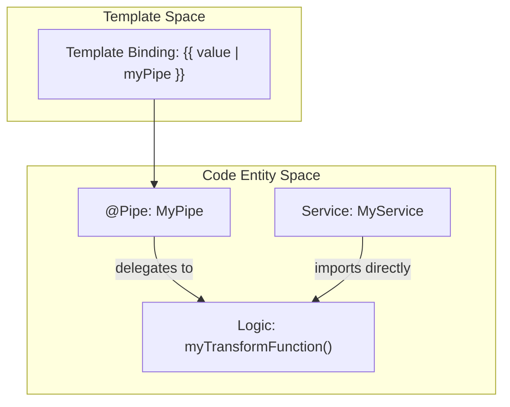

<!-- source: DeepWiki mcp.deepwiki.com · repo angular/skills · page 11 Pipes and Animations · fetched 2026-10-26 -->

# Pipes and Animations

<details>
<summary>Relevant source files</summary>

The following files were used as context for generating this wiki page:

- [angular-developer/references/angular-animations.md](angular-developer/references/angular-animations.md)
- [angular-developer/references/pipes.md](angular-developer/references/pipes.md)

</details>


This section provides a high-level overview of how to transform data within templates and how to handle element transitions and animations in Angular. It covers the declarative use of pipes for formatting and the modern approach to animations using native CSS integrations.

For detailed implementation guides, see the following child pages:
*   **[Pipes](#11.1)**: Covers the `@Pipe` decorator, built-in pipes, and the logic-extraction pattern for service reuse.
*   **[Animations](#11.2)**: Covers modern `animate.enter`/`leave` triggers and the legacy Animations DSL.

---

## Pipes

Pipes are declarative operators used within Angular templates to transform data for display. They are commonly used for formatting dates, currencies, and strings without modifying the underlying data in the component class [angular-developer/references/pipes.md:1-5]().

### Core Concepts
*   **Template Usage**: Pipes are applied using the `|` operator within interpolations or bindings [angular-developer/references/pipes.md:16-19]().
*   **Built-in Pipes**: Angular provides standard pipes such as `DatePipe`, `CurrencyPipe`, `DecimalPipe`, and `PercentPipe` [angular-developer/references/pipes.md:11, 72-77]().
*   **Pure vs. Impure**: By default, pipes are "pure," meaning they only re-evaluate when their input primitive or reference changes. "Impure" pipes (marked `pure: false`) run on every change detection cycle [angular-developer/references/pipes.md:132-143]().
*   **Service Integration**: Pipes should not be injected into services. Instead, logic should be extracted into standalone functions or locale-aware formatting functions like `formatDate` or `formatNumber` [angular-developer/references/pipes.md:27-33, 68-79]().

### Pipe Architecture
The following diagram illustrates how template-based pipes relate to the underlying transformation logic used in services.

**Data Transformation Flow**

Sources: [angular-developer/references/pipes.md:31-66]()

For details, see [Pipes](#11.1).

---

## Animations

Angular supports animating elements as they enter the DOM, leave the DOM, or change state. The recommended approach for modern applications (v20.2+) is leveraging native CSS animations via specific Angular triggers [angular-developer/references/angular-animations.md:1-9]().

### Animation Strategies
1.  **Native CSS (Recommended)**: Uses `animate.enter` and `animate.leave` attributes to apply CSS classes or keyframes when elements are added or removed by directives like `@if` or `@for` [angular-developer/references/angular-animations.md:10-22]().
2.  **Legacy DSL**: The `@angular/animations` package provides a TypeScript-based DSL (`trigger`, `state`, `transition`, `animate`) for complex orchestration, primarily used in older projects or specific complex use cases [angular-developer/references/angular-animations.md:127-156]().
3.  **Programmatic Control**: Developers can hook into animation events via `(animate.enter)` and `(animate.leave)` to integrate with third-party libraries like GSAP [angular-developer/references/angular-animations.md:53-61]().

### Animation Trigger Mapping
This diagram maps template-level animation triggers to the underlying CSS and event handling mechanisms.

**Animation System Mapping**
```mermaid
graph LR
    subgraph "Natural Language Space"
        "Entering Element"
        "Leaving Element"
        "State Change"
    end

    subgraph "Code Entity Space"
        AE["animate.enter"]
        AL["animate.leave"]
        AC["(animate.leave) Event"]
        TR["trigger() DSL"]
    end

    "Entering Element" --> AE
    "Leaving Element" --> AL
    "Leaving Element" --> AC
    "State Change" --> TR
```
Sources: [angular-developer/references/angular-animations.md:10-12, 57-61, 148-152]()

For details, see [Animations](#11.2).

---

