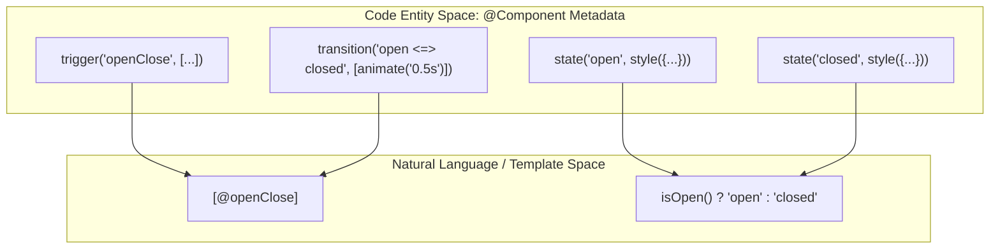
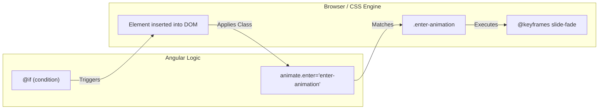

<!-- source: DeepWiki mcp.deepwiki.com · repo angular/skills · page 11.2 Animations · fetched 2026-10-26 -->

# Animations

<details>
<summary>Relevant source files</summary>

The following files were used as context for generating this wiki page:

- [angular-developer/references/angular-animations.md](angular-developer/references/angular-animations.md)
- [angular-developer/references/route-animations.md](angular-developer/references/route-animations.md)

</details>


Angular provides multiple strategies for animating elements, ranging from native CSS-based approaches to a specialized Domain Specific Language (DSL). The recommended approach depends on the Angular version and the complexity of the required transitions.

## Overview of Animation Strategies

| Strategy | Recommended Version | Description |
| :--- | :--- | :--- |
| **Native CSS (`animate.enter`/`leave`)** | v20.2+ | Uses CSS classes and standard animations for DOM entry/exit. |
| **View Transitions API** | Modern Browsers | Progressive enhancement for route-level transitions. |
| **Angular Animations DSL** | Legacy / Pre-v20.2 | A metadata-driven DSL (`trigger`, `state`, `transition`). |
| **Standard CSS Binding** | All Versions | Toggling classes to trigger CSS transitions/keyframes. |

**Important:** Do not mix the legacy Animations DSL and `animate.enter`/`leave` within the same component [angular-developer/references/angular-animations.md:131-131]().

---

## Native CSS Animations (Recommended)

For applications on **Angular v20.2 and above**, native CSS animations are the preferred method for handling elements entering or leaving the DOM [angular-developer/references/angular-animations.md:3-6]().

### `animate.enter` and `animate.leave`

These attributes apply specific CSS classes during the lifecycle of an element's presence in the DOM. Angular automatically removes the "enter" classes once the animation finishes. For "leave" animations, Angular delays the removal of the element from the DOM until the animation is complete [angular-developer/references/angular-animations.md:10-12]().

#### Implementation Example
In the template, attributes are applied to elements within control flow blocks:

```html
@if (isShown()) {
<div class="container" animate.enter="fade-in-class" animate.leave="fade-out-class">
  <p>Content</p>
</div>
}
```
[angular-developer/references/angular-animations.md:16-22]()

### Programmatic Control and Event Binding

Developers can bind to `(animate.enter)` and `(animate.leave)` events to integrate with JavaScript libraries like GSAP or to perform cleanup tasks [angular-developer/references/angular-animations.md:53-60]().

**Critical Requirement:** When using event bindings for leave animations, you **must** call `event.animationComplete()` to signal to Angular that it is safe to remove the element from the DOM [angular-developer/references/angular-animations.md:68-69]().

```ts
import { AnimationCallbackEvent } from '@angular/core';

onLeave(event: AnimationCallbackEvent) {
  // Custom logic (e.g., GSAP timeline)
  event.animationComplete(); // Required for DOM removal
}
```
[angular-developer/references/angular-animations.md:64-71]()

**Sources:**
- [angular-developer/references/angular-animations.md:3-22]()
- [angular-developer/references/angular-animations.md:53-71]()

---

## Route Transition Animations

Angular Router supports the browser's **View Transitions API**, providing a mechanism for smooth visual changes during navigation [angular-developer/references/route-animations.md:1-3]().

### Enabling View Transitions
To enable this feature, add `withViewTransitions()` to the `provideRouter` configuration in the application bootstrap [angular-developer/references/route-animations.md:5-11]().

### Customization via CSS
Because view transitions involve pseudo-elements that exist outside the component tree, styles must be defined in **global CSS files** (e.g., `styles.css`) rather than component-scoped styles [angular-developer/references/route-animations.md:22-24]().

**Data Flow: View Transition Lifecycle**
1. **Screenshot Old State**: Browser captures the current route view.
2. **DOM Update**: Router activates the new component.
3. **Screenshot New State**: Browser captures the destination route view.
4. **Transition**: Browser animates between screenshots using `::view-transition-old()` and `::view-transition-new()` pseudo-elements.

[angular-developer/references/route-animations.md:15-36]()

### Advanced Route Control
The `onViewTransitionCreated` callback allows for conditional skipping of animations based on the navigation source or destination [angular-developer/references/route-animations.md:38-51]().

**Sources:**
- [angular-developer/references/route-animations.md:1-51]()

---

## Legacy Animations DSL

For projects pre-dating v20.2 or those with significant existing animation codebases, the `@angular/animations` package provides a metadata-driven DSL [angular-developer/references/angular-animations.md:127-129]().

### Setup
The animation system must be initialized in the `bootstrapApplication` providers using `provideAnimationsAsync()` [angular-developer/references/angular-animations.md:133-139]().

### Code Entity Mapping: DSL to Template

The following diagram bridges the DSL configuration in the component decorator to its usage in the HTML template.

**Animation DSL Association**

[angular-developer/references/angular-animations.md:143-160]()

### Key Functions
- `trigger()`: Defines the name of the animation for template binding.
- `state()`: Defines sets of styles associated with a specific state name.
- `transition()`: Defines the timing and sequence when moving between states.
- `animate()`: Specifies the duration and easing of the transition.

[angular-developer/references/angular-animations.md:143-153]()

**Sources:**
- [angular-developer/references/angular-animations.md:127-160]()

---

## Advanced CSS Techniques

Standard CSS features are often sufficient for complex UI behaviors without requiring Angular-specific libraries.

### Auto-Height Animations
Using `grid-template-rows` with `0fr` and `1fr` allows for smooth transitions to "auto" height, which is traditionally difficult with standard `height` properties [angular-developer/references/angular-animations.md:95-111]().

### Staggering and Parallelism
- **Staggering**: Achieved by applying varying `animation-delay` or `transition-delay` values to items in a list [angular-developer/references/angular-animations.md:115-115]().
- **Parallel Animations**: Multiple animations can be defined in a single `animation` shorthand property (e.g., `animation: rotate 3s, fade-in 2s;`) [angular-developer/references/angular-animations.md:116-116]().

### System Entity Mapping: CSS Animation Logic

The following diagram maps Angular's attribute directives to the underlying CSS and Browser API behavior.

**CSS Animation Data Flow**

[angular-developer/references/angular-animations.md:8-48]()

**Sources:**
- [angular-developer/references/angular-animations.md:73-125]()

---

