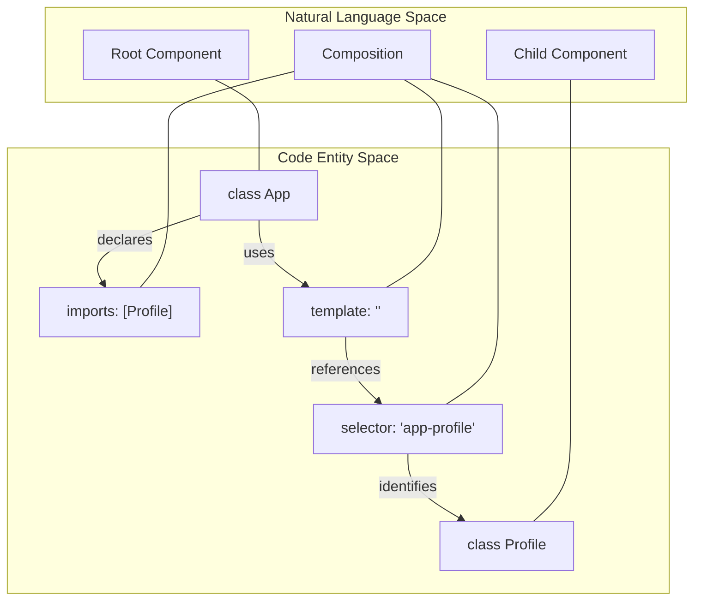
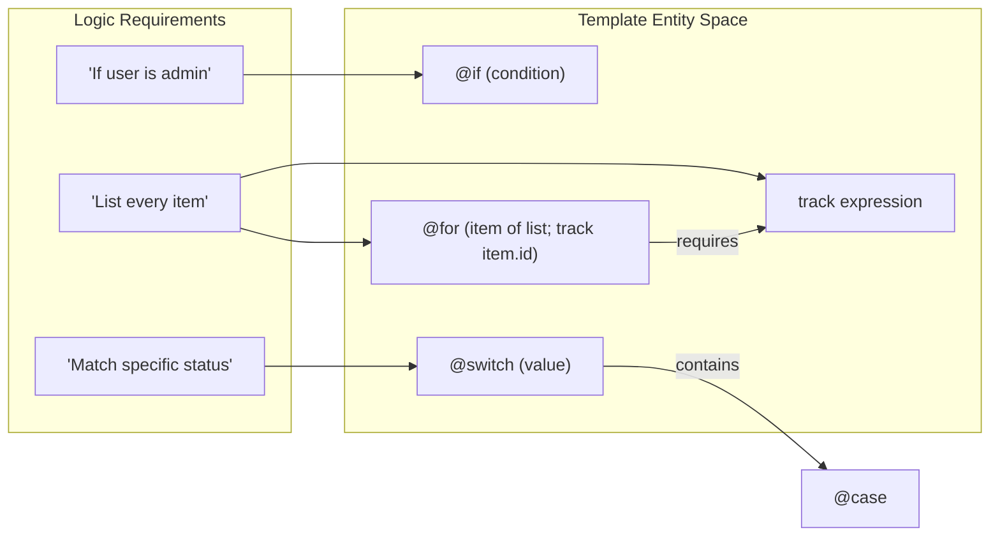

<!-- source: DeepWiki mcp.deepwiki.com · repo angular/skills · page 2.1 Component Anatomy and Template Syntax · fetched 2026-10-26 -->

# Component Anatomy and Template Syntax

<details>
<summary>Relevant source files</summary>

The following files were used as context for generating this wiki page:

- [angular-developer/references/components.md](angular-developer/references/components.md)
- [angular-developer/references/naming-conventions.md](angular-developer/references/naming-conventions.md)

</details>


This page provides a technical deep dive into the structure and definition of Angular components. It covers the `@Component` decorator, metadata configuration, modern template syntax including built-in control flow, and the component tree model.

## Component Anatomy

Angular components are the fundamental building blocks of an application, consisting of a TypeScript class that defines behavior, an HTML template for the UI, and CSS for styling [angular-developer/references/components.md:1-4]().

### The @Component Decorator
The `@Component` decorator defines the metadata for the class, instructing Angular how to instantiate the component and render its view [angular-developer/references/components.md:7-21]().

| Metadata Option | Description |
| :--- | :--- |
| `selector` | The CSS selector that identifies this component in templates [angular-developer/references/components.md:31](). |
| `template` | Inline HTML template (preferred for small templates) [angular-developer/references/components.md:32](). |
| `templateUrl` | Path to an external HTML file [angular-developer/references/components.md:33](). |
| `styles` | Inline CSS styles [angular-developer/references/components.md:34](). |
| `styleUrl` / `styleUrls` | Path(s) to external CSS file(s) [angular-developer/references/components.md:35](). |
| `imports` | Array of components, directives, or pipes used within the template [angular-developer/references/components.md:36](). |

### Standalone Components
In modern Angular (v19+), components are standalone by default [angular-developer/references/components.md:133](). This means they manage their own dependencies via the `imports` array rather than being declared in an `NgModule`.

### Naming Conventions
Following the "Intent over Role" philosophy, modern components drop the `.component.ts` suffix in filenames and the `Component` suffix in class names [angular-developer/references/naming-conventions.md:10]().

*   **File**: `product-list.ts` [angular-developer/references/naming-conventions.md:21]()
*   **Class**: `export class ProductList { ... }` [angular-developer/references/naming-conventions.md:22]()

**Sources:**
- [angular-developer/references/components.md:1-37]()
- [angular-developer/references/components.md:133-135]()
- [angular-developer/references/naming-conventions.md:10-22]()

---

## Component Tree and Data Flow

Angular applications are structured as a tree of components. Each component hosts a "View" (the DOM rendered by its template) inside a "Host Element" (the DOM element matching its selector) [angular-developer/references/components.md:129-134]().

### Natural Language to Code Entity Space: Component Composition

This diagram maps the conceptual "Component Tree" to the specific code entities required to implement it.



**Sources:**
- [angular-developer/references/components.md:42-49]()
- [angular-developer/references/components.md:129-134]()

---

## Template Syntax

Modern Angular templates support self-closing tags and a dedicated syntax for control flow.

### Self-Closing Tags
Angular supports self-closing tags for custom components. This is the preferred style when a component does not contain projected content [angular-developer/references/components.md:51-61]().

*   **Preferred**: `<app-profile />` [angular-developer/references/components.md:59]()
*   **Avoid**: `<app-profile></app-profile>` [angular-developer/references/components.md:64]()

### Built-in Control Flow
Angular provides optimized blocks for conditional rendering, loops, and switches.

#### 1. Conditional Rendering (`@if`)
Used for conditional branching. It supports `@else if` and `@else` blocks, as well as result aliasing using the `as` keyword [angular-developer/references/components.md:73-93]().

```html
@if (user.settings(); as settings) {
  <p>Theme: {{ settings.theme }}</p>
} @else {
  <p>No settings found.</p>
}
```

#### 2. Loops (`@for`)
Iterates over collections. The `track` expression is **mandatory** for DOM reuse and performance [angular-developer/references/components.md:95-98]().

| Variable | Description |
| :--- | :--- |
| `$index` | Index of the current row [angular-developer/references/components.md:109](). |
| `$count` | Total length of the collection [angular-developer/references/components.md:109](). |
| `$first` / `$last` | Boolean indicating if the item is the first or last [angular-developer/references/components.md:109](). |
| `$even` / `$odd` | Boolean indicating if the index is even or odd [angular-developer/references/components.md:109](). |

#### 3. Switching Content (`@switch`)
Renders content based on strict equality (`===`). It features no fallthrough behavior [angular-developer/references/components.md:111-114](). Developers can use `@default never;` to enforce exhaustive type checking at compile time [angular-developer/references/components.md:122-127]().

### Natural Language to Code Entity Space: Control Flow

This diagram bridges the logic of "Conditional Logic" to the specific Angular Template Blocks.



**Sources:**
- [angular-developer/references/components.md:69-128]()

---

