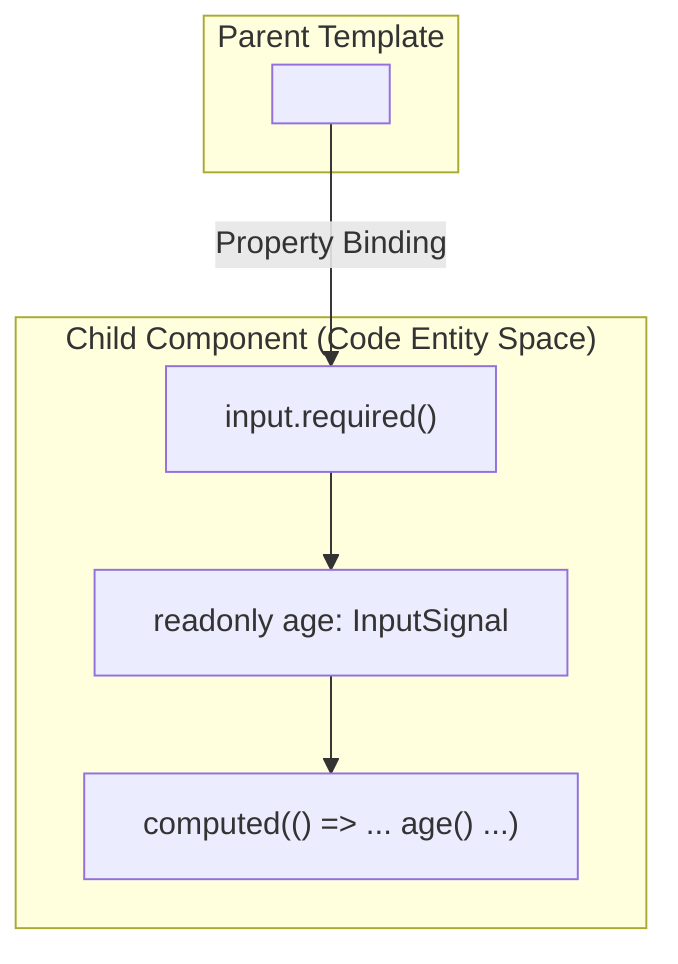
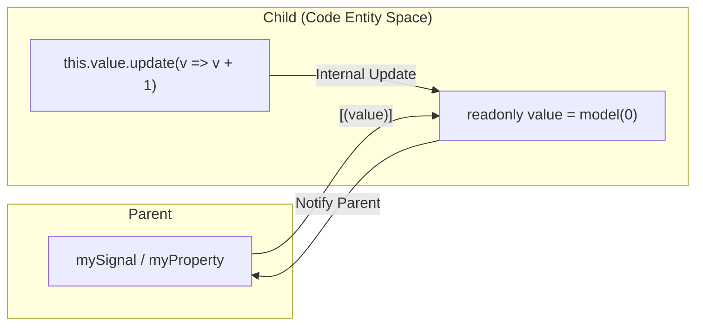
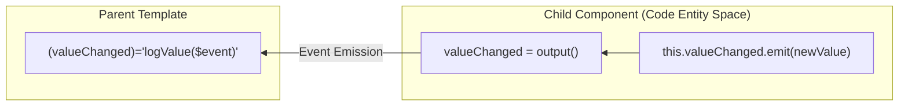

<!-- source: DeepWiki mcp.deepwiki.com · repo angular/skills · page 2.2 Inputs, Outputs, and Two-Way Binding · fetched 2026-10-26 -->

# Inputs, Outputs, and Two-Way Binding

Relevant source files

The following files were used as context for generating this wiki page:

- [angular-developer/references/inputs.md](angular-developer/references/inputs.md)
- [angular-developer/references/outputs.md](angular-developer/references/outputs.md)

This page covers the mechanisms for data flow between Angular components. It focuses on the modern signal-based APIs introduced for reactive data flow, while maintaining support for legacy decorator-based patterns.

## Signal-based Inputs

Inputs allow data to flow from a parent component to a child component. In modern Angular (v19+), inputs are defined using the `input()` function, which returns an `InputSignal` [angular-developer/references/inputs.md:3-7](). These signals are reactive, meaning they can be used in `computed()` values or `effect()` blocks within the component [angular-developer/references/inputs.md:23-24]().

### Declaration and Types

There are two primary ways to declare signal inputs:
1.  **Optional Inputs**: Created using `input(defaultValue)`. If the parent does not provide a value, the `defaultValue` is used [angular-developer/references/inputs.md:17-18]().
2.  **Required Inputs**: Created using `input.required<T>()`. These enforce that the parent must provide a value, resulting in build-time errors if omitted [angular-developer/references/inputs.md:20-21, 99-99]().

### Configuration: Aliases and Transforms

The `input` function accepts a configuration object to modify how the input behaves:

*   **Alias**: Allows the template property name to differ from the class property name [angular-developer/references/inputs.md:38-38, 46-47]().
*   **Transform**: A function that modifies the incoming value before it is stored in the signal. Angular provides built-in helpers like `booleanAttribute` and `numberAttribute` [angular-developer/references/inputs.md:39-39, 49-51]().

### Data Flow: Signal Inputs

The following diagram illustrates the flow of data from a parent template into a signal-based input.

**Signal Input Data Flow**

Sources: [angular-developer/references/inputs.md:9-26](), [angular-developer/references/inputs.md:30-32]()

---

## Two-Way Binding with `model()`

The `model()` API creates a specialized signal that supports two-way data binding. Unlike standard `input()`, which is read-only for the child component, a `model()` signal can be updated by the child using the `.update()` or `.set()` methods [angular-developer/references/inputs.md:54-68]().

When a child component updates a `model()`, the change is propagated back to the parent's bound property or signal [angular-developer/references/inputs.md:72-80]().

**Two-Way Binding Flow**

Sources: [angular-developer/references/inputs.md:58-80]()

---

## Signal-based Outputs

Outputs allow child components to emit custom events that parents can listen to. The modern API uses the `output()` function, which returns an `OutputEmitterRef` [angular-developer/references/outputs.md:3-7]().

### Implementation
*   **Emission**: Use the `.emit(value)` method to trigger the event [angular-developer/references/outputs.md:23-25]().
*   **Template Binding**: Parents bind to these using parentheses `()` and access the payload via the `$event` variable [angular-developer/references/outputs.md:29-35]().
*   **Programmatic Subscription**: For dynamically created components, outputs can be subscribed to via the `subscribe()` method on the emitter [angular-developer/references/outputs.md:50-63]().

### Configuration
Like inputs, outputs support an `alias` via a configuration object [angular-developer/references/outputs.md:37-48]().

**Output Event Propagation**

Sources: [angular-developer/references/outputs.md:9-35]()

---

## Legacy Decorator Patterns

While signal-based APIs are recommended, Angular continues to support decorator-based inputs and outputs for backward compatibility.

| Feature | Legacy API (@Input / @Output) | Modern API (input / output) |
| :--- | :--- | :--- |
| **Input Declaration** | `@Input() prop = value` [angular-developer/references/inputs.md:91]() | `prop = input(value)` [angular-developer/references/inputs.md:18]() |
| **Required Input** | `@Input({ required: true })` [angular-developer/references/inputs.md:91]() | `input.required()` [angular-developer/references/inputs.md:21]() |
| **Output Declaration** | `@Output() event = new EventEmitter()` [angular-developer/references/outputs.md:74]() | `event = output()` [angular-developer/references/outputs.md:18]() |
| **Reactivity** | Manual `ngOnChanges` or setters | Automatic via Signals [angular-developer/references/inputs.md:23-24]() |

Sources: [angular-developer/references/inputs.md:82-94](), [angular-developer/references/outputs.md:65-79]()

---

## Best Practices

*   **Prefer Signals**: Use `input()` and `output()` over decorators for better type safety and integration with Angular's reactive runtime [angular-developer/references/inputs.md:98-98, 83-83]().
*   **Naming**: Use `camelCase` for both inputs and outputs. Avoid prefixing outputs with `on` (e.g., use `valueChanged`, not `onValueChanged`) [angular-developer/references/outputs.md:84-84]().
*   **Avoid DOM Collisions**: Do not use names that conflict with standard HTML attributes or events like `id`, `title`, `click`, or `submit` [angular-developer/references/inputs.md:101-101, 86-86]().
*   **Pure Transforms**: Ensure that functions passed to the `transform` option of an input are pure and statically analyzable [angular-developer/references/inputs.md:100-100]().
*   **Bubbling**: Note that Angular custom events (outputs) do **not** bubble up the DOM tree like native browser events [angular-developer/references/outputs.md:85-85]().

Sources: [angular-developer/references/inputs.md:96-101](), [angular-developer/references/outputs.md:81-86]()

---

