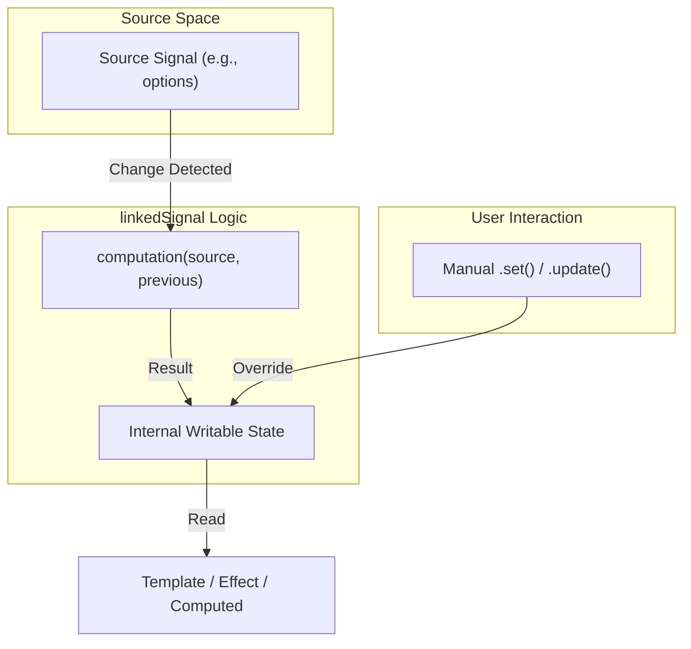
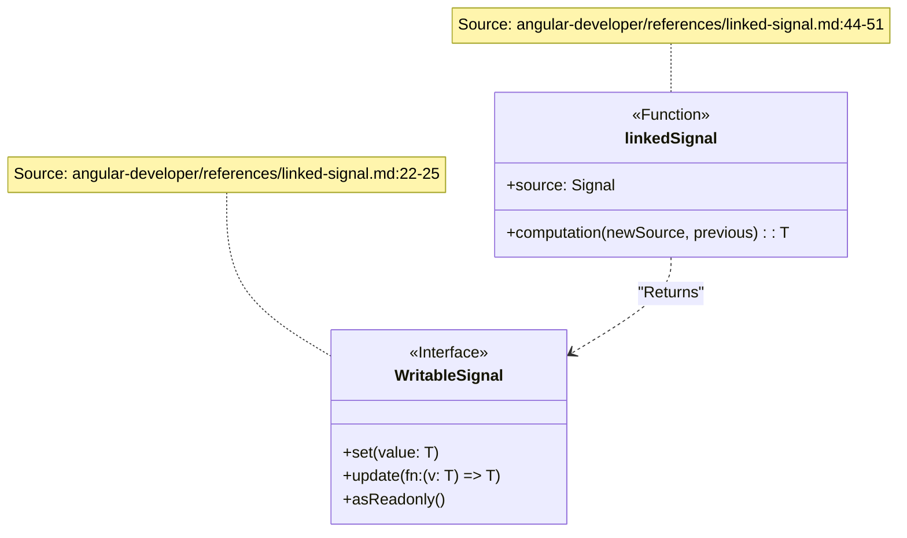

<!-- source: DeepWiki mcp.deepwiki.com · repo angular/skills · page 3.2 linkedSignal and Derived Writable State · fetched 2026-10-26 -->

# linkedSignal and Derived Writable State

<details>
<summary>Relevant source files</summary>

The following files were used as context for generating this wiki page:

- [angular-developer/references/linked-signal.md](angular-developer/references/linked-signal.md)

</details>


The `linkedSignal` function is a reactive primitive used to create writable state that is intrinsically linked to a source signal. It provides a mechanism for state that requires a default value derived from another signal while remaining independently modifiable by the user. When the source signal changes, the `linkedSignal` automatically resets or recomputes its value based on a provided computation function.

Sources: [angular-developer/references/linked-signal.md:1-5]()

## Core Mechanics and Implementation

`linkedSignal` bridges the gap between `computed()` (which is read-only) and `signal()` (which is standalone writable state). It tracks a source signal and executes a computation whenever that source changes, effectively "resetting" the local state. However, unlike a computed signal, it exposes `.set()` and `.update()` methods for manual overrides.

### Basic Shorthand Syntax
When the reset logic only depends on the current value of the source, a simple computation function can be passed. The signal will re-evaluate this function whenever any signal read inside it changes.

```ts
// Example: Selecting a default from a dynamic list
protected readonly options = signal(['A', 'B', 'C']);
protected readonly selection = linkedSignal(() => this.options()[0]);

// The user can override the selection
this.selection.set('B'); 

// If options changes to ['D', 'E'], selection automatically resets to 'D'
```
Sources: [angular-developer/references/linked-signal.md:7-27]()

### Advanced Object Syntax
For more complex synchronization—such as preserving a user's manual selection if it remains valid after a source change—`linkedSignal` accepts a configuration object with `source` and `computation` properties. The `computation` function receives:
1.  **newSource**: The current value of the source signal.
2.  **previous**: An object containing `source` (the previous value of the source) and `value` (the previous value of the `linkedSignal` itself).

Sources: [angular-developer/references/linked-signal.md:29-53]()

## Data Flow: Source Synchronization

The following diagram illustrates how state flows from a source signal through the `linkedSignal` logic, and how manual updates interact with this flow.

**Diagram: linkedSignal State Synchronization Flow**

Sources: [angular-developer/references/linked-signal.md:3-5](), [angular-developer/references/linked-signal.md:33-34]()

## Comparison of Reactive Primitives

Choosing the correct primitive is critical for maintaining a clean reactive graph and avoiding anti-patterns like state synchronization inside effects.

| Primitive | Writable | Reset Logic | Primary Use Case |
| :--- | :--- | :--- | :--- |
| `computed()` | No | Automatic | **Strictly** derived state that should never be manually changed. |
| `linkedSignal()` | Yes | Automatic (on source change) | State derived from a source that **must** allow user overrides. |
| `signal()` | Yes | Manual | Independent state with no automatic dependency on other signals. |

### The Effect Anti-Pattern
It is considered an anti-pattern to use `effect()` to synchronize one signal to another (e.g., calling `signal.set()` inside an `effect` that reads another signal). This often leads to unnecessary change detection cycles or infinite loops. `linkedSignal` replaces this pattern by providing a declarative way to handle dependent writable state.

Sources: [angular-developer/references/linked-signal.md:55-59]()

## Code Entity Mapping

This diagram maps the conceptual "Dependent State" to the specific TypeScript entities and parameters used in the `angular/core` implementation.

**Diagram: Entity Mapping for linkedSignal**

Sources: [angular-developer/references/linked-signal.md:20-25](), [angular-developer/references/linked-signal.md:44-51]()

---

