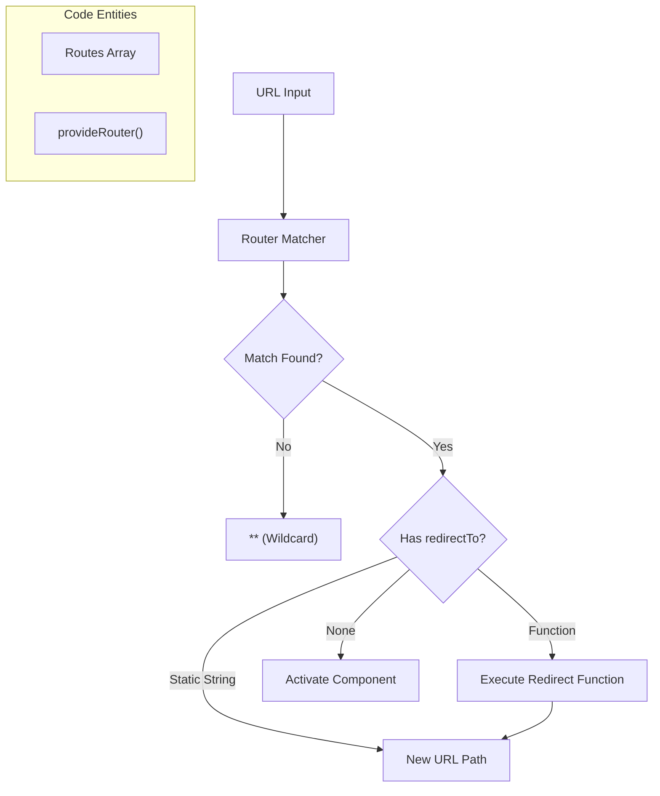
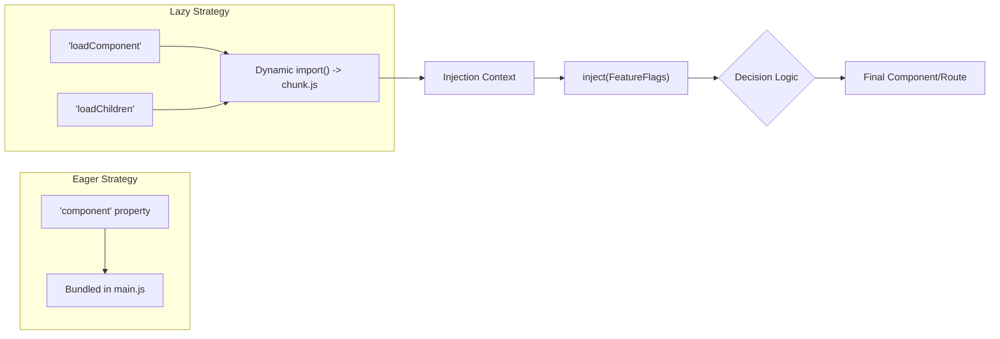

<!-- source: DeepWiki mcp.deepwiki.com · repo angular/skills · page 5.1 Defining Routes and Loading Strategies · fetched 2026-10-26 -->

# Defining Routes and Loading Strategies

Relevant source files

The following files were used as context for generating this wiki page:

- [angular-developer/references/component-styling.md](angular-developer/references/component-styling.md)
- [angular-developer/references/define-routes.md](angular-developer/references/define-routes.md)
- [angular-developer/references/loading-strategies.md](angular-developer/references/loading-strategies.md)

This page documents the configuration and implementation of the Angular Router. It covers the structure of the `Routes` array, path matching logic, redirection strategies, and the mechanisms for eager versus lazy loading of application resources.

## Basic Configuration

In Angular, routes are defined as an array of objects that map URL paths to specific components. This configuration is registered with the application via `provideRouter` during the bootstrapping phase within the `ApplicationConfig` [angular-developer/references/define-routes.md:7-19]().

### URL Path Types

Angular supports several types of path matching:
*   **Static Paths**: Matches a literal string (e.g., `'admin'`) [angular-developer/references/define-routes.md:24-24]().
*   **Route Parameters**: Dynamic segments identified by a colon prefix (e.g., `'user/:id'`) [angular-developer/references/define-routes.md:25-25]().
*   **Wildcard Paths**: Represented by `**`, these match any URL. They are typically used for "404 Not Found" pages and must be placed at the end of the `Routes` array [angular-developer/references/define-routes.md:26-26]().

### Matching Strategy
Angular employs a **first-match wins** strategy. The router iterates through the `Routes` array and selects the first entry that matches the URL. Consequently, more specific routes must be defined before more general or wildcard routes [angular-developer/references/define-routes.md:28-30]().

### Route Data and Metadata
*   **Static Data**: Metadata can be attached to a route using the `data` property [angular-developer/references/define-routes.md:69-69]().
*   **Page Titles**: The `title` property allows for static or dynamic document titles, which can be managed via `ResolveFn` or a custom `TitleStrategy` [angular-developer/references/define-routes.md:59-65]().

**Sources:**
* [angular-developer/references/define-routes.md:7-30]()
* [angular-developer/references/define-routes.md:59-71]()

---

## Redirection and Conditional Logic

The `redirectTo` property allows the router to navigate from one path to another.

### Static Redirects
A simple string mapping that points a path to a different destination [angular-developer/references/define-routes.md:33-39]().

### Conditional Redirects
For complex logic, `redirectTo` can accept a function. This function receives the route parameters and can return a string based on application state or logic (e.g., time-based redirection) [angular-developer/references/define-routes.md:41-57]().

### Route Redirection Flow
The following diagram illustrates how the Router processes a URL to determine the final destination, including conditional logic.

**Sources:**
* [angular-developer/references/define-routes.md:33-57]()

---

## Nested and Child Routes

Complex UIs often require nested views. The `children` property allows defining a hierarchy of routes. When a child route is active, its component is rendered inside a `<router-outlet />` located within the parent component's template [angular-developer/references/define-routes.md:72-85]().

### Scoped Dependencies
The `providers` array within a route definition allows developers to scope dependencies to a specific route and all of its descendants [angular-developer/references/define-routes.md:70-70]().

**Sources:**
* [angular-developer/references/define-routes.md:70-85]()

---

## Loading Strategies

Angular provides two primary methods for loading components and route configurations to optimize performance.

### Eager Loading
Components are included in the initial JavaScript bundle. This is recommended for primary landing pages to ensure immediate availability [angular-developer/references/loading-strategies.md:5-15]().

### Lazy Loading
Resources are loaded on demand, creating separate JavaScript chunks and reducing the initial bundle size [angular-developer/references/loading-strategies.md:16-19]().

*   **`loadComponent`**: Used to asynchronously load a standalone component [angular-developer/references/loading-strategies.md:20-29]().
*   **`loadChildren`**: Used to asynchronously load a nested `Routes` configuration [angular-developer/references/loading-strategies.md:31-40]().

### Logic-Driven Loading
Loader functions run within an **injection context**, enabling the use of `inject()` to make runtime decisions about which resource to load (e.g., based on feature flags) [angular-developer/references/loading-strategies.md:44-58]().

### Component Loading Flow
This diagram bridges the natural language concepts of "Eager" and "Lazy" loading to the specific properties used in the `Routes` configuration.

### Strategy Comparison

| Strategy | Property | Bundle | Use Case |
| :--- | :--- | :--- | :--- |
| **Eager** | `component` | Initial Payload | Critical landing pages [angular-developer/references/loading-strategies.md:62-62]() |
| **Lazy** | `loadComponent` | Separate Chunk | Feature components [angular-developer/references/loading-strategies.md:63-63]() |
| **Lazy** | `loadChildren` | Separate Chunk | Entire feature modules/routes [angular-developer/references/loading-strategies.md:33-35]() |

**Sources:**
* [angular-developer/references/loading-strategies.md:1-63]()

---

