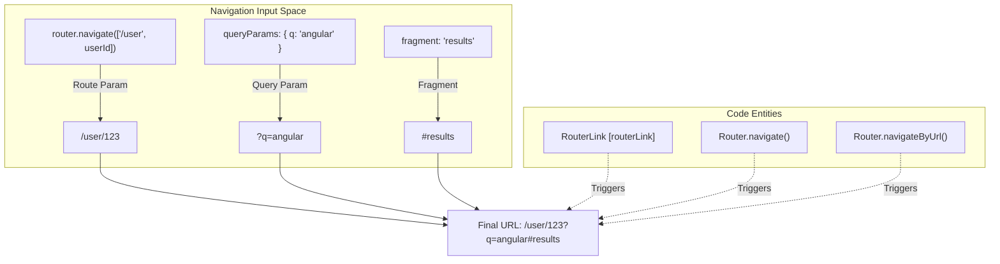
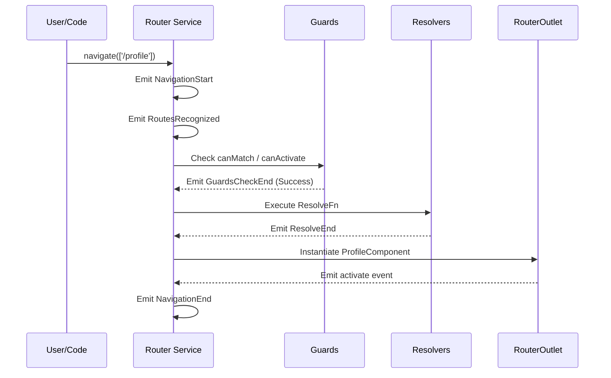

<!-- source: DeepWiki mcp.deepwiki.com · repo angular/skills · page 5.2 Navigation, Outlets, and Route Lifecycle · fetched 2026-10-26 -->

# Navigation, Outlets, and Route Lifecycle

Relevant source files

The following files were used as context for generating this wiki page:

- [angular-developer/references/navigate-to-routes.md](angular-developer/references/navigate-to-routes.md)
- [angular-developer/references/router-lifecycle.md](angular-developer/references/router-lifecycle.md)
- [angular-developer/references/show-routes-with-outlets.md](angular-developer/references/show-routes-with-outlets.md)

This page covers the mechanisms for navigating between routes, rendering route content via outlets, and monitoring the navigation lifecycle within an Angular application. It details declarative and programmatic navigation, the hierarchy of `RouterOutlet`, and the chronological sequence of events emitted by the `Router` service.

## Navigation Strategies

Angular provides two primary methods for triggering navigation: declarative directives in templates and programmatic service calls in TypeScript.

### Declarative Navigation (`RouterLink`)

The `RouterLink` directive is used on anchor elements to link to routes. It supports absolute paths (starting with `/`) and relative paths (using `../` to ascend levels) [angular-developer/references/navigate-to-routes.md:5-27]().

| Feature | Description |
| :--- | :--- |
| **`routerLink`** | The path or command array to navigate to [angular-developer/references/navigate-to-routes.md:16-17](). |
| **`routerLinkActive`** | A CSS class applied when the link's route is active [angular-developer/references/navigate-to-routes.md:16](). |
| **Absolute Path** | e.g., `/dashboard` navigates from the root [angular-developer/references/navigate-to-routes.md:26](). |
| **Relative Path** | e.g., `['edit']` navigates relative to the current segment [angular-developer/references/navigate-to-routes.md:27](). |

### Programmatic Navigation (`Router`)

For logic-driven navigation, the `Router` service is injected into components or services [angular-developer/references/navigate-to-routes.md:31-38]().

*   **`router.navigate(commands, extras)`**: Navigates using an array of commands. It allows for complex configurations like `queryParams`, `fragment`, and `relativeTo` [angular-developer/references/navigate-to-routes.md:33-52]().
*   **`router.navigateByUrl(url, extras)`**: Navigates using a full string path. Useful for absolute navigation or replacing the current history entry via `replaceUrl: true` [angular-developer/references/navigate-to-routes.md:54-63]().

### Navigation Parameters Diagram

This diagram illustrates how navigation commands translate into URL segments and parameters.

**Sources:** [angular-developer/references/navigate-to-routes.md:9-69]()

---

## Router Outlets

The `RouterOutlet` directive acts as a placeholder where Angular renders the component associated with the current URL segment [angular-developer/references/show-routes-with-outlets.md:3-7]().

### Primary and Named Outlets
*   **Primary Outlet**: The default `<router-outlet />` without a name [angular-developer/references/show-routes-with-outlets.md:27-31]().
*   **Named Outlets**: Secondary outlets used for sidebars, popups, or multi-pane layouts. They are targeted by the `name` attribute in the template and the `outlet` property in the route configuration [angular-developer/references/show-routes-with-outlets.md:25-44]().

### Nested Outlets
For child routes, the parent component must provide its own `<router-outlet />` to render its children [angular-developer/references/show-routes-with-outlets.md:15-23]().

### Data Passing with `routerOutletData`
Components rendered inside an outlet can receive contextual data via the `routerOutletData` input. This data is accessed within the routed component using the `ROUTER_OUTLET_DATA` injection token, which returns a `Signal` [angular-developer/references/show-routes-with-outlets.md:58-68]().

### Outlet Events
`RouterOutlet` exposes lifecycle events for the components it manages:
*   `(activate)`: Emitted when a new component is instantiated [angular-developer/references/show-routes-with-outlets.md:50]().
*   `(deactivate)`: Emitted when a component is destroyed [angular-developer/references/show-routes-with-outlets.md:51]().
*   `(attach)` / `(detach)`: Emitted during route reuse via `RouteReuseStrategy` [angular-developer/references/show-routes-with-outlets.md:52]().

**Sources:** [angular-developer/references/show-routes-with-outlets.md:1-68]()

---

## Router Lifecycle Events

The `Router` service provides an `events` observable that tracks the lifecycle of a navigation request [angular-developer/references/router-lifecycle.md:3]().

### Chronological Event Sequence

1.  **`NavigationStart`**: Navigation is triggered [angular-developer/references/router-lifecycle.md:7]().
2.  **`RoutesRecognized`**: The URL is successfully matched to a route configuration [angular-developer/references/router-lifecycle.md:8]().
3.  **`GuardsCheckStart` / `End`**: Evaluation of `canActivate`, `canMatch`, and other guards [angular-developer/references/router-lifecycle.md:9]().
4.  **`ResolveStart` / `End`**: Data fetching via `ResolveFn` occurs here [angular-developer/references/router-lifecycle.md:10]().
5.  **`NavigationEnd`**: Successful completion. The new component is rendered [angular-developer/references/router-lifecycle.md:11]().
6.  **`NavigationCancel` / `Error`**: Termination due to a guard returning `false` or a code error [angular-developer/references/router-lifecycle.md:12-13]().

### Lifecycle Data Flow Diagram

**Sources:** [angular-developer/references/router-lifecycle.md:5-13](), [angular-developer/references/show-routes-with-outlets.md:46-55]()

### Debugging Navigation
To log all routing events to the console for debugging, use `withDebugTracing()` during router configuration:
`provideRouter(routes, withDebugTracing())` [angular-developer/references/router-lifecycle.md:33-38]().

**Sources:** [angular-developer/references/router-lifecycle.md:1-45]()

---

