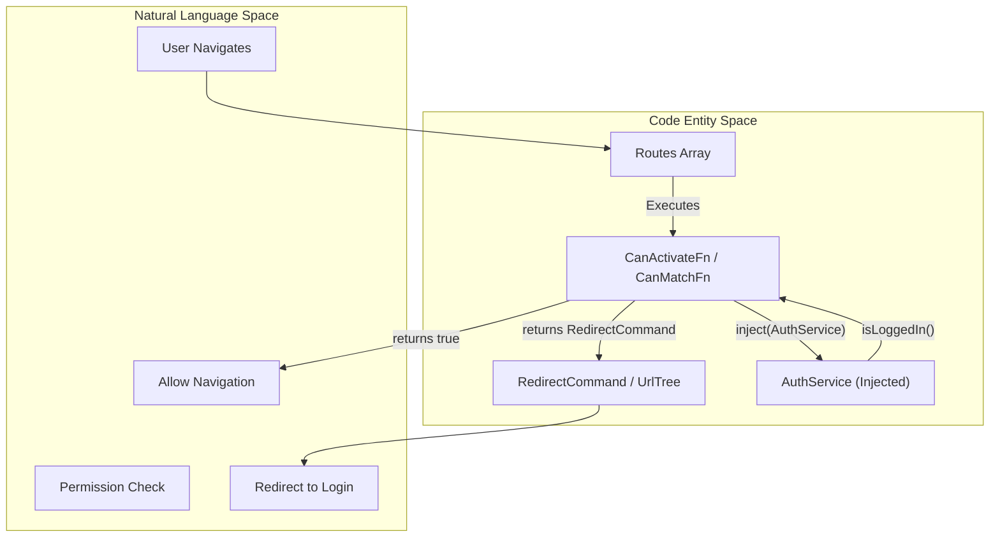
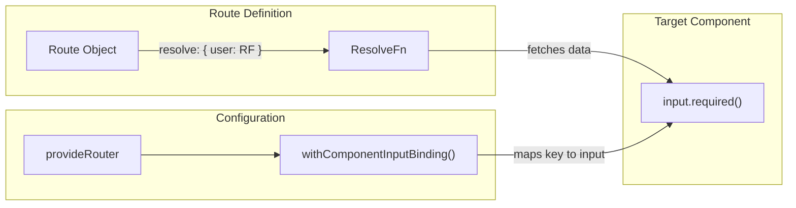

<!-- source: DeepWiki mcp.deepwiki.com · repo angular/skills · page 5.3 Route Guards and Data Resolvers · fetched 2026-10-26 -->

# Route Guards and Data Resolvers

<details>
<summary>Relevant source files</summary>

The following files were used as context for generating this wiki page:

- [angular-developer/references/data-resolvers.md](angular-developer/references/data-resolvers.md)
- [angular-developer/references/route-guards.md](angular-developer/references/route-guards.md)

</details>


Route guards and data resolvers are functional primitives used to control navigation flow and pre-fetch necessary data before a component is instantiated. Since Angular 15, these are primarily implemented as functions rather than classes, leveraging the `inject()` function for dependency access.

## Route Guards

Route guards determine whether a navigation request should proceed, be blocked, or be redirected. They are executed during the routing lifecycle before the target component is rendered.

### Guard Types and Execution Flow

| Guard Type | Purpose | Behavior on `false` |
| :--- | :--- | :--- |
| `CanMatch` | Determines if a route should be considered in the matching process. | Router continues to search for other matching routes in the configuration. |
| `CanActivate` | Checks if a user can access the specific route. | Navigation is cancelled. |
| `CanActivateChild` | Checks if a user can access child routes of the current route. | Navigation to any child route is cancelled. |
| `CanDeactivate` | Checks if a user can leave the current route (e.g., unsaved changes). | Navigation is cancelled, user remains on the current page. |

### Functional Implementation

Modern guards are defined using functional types like `CanActivateFn` or `CanMatchFn`. They have access to the `ActivatedRouteSnapshot` and `RouterStateSnapshot` [angular-developer/references/route-guards.md:17-27]().

**Entity Mapping: Navigation Security Flow**

Sources: [angular-developer/references/route-guards.md:7-28]()

### Return Values and Redirection
Guards can return several types of values to control the router:
*   `boolean`: `true` allows navigation; `false` blocks it [angular-developer/references/route-guards.md:46-46]().
*   `UrlTree` or `RedirectCommand`: Blocks current navigation and triggers a new navigation to the provided destination [angular-developer/references/route-guards.md:47-47]().
*   `Observable` or `Promise`: Asynchronous resolution of the above types [angular-developer/references/route-guards.md:48-48]().

### Security Considerations
Client-side guards are intended for User Experience (UX) to prevent users from reaching UI states they are not permitted to see. They are **not** a substitute for server-side authorization. All sensitive data and operations must be protected by server-side checks [angular-developer/references/route-guards.md:50-52]().

---

## Data Resolvers

Data resolvers allow the application to fetch data required by a component before the navigation completes. This ensures the component has immediate access to its data upon initialization, avoiding "empty" UI states.

### ResolveFn Implementation
Resolvers are defined using the `ResolveFn<T>` type. They utilize the `inject()` function to access data services [angular-developer/references/data-resolvers.md:7-15]().

```ts
export const userResolver: ResolveFn<User> = (route, state) => {
  const userService = inject(UserService);
  const id = route.paramMap.get('id')!;
  return userService.getUser(id);
};
```
Sources: [angular-developer/references/data-resolvers.md:9-15]()

### Data Access Patterns

There are two primary ways to consume resolved data within a component:

1.  **Component Input Binding (Modern/Preferred)**: By enabling `withComponentInputBinding()` in the `provideRouter` configuration, resolved data is automatically mapped to component `input()` signals or `@Input()` properties that match the key in the `resolve` configuration [angular-developer/references/data-resolvers.md:41-51]().
2.  **ActivatedRoute (Traditional)**: Accessing the `data` observable from the `ActivatedRoute` service and converting it to a signal using `toSignal` [angular-developer/references/data-resolvers.md:33-39]().

**Entity Mapping: Data Pre-fetching Flow**

Sources: [angular-developer/references/data-resolvers.md:21-29](), [angular-developer/references/data-resolvers.md:41-51]()

### Error Handling in Resolvers
If a resolver fails (e.g., an Observable errors), navigation is blocked [angular-developer/references/data-resolvers.md:55-55](). Developers should handle errors within the resolver using `catchError` to either provide fallback data or redirect the user using a `RedirectCommand` [angular-developer/references/data-resolvers.md:57-64]().

### Best Practices
*   **Lightweight Resolvers**: Only fetch data critical for the initial render. Non-critical data should be fetched within the component using `resource()` or `httpResource()` to avoid delaying navigation [angular-developer/references/data-resolvers.md:68-68]().
*   **Navigation Feedback**: Since the UI remains on the previous page while resolvers execute, it is essential to listen to `Router` events (like `NavigationStart` and `NavigationEnd`) to display a global loading indicator [angular-developer/references/data-resolvers.md:69-69]().

Sources: [angular-developer/references/data-resolvers.md:1-69](), [angular-developer/references/route-guards.md:1-52]()

---

