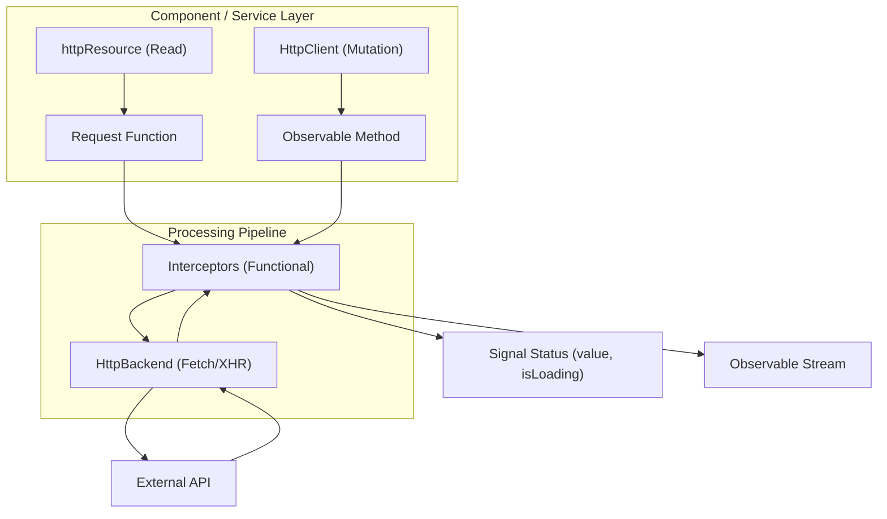
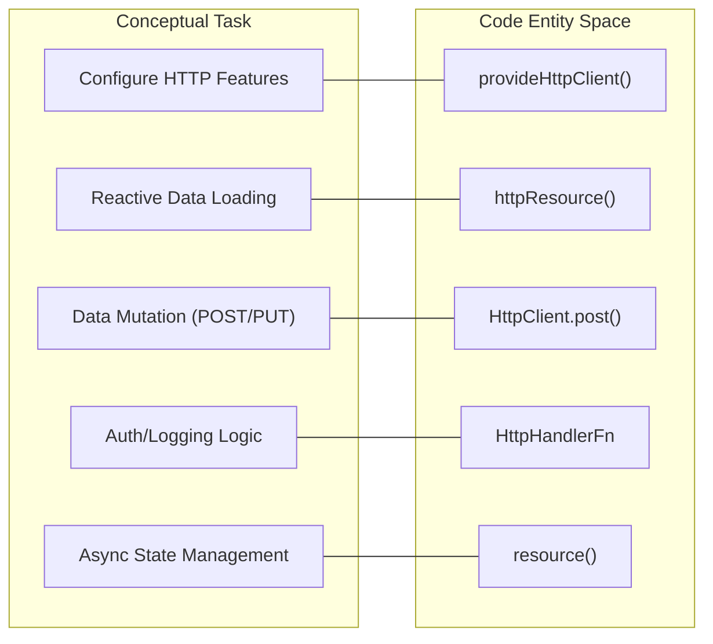

<!-- source: DeepWiki mcp.deepwiki.com · repo angular/skills · page 7 HTTP Communication · fetched 2026-10-26 -->

# HTTP Communication

Relevant source files

The following files were used as context for generating this wiki page:

- [README.md](README.md)
- [angular-developer/references/http-client.md](angular-developer/references/http-client.md)
- [angular-developer/references/resource.md](angular-developer/references/resource.md)

Angular provides a robust, integrated layer for backend communication that leverages dependency injection, security features, and modern reactive primitives. The framework offers two primary ways to interact with HTTP services: the traditional `HttpClient` for imperative actions and mutations, and the signal-native `httpResource` for reactive data fetching.

### Core Architecture

The HTTP system is built around a centralized configuration and a pipeline of interceptors. While `HttpClient` is available by default in modern Angular versions, `provideHttpClient` is used to configure specific features like interceptors and XSRF protection [angular-developer/references/http-client.md:7-22]().

Modern HTTP Logic Flow:

Sources: [angular-developer/references/http-client.md:24-40](), [angular-developer/references/http-client.md:88-99](), [angular-developer/references/http-client.md:53-72]()

---

### HttpClient and Interceptors
`HttpClient` is the foundation for HTTP communication in Angular. It is primarily used for **mutations** (POST, PUT, PATCH, DELETE) and legacy Observable-based streams [angular-developer/references/http-client.md:104-104]().

*   **Configuration**: Use `provideHttpClient()` to enable features like `withInterceptors()` or `withXsrfConfiguration()` [angular-developer/references/http-client.md:10-15]().
*   **Immutability**: `HttpRequest`, `HttpHeaders`, and `HttpParams` are immutable. Operations like `.set()` return new instances rather than modifying the original [angular-developer/references/http-client.md:48-48]().
*   **Interceptors**: Modern Angular prefers functional interceptors over class-based ones. They allow you to transform outgoing requests and incoming responses globally [angular-developer/references/http-client.md:53-67]().

For details, see [HttpClient and Interceptors](#7.1).

Sources: [angular-developer/references/http-client.md:1-86]()

---

### httpResource for Reactive Data Fetching
`httpResource` is a signal-native wrapper around the HTTP stack, designed specifically for **reads**. It integrates directly with Angular's signal reactivity to fetch data whenever its dependencies change [angular-developer/references/http-client.md:88-91]().

*   **Automatic Cancellation**: When a reactive dependency (like an `input` or `signal`) changes, `httpResource` automatically cancels the pending request and starts a new one [angular-developer/references/http-client.md:102-102]().
*   **Status Tracking**: It exposes the state of the request through synchronous signals: `value()`, `isLoading()`, `hasValue()`, and `error()` [angular-developer/references/resource.md:54-62]().
*   **Specialized Types**: Includes built-in support for various response formats via `httpResource.text`, `httpResource.blob`, and `httpResource.arrayBuffer` [angular-developer/references/http-client.md:106-106]().

For details, see [httpResource for Reactive Data Fetching](#7.2).

Sources: [angular-developer/references/http-client.md:88-108](), [angular-developer/references/resource.md:1-74]()

---

### Code Entity Mapping

The following diagram maps the conceptual HTTP tasks to the specific Angular entities used to implement them.

Mapping Concepts to Code:

Sources: [angular-developer/references/http-client.md:10-15](), [angular-developer/references/http-client.md:36-38](), [angular-developer/references/http-client.md:65-67](), [angular-developer/references/http-client.md:97-97](), [angular-developer/references/resource.md:19-29]()

---

