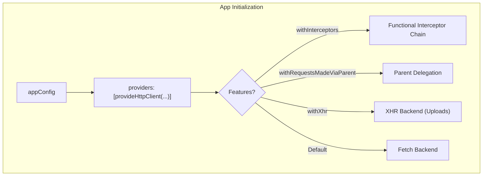
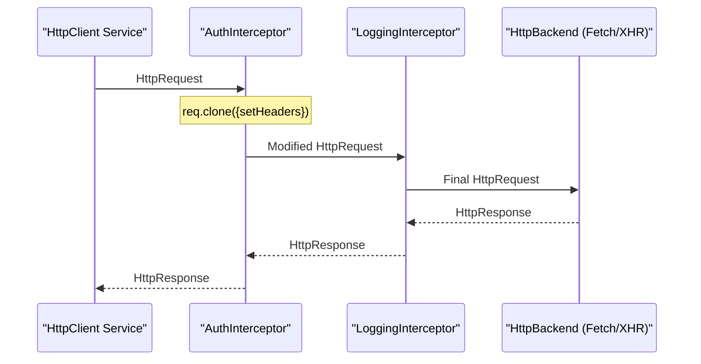
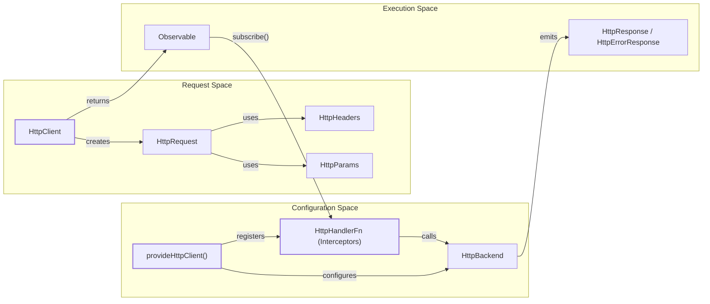

<!-- source: DeepWiki mcp.deepwiki.com · repo angular/skills · page 7.1 HttpClient and Interceptors · fetched 2026-10-26 -->

# HttpClient and Interceptors

<details>
<summary>Relevant source files</summary>

The following files were used as context for generating this wiki page:

- [README.md](README.md)
- [angular-developer/references/http-client.md](angular-developer/references/http-client.md)

</details>


The `HttpClient` in Angular provides a robust, type-safe API for performing HTTP requests. It integrates deeply with Angular's dependency injection (DI) system, interceptor pipeline, and security features like XSRF protection. In modern Angular (v21+), `HttpClient` is optimized for functional patterns and signal-based reactivity.

## Configuration and Setup

In Angular v21 and later, `HttpClient` is available for injection by default [angular-developer/references/http-client.md:7-7](). The `provideHttpClient()` function is used to configure specific HTTP features or when working with multiple injectors [angular-developer/references/http-client.md:7-15]().

### provideHttpClient Features

| Feature | Description |
| :--- | :--- |
| `withInterceptors([...])` | Registers functional interceptors in the order provided [angular-developer/references/http-client.md:13-13](). |
| `withRequestsMadeViaParent()` | Allows a child injector to add interceptors while still delegating to the parent HTTP chain [angular-developer/references/http-client.md:22-22](). |
| `withXsrfConfiguration(...)` | Customizes cookie and header names for XSRF protection [angular-developer/references/http-client.md:85-85](). |
| `withNoXsrfProtection()` | Disables the default XSRF protection [angular-developer/references/http-client.md:85-85](). |
| `withXhr()` | Configures the `XMLHttpRequest` backend. Required only for upload progress events; should not be used for SSR [angular-developer/references/http-client.md:18-18](). |

**Configuration Logic**

Sources: [angular-developer/references/http-client.md:7-22]()

## The HttpClient Service

Backend communication should be encapsulated in `@Service()` classes rather than components [angular-developer/references/http-client.md:26-26]().

### Request Methods and Observables
`HttpClient` methods (e.g., `get`, `post`, `put`, `patch`, `delete`) return "cold" `Observable`s. No request is dispatched until the `Observable` is subscribed to [angular-developer/references/http-client.md:44-44]().

*   **Mutations:** Always subscribe to `post`, `put`, `patch`, and `delete` requests to ensure they execute [angular-developer/references/http-client.md:45-45]().
*   **Type Safety:** Generic type parameters (e.g., `.get<User>(...)`) are type assertions only; runtime validation is recommended for untrusted data [angular-developer/references/http-client.md:46-46]().
*   **Immutability:** `HttpHeaders` and `HttpParams` are immutable. Methods like `.set()` or `.append()` return a new instance [angular-developer/references/http-client.md:48-48]().

### Fetch Options
Angular supports standard fetch options including `timeout`, `cache`, `priority`, `mode`, `redirect`, `credentials`, `keepalive`, `referrer`, and `integrity` [angular-developer/references/http-client.md:49-49](). Using `withCredentials: true` overrides the `credentials` fetch option [angular-developer/references/http-client.md:49-49]().

Sources: [angular-developer/references/http-client.md:24-52]()

## Functional Interceptors

Interceptors allow developers to inspect and transform HTTP requests and responses globally. Modern Angular prefers functional interceptors over class-based ones [angular-developer/references/http-client.md:55-55]().

### Implementation Pattern
A functional interceptor takes an `HttpRequest` and an `HttpHandlerFn` (the next handler in the chain) [angular-developer/references/http-client.md:65-65]().

```ts
// Example: Auth Interceptor
export function authInterceptor(req: HttpRequest<unknown>, next: HttpHandlerFn) {
  const authToken = inject(AuthService).getToken();
  const newReq = req.clone({
    setHeaders: { Authorization: `Bearer ${authToken}` }
  });
  return next(newReq);
}
```
[angular-developer/references/http-client.md:65-67]()

### Key Interceptor Rules
1.  **Order:** Interceptors execute in the order they are listed in `withInterceptors` [angular-developer/references/http-client.md:74-74]().
2.  **Immutability:** `HttpRequest` and `HttpResponse` objects are immutable. Use `.clone()` to modify them [angular-developer/references/http-client.md:75-75]().
3.  **DI Access:** Functional interceptors can use `inject()` to access services [angular-developer/references/http-client.md:77-77]().
4.  **Metadata:** Use `HttpContextToken` to pass metadata to interceptors that should not be sent to the backend [angular-developer/references/http-client.md:78-78]().

**Interceptor Pipeline Flow**

Sources: [angular-developer/references/http-client.md:53-80]()

## Security and XSRF

Angular provides built-in protection against Cross-Site Request Forgery (XSRF).

*   **Automatic Protection:** `provideHttpClient()` enables XSRF protection by default for mutating requests (POST, PUT, etc.) to relative or same-origin URLs [angular-developer/references/http-client.md:84-84]().
*   **Mechanism:** The client reads the `XSRF-TOKEN` cookie and attaches its value to the `X-XSRF-TOKEN` HTTP header [angular-developer/references/http-client.md:84-84]().
*   **XSSI:** `HttpClient` automatically strips the `)]}',\n` prefix from JSON responses to prevent Cross-Site Script Inclusion [angular-developer/references/http-client.md:83-83]().

Sources: [angular-developer/references/http-client.md:81-86]()

## Code Entity Mapping

The following diagram maps the conceptual HTTP flow to the specific code entities provided in the `HttpClient` API.

**HTTP Entity Map**

Sources: [angular-developer/references/http-client.md:7-80]()

---

