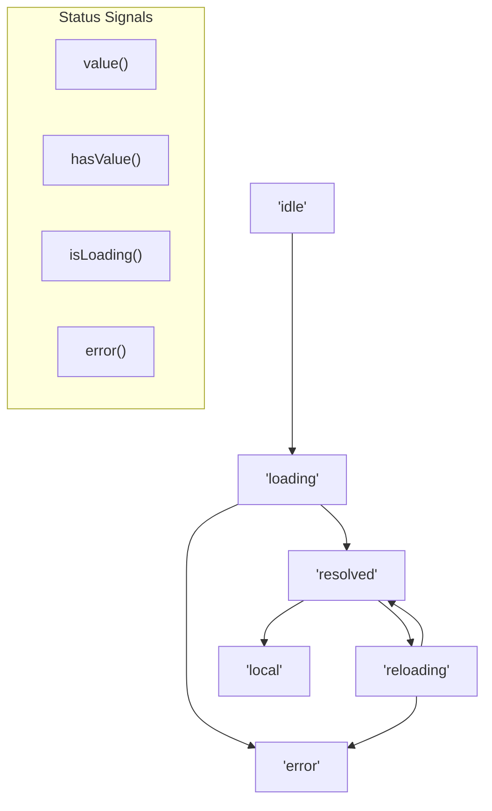

<!-- source: DeepWiki mcp.deepwiki.com · repo angular/skills · page 7.2 httpResource for Reactive Data Fetching · fetched 2026-10-26 -->

# httpResource for Reactive Data Fetching

<details>
<summary>Relevant source files</summary>

The following files were used as context for generating this wiki page:

- [README.md](README.md)
- [angular-developer/references/http-client.md](angular-developer/references/http-client.md)
- [angular-developer/references/resource.md](angular-developer/references/resource.md)

</details>


The `httpResource()` function is a signal-native wrapper for Angular's HTTP stack. It bridges the gap between reactive signals and asynchronous HTTP communication, providing a simpler alternative to `HttpClient` observables for data-fetching scenarios. Unlike traditional `HttpClient` methods which return "cold" observables, `httpResource` is eager and automatically manages request lifecycles, cancellations, and status tracking through signals.

## Core Concepts and Data Flow

`httpResource` is built upon the `resource()` API, specialized for the Angular HTTP stack. It integrates with existing HTTP features like interceptors, transfer cache, and security protections while exposing a reactive interface [angular-developer/references/http-client.md:87-91]().

### Request Execution Flow
1.  **Reactive Trigger**: The request function (or params) is tracked by Angular's reactivity system.
2.  **Automatic Cancellation**: If a dependency changes while a request is in flight, the pending request is automatically aborted [angular-developer/references/http-client.md:102-102]().
3.  **Eager Loading**: The request is sent as soon as its reactive dependencies are evaluated, without requiring a manual subscription [angular-developer/references/http-client.md:101-101]().
4.  **Signal Updates**: The resource updates its internal status signals (`value`, `isLoading`, `status`, etc.) as the request progresses [angular-developer/references/resource.md:54-62]().

### Logic to Entity Mapping

| System Concept | Code Entity | Role |
| :--- | :--- | :--- |
| **Reactive Wrapper** | `httpResource()` | Primary function to create a signal-based HTTP resource. |
| **Request Definition** | `request` function | A function that returns a URL string or request options. |
| **Status Tracking** | `status()` | Signal returning `'idle'`, `'loading'`, `'resolved'`, or `'error'`. |
| **Data Access** | `value()` | Signal containing the resolved response body. |
| **Availability Check** | `hasValue()` | Type-guard signal to check if data is ready. |

**Sources:** [angular-developer/references/http-client.md:87-108](), [angular-developer/references/resource.md:54-62]()

## Implementation and Usage

`httpResource` can be initialized with a simple URL string or a more complex configuration object.

### Basic Fetching
```ts
import { httpResource } from '@angular/common/http';
import { input, Component } from '@angular/core';

@Component({...})
export class UserProfile {
  // Input triggers re-fetch automatically when it changes
  readonly userId = input.required<string>();
  
  // Resource defined as a derivation of the input
  readonly user = httpResource(() => `/api/users/${this.userId()}`);
}
```
[angular-developer/references/http-client.md:92-99]()

### Skipping Requests
To prevent a request from being sent (e.g., when a required parameter is missing), return `undefined` from the request function [angular-developer/references/http-client.md:103-103]().

### Specialized Variants
For non-JSON responses, `httpResource` provides specialized methods:
*   `httpResource.text()`: Returns the response as a string.
*   `httpResource.blob()`: Returns the response as a Binary Large Object.
*   `httpResource.arrayBuffer()`: Returns the response as an ArrayBuffer.

[angular-developer/references/http-client.md:106-106]()

## Status and Metadata Signals

The object returned by `httpResource()` provides several signals to inspect the state of the request and the response metadata.

### Data Flow: Request Lifecycle
The following diagram illustrates how the `Resource` status transitions during an HTTP lifecycle.

**HTTP Resource State Transitions**

**Sources:** [angular-developer/references/resource.md:54-63]()

### Available Signals
| Signal | Type | Description |
| :--- | :--- | :--- |
| `value()` | `T \| undefined` | The resolved data. Reading this while in an error state throws an exception [angular-developer/references/http-client.md:105-105](). |
| `hasValue()` | `boolean` | Returns `true` if a value is currently available. Used to guard `value()` reads [angular-developer/references/resource.md:59-59](). |
| `isLoading()` | `boolean` | `true` if a request is currently in flight [angular-developer/references/resource.md:60-60](). |
| `error()` | `any \| undefined` | Contains the error object if the request failed [angular-developer/references/resource.md:61-61](). |
| `headers()` | `HttpHeaders` | Exposes the response headers [angular-developer/references/http-client.md:108-108](). |
| `statusCode()` | `number` | Exposes the HTTP status code of the response [angular-developer/references/http-client.md:108-108](). |

## Advanced Configuration

### Validation and Transformation
The `parse` option allows for runtime schema validation or data transformation before the signal is updated. This is useful for ensuring backend data matches expected types [angular-developer/references/http-client.md:107-107]().

### Progress Tracking
To track download progress, set `reportProgress: true` in the request options. The progress can then be read via the `progress()` signal [angular-developer/references/http-client.md:108-108]().

### Local Mutation
Like standard resources, `httpResource` supports optimistic updates via `value.set()`. This changes the resource status to `'local'` [angular-developer/references/resource.md:64-70]().

## Comparison: httpResource vs HttpClient

While `httpResource` is preferred for reading data reactively, `HttpClient` remains the standard for mutations.

| Feature | `httpResource` | `HttpClient` (Observable) |
| :--- | :--- | :--- |
| **Primary Use Case** | Data fetching (Reads) [angular-developer/references/http-client.md:104-104]() | Mutations (POST, PUT, DELETE) [angular-developer/references/http-client.md:104-104]() |
| **Execution** | Eager (on dependency change) | Cold (on subscription) [angular-developer/references/http-client.md:44-44]() |
| **Cancellation** | Automatic on dependency change | Manual (unsubscription) |
| **State Management** | Built-in status signals | Manual state tracking |
| **Interceptors** | Supported [angular-developer/references/http-client.md:87-91]() | Supported [angular-developer/references/http-client.md:3-3]() |

**Sources:** [angular-developer/references/http-client.md:42-52](), [angular-developer/references/http-client.md:101-108]()

---

