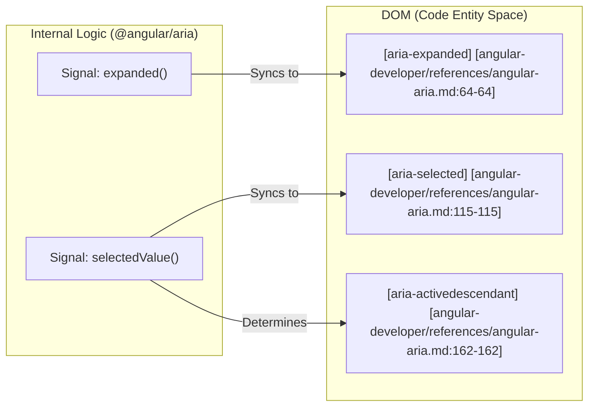

<!-- source: DeepWiki mcp.deepwiki.com · repo angular/skills · page 8 Accessibility with Angular Aria · fetched 2026-10-26 -->

# Accessibility with Angular Aria

<details>
<summary>Relevant source files</summary>

The following files were used as context for generating this wiki page:

- [angular-developer/references/angular-aria.md](angular-developer/references/angular-aria.md)

</details>


Angular Aria (`@angular/aria`) is a collection of headless, accessible directives that implement common WAI-ARIA patterns. These directives handle complex accessibility logic, including keyboard interactions, ARIA attributes, focus management, and screen reader support, while leaving the HTML structure and CSS styling to the developer [angular-developer/references/angular-aria.md:1-5]().

### Headless Component Philosophy

Unlike traditional component libraries, Angular Aria is **headless**. It provides the behavioral logic via directives but does not include default styles or specific DOM structures. Developers must use CSS to style different states by targeting the ARIA attributes that the directives automatically apply and update [angular-developer/references/angular-aria.md:7-9]().

Common ARIA attributes to target in CSS include:
*   `[aria-expanded="true"]` / `[aria-expanded="false"]` [angular-developer/references/angular-aria.md:13-13]()
*   `[aria-selected="true"]` [angular-developer/references/angular-aria.md:14-14]()
*   `[aria-disabled="true"]` [angular-developer/references/angular-aria.md:15-15]()
*   `[aria-current="page"]` [angular-developer/references/angular-aria.md:16-16]()

### Core Pattern Groups

The library is organized into pattern groups that correspond to standard WAI-ARIA roles.

#### Accordion, Listbox, and Combobox
These patterns manage selection and disclosure. The **Accordion** organizes content into expandable sections using `ngAccordionGroup` and `ngAccordionTrigger` [angular-developer/references/angular-aria.md:22-30](). The **Listbox** provides a foundation for selectable lists via `ngListbox` and `ngOption` [angular-developer/references/angular-aria.md:77-85](). The **Combobox** and **Select** patterns combine these with a popup mechanism (`ngComboboxPopup`) to create autocompletes or dropdown menus [angular-developer/references/angular-aria.md:127-142]().

For details on implementation, inputs, and two-way binding for these patterns, see **[Aria Patterns: Accordion, Listbox, Combobox, and Select](#8.1)**.

#### Menus, Tabs, and Navigation
These patterns handle complex navigation structures. The **Menu** pattern implements hierarchical command menus, while **Tabs** manages content switching via a tab list. **Toolbar**, **Tree**, and **Grid** directives provide specialized keyboard navigation, such as roving tabindex for single-dimensional lists and 2D navigation for grids.

For details on keyboard navigation, roving tabindex, and layout directives, see **[Aria Patterns: Menu, Tabs, Toolbar, Tree, and Grid](#8.2)**.

### System Architecture Diagrams

The following diagrams illustrate how the headless directives bridge the gap between standard HTML elements and the complex ARIA state management required for accessibility.

#### Component to Directive Mapping
This diagram shows how developers apply `@angular/aria` directives to standard HTML tags to transform them into accessible widgets.

| Directive Name | Target Element | Primary Role |
| :--- | :--- | :--- |
| `ngAccordionGroup` | `div` / `section` | Container for panels [angular-developer/references/angular-aria.md:45-45]() |
| `ngAccordionTrigger` | `button` | Toggles panel visibility [angular-developer/references/angular-aria.md:47-47]() |
| `ngListbox` | `ul` / `div` | Manages selection state [angular-developer/references/angular-aria.md:101-101]() |
| `ngCombobox` | `input` / `div` | Trigger for a popup [angular-developer/references/angular-aria.md:147-148]() |

**Directive Integration Flow**

```mermaid
graph TD
    subgraph "Natural Language Space"
        UserIntent["'Create a searchable dropdown'"]
    end

    subgraph "Code Entity Space"
        InputTag["HTML <input>"]
        ComboboxDir["ngCombobox [angular-developer/references/angular-aria.md:148-148]"]
        PopupTemplate["ng-template ngComboboxPopup [angular-developer/references/angular-aria.md:156-156]"]
        WidgetDir["ngComboboxWidget [angular-developer/references/angular-aria.md:158-158]"]
        ListboxDir["ngListbox [angular-developer/references/angular-aria.md:159-159]"]
    end

    UserIntent --> InputTag
    InputTag -- "Decorated with" --> ComboboxDir
    ComboboxDir -- "Controls" --> PopupTemplate
    PopupTemplate -- "Contains" --> WidgetDir
    WidgetDir -- "Wraps" --> ListboxDir
```

Sources: [angular-developer/references/angular-aria.md:145-169]()

**State Synchronization Flow**
This diagram demonstrates how internal directive logic updates DOM attributes for Screen Readers.


Sources: [angular-developer/references/angular-aria.md:108-108](), [angular-developer/references/angular-aria.md:162-162]()

### Styling Strategy

Because the directives are headless, styling is entirely decoupled from logic. Developers should use attribute selectors in CSS to ensure styles stay in sync with the accessibility state.

```css
/* Example: Styling an Accordion Trigger based on ARIA state */
.accordion-header[aria-expanded='true'] .icon {
  transform: rotate(180deg);
}

/* Example: Styling a Listbox Option based on ARIA selection */
.option[aria-selected='true'] {
  background: #e0f7fa;
  font-weight: bold;
}
```
Sources: [angular-developer/references/angular-aria.md:64-66](), [angular-developer/references/angular-aria.md:115-118]()

---

**Sources:**
- [angular-developer/references/angular-aria.md:1-213]()

---

