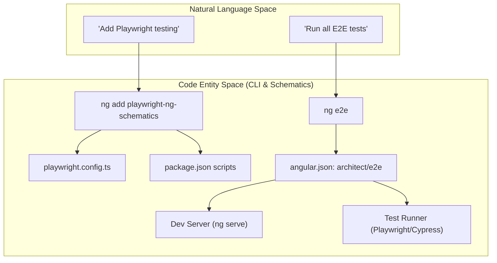
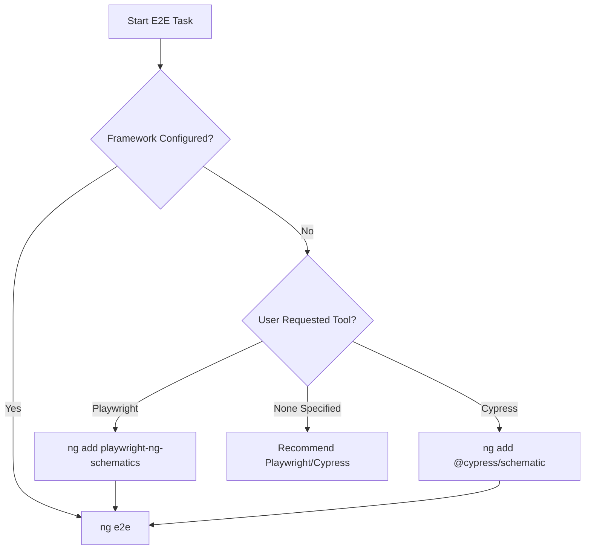

<!-- source: DeepWiki mcp.deepwiki.com · repo angular/skills · page 9.3 End-to-End Testing · fetched 2026-10-26 -->

# End-to-End Testing

<details>
<summary>Relevant source files</summary>

The following files were used as context for generating this wiki page:

- [angular-developer/references/e2e-testing.md](angular-developer/references/e2e-testing.md)

</details>


End-to-End (E2E) testing in Angular focuses on verifying the entire application workflow by running tests against a live version of the application. Unlike unit tests that isolate components, E2E tests simulate real user interactions in a browser environment to ensure that all integrated parts—frontend, backend, and routing—function correctly together.

## E2E Framework Integration

Angular does not mandate a specific E2E tool but provides official schematics for popular industry-standard frameworks. Integration is handled via the `ng add` command, which configures the workspace, adds necessary dependencies, and creates the required configuration files (e.g., `playwright.config.ts` or `cypress.config.ts`).

### Supported Tooling

The following frameworks are officially supported via schematics:

| Framework | Installation Command | Description |
| :--- | :--- | :--- |
| **Playwright** | `ng add playwright-ng-schematics` | Modern, fast, and reliable E2E testing for modern web apps. |
| **Cypress** | `ng add @cypress/schematic` | All-in-one testing framework with a rich visual debugger. |
| **Nightwatch** | `ng add @nightwatch/schematics` | Integrated E2E testing solution based on Node.js and W3C WebDriver. |
| **WebdriverIO** | `ng add @wdio/schematics` | Extensible testing framework for browser and mobile automation. |
| **Puppeteer** | `ng add @puppeteer/ng-schematics` | High-level API to control Chrome or Chromium over the DevTools Protocol. |

> [!IMPORTANT]
> These setup guidelines should only be used if no E2E framework is currently configured in the workspace or if a migration/new setup is explicitly requested [angular-developer/references/e2e-testing.md:3-5]().

**Sources:**
- [angular-developer/references/e2e-testing.md:8-29]()

## Execution Model

Once a framework is integrated, tests are executed using the Angular CLI's unified `e2e` command. This command typically triggers a build of the application, starts a local development server, and سپس runs the test suite against that server.

### The `ng e2e` Command

The command structure follows the standard Angular CLI pattern:

```shell
ng e2e [project] [options]
```

This command maps to the `e2e` target defined in the `angular.json` workspace configuration file. Depending on the chosen schematic, this target will invoke the specific runner (e.g., Playwright or Cypress) with the appropriate base URL of the dev server [angular-developer/references/e2e-testing.md:31-35]().

### Custom and Enterprise Runners

For tools that do not have an official Angular schematic (such as Selenium, TestCafe, or Katalon Studio), execution should be managed via standard `package.json` scripts rather than the `ng e2e` delegate [angular-developer/references/e2e-testing.md:37-39]().

**Sources:**
- [angular-developer/references/e2e-testing.md:31-39]()

## Code-to-System Mapping

The following diagram illustrates how the Natural Language request for testing maps to the underlying Angular CLI commands and the specific schematics that implement the E2E infrastructure.

### E2E Setup and Execution Flow

"E2E Setup and Execution Flow"


**Sources:**
- [angular-developer/references/e2e-testing.md:8-13]()
- [angular-developer/references/e2e-testing.md:31-35]()

### Testing Framework Selection Logic

The repository follows a specific decision path for E2E configuration based on the project's current state.

"E2E Framework Selection Logic"


**Sources:**
- [angular-developer/references/e2e-testing.md:3-5]()
- [angular-developer/references/e2e-testing.md:8-29]()

---

