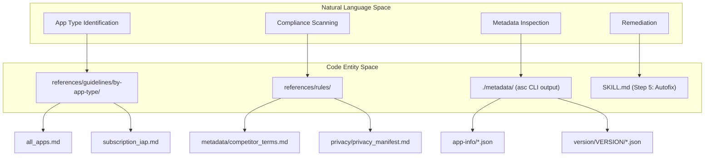
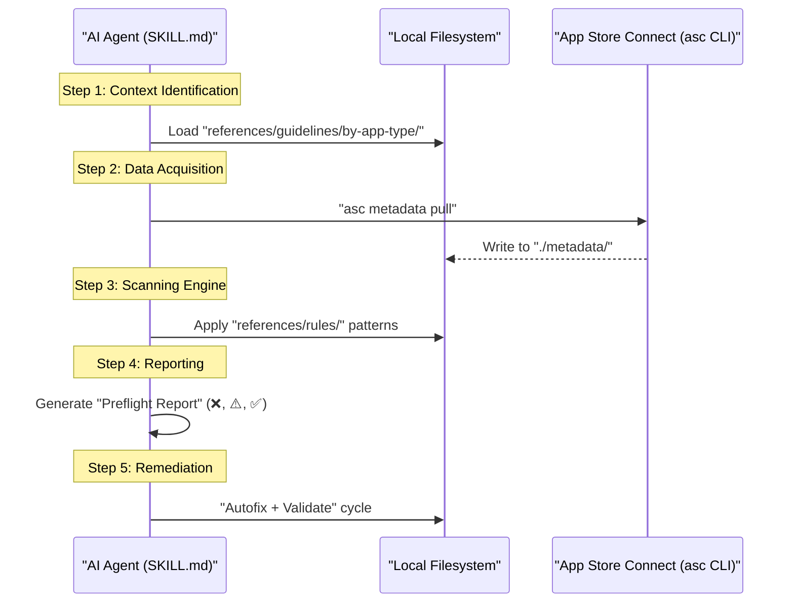

<!-- source: DeepWiki mcp.deepwiki.com · repo truongduy2611/app-store-preflight-skills · page 1 Overview · fetched 2026-10-26 -->

# Overview

Relevant source files

The following files were used as context for generating this wiki page:

- [LICENSE](LICENSE)
- [README.md](README.md)
- [SKILL.md](SKILL.md)

The **App Store Preflight Skills** system is an AI agent skill designed to automate the audit of iOS and macOS projects against Apple's App Store Review Guidelines. By scanning source code, project configurations, and App Store metadata, the system identifies common patterns that lead to rejections before a developer submits their build for review [README.md:3-7]().

The system exists to reduce the friction of the App Store submission process, providing a "pre-flight" check that mirrors the scrutiny of Apple's review team. It integrates directly with the `asc` CLI to pull live metadata and uses a structured library of rejection rules and app-type checklists to generate actionable compliance reports [README.md:9-13]().

### System Architecture: From Natural Language to Code Entities

The following diagram illustrates how the high-level "Preflight" concepts map to specific files and directories within the codebase.

**Codebase Entity Mapping**

Sources: [README.md:21-38](), [README.md:52-89](), [SKILL.md:23-38](), [SKILL.md:51-52]()

---

## Core Components

### 1. Guideline Index & Checklists
The system categorizes Apple's 100+ guidelines into digestible checklists based on the app's functionality. Every scan starts with a universal baseline (`all_apps.md`) and layers on specialized checks for categories like AI, Subscriptions, or Games [README.md:21-36]().

For details, see [Guideline Index & App-Type Checklists](#2).

### 2. Rejection Rules Reference
The core logic of the system is contained within `references/rules/`. These are categorized into five domains:
*   **Metadata**: Checks for competitor terms, trademark misuse, and storefront-specific bans [README.md:54-62]().
*   **Subscription**: Validates pricing transparency and legal links [README.md:64-69]().
*   **Privacy**: Audits `PrivacyInfo.xcprivacy` and data collection practices [README.md:71-76]().
*   **Design**: Identifies "minimum functionality" issues and Sign in with Apple requirements [README.md:78-83]().
*   **Entitlements**: Audits `.entitlements` files for unused or unjustified permissions [README.md:85-89]().

For details, see [Rejection Rules Reference](#3).

### 3. Preflight Pipeline
The AI agent follows a five-step execution model defined in `SKILL.md`. This pipeline ensures that the context is correctly identified before scanning begins and provides a closed-loop system for fixing identified issues [SKILL.md:13-104]().

**The Preflight Execution Pipeline**

Sources: [SKILL.md:23-104](), [README.md:40-46]()

For details, see [How the Preflight Pipeline Works](#1.2).

---

## Getting Started

To use the system, developers must install the skill via `npx` and ensure the `asc` CLI is configured for authentication. The skill relies on the canonical JSON layout provided by `asc metadata pull` to perform its audits [README.md:15-19](), [SKILL.md:17-21]().

For a step-by-step installation and configuration guide, see [Getting Started](#1.1).

---

## Navigation Summary

| Page | Purpose |
| :--- | :--- |
| [Getting Started](#1.1) | Installation, `asc` CLI setup, and authentication. |
| [How the Preflight Pipeline Works](#1.2) | Deep dive into the 5-stage agent execution logic. |
| [Guideline Index & App-Type Checklists](#2) | Overview of app-type checklists and the guideline library. |
| [Rejection Rules Reference](#3) | Technical details on the specific patterns detected by the system. |
| [Autofix & Validation System](#4) | How the system applies and verifies automated remediations. |
| [Glossary](#5) | Key terms and code entity definitions. |

Sources: [README.md:1-114](), [SKILL.md:1-128]()

---

