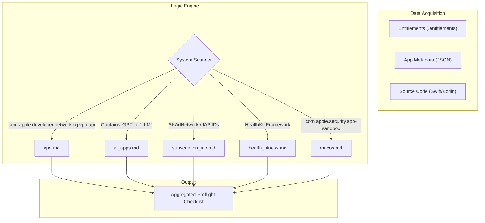

<!-- source: DeepWiki mcp.deepwiki.com · repo truongduy2611/app-store-preflight-skills · page 2.2 App-Type Specific Checklists · fetched 2026-10-26 -->

# App-Type Specific Checklists

Relevant source files

The following files were used as context for generating this wiki page:

- [references/guidelines/by-app-type/ai_apps.md](references/guidelines/by-app-type/ai_apps.md)
- [references/guidelines/by-app-type/crypto_finance.md](references/guidelines/by-app-type/crypto_finance.md)
- [references/guidelines/by-app-type/games.md](references/guidelines/by-app-type/games.md)
- [references/guidelines/by-app-type/health_fitness.md](references/guidelines/by-app-type/health_fitness.md)
- [references/guidelines/by-app-type/kids.md](references/guidelines/by-app-type/kids.md)
- [references/guidelines/by-app-type/macos.md](references/guidelines/by-app-type/macos.md)
- [references/guidelines/by-app-type/social_ugc.md](references/guidelines/by-app-type/social_ugc.md)
- [references/guidelines/by-app-type/subscription_iap.md](references/guidelines/by-app-type/subscription_iap.md)
- [references/guidelines/by-app-type/vpn.md](references/guidelines/by-app-type/vpn.md)

The App Store Preflight Skills system employs a "base + delta" loading model for compliance verification. While the **Universal Checklist (all_apps.md)** covers the baseline requirements for every submission, the system identifies the specific nature of an application to activate one or more of the nine specialized checklists found in `references/guidelines/by-app-type/`.

This approach ensures that a high-utility utility app isn't burdened with "Loot Box" disclosure requirements, while a Generative AI app is strictly audited for China storefront compliance and medical disclaimers.

### The Loading Model

The AI agent determines which checklists to apply by analyzing the app's metadata, entitlements, and source code during the **Context Identification** stage. Multiple checklists can be active simultaneously (e.g., a Game that also uses Generative AI).

| Category | Primary Target | Key File |
| :--- | :--- | :--- |
| **AI & Generative AI** | Apps using LLMs, Diffusers, or Deep Synthesis | [ai_apps.md:1-38]() |
| **Subscriptions & IAP** | Apps with auto-renewable subs or digital goods | [subscription_iap.md:1-35]() |
| **Social & UGC** | Messaging, Communities, and Content Platforms | [social_ugc.md:1-33]() |
| **Games** | Casual, Hardcore, and Gambling titles | [games.md:1-32]() |
| **Health & Medical** | HealthKit integration and diagnostic tools | [health_fitness.md:1-32]() |
| **Crypto & Finance** | Wallets, Exchanges, and Loan providers | [crypto_finance.md:1-32]() |
| **Kids Category** | Apps specifically targeting children under 13 | [kids.md:1-28]() |
| **macOS Specific** | Desktop apps (Sandboxing & Entitlements) | [macos.md:1-39]() |
| **VPN & Networking** | VPN providers and Network managers | [vpn.md:1-19]() |

**Sources:**
- `references/guidelines/by-app-type/`

---

### AI & Generative AI Apps
This checklist focuses on the rapidly evolving regulatory landscape for AI, particularly regarding the **China DST (Deep Synthesis Technology)** regulations. It enforces strict metadata bans on terms like "ChatGPT" or "OpenAI" for the China storefront [ai_apps.md:7-8]() and ensures that AI-generated health advice includes mandatory medical disclaimers [ai_apps.md:10-10]().

For details, see **[AI & Generative AI Apps (#2.2.1)]**.

**Sources:**
- [references/guidelines/by-app-type/ai_apps.md:1-38]()

---

### Subscriptions & In-App Purchases
This is the most frequently triggered delta checklist. It validates the visual hierarchy of paywalls—ensuring the billed amount is more prominent than "calculated" monthly costs [subscription_iap.md:10-10](). It also verifies the presence of mandatory legal links (EULA/Privacy Policy) both in the metadata and on the purchase screen [subscription_iap.md:11-13]().

For details, see **[Subscriptions & In-App Purchases (#2.2.2)]**.

**Sources:**
- [references/guidelines/by-app-type/subscription_iap.md:1-35]()

---

### Specialized Industry Checklists

#### Games
Focuses on **Guideline 3.1.1** requirements for loot box odds disclosure [games.md:8-8]() and ensuring that in-game currency does not expire [games.md:9-9](). It also checks for "lasting entertainment value" to prevent store spamming [games.md:28-29]().

#### Health, Fitness & Medical
Strictly enforces **Guideline 1.4.1**, preventing apps from claiming sensor-only diagnostics (e.g., measuring blood pressure via camera) without clinical proof [health_fitness.md:7-9](). It also audits **HealthKit** usage to ensure data is never used for advertising [health_fitness.md:11-11]().

#### Crypto, Finance & Trading
Ensures that any app handling cryptocurrency or financial trading is submitted by a **Legal Entity** rather than an individual developer [crypto_finance.md:7-15](). It specifically prohibits on-device crypto mining [crypto_finance.md:8-8]().

**Sources:**
- [references/guidelines/by-app-type/games.md:1-32]()
- [references/guidelines/by-app-type/health_fitness.md:1-32]()
- [references/guidelines/by-app-type/crypto_finance.md:1-32]()

---

### Platform & Audience Checklists

#### macOS Specific
Unlike iOS apps, macOS apps are audited for **Sandboxing compliance** [macos.md:7-7]() and appropriate use of entitlements. The system flags "Temporary Exception" entitlements which often trigger manual Apple review [macos.md:38-38]().

#### Kids Category
Enforces the "Parental Gate" requirement for all external links or IAP opportunities [kids.md:7-8](). It also restricts third-party analytics and advertising to services with verified kids-specific policies [kids.md:9-10]().

**Sources:**
- [references/guidelines/by-app-type/macos.md:1-39]()
- [references/guidelines/by-app-type/kids.md:1-28]()

---

### System Logic: Checklist Activation

The following diagram illustrates how the system maps technical indicators to the specialized checklists.

**Context-to-Checklist Mapping**

**Sources:**
- [references/guidelines/by-app-type/vpn.md:7-7]()
- [references/guidelines/by-app-type/ai_apps.md:25-32]()
- [references/guidelines/by-app-type/subscription_iap.md:1-3]()
- [references/guidelines/by-app-type/health_fitness.md:26-31]()
- [references/guidelines/by-app-type/macos.md:7-9]()

---

