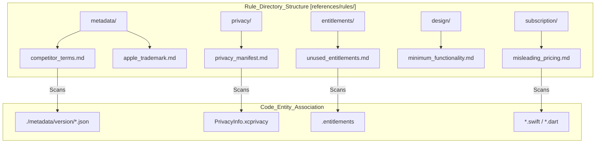
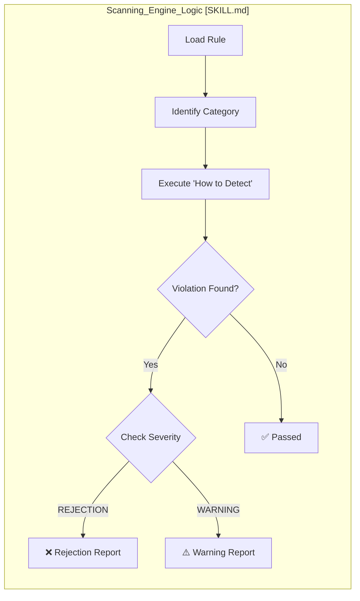

<!-- source: DeepWiki mcp.deepwiki.com · repo truongduy2611/app-store-preflight-skills · page 3 Rejection Rules Reference · fetched 2026-10-26 -->

# Rejection Rules Reference

Relevant source files

The following files were used as context for generating this wiki page:

- [README.md](README.md)
- [SKILL.md](SKILL.md)

The `references/rules/` directory contains the core logic of the App Store Preflight system. While the guidelines in `references/guidelines/` provide the "what" of Apple's requirements, these rules define the "how"—the specific patterns, file paths, and code entities that trigger a potential rejection.

Each rule is a structured Markdown file designed to be interpretable by both human developers and the AI scanning engine. Rules are categorized into five distinct domains to align with the standard App Store Review process.

### Rule Structure and Severity

All rules follow a standardized format to ensure consistency across the scanning pipeline [README.md:91-105](). Every rule file includes:

*   **Guideline**: The specific Apple App Store Review Guideline number (e.g., 2.3.1).
*   **Severity**: Either `REJECTION` (immediate blocker) or `WARNING` (potential issue requiring manual review).
*   **Category**: The domain the rule belongs to (Metadata, Subscription, Privacy, Design, or Entitlements).
*   **Detection Logic**: Specific instructions on how to identify the violation in source code or metadata.
*   **Resolution**: Actionable steps to fix the violation.

### Rule Domains

The system organizes rejection logic into five functional domains. The scanning engine iterates through these directories to evaluate the project state [SKILL.md:61-72]().

#### 1. Metadata Rules
These rules focus on the information submitted via App Store Connect, such as descriptions, keywords, and app previews. They primarily target violations of Guideline 2.3 (Accurate Metadata) and Guideline 5.2.5 (Apple Trademarks).
*   **Key Checks**: Competitor brand mentions, Apple trademark misuse, and storefront-specific bans (e.g., AI terms in China).
*   **For details, see [Metadata Rules](#3.1)**.

#### 2. Subscription Rules
Focuses on Guideline 3.1.2 regarding auto-renewable subscriptions. These rules inspect both the metadata (ToS/PP links) and the visual hierarchy of in-app paywalls.
*   **Key Checks**: Misleading pricing displays and missing legal links in both the app and App Store description.
*   **For details, see [Subscription Rules](#3.2)**.

#### 3. Privacy Rules
Addresses Guideline 5.1.1 regarding data collection and transparency. This includes the technical requirements for the `PrivacyInfo.xcprivacy` manifest introduced by Apple in 2024.
*   **Key Checks**: Missing privacy manifests and "data greed" (requesting irrelevant personal information).
*   **For details, see [Privacy Rules](#3.3)**.

#### 4. Design Rules
Covers Guideline 4.0 (Design) and 4.2 (Minimum Functionality). These rules verify that the app provides a unique, high-quality experience and correctly implements system features like "Sign in with Apple."
*   **Key Checks**: WebView wrappers, low-utility apps, and post-authentication data collection for Apple ID users.
*   **For details, see [Design Rules](#3.4)**.

#### 5. Entitlements Rules
Enforces the principle of least privilege under Guideline 2.4.5(i). It audits the `.entitlements` file against actual API usage in the source code.
*   **Key Checks**: Unused or over-privileged entitlements, specifically temporary exception entitlements on macOS.
*   **For details, see [Entitlements Rules](#3.5)**.

### Technical Mapping: From Rules to Code

The following diagrams illustrate how the abstract "Rejection Rules" relate to the physical files and the execution flow of the Preflight Skill.

**Rule File Architecture**

**Detection and Severity Logic**

**Sources:**
* [README.md:50-90]()
* [README.md:91-105]()
* [SKILL.md:61-72]()
* [SKILL.md:113-128]()

---

