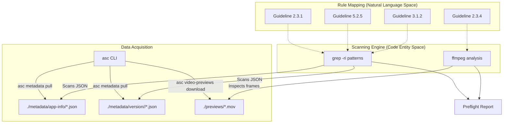

<!-- source: DeepWiki mcp.deepwiki.com · repo truongduy2611/app-store-preflight-skills · page 3.1 Metadata Rules · fetched 2026-10-26 -->

# Metadata Rules

<details>
<summary>Relevant source files</summary>

The following files were used as context for generating this wiki page:

- [references/rules/metadata/accurate_metadata.md](references/rules/metadata/accurate_metadata.md)
- [references/rules/metadata/apple_trademark.md](references/rules/metadata/apple_trademark.md)
- [references/rules/metadata/china_storefront.md](references/rules/metadata/china_storefront.md)
- [references/rules/metadata/competitor_terms.md](references/rules/metadata/competitor_terms.md)
- [references/rules/metadata/subscription_metadata.md](references/rules/metadata/subscription_metadata.md)

</details>


The **Metadata Rules** engine enforces compliance with Apple's App Store Review Guidelines regarding the textual and visual information provided in an app's store listing. These rules prevent common rejection triggers such as referencing competitors, misusing Apple trademarks, or failing to disclose subscription terms. The system utilizes the `asc` CLI to pull canonical metadata from App Store Connect for automated analysis.

## Metadata Scanning Architecture

The metadata scanning process follows a "Pull-Analyze-Report" flow. It transitions from the **Natural Language Space** (Apple Guidelines) to the **Code Entity Space** by mapping specific guideline numbers to `grep` patterns and `asc` CLI commands.

### Data Flow: Metadata Acquisition to Rule Enforcement



**Sources:**
- [references/rules/metadata/competitor_terms.md:19-27]()
- [references/rules/metadata/apple_trademark.md:45-57]()
- [references/rules/metadata/accurate_metadata.md:25-41]()
- [references/rules/metadata/subscription_metadata.md:27-36]()

---

## 1. Competitor Platform Terms (Guideline 2.3.1)

This rule prevents the mention of competing mobile platforms (e.g., Android, Google Play) within any metadata field. Apple considers these references "not appropriate for the App Store."

### Detection Logic
The system searches all localized metadata files in `./metadata/app-info/` and `./metadata/version/<VERSION>/` using the following pattern:
`grep -ri "android\|google play\|samsung\|huawei\|apk\|amazon appstore\|windows store\|microsoft store"` [references/rules/metadata/competitor_terms.md:25-27]().

### Resolution Workflow
1. **Identify**: Locate the specific file and locale flagged by the `grep` command.
2. **Sanitize**: Replace "Android" with "multiple platforms" or "your previous device" [references/rules/metadata/competitor_terms.md:41-44]().
3. **Verify**: Run `asc metadata push --dry-run` to ensure changes are valid before submission [references/rules/metadata/competitor_terms.md:45]().

**Sources:**
- [references/rules/metadata/competitor_terms.md:1-54]()

---

## 2. Apple Trademark Misuse (Guideline 5.2.5)

Ensures the app does not imply an official Apple association or use Apple's intellectual property (logos, device silhouettes) in icons or screenshots.

### Flagged Entities
| Category | Prohibited Items |
| :--- | :--- |
| **App Icon** | Device silhouettes (iPhone/iPad), Apple logo variations [references/rules/metadata/apple_trademark.md:11-14](). |
| **App Name** | "iPhone Cleaner", "iCloud Backup", "Siri Helper" [references/rules/metadata/apple_trademark.md:16-18](). |
| **Screenshots** | 3D renders of Apple products, competitor devices shown next to Apple devices [references/rules/metadata/apple_trademark.md:25-31](). |

### Detection Implementation
The engine scans `Assets.xcassets/AppIcon.appiconset/Contents.json` for visual asset references and performs a case-insensitive search across metadata for terms like `vision pro`, `imessage`, and `airdrop` [references/rules/metadata/apple_trademark.md:41-57]().

**Sources:**
- [references/rules/metadata/apple_trademark.md:1-94]()

---

## 3. Accurate App Previews (Guideline 2.3.4)

App preview videos must be pure screen captures. Unlike static screenshots, videos are prohibited from using device frames or "lifestyle" shots.

### Technical Detection (ffmpeg)
To automate the detection of device frames (bezels) or non-app content, the system extracts the first frame of downloaded previews:
```bash
ffmpeg -i "$preview" -vframes 1 -q:v 2 "${preview%.*}_frame.jpg"
```
[references/rules/metadata/accurate_metadata.md:34-41]()

### Resolution
Developers must re-record using the Xcode Simulator or QuickTime screen recording to ensure no external framing is present [references/rules/metadata/accurate_metadata.md:45-48]().

**Sources:**
- [references/rules/metadata/accurate_metadata.md:1-63]()

---

## 4. Subscription Metadata Disclosures (Guideline 3.1.2)

For apps with auto-renewable subscriptions, specific legal links and pricing details must be present in both the binary and the App Store Connect metadata fields.

### Required Metadata Fields
1. **Privacy Policy URL**: Must be set in the `privacyPolicyUrl` field in the app info JSON [references/rules/metadata/subscription_metadata.md:17-18]().
2. **Terms of Use (EULA)**: Must be either a custom EULA or a functional link in the App Description [references/rules/metadata/subscription_metadata.md:19-21]().

### Verification Script
```bash
# Check for EULA/ToS keywords in localized descriptions
grep -i "terms of use\|terms of service\|eula" ./metadata/version/<VERSION>/*.json
```
[references/rules/metadata/subscription_metadata.md:30-32]()

**Sources:**
- [references/rules/metadata/subscription_metadata.md:1-82]()

---

## 5. China Storefront AI Restrictions (Guideline 5 - Legal)

Apps distributed in China are subject to strict Deep Synthesis Technology (DST) regulations. Metadata cannot mention specific AI brands that lack MIIT licensing.

### Banned Terms for China Storefront
The system flags the following terms if the China mainland storefront is active:
`ChatGPT`, `OpenAI`, `GPT-4`, `Gemini`, `Claude`, `Anthropic`, `Midjourney`, `DALL-E` [references/rules/metadata/china_storefront.md:10-14]().

### Remediation Strategies
| Strategy | Action |
| :--- | :--- |
| **Remove References** | Replace brand names with "AI-powered" across **all** locales [references/rules/metadata/china_storefront.md:52-54](). |
| **Exclude Storefront** | Deselect "China mainland" in Pricing and Availability [references/rules/metadata/china_storefront.md:58-60](). |
| **Functionality** | Suppress AI features for China-specific builds and update Review Notes [references/rules/metadata/china_storefront.md:55-56](). |

**Sources:**
- [references/rules/metadata/china_storefront.md:1-75]()

---

