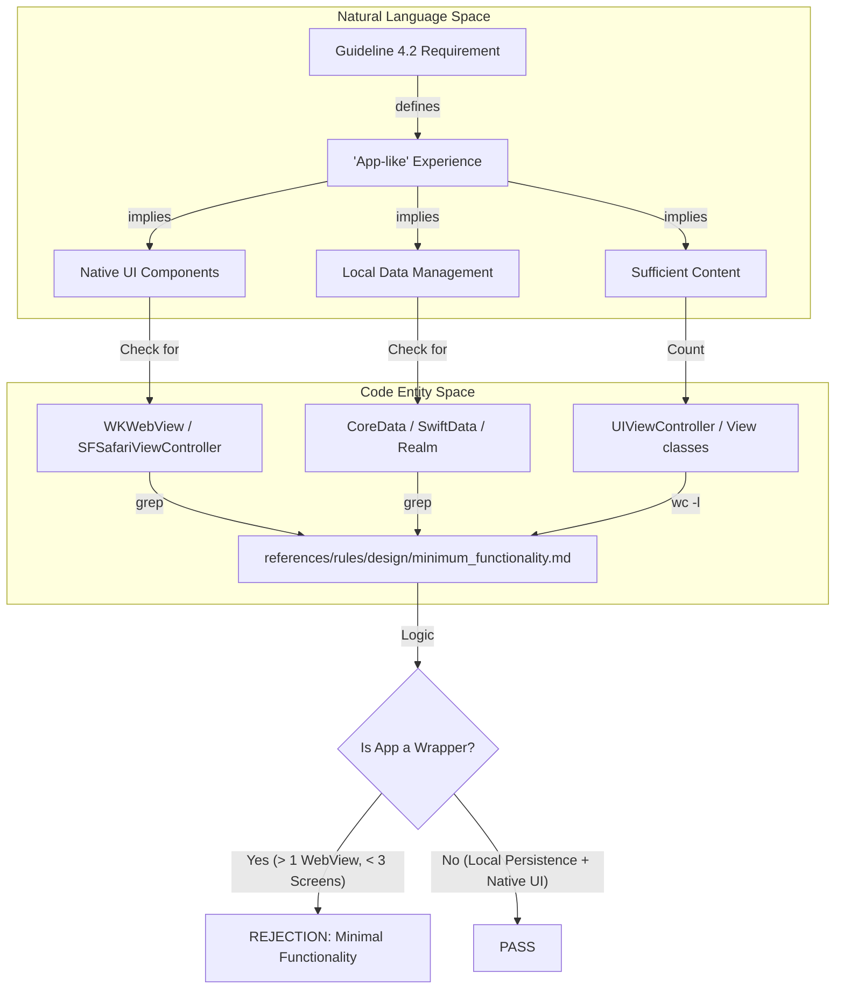
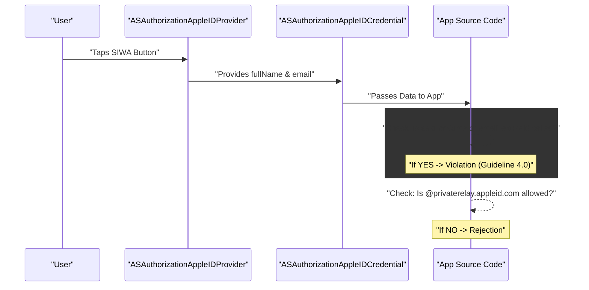

<!-- source: DeepWiki mcp.deepwiki.com · repo truongduy2611/app-store-preflight-skills · page 3.4 Design Rules · fetched 2026-10-26 -->

# Design Rules

Relevant source files

The following files were used as context for generating this wiki page:

- [references/rules/design/minimum_functionality.md](references/rules/design/minimum_functionality.md)
- [references/rules/design/sign_in_with_apple.md](references/rules/design/sign_in_with_apple.md)

The **Design Rules** section covers the technical and experiential requirements mandated by Apple's Human Interface Guidelines and App Store Review Guidelines (specifically Guideline 4.0 and 4.2). These checks focus on ensuring the app provides a native-quality experience that justifies its existence as a standalone application rather than a web-based service, and that integrated Apple services like **Sign in with Apple** are implemented according to strict UX standards.

## 3.4.1 Minimum Functionality (Guideline 4.2)

Apple requires that apps provide "valuable utility or entertainment" beyond what a standard mobile website offers. Apps that serve as simple shells for websites or lack sufficient interactive depth are frequently rejected under Guideline 4.2.

### Implementation and Detection

The preflight system uses a combination of static analysis and metadata inspection to identify "thin" apps. The detection logic focuses on four primary signals: WebView dominance, screen count, model layer complexity, and data persistence.

#### Data Flow: Minimum Functionality Assessment
The following diagram illustrates how the system evaluates an app's "app-like" qualities by scanning the codebase for specific architectural patterns.

**Title: Minimum Functionality Detection Logic**

**Sources:** [references/rules/design/minimum_functionality.md:30-52](), [references/rules/design/minimum_functionality.md:8-17]()

### Technical Signals
The system identifies design-rule violations through the following shell-based heuristics:

| Metric | Threshold / Signal | Code Reference |
| :--- | :--- | :--- |
| **WebView Usage** | Presence of `WKWebView`, `UIWebView`, or `SFSafariViewController` | [references/rules/design/minimum_functionality.md:32-34]() |
| **Screen Count** | `< 3` unique `UIViewController` or SwiftUI `View` definitions | [references/rules/design/minimum_functionality.md:36-37](), [references/rules/design/minimum_functionality.md:48-48]() |
| **Model Layer** | Absence of dedicated `Models` or `Model` directories | [references/rules/design/minimum_functionality.md:39-40]() |
| **Persistence** | Usage of `CoreData`, `SwiftData`, `UserDefaults`, `Realm`, or `KeychainSwift` | [references/rules/design/minimum_functionality.md:42-43]() |
| **Metadata** | App descriptions `< 50` words in length | [references/rules/design/minimum_functionality.md:54-61]() |

**Sources:** [references/rules/design/minimum_functionality.md:30-61]()

---

## 3.4.2 Sign in with Apple (SIWA) Implementation

If an app provides third-party social login providers (e.g., Google, Facebook), it must also offer **Sign in with Apple** as an equivalent option. Furthermore, the implementation must adhere to Apple's UX requirements regarding data collection and visual prominence.

### Key Requirements
1.  **Data Parsimony**: If the user shares their name or email via the `ASAuthorizationAppleIDProvider`, the app must not prompt for this information again via native text fields [references/rules/design/sign_in_with_apple.md:9-10]().
2.  **Visual Parity**: The SIWA button must be as prominent as other social login buttons and should use the system-provided `ASAuthorizationAppleIDButton` [references/rules/design/sign_in_with_apple.md:11-12]().
3.  **Relay Email Handling**: Apps must successfully process and validate email addresses ending in `@privaterelay.appleid.com` [references/rules/design/sign_in_with_apple.md:13-13]().

### Technical Architecture
The system scans for the `AuthenticationServices` framework usage and looks for common anti-patterns where developers request profile information that has already been provided by the credential.

**Title: SIWA Compliance Data Flow**

**Sources:** [references/rules/design/sign_in_with_apple.md:17-30](), [references/rules/design/sign_in_with_apple.md:40-43]()

### Detection Logic
The skill executes the following checks to identify SIWA UX violations:

*   **Credential Handling**: It searches for `ASAuthorizationAppleIDProvider` and `appleIDCredential` to locate the implementation, then cross-references those files for forbidden UI elements like `nameTextField` or `profileSetup` functions [references/rules/design/sign_in_with_apple.md:18-24]().
*   **Relay Validation**: It greps for email validation logic (e.g., `isValidEmail`) to ensure that `privaterelay.appleid.com` is not accidentally blocked by overly restrictive regex patterns [references/rules/design/sign_in_with_apple.md:26-30]().

**Sources:** [references/rules/design/sign_in_with_apple.md:15-30]()

## Remediation Workflow

### Minimum Functionality
1.  **Native Integration**: Replace web-based navigation with native UI components.
2.  **Offline Support**: Implement local caching using `SwiftData` or `UserDefaults` to ensure the app works without a network connection [references/rules/design/minimum_functionality.md:65-76]().
3.  **Reviewer Context**: Use the `asc metadata pull` command to audit the app description and ensure it clearly articulates native features that Safari cannot provide [references/rules/design/minimum_functionality.md:78-82]().

### Sign in with Apple
1.  **Use Credentials**: Cache `fullName` and `email` directly from the `ASAuthorizationAppleIDCredential` on the first successful login [references/rules/design/sign_in_with_apple.md:40-41]().
2.  **Standard Components**: Use `ASAuthorizationAppleIDButton` in Swift or the `sign_in_with_apple` package in Flutter to ensure visual compliance [references/rules/design/sign_in_with_apple.md:43-43]().

**Sources:** [references/rules/design/minimum_functionality.md:63-82](), [references/rules/design/sign_in_with_apple.md:39-44]()

---

