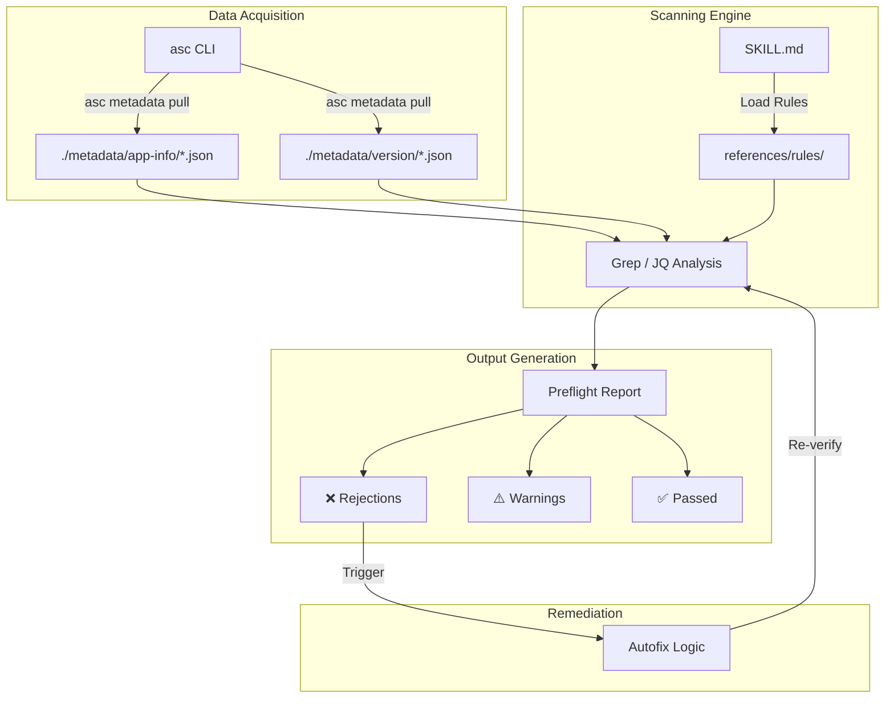
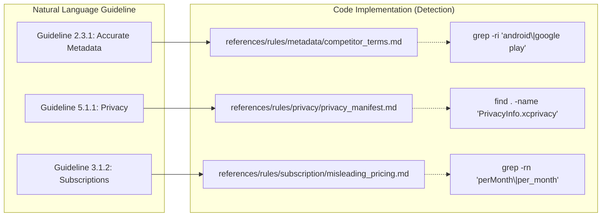

<!-- source: DeepWiki mcp.deepwiki.com · repo truongduy2611/app-store-preflight-skills · page 5 Glossary · fetched 2026-10-26 -->

# Glossary

Relevant source files

The following files were used as context for generating this wiki page:

- [README.md](README.md)
- [SKILL.md](SKILL.md)
- [references/guidelines/README.md](references/guidelines/README.md)
- [references/rules/design/sign_in_with_apple.md](references/rules/design/sign_in_with_apple.md)
- [references/rules/entitlements/unused_entitlements.md](references/rules/entitlements/unused_entitlements.md)
- [references/rules/metadata/china_storefront.md](references/rules/metadata/china_storefront.md)
- [references/rules/privacy/privacy_manifest.md](references/rules/privacy/privacy_manifest.md)
- [references/rules/subscription/misleading_pricing.md](references/rules/subscription/misleading_pricing.md)

This page provides technical definitions for codebase-specific terms, Apple Review Guideline references, CLI tools, and domain concepts used within the App Store Preflight Skills. It serves as a bridge between the natural language requirements of the App Store and the automated detection logic implemented in the skill.

## Core Concepts & Pipeline

The preflight process follows a structured pipeline to identify potential rejections before they occur.

| Term | Definition | Code Reference |
|:---|:---|:---|
| **Preflight Report** | The final output generated by the AI agent summarizing findings categorized by severity (Rejection, Warning, Passed). | [SKILL.md:73-92]() |
| **App-Type Checklist** | A specialized markdown file containing a subset of guidelines and rules relevant to a specific category of app (e.g., AI, Games, Kids). | [SKILL.md:23-40]() |
| **Rejection Rule** | A technical specification file in `references/rules/` that defines what to check, how to detect it via grep/code analysis, and how to resolve it. | [README.md:52-90]() |
| **Autofix** | Automated remediation logic where the agent suggests or applies text replacements (e.g., removing competitor names) or generates missing assets. | [SKILL.md:94-103]() |

### Data Flow: From Metadata to Report
The following diagram illustrates how the system transitions from raw App Store data to a structured compliance report.

**Preflight Data Logic Flow**

**Sources:** [SKILL.md:42-72](), [README.md:40-48](), [references/rules/metadata/china_storefront.md:30-45]()

---

## Technical Tooling

The skill relies on external CLI tools to interface with the Apple ecosystem and parse project files.

### `asc` (App Store Connect CLI)
The primary tool used to fetch canonical metadata from App Store Connect.
*   **`asc auth login`**: Establishes session using API keys (`ASC_KEY_ID`, `ASC_ISSUER_ID`). [SKILL.md:109-109]()
*   **`asc metadata pull`**: Downloads app information and version-specific localizations into a standard JSON structure. [SKILL.md:42-52]()
*   **`asc auth doctor`**: Diagnostic command to verify environment variable configuration. [SKILL.md:109-109]()

### File Formats
*   **`.xcprivacy`**: The Privacy Manifest file required by Apple as of Spring 2024. It must declare "Required Reason APIs". [references/rules/privacy/privacy_manifest.md:1-4]()
*   **`.entitlements`**: XML property list defining the specific capabilities and security permissions an app requests from the OS. [references/rules/entitlements/unused_entitlements.md:6-24]()
*   **`all_apps.md`**: The universal baseline checklist applied to every scan regardless of app type. [README.md:25-27]()

**Code Entity Mapping: Detection Logic**

**Sources:** [README.md:54-76](), [references/rules/privacy/privacy_manifest.md:26-46](), [references/rules/subscription/misleading_pricing.md:22-29]()

---

## Domain Terms & Guideline References

Definitions for specific Apple-centric concepts encountered during the preflight scan.

### Metadata Compliance
*   **China Storefront (DST/MIIT)**: Refers to Chinese regulations on Deep Synthesis Technology. Apps in the China storefront are scanned for banned AI terms like `ChatGPT` or `OpenAI`. [references/rules/metadata/china_storefront.md:6-17]()
*   **Competitor Terms**: Mentioning rival platforms (Android, Google Play) in metadata is a violation of Guideline 2.3.10. [references/guidelines/README.md:52-52]()
*   **Device Frames**: Using physical hardware imagery (e.g., an iPhone bezel) inside App Preview videos or screenshots, which violates Guideline 2.3.4. [README.md:61-61]()

### Privacy & Security
*   **Required Reason APIs**: A set of Apple APIs (e.g., `UserDefaults`, `systemUptime`) that require a declared justification in the Privacy Manifest. [references/rules/privacy/privacy_manifest.md:9-17]()
*   **Temporary Exception Entitlements**: Entitlements starting with `com.apple.security.temporary-exception.*` that allow macOS apps to bypass sandbox restrictions; these require manual justification to Apple. [SKILL.md:111-111]()
*   **Privacy Relay Email**: Apple's `*@privaterelay.appleid.com` addresses. Apps must not reject these as "invalid" emails. [references/rules/design/sign_in_with_apple.md:13-13]()

### Business & Subscriptions
*   **Billed Amount**: The total price a user is charged by Apple. This must be the most prominent element on a paywall. [references/rules/subscription/misleading_pricing.md:6-13]()
*   **Calculated Pricing**: Derived costs (e.g., "Price per week") shown for annual plans. These must be subordinate to the Billed Amount. [references/rules/subscription/misleading_pricing.md:7-13]()
*   **Sign in with Apple (SIWA)**: A required authentication method if other 3rd-party social logins are provided. Common rejections involve asking for a name/email after the user has already provided it via the SIWA framework. [references/rules/design/sign_in_with_apple.md:6-14]()

**Sources:** [SKILL.md:107-112](), [references/rules/metadata/china_storefront.md:1-27](), [references/rules/privacy/privacy_manifest.md:1-23](), [references/rules/subscription/misleading_pricing.md:1-19]()