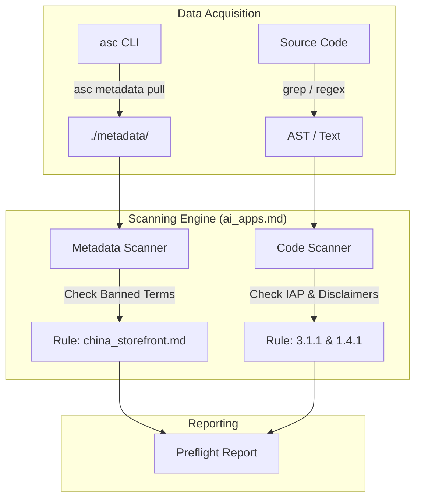

<!-- source: DeepWiki mcp.deepwiki.com · repo truongduy2611/app-store-preflight-skills · extra page AI & Generative AI Apps · fetched 2026-10-26 -->

# AI & Generative AI Apps

<details>
<summary>Relevant source files</summary>

The following files were used as context for generating this wiki page:

- [references/guidelines/by-app-type/ai_apps.md](references/guidelines/by-app-type/ai_apps.md)
- [references/rules/metadata/china_storefront.md](references/rules/metadata/china_storefront.md)

</details>


This page provides a technical deep dive into the compliance requirements for applications utilizing Artificial Intelligence (AI), Generative AI, and Deep Synthesis Technology (DST). The preflight system evaluates these apps against a specialized checklist that extends the universal baseline to address specific Apple guidelines regarding content moderation, medical disclaimers, data privacy, and regional legal restrictions—most notably the Chinese Ministry of Industry and Information Technology (MIIT) regulations.

## Overview of AI Compliance Pipeline

When an app is identified as containing AI features, the preflight engine activates the `ai_apps.md` checklist. This process involves scanning both the codebase for API integrations (e.g., OpenAI, Anthropic) and the app metadata for restricted terminology.

### Data Flow for AI Preflight
The following diagram illustrates how the system transitions from raw metadata and source code to a compliance report.

**AI Compliance Data Flow**

Sources: [references/guidelines/by-app-type/ai_apps.md:1-38](), [references/rules/metadata/china_storefront.md:30-38]()

---

## China DST & MIIT Compliance

The most frequent cause for rejection of AI apps is non-compliance with the *Administrative Provisions on Deep Synthesis of Internet-based Information Services*. If an app is distributed on the **China mainland storefront**, it must not reference unlicensed AI services in its metadata or provide access to them in-app without a permit.

### Banned AI Brand Terms
The system scans all locales in `./metadata/app-info/` and `./metadata/version/` for the following restricted terms:

| Category | Banned Terms (Case-Insensitive) |
| :--- | :--- |
| **OpenAI** | `ChatGPT`, `GPT-4`, `GPT-4o`, `GPT`, `OpenAI`, `DALL-E` |
| **Google** | `Gemini`, `Bard` |
| **Anthropic** | `Claude`, `Anthropic` |
| **Microsoft** | `Copilot` (when used in AI context) |
| **Other** | `Midjourney`, `Stable Diffusion` (cloud API) |

### Detection Implementation
The preflight tool utilizes `grep` patterns to identify these terms across all localized metadata files, as Apple may flag any locale if the app is available in the China storefront.

```bash
# Example detection logic used by the scanner
grep -ri "chatgpt\|openai\|gpt-4\|gemini\|claude\|anthropic\|midjourney\|dall-e" \
  ./metadata/app-info/ ./metadata/version/<VERSION>/
```

Sources: [references/rules/metadata/china_storefront.md:9-17](), [references/rules/metadata/china_storefront.md:40-45](), [references/guidelines/by-app-type/ai_apps.md:23-32]()

---

## Technical Requirements & Guidelines

Beyond regional restrictions, AI apps must adhere to safety and monetization standards defined in the `ai_apps.md` checklist.

### Content Moderation (Guideline 1.2)
If the AI generates user-facing content (text, images, or audio), the app must implement robust filtering. The preflight check looks for:
*   Presence of reporting mechanisms for offensive content.
*   In-app moderation logic or calls to safety-tuned APIs.

### Health Disclaimers (Guideline 1.4.1)
AI apps providing health or medical advice must include explicit disclaimers stating that the AI is not a substitute for professional medical diagnosis. The system checks for "medical disclaimer" strings in the app description and UI source files.

### Data Minimization & Consent (Guideline 5.1.1)
*   **Guideline 2.5.14**: The app must obtain explicit consent before processing user recordings or inputs for AI training or inference.
*   **Guideline 5.1.1(iii)**: Data minimization is enforced; apps should not transmit more user data to an AI service than is strictly necessary for the requested function.

### Monetization (Guideline 3.1.1)
AI features, such as "credits" or "tokens" for generation, must be unlocked via **In-App Purchases (IAP)**. The use of external payment methods for these digital goods is a high-severity rejection risk.

Sources: [references/guidelines/by-app-type/ai_apps.md:9-21]()

---

## Mapping Code Entities to Compliance Rules

The following diagram bridges the gap between the logical compliance requirements and the specific files and CLI tools used to enforce them.

**Entity Mapping: Requirements to Implementation**
```mermaid
classDiagram
    class "App Store Connect" {
        <<Service>>
        +PricingAndAvailability
        +MetadataLocales
    }
    class "asc_CLI" {
        <<Tool>>
        +metadata_pull()
    }
    class "china_storefront_md" {
        <<Rule>>
        +check_banned_terms()
        +verify_storefront()
    }
    class "ai_apps_md" {
        <<Checklist>>
        +guideline_1_4_1_Health
        +guideline_3_1_1_IAP
        +guideline_5_DST
    }

    "App Store Connect" ..> "asc_CLI" : Data Source
    "asc_CLI" --> "china_storefront_md" : populates ./metadata/
    "china_storefront_md" --|> "ai_apps_md" : Implements China DST
```

Sources: [references/rules/metadata/china_storefront.md:30-38](), [references/guidelines/by-app-type/ai_apps.md:1-21]()

## Remediation Strategies

If the preflight scan identifies a violation, the following resolution paths are recommended:

1.  **Generic Terminology**: Replace banned brand names with generic terms like "AI-powered," "Smart Assistant," or "Generative Image Tool" in all metadata fields.
2.  **Regional Suppression**: Implement logic to deactivate AI functionality specifically for the China storefront build and update the "App Review Notes" (Guideline 2.3.1) to reflect this.
3.  **Storefront Exclusion**: If the AI functionality is core to the app and cannot be suppressed, deselect "China mainland" in the App Store Connect "Pricing and Availability" section.
4.  **Medical Disclaimers**: Ensure a clear disclaimer is visible in the `App Description` and on the initial screen where AI medical advice is presented.

Sources: [references/rules/metadata/china_storefront.md:50-63](), [references/guidelines/by-app-type/ai_apps.md:34-38]()

---

