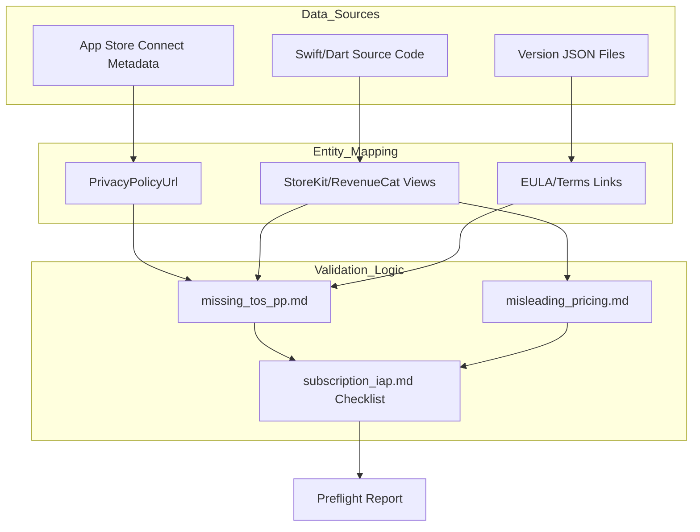
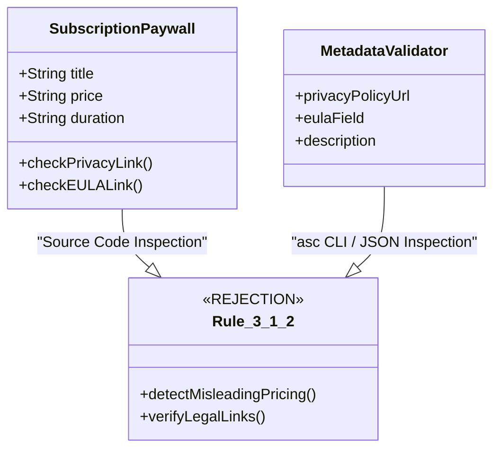

<!-- source: DeepWiki mcp.deepwiki.com · repo truongduy2611/app-store-preflight-skills · extra page Subscriptions & In-App Purchases · fetched 2026-10-26 -->

# Subscriptions & In-App Purchases

Relevant source files

The following files were used as context for generating this wiki page:

- [references/guidelines/by-app-type/subscription_iap.md](references/guidelines/by-app-type/subscription_iap.md)
- [references/rules/subscription/misleading_pricing.md](references/rules/subscription/misleading_pricing.md)
- [references/rules/subscription/missing_tos_pp.md](references/rules/subscription/missing_tos_pp.md)

This page provides a technical deep dive into the `subscription_iap.md` checklist and its associated enforcement rules. It covers the requirements for digital content delivery, pricing transparency, and the mandatory legal links required for App Store compliance.

## Purpose and Scope

The Subscriptions & In-App Purchase (IAP) module ensures that apps offering digital goods or services comply with Apple's strict Business and Payment guidelines (Section 3.1). The system focuses on preventing "bait-and-switch" pricing, ensuring technical persistence of purchases, and verifying that all required metadata and legal links are present both in-code and in App Store Connect.

## System Data Flow: IAP Validation

The following diagram illustrates how the preflight skill validates subscription and IAP compliance by cross-referencing source code, metadata files, and App Store Connect configurations.

### IAP Compliance Data Flow

**Sources:** [references/guidelines/by-app-type/subscription_iap.md:1-35](), [references/rules/subscription/missing_tos_pp.md:1-58](), [references/rules/subscription/misleading_pricing.md:1-64]()

---

## Core Requirements & Implementation

### 1. Pricing Transparency & Visual Hierarchy
Guideline 3.1.2 requires that the **actual billed amount** be the most prominent element on any subscription screen. The system flags "misleading pricing" where calculated monthly costs (e.g., "$2.50/mo") overshadow the annual charge (e.g., "$29.99/year").

**Technical Checks:**
- **Font Size/Weight:** The billed amount must use the largest and boldest font [references/rules/subscription/misleading_pricing.md:39-45]().
- **Color Contrast:** Calculated prices must use subordinate (lower contrast) colors [references/rules/subscription/misleading_pricing.md:41-43]().
- **Detection Logic:** The scanner searches for patterns like `perMonth`, `per_month`, or `divided` in UI code to identify where price manipulation might be occurring [references/rules/subscription/misleading_pricing.md:28-29]().

### 2. Legal Links (ToS/PP)
Every subscription paywall must provide functional, tappable links to the Privacy Policy and Terms of Use (EULA).

**Code-to-Metadata Mapping:**
| Requirement | Code Entity / Metadata Key | Source File |
| :--- | :--- | :--- |
| **Privacy Policy URL** | `privacyPolicyUrl` | [references/rules/subscription/missing_tos_pp.md:37]() |
| **EULA/ToS Link** | `terms`, `eula`, `TermsOfService` | [references/rules/subscription/missing_tos_pp.md:28]() |
| **Subscription Title** | Paywall UI Text | [references/guidelines/by-app-type/subscription_iap.md:30]() |
| **Billed Amount** | `StoreKit` / `RevenueCat` price | [references/rules/subscription/misleading_pricing.md:25]() |

**Sources:** [references/rules/subscription/missing_tos_pp.md:6-18](), [references/guidelines/by-app-type/subscription_iap.md:28-35]()

---

## Technical Detection & Rule Mapping

The system bridges natural language guidelines to code entities using `grep` patterns and metadata field validation.

### Code Entity Space Mapping

**Sources:** [references/rules/subscription/missing_tos_pp.md:19-38](), [references/rules/subscription/misleading_pricing.md:20-30]()

### Key Functions and Search Patterns
The preflight engine utilizes specific search patterns to identify compliance issues in `Swift` and `Dart` files:

- **UI Discovery:** Searches for `paywall`, `subscribe`, or `purchase` to locate the entry point of the IAP flow [references/rules/subscription/missing_tos_pp.md:25]().
- **Link Validation:** Checks for the presence of `PrivacyPolicy` or `TermsOfService` strings within those UI files [references/rules/subscription/missing_tos_pp.md:28]().
- **Metadata Verification:** Uses `jq` or `grep` on local metadata caches (e.g., `./metadata/app-info/*.json`) to ensure the `privacyPolicyUrl` is populated [references/rules/subscription/missing_tos_pp.md:37]().

---

## Critical Compliance Checklist

The `subscription_iap.md` checklist identifies high-risk areas that result in immediate rejection:

| Guideline | Requirement | Technical Context |
| :--- | :--- | :--- |
| **3.1.1** | Digital Content Unlocks | Must use Apple IAP; no external license keys or crypto [references/guidelines/by-app-type/subscription_iap.md:7](). |
| **3.1.1** | Restore Purchases | Mandatory for all non-consumable and subscription IAPs [references/guidelines/by-app-type/subscription_iap.md:16](). |
| **3.1.1** | Loot Box Odds | Must disclose randomized item odds before purchase [references/guidelines/by-app-type/subscription_iap.md:14](). |
| **3.1.2(b)** | State Management | Ensure seamless upgrade/downgrade without duplicate charges [references/guidelines/by-app-type/subscription_iap.md:21](). |
| **5.1.1(i)** | Privacy Manifest | Privacy Policy URL must be set in App Store Connect metadata [references/guidelines/by-app-type/subscription_iap.md:13](). |

**Sources:** [references/guidelines/by-app-type/subscription_iap.md:5-17](), [references/guidelines/by-app-type/subscription_iap.md:19-26]()

## Resolution Workflow

When a violation is detected (e.g., Missing ToS/PP), the following steps are required:
1. **In-App:** Add tappable `Terms of Use` and `Privacy Policy` links to the `StoreKit` or `RevenueCat` view [references/rules/subscription/missing_tos_pp.md:45]().
2. **Metadata:** Update the `Privacy Policy URL` field in App Store Connect using `asc metadata` or the web portal [references/rules/subscription/missing_tos_pp.md:47]().
3. **Description:** Ensure the app description in all locales references the EULA (Standard Apple or Custom) [references/rules/subscription/missing_tos_pp.md:46-48]().

**Sources:** [references/rules/subscription/missing_tos_pp.md:44-49](), [references/rules/subscription/misleading_pricing.md:46-50]()

---

