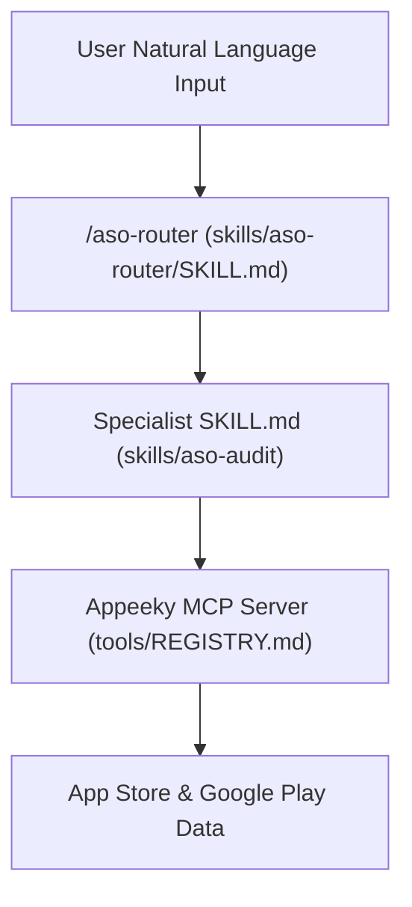
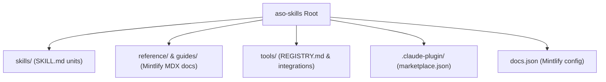

<!-- source: DeepWiki mcp.deepwiki.com · repo Eronred/aso-skills · page 1 Overview · fetched 2026-10-26 -->

# Overview

Relevant source files

The following files were used as context for generating this wiki page:

- [.claude-plugin/marketplace.json](.claude-plugin/marketplace.json)
- [README.md](README.md)
- [index.mdx](index.mdx)
- [introduction.mdx](introduction.mdx)
- [reference/competitor-analysis.mdx](reference/competitor-analysis.mdx)
- [reference/skills-overview.mdx](reference/skills-overview.mdx)
- [skills/aso-router/SKILL.md](skills/aso-router/SKILL.md)
- [tools/REGISTRY.md](tools/REGISTRY.md)

## Purpose and Scope

`aso-skills` is an open-source library consisting of over 40 Markdown Agent Skills designed for App Store Optimization (ASO) and mobile app marketing, coupled with a Mintlify documentation site. The repository provides structured `SKILL.md` files that integrate with AI assistants such as Cursor, Claude Code, or any Agent Skills-compatible environment to automate keyword research, metadata generation, competitor analysis, and app growth workflows [README.md:18-20] [introduction.mdx:1-8]. Live data enrichment is powered by the Appeeky API and Model Context Protocol (MCP) server [README.md:18-21] [tools/REGISTRY.md:5-15].

*Sources: [README.md:18-21](), [skills/aso-router/SKILL.md:1-22](), [tools/REGISTRY.md:1-15]()*

---

## Getting Started & Installation

The library can be installed directly into supported IDEs and agent frameworks using package runners, manual repository cloning, or plugin marketplace configurations [README.md:40-47] [.claude-plugin/marketplace.json:12-65]. 

For installation procedures via `npx skills add`, manual `git clone` paths, plugin marketplace integration, and per-editor directory structures, see [Getting Started & Installation](#1.1).

*Sources: [README.md:40-47](), [.claude-plugin/marketplace.json:1-65]*

---

## First ASO Audit Walkthrough

Users can evaluate mobile application listings by supplying identifiers (such as Apple numeric App IDs or Google Play package names) and invoking audit workflows [reference/competitor-analysis.mdx:27-32] [index.mdx:33-35]. 

For an end-to-end tutorial covering app identifier discovery, executing `/aso-audit`, reading scoring rubrics, and processing prioritized fix tiers, see [First ASO Audit Walkthrough](#1.2).

*Sources: [README.md:50-51](), [index.mdx:33-35](), [reference/competitor-analysis.mdx:27-32]*

---

## Repository Layout

The codebase is organized into dedicated directories separating agent execution units, documentation pages, integration maps, and plugin configuration definitions [README.md:76-112] [tools/REGISTRY.md:1-50].

*Sources: [README.md:76-112](), [tools/REGISTRY.md:1-50](), [.claude-plugin/marketplace.json:1-65]*

For a comprehensive map detailing `skills/`, `reference/`, `guides/`, `tools/`, `.claude-plugin/`, and configuration files, see [Repository Layout](#1.3).

*Sources: [README.md:76-112](), [tools/REGISTRY.md:1-50]()*

---

