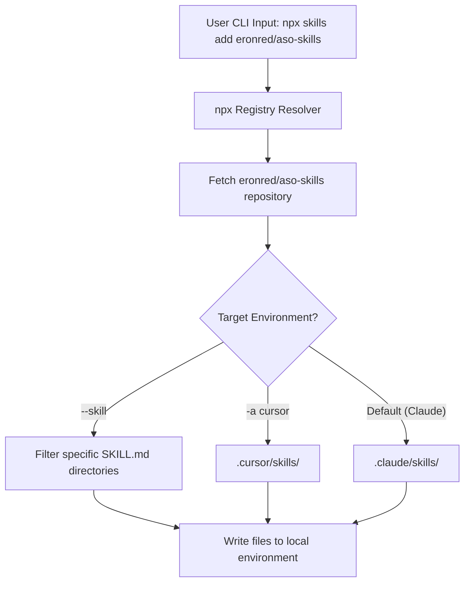
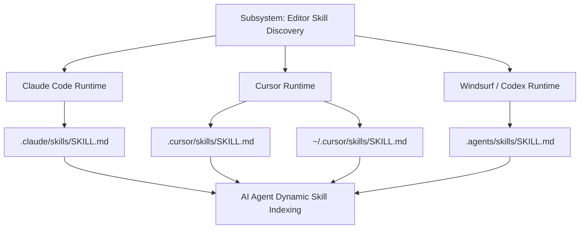

<!-- source: DeepWiki mcp.deepwiki.com · repo Eronred/aso-skills · page 1.1 Getting Started & Installation · fetched 2026-10-26 -->

# Getting Started & Installation

<details>
<summary>Relevant source files</summary>

The following files were used as context for generating this wiki page:

- [.claude-plugin/marketplace.json](.claude-plugin/marketplace.json)
- [README.md](README.md)
- [install/claude-code.mdx](install/claude-code.mdx)
- [install/cursor.mdx](install/cursor.mdx)
- [install/other-agents.mdx](install/other-agents.mdx)
- [quickstart.mdx](quickstart.mdx)
- [skills/aso-router/SKILL.md](skills/aso-router/SKILL.md)
- [tools/REGISTRY.md](tools/REGISTRY.md)

</details>


## Purpose and Scope
This document outlines the installation mechanics, directory structures, and configuration pathways for deploying the `aso-skills` library into AI-assisted development environments. It covers automated installation via the Agent Skills CLI (`npx skills add`), manual repository cloning, plugin marketplace integration (`.claude-plugin/marketplace.json`), and per-editor target directories for Cursor, Claude Code, Windsurf, and Codex.

Sources: [README.md:40-47](), [.claude-plugin/marketplace.json:1-65]()

---

## 1. CLI Installation Architecture (`npx skills add`)

The primary installation path leverages the Agent Skills CLI ecosystem via `npx skills add`. This command resolves the remote repository `eronred/aso-skills`, downloads the requested skill units (`SKILL.md`), and populates the local project or global configuration directories.

### Command Parameters & Modifiers
* **Full Library Install (Claude Code)**: Fetches all skill units and installs them into the project-local `.claude/skills/` directory [install/claude-code.mdx:9-17]().
* **Target Editor Flag (`-a cursor`)**: Directs the CLI to format and place skills into Cursor-compatible paths [install/cursor.mdx:9-29]().
* **Global Flag (`-g`)**: Installs skills into user-level global directories, making them available across all projects on the machine [install/cursor.mdx:24-28]().
* **Selective Filtering (`--skill`)**: Allows granular cherry-picking of specific skill packages to keep agent context lightweight [install/claude-code.mdx:21-27]().


*Sources: [README.md:40-47](), [install/claude-code.mdx:9-39](), [install/cursor.mdx:9-29]()*

---

## 2. Per-Editor Target Directories & Configuration

Different AI-assisted editors read skills from specific file-system paths. The library adapts to these environments by mapping skill packages into distinct target directories [install/other-agents.mdx:62-73]().

### Editor Directory Mapping Table

| Editor | Project-Level Path | Global Path | Configuration Reference |
| :--- | :--- | :--- | :--- |
| **Cursor** | `.cursor/skills/` [install/cursor.mdx:54-59]() | `~/.cursor/skills/` [install/cursor.mdx:61-66]() | `.cursor/mcp.json` [install/cursor.mdx:102-113]() |
| **Claude Code** | `.claude/skills/` [install/claude-code.mdx:11-17]() | N/A | `.claude/config.json` |
| **Windsurf** | `.agents/skills/` [install/other-agents.mdx:24-27]() | N/A | Agent settings |
| **Codex** | `.codex/skills/` [install/other-agents.mdx:29-32]() | N/A | Codex config |


*Sources: [install/claude-code.mdx:11-103](), [install/cursor.mdx:53-68](), [install/other-agents.mdx:21-73]()*

---

## 3. Manual Git Clone & Marketplace Integration

When automated CLI access is restricted or local version control is preferred, manual synchronization is supported via standard Git operations and plugin manifests.

### Manual Synchronization Workflow
1. Clone the repository directly to a local workspace [install/claude-code.mdx:80-84]():
   ```bash
   git clone https://github.com/eronred/aso-skills.git
   ```
2. Create the destination target directory [install/claude-code.mdx:86-90]():
   ```bash
   mkdir -p .claude/skills
   ```
3. Copy skill modules recursively [install/claude-code.mdx:91-95]():
   ```bash
   cp -r aso-skills/skills/* .claude/skills/
   ```

### Plugin Marketplace Specification
For platforms supporting the Claude Plugin standard, the repository exposes [.claude-plugin/marketplace.json]() which registers the plugin metadata, repository URI, and enumerates all 40+ contained skill entry points [ [.claude-plugin/marketplace.json:1-65]()]:

* **Plugin Name**: `aso-skills` [.claude-plugin/marketplace.json:2]()
* **Owner**: `Appeeky` [.claude-plugin/marketplace.json:4]()
* **Strict Mode**: Disabled (`strict: false`) to allow flexible skill composition [.claude-plugin/marketplace.json:17]()
* **Registered Skills**: Maps paths from `./skills/aso-router` through specialist domains [.claude-plugin/marketplace.json:22-61]()

Sources: [.claude-plugin/marketplace.json:1-65](), [install/claude-code.mdx:76-103]()

---

## 4. Optional Tooling & MCP Server Connection

While skills function using built-in expert frameworks, live App Store intelligence requires linking the Appeeky Model Context Protocol (MCP) server [tools/REGISTRY.md:5-15]().

### MCP Client Configuration Structure
Add the following transport configuration to your editor's MCP settings file (e.g., `.cursor/mcp.json` or Claude configuration) [install/claude-code.mdx:129-140]():

```json
{
  "mcpServers": {
    "appeeky": {
      "url": "https://mcp.appeeky.com/mcp",
      "headers": { "Authorization": "Bearer apk_your_key_here" }
    }
  }
}
```

### Verification & Router Execution
Once installed, verification is performed by invoking the dispatcher router skill `skills/aso-router/SKILL.md` [skills/aso-router/SKILL.md:1-6]() or executing a direct audit command [install/claude-code.mdx:107-121]():
* **Router dispatch**: `/aso-router` [README.md:68-72]()
* **Direct invocation**: `/aso-audit` [README.md:74]()

Sources: [README.md:40-74](), [tools/REGISTRY.md:1-15](), [install/claude-code.mdx:125-147]()

---

