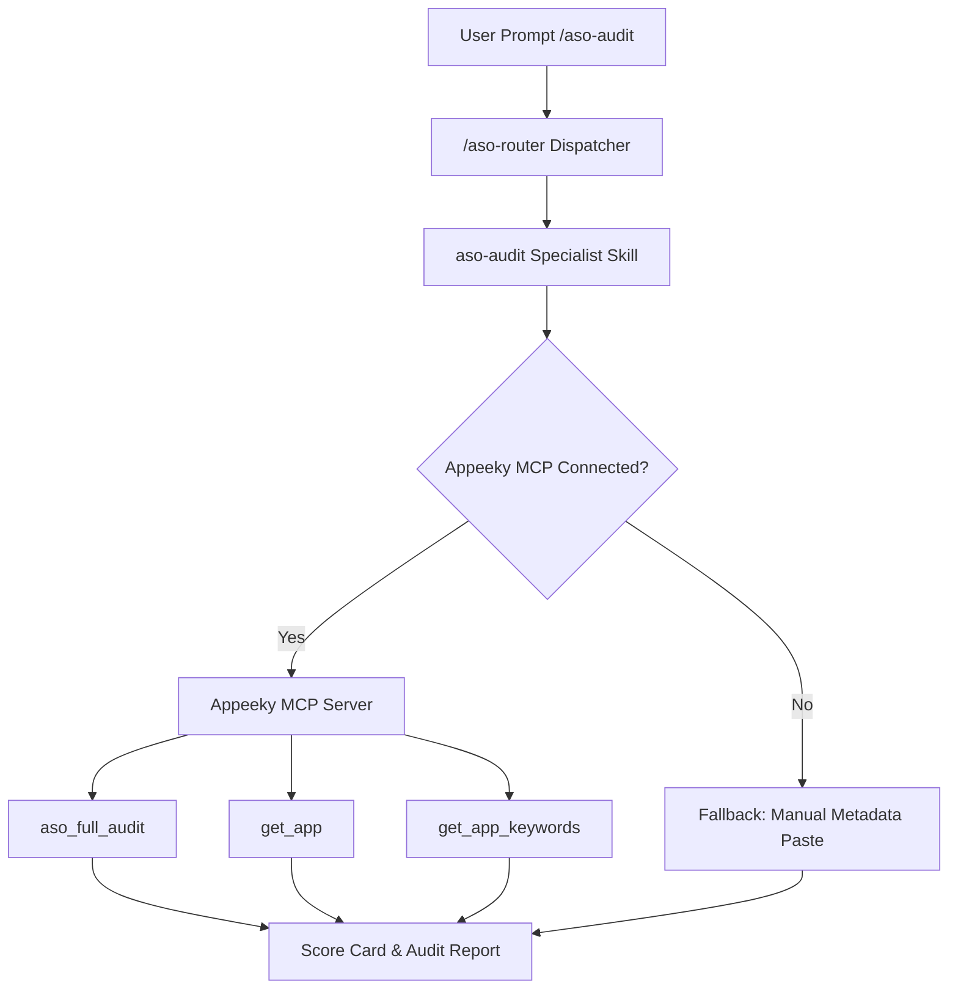
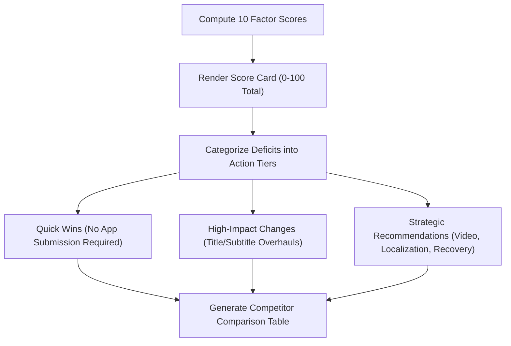

<!-- source: DeepWiki mcp.deepwiki.com · repo Eronred/aso-skills · page 1.2 First ASO Audit Walkthrough · fetched 2026-10-26 -->

# First ASO Audit Walkthrough

Relevant source files

The following files were used as context for generating this wiki page:

- [guides/first-aso-audit.mdx](guides/first-aso-audit.mdx)
- [reference/aso-audit.mdx](reference/aso-audit.mdx)

## Purpose and Scope

This page provides a technical walkthrough for executing and understanding the `aso-audit` skill (`reference/aso-audit.mdx:7-8()`). It details how input parameters like App IDs are processed, how the underlying MCP tools fetch live metadata and keyword rankings, how the 10-factor scoring rubric is computed, and how recommendations are prioritized into actionable remediation tiers (`guides/first-aso-audit.mdx:7-122()`, `reference/aso-audit.mdx:27-102()`).

Sources: `guides/first-aso-audit.mdx:7-122()`, `reference/aso-audit.mdx:7-102()`

---

## Identifying App Targets: App ID Resolution

Before an audit can run, the target application must be correctly identified. The identification scheme varies by platform as outlined in the audit guide (`guides/first-aso-audit.mdx:22-47()`):

- **Apple App Store (iOS)**: Resolved using a numeric App ID parsed from the App Store URL pattern (`https://apps.apple.com/.../id[AppID]`) or retrieved directly from App Store Connect (`guides/first-aso-audit.mdx:28-34()`).
- **Google Play (Android)**: Resolved using a package name string (reverse-domain format like `com.myapp.android`) extracted from the Google Play URL or Google Play Console dashboard (`guides/first-aso-audit.mdx:40-45()`).

Sources: `guides/first-aso-audit.mdx:22-47()`

---

## Audit Execution and Data Flow

The audit can be invoked directly via the `/aso-audit` command or routed dynamically through the `/aso-router` dispatcher (`guides/first-aso-audit.mdx:56-70()`, `reference/aso-audit.mdx:9-21()`). When executed, the system ingests specific parameters (`app_id`, `target_country`, and `platform`) to configure the audit run (`reference/aso-audit.mdx:31-42()`).

*Figure 1: Data flow and execution path from user prompt to MCP tool integration.*

Sources: `guides/first-aso-audit.mdx:56-80()`, `reference/aso-audit.mdx:9-42()`, `reference/aso-audit.mdx:116-129()`

---

## The 10-Factor Scoring Framework

The core evaluation logic computes a weighted ASO score from 0 to 100 based on ten discrete factors (`reference/aso-audit.mdx:43-62()`):

| Factor | Weight (iOS / Android) | Core Evaluation Criteria |
| :--- | :--- | :--- |
| **Title** | 20% | Primary keyword usage, 30-character limit utilization, brand balance, readability (`reference/aso-audit.mdx:51()`) |
| **Subtitle** | 15% (iOS only) | Secondary non-overlapping keywords, value proposition, character constraints (`reference/aso-audit.mdx:52()`) |
| **Keyword Field** | 15% (iOS only) | Non-repetitive tokens, no trailing comma spaces, singular forms, 100-character use (`reference/aso-audit.mdx:53()`) |
| **Description** | 5% / 15% | First-3-line hook, feature framing, keyword density (Android), formatting, CTA (`reference/aso-audit.mdx:54()`) |
| **Ratings & Reviews** | 10% | Overall rating, review recency, sentiment velocity, developer response rate (`reference/aso-audit.mdx:55()`) |
| **Screenshots** | 10% | Slot utilization (up to 10), first 3 slots for core value, captions, consistency (`reference/aso-audit.mdx:56()`) |
| **App Preview Video**| 5% | Existence, 3-second hook, 15–30s duration, visual comprehension without audio (`reference/aso-audit.mdx:57()`) |
| **Category** | 5% | Optimal primary and secondary category assignments (`reference/aso-audit.mdx:58()`) |
| **Localization** | 5% | Metadata translation and keyword localization per target market (`reference/aso-audit.mdx:59()`) |
| **Ratings Momentum** | 10% | Trend trajectory of ratings over time (improving vs. declining) (`reference/aso-audit.mdx:60()`) |

Sources: `reference/aso-audit.mdx:43-62()`

---

## Score Card & Prioritized Remediation Flow

Following evaluation, the system structures the output into an ASO Score Card followed by a tiered remediation plan (`reference/aso-audit.mdx:64-102()`):

*Figure 2: Remediation mapping workflow from score calculation to prioritized output tiers.*

Sources: `guides/first-aso-audit.mdx:110-122()`, `reference/aso-audit.mdx:64-102()`

---

