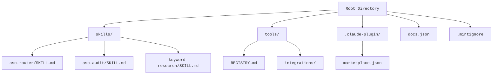
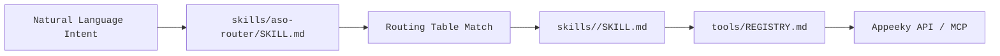

<!-- source: DeepWiki mcp.deepwiki.com · repo Eronred/aso-skills · page 1.3 Repository Layout · fetched 2026-10-26 -->

# Repository Layout

Relevant source files

The following files were used as context for generating this wiki page:

- [.atlas-analysis.json](.atlas-analysis.json)
- [.claude-plugin/marketplace.json](.claude-plugin/marketplace.json)
- [.mintignore](.mintignore)
- [AGENTS.md](AGENTS.md)
- [CLAUDE.md](CLAUDE.md)
- [README.md](README.md)
- [docs.json](docs.json)
- [skills/aso-router/SKILL.md](skills/aso-router/SKILL.md)
- [tools/REGISTRY.md](tools/REGISTRY.md)

## Purpose and Scope

This document provides a technical map of the `aso-skills` repository structure (`https://github.com/Eronred/aso-skills`), detailing the organization of individual agent skill units (`skills/`), the documentation site (`docs.json`), the tool integration registry (`tools/`), and plugin distribution files (`.claude-plugin/`) [AGENTS.md:1-15](), [docs.json:1-105](), [.claude-plugin/marketplace.json:1-12](). 

Sources: `AGENTS.md:1-15`, `docs.json:1-105`, `.claude-plugin/marketplace.json:1-12`

---

## Top-Level Directory Architecture

The repository is structured around the [Agent Skills](https://agentskills.io) open standard [AGENTS.md:1-3](). At the root level, directories segregate core skill execution logic from tooling registries, documentation configuration, and IDE plugin manifests.

*Figure 1: High-level repository directory layout and code entity mapping.*

The core mapping of directories to codebase entities is summarized below:

| Directory / File | Code Entity / Role | Primary Content |
|------------------|--------------------|-----------------|
| `skills/` | Skill Modules | Contains subdirectories for each specialized agent skill, housing `SKILL.md` instructions and optional reference docs [AGENTS.md:5-12](). |
| `tools/` | Tool Registry & Integration | Houses `tools/REGISTRY.md` mapping capability endpoints to skills and external APIs [tools/REGISTRY.md:1-10](). |
| `.claude-plugin/` | IDE Plugin Manifest | Contains `marketplace.json` defining skill registration for Claude Code and compatible agents [.claude-plugin/marketplace.json:1-12](). |
| `docs.json` | Mintlify Configuration | Defines the documentation site tabs, groups, and page navigation hierarchies [docs.json:1-105](). |
| `.mintignore` | Build Exclusions | Specifies patterns (`skills/*/`, `tools/`) excluded from the public Mintlify documentation build [.mintignore:1-9](). |

Sources: `AGENTS.md:5-12`, `tools/REGISTRY.md:1-10`, `.claude-plugin/marketplace.json:1-12`, `docs.json:1-105`, `.mintignore:1-10`

---

## Skill Unit Structure (`skills/`)

Every skill in the library resides in its own subdirectory under `skills/<skill-name>/` [AGENTS.md:8](). Each skill unit consists of a mandatory `SKILL.md` entry point that adheres to strict frontmatter requirements and markdown formatting rules [AGENTS.md:16-28]().

*Figure 2: Execution and data flow from natural language routing to specific skill modules and tool registries.*

### Frontmatter Specification
Each `SKILL.md` begins with a YAML frontmatter block parsed by agent hosts:
- `name`: Must match the directory name, formatted in lowercase with hyphens (`1-64` characters) [AGENTS.md:20]().
- `description`: Trigger phrases, scope boundaries, and fallback instructions (`1-1024` characters) [AGENTS.md:21]() [skills/aso-router/SKILL.md:1-6]().
- `metadata`: Contains versioning information (e.g., `version: 1.0.0`) [AGENTS.md:22-25]() [skills/aso-router/SKILL.md:4-6]().

Sources: `AGENTS.md:8-28`, `skills/aso-router/SKILL.md:1-6`

---

## Tool Registry (`tools/`)

The `tools/` directory maintains integration metadata that links agent skills to real-time data sources, primarily the Appeeky API and MCP server [tools/REGISTRY.md:1-10]().

- `tools/REGISTRY.md`: Acts as the central capability matrix defining REST endpoints (`GET /v1/...`) and MCP tools (`get_app`, `aso_full_audit`) alongside the specific skills that consume them [tools/REGISTRY.md:1-92]().

Sources: `tools/REGISTRY.md:1-92`

---

## Documentation and Configuration Files

The repository configures both documentation rendering and plugin syndication through dedicated configuration files at the root level:

- `docs.json`: Configures the Mintlify documentation site structure, dividing pages into navigation tabs (`Docs`, `Skills Reference`) and groups (`Get Started`, `Installation`, `ASO Core Skills`, `Guides`, `All Skills`) [docs.json:20-105]().
- `.mintignore`: Prevents source-only files such as `skills/*/` and `tools/` from polluting the compiled documentation artifact [.mintignore:1-9]().
- `.claude-plugin/marketplace.json`: Registers all 40+ skills under the `aso-skills` plugin package for distribution in Claude Code [.claude-plugin/marketplace.json:1-65]().

Sources: `docs.json:20-105`, `.mintignore:1-10`, `.claude-plugin/marketplace.json:1-65`

---

