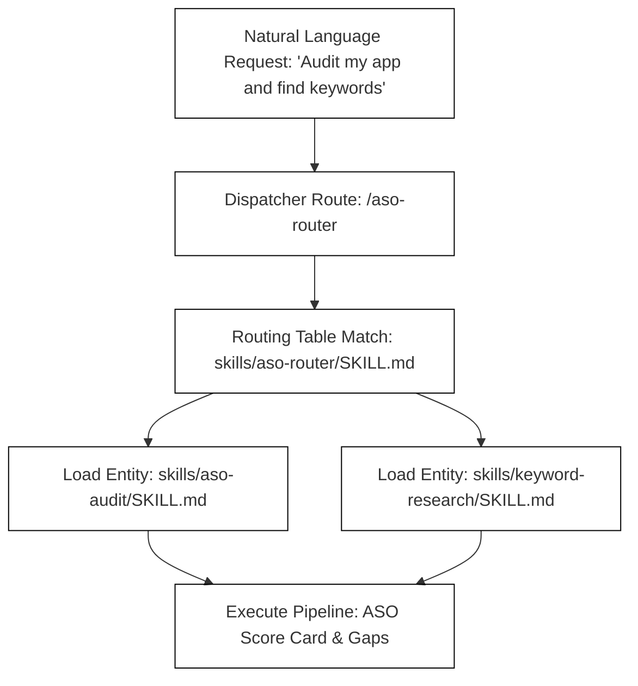
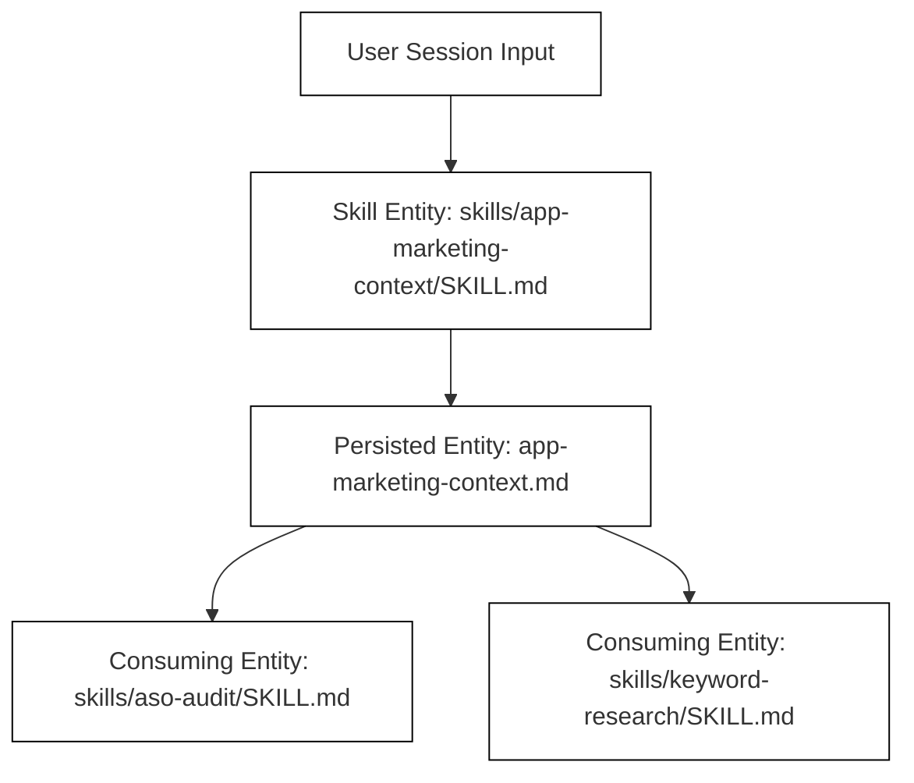

<!-- source: DeepWiki mcp.deepwiki.com · repo Eronred/aso-skills · page 2 Skill System Architecture · fetched 2026-10-26 -->

# Skill System Architecture

Relevant source files

The following files were used as context for generating this wiki page:

- [.claude-plugin/marketplace.json](.claude-plugin/marketplace.json)
- [README.md](README.md)
- [how-skills-work.mdx](how-skills-work.mdx)
- [skills/aso-router/SKILL.md](skills/aso-router/SKILL.md)
- [tools/REGISTRY.md](tools/REGISTRY.md)

The Skill System Architecture defines how Markdown-based agent skills (`SKILL.md`) are structured, discovered, loaded, routed, and chained together by AI assistants. The system bridges natural language user intent with structured execution frameworks and live App Store data pipelines. 

For full technical details, see the child pages:
- [The aso-router Dispatcher](#2.1)
- [app-marketing-context: Shared State](#2.2)
- [Authoring & Validating Skills](#2.3)

---

## 2.1. The aso-router Dispatcher

The `/aso-router` serves as the single entry point for natural language requests [skills/aso-router/SKILL.md:1-119](). Rather than requiring users to manually invoke one of over 40 individual specialist skills [README.md:76-112](), the router reads incoming prompts, matches them against a comprehensive routing table [skills/aso-router/SKILL.md:22-109](), and dispatches up to three specialist skills [skills/aso-router/SKILL.md:10-20]().

For compound workflows—such as optimizing an entire app store listing or executing a launch plan—the router sequences multiple skills in a deterministic execution order (e.g., `aso-audit` preceding `keyword-research` and `metadata-optimization`) [skills/aso-router/SKILL.md:110-119]() and [how-skills-work.mdx:83-90]().

*Figure 2.1: Bridging natural language prompts to code execution paths via `/aso-router`.*

Sources: [skills/aso-router/SKILL.md:1-119](), [how-skills-work.mdx:73-92]()

For details on intent parsing rules, ambiguity handling, and compound sequences, see [The aso-router Dispatcher](#2.1).

---

## 2.2. app-marketing-context: Shared State

Downstream specialist skills frequently require baseline metadata about the target application—such as its App ID, primary category, target audience, competitors, and monetization model. The `app-marketing-context` skill provides an interactive interview mechanism that initializes and persists this state within a shared `app-marketing-context.md` file [skills/aso-router/SKILL.md:104-109]() and [.claude-plugin/marketplace.json:23]().

Once established, downstream skills read this shared artifact to automatically parameterize data calls (such as retrieving rankings or running competitor comparisons) without requiring the user to re-enter basic app parameters.

*Figure 2.2: Context persistence lifecycle flowing from interactive prompts to shared state files.*

Sources: [skills/aso-router/SKILL.md:104-109](), [.claude-plugin/marketplace.json:21-23]()

For details on interview flows, schema definitions, and context consumption patterns, see [app-marketing-context: Shared State](#2.2).

---

## 2.3. Authoring & Validating Skills

Every unit of expertise in the repository is encapsulated in a dedicated `SKILL.md` file containing a YAML frontmatter block, role definitions, operational frameworks, scoring rubrics, and standardized output templates [how-skills-work.mdx:9-29](). 

To ensure consistency and compatibility across IDE integrations like Cursor and Claude Code [.claude-plugin/marketplace.json:1-11](), skills must adhere to strict naming conventions, frontmatter specifications, and validation scripts such as `validate-skills.sh`.

Sources: [.claude-plugin/marketplace.json:1-65](), [how-skills-work.mdx:1-128]()

For details on frontmatter schemas, template requirements, validation checks, and contribution workflows, see [Authoring & Validating Skills](#2.3).

---

