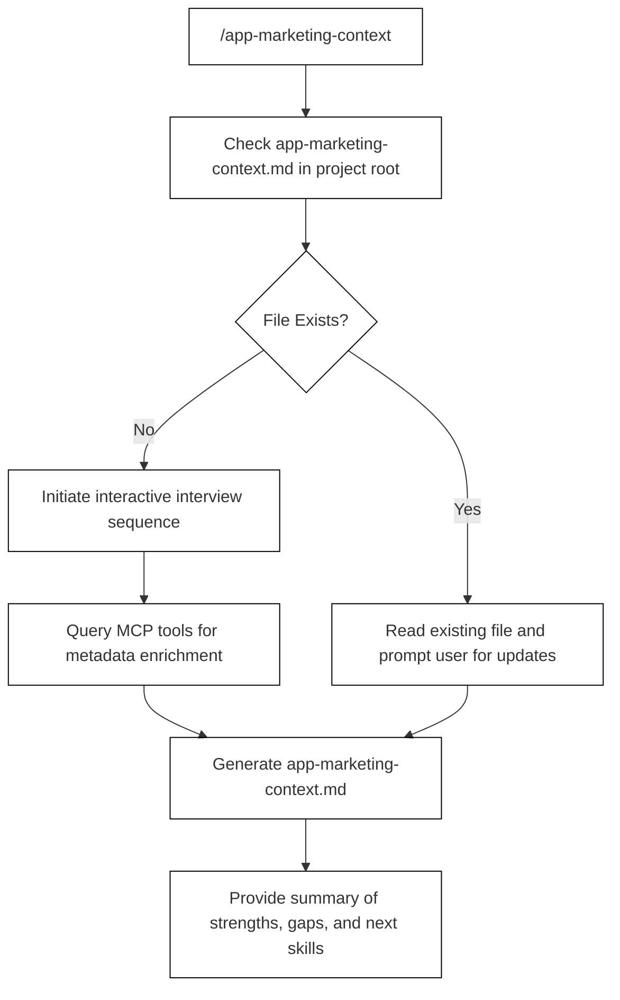
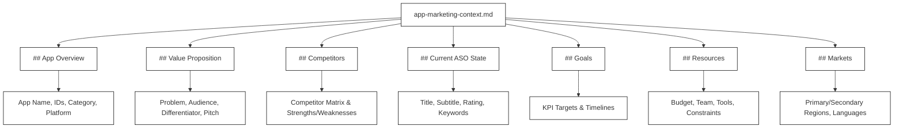
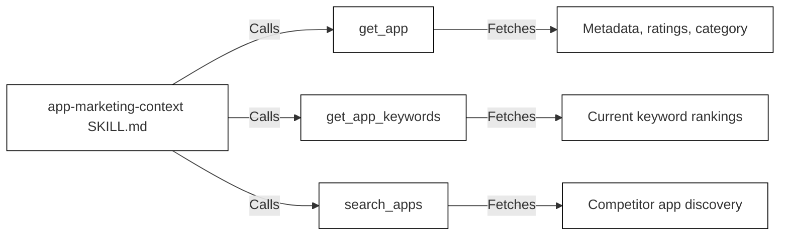
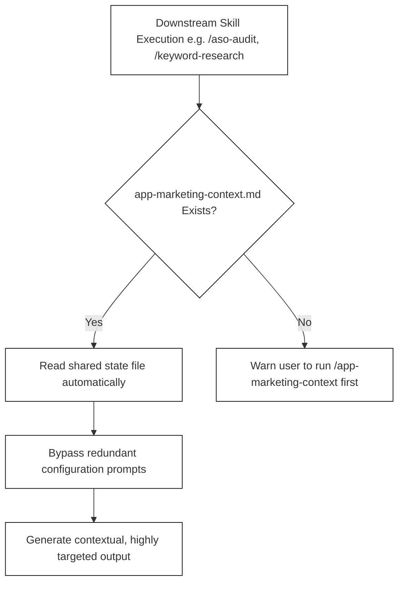

<!-- source: DeepWiki mcp.deepwiki.com · repo Eronred/aso-skills · page 2.2 app-marketing-context: Shared State · fetched 2026-10-26 -->

# app-marketing-context: Shared State

Relevant source files

The following files were used as context for generating this wiki page:

- [reference/app-marketing-context.mdx](reference/app-marketing-context.mdx)
- [skills/app-marketing-context/SKILL.md](skills/app-marketing-context/SKILL.md)

The `app-marketing-context` skill serves as the foundational architecture for the entire ASO Skills library. It conducts a structured interactive interview with the user to establish a comprehensive app profile, persisting the output to a centralized `app-marketing-context.md` file in the project root [reference/app-marketing-context.mdx:7-10](). Downstream skills automatically check for and consume this shared state, eliminating redundant prompting and ensuring consistent app positioning, audience targeting, and goal alignment across all operations [reference/app-marketing-context.mdx:7-10]().

Sources:
- `reference/app-marketing-context.mdx:7-10`
- `skills/app-marketing-context/SKILL.md:3-10`

---

## Initial Assessment and Execution Flow

When invoked via `/app-marketing-context` or routed through `/aso-router`, the skill first performs an environmental check to determine whether a context file already exists [skills/app-marketing-context/SKILL.md:12-19]().

*Figure 1: State detection and document generation pipeline for `app-marketing-context`.*

Sources:
- `reference/app-marketing-context.mdx:11-23`
- `skills/app-marketing-context/SKILL.md:12-19`

---

## Interactive Interview Inputs and Schema

The skill collects specific inputs spanning technical identifiers, value propositions, competitive intelligence, and business objectives [reference/app-marketing-context.mdx:29-63](). 

| Parameter | Type | Required | Description |
| :--- | :--- | :--- | :--- |
| `app_id_ios` | string | No | Apple numeric App ID (e.g., `1617391485`), used to fetch live metadata and rankings [reference/app-marketing-context.mdx:33-35](). |
| `app_id_android` | string | No | Google Play package name (e.g., `com.example.myapp`) [reference/app-marketing-context.mdx:37-39](). |
| `app_description` | string | Yes | Plain-language description of the core problem solved [reference/app-marketing-context.mdx:41-43](). |
| `target_audience` | string | Yes | Ideal user demographics, behaviors, and pain points [reference/app-marketing-context.mdx:45-47](). |
| `main_competitors` | array | No | Top 3–5 competitor names or App IDs [reference/app-marketing-context.mdx:49-51](). |
| `goals` | array | Yes | Top 1–3 goals with target metrics and timelines [reference/app-marketing-context.mdx:53-55](). |
| `budget_and_team` | string | No | Monthly marketing budget and team size configuration [reference/app-marketing-context.mdx:57-59](). |
| `markets` | array | No | Target countries or regions in priority order (default: `["US"]`) [reference/app-marketing-context.mdx:61-63](). |

Sources:
- `reference/app-marketing-context.mdx:29-63`
- `skills/app-marketing-context/SKILL.md:39-114`

---

## Context Document Structure

The generated `app-marketing-context.md` file is parsed by downstream skills to read structural sections [skills/app-marketing-context/SKILL.md:20-117]().

*Figure 2: Hierarchical sections stored inside `app-marketing-context.md`.*

Sources:
- `skills/app-marketing-context/SKILL.md:20-117`
- `reference/app-marketing-context.mdx:69-108`

---

## MCP Tool Integration

When an App ID is supplied, the skill leverages Model Context Protocol (MCP) tools to auto-populate metadata and current ranking metrics [reference/app-marketing-context.mdx:127-134]().

*Figure 3: MCP tool integration mapping within the context-gathering lifecycle.*

Sources:
- `reference/app-marketing-context.mdx:127-134`

---

## Downstream Skill Consumption

Every skill in the library checks for the presence of `app-marketing-context.md` prior to execution [reference/app-marketing-context.mdx:7-10](). 

*Figure 4: How downstream skills consume the shared state artifact.*

Sources:
- `reference/app-marketing-context.mdx:7-10`
- `skills/app-marketing-context/SKILL.md:124-130`

---

